# DOCUMENTACIÓN MAESTRA DE INGENIERÍA DE SOFTWARE — PAW PATITA CUSCO v5.2

> **Documento Técnico-Académico de Referencia Única (Single Source of Truth)**  
> **Cobertura Curricular:** Unidad I (*Modelado y Análisis de Procesos*), Unidad II (*Ingeniería de Requisitos — IEEE 830*), Unidad III (*Arquitectura de Software y Diseño de Base de Datos Relacional*) y Unidad IV (*Interacción Humano-Computadora — HCI & Aseguramiento de Calidad*).  
> **Estado de Trazabilidad:** 100% verificado contra el código fuente de producción en la rama `main` (`v5.2`, commit base `081d21a`).

---

## Tabla de Contenidos

1. [Ficha Técnica, Contexto y Alcance del Sistema](#1-ficha-técnica-contexto-y-alcance-del-sistema)
2. [Ingeniería de Requisitos (Estándar IEEE 830)](#2-ingeniería-de-requisitos-estándar-ieee-830)
3. [Modelado de Procesos de Negocio (BPMN) y Comportamiento (UML)](#3-modelado-de-procesos-de-negocio-bpmn-y-comportamiento-uml)
4. [Arquitectura de Software y Diseño Detallado](#4-arquitectura-de-software-y-diseño-detallado)
5. [Diseño, Normalización y Diccionario de Base de Datos](#5-diseño-normalización-y-diccionario-de-base-de-datos)
6. [Diseño de Interacción Humano-Computadora (HCI)](#6-diseño-de-interacción-humano-computadora-hci)
7. [Aseguramiento de Calidad (QA), Gestión de Configuración y Guía de Uso](#7-aseguramiento-de-calidad-qa-gestión-de-configuración-y-guía-de-uso)

---

## 1. Ficha Técnica, Contexto y Alcance del Sistema

### 1.1. Ficha Técnica de Identificación

| Atributo Técnico | Especificación Oficial Verificada (`v5.2`) |
| :--- | :--- |
| **Nombre del Software** | **Paw Patita Cusco** — Plataforma SaaS de Cuidado Familiar Canino & Central de Emergencias Veterinarias S.O.S. 24h |
| **Versión en Producción** | **`v5.2`** (*Edición Comercial "Andes & Huellas Cusco" — Responsive Total & Certificación IHC 20/20*) |
| **Dominio de Negocio** | Pet-Tech / Economía Colaborativa de Servicios de Cuidado Temporal Canino, Identidad Sanitaria Digital (`PAW-ID`) y Gestión de Emergencias Veterinarias |
| **Cobertura Geográfica** | **8 distritos operativos de Cusco, Perú** (`CUSCO_CONFIG.DISTRITOS`): Cusco Centro, Wanchaq, San Sebastián, San Jerónimo, Santiago, San Blas, Saylla y Poroy — con atención a residentes locales y turistas en tránsito hacia el **Valle Sagrado de los Incas** y **Machu Picchu** |
| **Centro Geodésico Base** | Plaza de Armas del Cusco (`lat: -13.5167`, `lng: -71.9788`, zoom cartográfico `13`, zona horaria oficial `America/Lima` / `UTC-5`) |
| **URL Oficial de Producción** | `https://rubikanton.github.io/pawPatita/` *(GitHub Pages — rama `main`, raíz `/` con `.nojekyll`)* |
| **Repositorio Git Oficial** | `https://github.com/RubikAnton/pawPatita.git` |
| **Infraestructura Backend** | **Supabase Cloud** (`https://evephdzpoonavggwoejs.supabase.co`): PostgreSQL 15+, GoTrue Auth (JWT), PostgREST, Row Level Security (RLS), 23 RPCs PL/pgSQL, Supabase Storage y Supabase Realtime (WebSockets) |
| **Arquitectura Frontend** | SPA Estática Serverless (JAMstack): HTML5 semántico (`index.html`), 6 hojas CSS3 modulares (`css/*.css`), **28 Vanilla ES Modules** (`js/**/*.js`, sin bundler ni dependencias npm), Bootstrap 5.3.3, Bootstrap Icons 1.11.3, Leaflet 1.9.4, QRCode.js 1.0.0, Chart.js 4.4.1 y `@supabase/supabase-js@2` |
| **Internacionalización y Moneda** | Bilingüe reactivo **`ES / EN`** (`335` claves simétricas en `js/i18n.js`) y conversión monetaria en vivo **`S/ PEN ↔ $ USD`** (tipo de cambio administrable, base `3.75`) |
| **Marco Normativo Peruano** | Ley N.º 29733 (Protección de Datos Personales y derechos ARCO), Ley N.º 30407 (Protección y Bienestar Animal), Art. 411 del Código Penal (Declaración Jurada) y colegiatura CMVP (Colegio Médico Veterinario del Perú — Cusco) |
| **Contexto Académico** | Curso: *Análisis y Diseño de Software* — **NRC 39575** \| Docente: **Holguin Herrera, Melisa Betys** |
| **Equipo de Desarrollo** | Chacón Copa, Angelo Ricardo • Huarancca Camala, Frank Smit • Illapuma Yupanqui, Jerson Reyder • Lovaton Casas, Arantxa Alejandra • Ortiz Gutierrez, Nasdig Jordan |
| **Fecha de Consolidación** | Noviembre de 2026 — Cusco, Perú |

### 1.2. Planteamiento del Problema y Justificación Técnica

En la ciudad del Cusco convergen dos segmentos de alta demanda en el cuidado temporal de mascotas caninas: **(a) residentes locales** con jornadas laborales extendidas, viajes o imprevistos, y **(b) turistas nacionales y extranjeros** (*pet-friendly travelers*) que arriban a la ciudad con sus perros y requieren cuidado confiable mientras realizan excursiones de día completo o pernocte hacia Machu Picchu, Montaña de 7 Colores o el Valle Sagrado (lugares donde el ingreso de mascotas está restringido por normativa del SERNANP y operadores ferroviarios).

El diagnóstico situacional y operativo identifica **cinco problemas estructurales** en el mercado cusqueño actual:

1. **Informalidad y asimetría de confianza:** La contratación de cuidadores se realiza predominantemente mediante grupos de redes sociales o recomendaciones verbales, sin verificación formal de identidad (`DNI`), antecedentes policiales, antecedentes penales, domicilio ni evaluación de idoneidad del hogar anfitrión.
2. **Ausencia de historial sanitario verificable (`PAW-ID`):** No existe un estándar digital que certifique si un perro cuenta con vacunación vigente (Séxtuple, Antirrábica, desparasitación) avalada por un médico veterinario colegiado (CMVP), ni un mecanismo público de escaneo QR seguro ante extravíos que proteja los datos sensibles del dueño.
3. **Vulnerabilidad y demora crítica ante emergencias veterinarias:** Ante síntomas de mal de altura, intoxicaciones, traumatismos o urgencias súbitas durante la custodia, los cuidadores carecen de un protocolo estandarizado para geolocalizar clínicas 24h aliadas, transferir instantáneamente alergias/medicación de la mascota y mantener trazabilidad tanto clínica como financiera del gasto médico de urgencia.
4. **Inexistencia de custodia financiera (*Pago Protegido en Garantía*) y reglas claras:** Los pagos adelantados directos exponen a propietarios a cancelaciones abruptas sin reembolso y a cuidadores a inasistencias sin compensación ni control real de cupos por franja horaria (*overbooking*).
5. **Opacidad durante la custodia:** Los dueños (especialmente turistas extranjeros con barrera idiomática) sufren incertidumbre por falta de reportes fotográficos estructurados y verificables durante la estadía.

**Justificación técnica de la solución v5.2:** Frente a soluciones artesanales o plataformas acopladas a hojas de cálculo sin integridad transaccional, **Paw Patita Cusco v5.2** implementa una base de datos relacional normalizada en 3FN (**23 tablas** en PostgreSQL 15+), control de acceso *Zero-Trust* en motor de base de datos mediante **Row Level Security (RLS)**, lógica crítica encapsulada en **23 procedimientos almacenados transaccionales (RPCs)** con bloqueos pesimistas a nivel de fila (`FOR UPDATE`), mensajería reactiva por WebSockets (**Supabase Realtime**), gestión documental directa en la nube con URLs firmadas (**Supabase Storage**) y una interfaz web progresiva modular ligera en **Vanilla ES Modules** optimizada para redes móviles en Cusco.

### 1.3. Objetivos del Sistema

#### Objetivo General
Diseñar, construir y desplegar una plataforma web SaaS integral, segura, bilingüe y responsiva (**Paw Patita Cusco v5.2**) que gestione de extremo a extremo el ciclo de vida del cuidado temporal canino en Cusco —desde la acreditación documental de cuidadores y clínicas veterinarias hasta la reserva anti-overbooking, custodia financiera protegida, seguimiento fotográfico en vivo, identidad sanitaria `PAW-ID` y respuesta a emergencias veterinarias S.O.S. 24h con trazabilidad financiera y auditoría forense automática.

#### Objetivos Específicos
1. **Formalizar la ingeniería de requisitos (IEEE 830)** y reglas de negocio cuantitativas (reparto `15%` plataforma / `85%` cuidador, estacionalidad turística de Cusco, política escalonada de cancelaciones, arbitraje porcentual y control temporal de Check-Out en zona `America/Lima`).
2. **Garantizar la integridad transaccional ACID y la seguridad perimetral** mediante PostgreSQL 15+ en Tercera Forma Normal (3FN), RLS obligatorio en el 100% de tablas, autenticación JWT (GoTrue), aislamiento de notificaciones por `auth.uid()` y bitácora forense inmutable por triggers.
3. **Implementar identidad sanitaria verificada (`PAW-ID`) y red de respuesta S.O.S. 24h** con dictámenes firmados con colegiatura CMVP, generación/impresión de credencial QR pública segura (Ley N.º 29733), derivación en tiempo real a clínicas aliadas y trazabilidad de cargos clínicos entre Propietario, Veterinaria y Administrador.
4. **Asegurar excelencia en Interacción Humano-Computadora (HCI)** bajo el sistema de diseño *"Andes & Huellas Cusco"* con contraste WCAG AA/AAA, responsividad verificada (`360px`, `768px`, `1366px+`), internacionalización `ES/EN`, validación preventiva centralizada (`validators.js`) y cumplimiento certificado `20/20` de las 10 Heurísticas de Jakob Nielsen.

### 1.4. Delimitación y Fronteras del Alcance

| Dimensión | Incluido en Paw Patita Cusco v5.2 | Fuera del Alcance (Frontera del Sistema) |
| :--- | :--- | :--- |
| **Gestión de Usuarios y Roles** | 4 roles autenticados (`propietario` unificado Local/Turista, `cuidador`, `veterinaria`, `administrador`) + actor público visitante/QR; bloqueo de acceso a cuentas `pendiente`, `rechazado` o `suspendido`; recuperación de contraseña real vía email. | Autenticación federada OAuth externa (Google/Apple Sign-In) o biometría nativa móvil. |
| **Gestión Documental y Multimedia** | Subida directa a Supabase Storage (`image/jpeg`, `image/png`, `image/webp` hasta 5 MB con compresión Canvas, y `application/pdf` hasta 10 MB) en 6 buckets públicos/privados + visor universal con URLs firmadas `storage://`. | Firma digital criptográfica con certificado token RENIEC/INDECOPI o validación automática vía API de PNP/Poder Judicial. |
| **Pagos, Garantía y Liquidaciones** | Registro validado de pago (Yape, Plin, Tarjeta últimos 4 dígitos, Transferencia), retención contable en garantía (`en_garantia`), liberación automática en Check-Out (`disponible`), solicitud de retiro (`solicitado`) y desembolso administrativo con N.º de operación (`pagado`), más regularización y conciliación de cargos clínicos S.O.S. | Procesamiento de cargo bancario real en vivo con pasarela PCI-DSS (Niubiz/Culqi/Stripe) o emisión electrónica directa hacia API OSE/SUNAT (se emiten boletas/facturas referenciales imprimibles). |
| **Tarificación y Reglas Comerciales** | Tarifa base por día, recargo estacional por temporadas oficiales de Cusco (`temporadas_tarifas`), recargo por cachorro `< 1 año` (`10%`), extras (baño higiénico, recojo en hotel) y conversión `PEN/USD`. | **Cupones promocionales:** Inhabilitados intencionalmente desde v5.1 en UI y RPCs para garantizar cotización transparente (`cupones_promocionales` se conserva inactiva solo por integridad referencial histórica). |
| **Geolocalización y Emergencias S.O.S.** | Mapa interactivo de Cusco (`Leaflet 1.9.4` + OpenStreetMap), geolocalización GPS del navegador al emitir S.O.S., cálculo de clínica 24h sugerida y actualización clínica/financiera en tiempo real. | Rastreo GPS continuo en segundo plano (tracking vehicular de paseo segundo a segundo) o despacho automático de ambulancia física. |

---

## 2. Ingeniería de Requisitos (Estándar IEEE 830)

### 2.1. Actores y Stakeholders

| Actor / Rol | Tipo / Identificador BD | Perfil Operativo y Responsabilidades | Permisos y Fronteras de Seguridad |
| :--- | :--- | :--- | :--- |
| **Propietario (Local / Turista Unificado)** | Autenticado (`rol = 'propietario'`) | Dueño de mascotas caninas residente en Cusco o turista temporal (`es_turista = true`, con hotel/Airbnb, idioma `ES/EN` y moneda `PEN/USD`). Registra mascotas, gestiona Carnés `PAW-ID`, explora el catálogo, cotiza y reserva en 4 pasos, visualiza el Muro en Vivo, cancela/abre disputas, califica servicios, emite S.O.S. y regulariza cargos clínicos. | Solo lee/edita su perfil, sus mascotas, sus reservas, sus pagos, sus reportes de muro y sus alertas S.O.S. No accede a liquidaciones de cuidadores ni auditoría global. |
| **Cuidador Independiente** | Autenticado (`rol = 'cuidador'`) | Persona natural verificada legalmente en Cusco que ofrece servicios de *Paseo*, *Hospedaje*, *Guardería* o *Domicilio Turístico*. Gestiona su catálogo `HU-XXX`, agenda por días y bloques horarios, acepta/rechaza reservas, ejecuta Check-In/Check-Out, publica fotos en el Muro (solo `en_curso`), emite S.O.S. (solo `en_curso`), responde reseñas y solicita retiros de su billetera (`85%`). | Inicia en `estado_cuenta = 'pendiente'` (bloqueado en login hasta aprobación del Admin). Solo consulta mascotas y reservas asignadas a su `id_cuidador`. |
| **Clínica Veterinaria Aliada** | Autenticado (`rol = 'veterinaria'`) | Establecimiento médico veterinario acreditado en Cusco con RUC y colegiatura CMVP. Audita cartillas sanitarias (Img/PDF) y emite dictámenes (`validado` / `observado`), atiende alertas S.O.S. 24h en tiempo real (`en_atencion` → `estabilizada` → `resuelta`) registrando diagnóstico, tratamiento y costo referencial, y mantiene los datos de su sede. | Inicia en `estado_afiliacion = 'pendiente'` hasta acreditación. Solo actualiza alertas S.O.S. derivadas a su sede (`id_clinica_asociada`) y su propia configuración de clínica. |
| **Administrador de Plataforma** | Autenticado (`rol = 'administrador'`) | Operador ejecutivo de Paw Patita Cusco. Supervisa KPIs financieros reales (`15%` comisión / `85%` cuidador) por los 8 distritos de Cusco, acredita/rechaza/suspende cuidadores y clínicas (o crea clínicas directamente), arbitra disputas (`0%–100%`), desembolsa liquidaciones con N.º de operación, reasigna/concilia cargos S.O.S., configura parámetros/temporadas e inspecciona la Bitácora Forense de Auditoría. | Acceso total gobernado por `get_my_role() = 'administrador'`. En `notificaciones`, por aislamiento v5.2 solo lee sus propias notificaciones (`id_usuario_destino = auth.uid()`). |
| **Visitante / Escáner QR PAW-ID** | Público no autenticado (`anon`) | Ciudadano, turista o veterinario externo sin sesión iniciada. Explora Landing, Catálogo público, Mapa de Cusco, Modal Perfil de Cuidador, Marco Legal, Centro de Ayuda, formularios de Registro/Postulación y escanea el código QR del collar/carné (`#/paw-id/PAW-XXXX`). | Lectura restringida a `v_catalogo_cuidadores`, `clinicas_veterinarias` activas, `temporadas_tarifas`, `terminos_condiciones` y `rpc_obtener_paw_id_publico` (oculta DNI y dirección privada). |

### 2.2. Catálogo Completo de Requisitos Funcionales (`RF-01` al `RF-32`)

| ID | Módulo | Nombre del Requisito | Descripción Funcional Detallada (Trazable al Código v5.2) | Prioridad | Rol(es) |
| :---: | :--- | :--- | :--- | :---: | :--- |
| **RF-01** | Auth y Cuentas | Registro de Propietario Unificado (Local/Turista) | Permitir el alta de cuentas `propietario` en Supabase Auth (`registrarPropietario` + trigger `handle_new_auth_user`) con interruptor condicional de turista (`es_turista`, país, idioma, hotel en Cusco), documento (`DNI`/`CE`/`Pasaporte`), contacto de auxilio y aceptación obligatoria de TyC v5.2 y Privacidad. | Alta | Visitante, Propietario |
| **RF-02** | Auth y Cuentas | Postulación de Cuidador con Expediente Documental | Permitir a postulantes registrarse (`postularCuidador`) adjuntando directamente en Supabase Storage (`file-uploader.js`) foto de perfil, foto del hogar y 4 documentos legales (`DNI`, `Antecedentes Policiales`, `Antecedentes Penales`, `Domicilio` en Img/PDF), más Declaración Jurada obligatoria, creando su cuenta en `estado_cuenta = 'pendiente'`. | Alta | Visitante, Cuidador |
| **RF-03** | Auth y Cuentas | Postulación de Clínica Veterinaria Aliada | Permitir la solicitud de afiliación de clínicas en Cusco (`postularClinicaVeterinaria`) validando RUC (11 dígitos), CMVP, horario (`24 Horas`/`Extendido`/`Diurno`), tarifa de urgencia, DNI del director médico, foto de fachada y constancia CMVP/RUC (Img/PDF), creando registro en `estado_afiliacion = 'pendiente'`. | Alta | Visitante, Veterinaria |
| **RF-04** | Auth y Cuentas | Autenticación, Bloqueo de Cuentas Inactivas y Recuperación | Autenticar por correo/contraseña (`loginWithEmail`), ofrecer 4 accesos demo rápidos y toggle visual de contraseña; bloquear sesión (destruyendo JWT) si `estado_cuenta != 'activo'` (`pendiente`, `rechazado`, `suspendido`); soportar restablecimiento real vía email (`requestPasswordReset`, `updatePassword` en `#/reset-password`). | Alta | Todos |
| **RF-05** | Auth y Cuentas | Edición de Perfil y Cambio de Modalidad Local/Turista | Permitir al propietario actualizar sus datos personales, distrito, dirección, contacto de emergencia, avatar (Storage `perfiles`) y conmutar su perfil entre Local y Turista (`hospedaje_hotel_cusco`, país, idioma). | Media | Propietario |
| **RF-06** | Mascotas y PAW-ID | Gestión CRUD y Baja Lógica de Mascotas | Permitir crear, editar y archivar (`activa = false`) mascotas en `public.mascotas` (`carnet-digital.js`), almacenando `fecha_nacimiento`, raza, tamaño, sexo, peso (`0.3–100 kg`), esterilización, alergias, medicación, dieta, conducta, foto y cartilla de vacunas (Img/PDF en `mascotas-fotos`), calculando edad dinámica exacta en años y meses. | Alta | Propietario |
| **RF-07** | Mascotas y PAW-ID | Generación e Impresión de Carné Digital PAW-ID con QR | Generar la credencial oficial `PAW-ID` (`PAW-XXXX`) incrustando un código QR real vía `QRCode.js` hacia `#/paw-id/PAW-XXXX`, mostrando sello de clínica validadora (CMVP) y habilitando impresión directa en formato billetera `85mm x 54mm` (`css/print.css`). | Alta | Propietario, Cuidador |
| **RF-08** | Mascotas y PAW-ID | Escaneo Público Seguro de Carné QR PAW-ID | Exponer la ruta pública `#/paw-id/:paw_id` (`paw-id-publico.js` → `rpc_obtener_paw_id_publico`) mostrando foto, nombre, edad dinámica, estado sanitario, alergias, medicación, clínica CMVP y botones de llamada/WhatsApp al propietario, ocultando DNI y dirección domiciliaria exacta (Ley N.º 29733). | Alta | Visitante, Todos |
| **RF-09** | Mascotas y PAW-ID | Auditoría Sanitaria y Dictamen CMVP de Cartillas | Permitir a clínicas veterinarias aliadas inspeccionar cartillas de vacunación (imágenes y PDFs vía `abrirVisorDocumento`) y emitir dictamen oficial `validado` (con vigencia y sello CMVP) u `observado` (con motivo médico obligatorio) mediante `rpc_vet_dictaminar_ficha`, registrando historial en `validaciones_veterinarias`. | Alta | Veterinaria |
| **RF-10** | Catálogo y Mapa | Exploración de Catálogo con Filtros Combinados y Mapa Cusco | Renderizar cuidadores aprobados (`v_catalogo_cuidadores`) y clínicas activas sobre catálogo y mapa interactivo de Cusco (`Leaflet 1.9.4`), con filtrado reactivo por distrito, categoría de servicio, recojo en hotel, tarifa máxima (`PEN/USD`), calificación mínima, texto libre y ordenamiento, más modal scrollable *"Ver Perfil del Cuidador"*. | Alta | Visitante, Propietario |
| **RF-11** | Servicios y Agenda | Gestión CRUD de Ofertas de Servicio del Cuidador | Permitir al cuidador crear, editar, pausar o reactivar ofertas (`servicios` con código `HU-XXX`) en las 4 categorías (*Paseo*, *Hospedaje*, *Guardería*, *Domicilio Turístico*), fijando tarifa diaria, descripción y opción/tarifa de recojo en hotel. | Alta | Cuidador |
| **RF-12** | Servicios y Agenda | Gestión de Agenda por Bloques Horarios, Modalidad 24h y Cupos | Permitir al cuidador administrar un calendario mensual navegable de 7 columnas (`Lun..Dom`), configurar cupos máximos (`1–15`), bloquear/liberar fechas o bloques (`todo_el_dia`, `manana_08_12`, `tarde_14_18`, `noche_18_22`, `personalizado`), editar plantilla semanal y replicar disponibilidad a 3 o 7 días preservando `cupos_reservados`. | Alta | Cuidador |
| **RF-13** | Cotización y Reservas | Cotización Dinámica con Temporadas de Cusco y Conversión PEN/USD | Calcular de forma autoritativa en servidor (`rpc_cotizar_reserva`) el costo por días, recargo por temporada turística oficial de Cusco (`temporadas_tarifas`), recargo por cachorro `< 1 año` (`10%`), extras (`baño higiénico`, `recojo en hotel`), desglose transparente `15%` plataforma / `85%` cuidador y conversión `PEN/USD` (sin cupones). | Alta | Visitante, Propietario |
| **RF-14** | Cotización y Reservas | Wizard de Reserva de 4 Pasos con Bloqueo Anti-Overbooking | Guiar al propietario en 4 pasos (`wizard-reserva.js`): 1) Selección de cuidador, oferta y mascota (bloqueando mascotas `observado`), 2) Fechas y bloque horario (forzando `todo_el_dia` 24h para `Hospedaje` y verificando TODOS los días del rango), 3) Cotización transparente y extras, 4) Pasarela validada (Yape/Plin/Tarjeta/Transferencia) y aceptación TyC v5.2, ejecutando `rpc_crear_reserva` con `FOR UPDATE`. | Alta | Propietario |
| **RF-15** | Cotización y Reservas | Emisión e Impresión de Comprobante de Pago | Generar código de pago (`PAY-2026-XXXX`) y comprobante electrónico referencial (`Boleta Electrónica` / `Factura Electrónica`) visualizable e imprimible desde el panel del propietario (`abrirModalComprobantePago`). | Media | Propietario |
| **RF-16** | Operación del Servicio | Respuesta a Reservas (Aceptar / Rechazar con Reembolso) | Permitir al cuidador aceptar (`confirmada`) o rechazar con motivo obligatorio (`cancelada`) solicitudes `pendiente_confirmacion` mediante `rpc_cuidador_responder_reserva`; el rechazo libera cupos horarios, anula la garantía y reembolsa el `100%` al propietario. | Alta | Cuidador |
| **RF-17** | Operación del Servicio | Coordinación Directa por WhatsApp Condicionada | Habilitar enlace directo `wa.me/51...` entre propietario y cuidador exclusivamente cuando la reserva se encuentre en estado `confirmada` o `en_curso`, evitando desintermediación previa al pago. | Baja | Propietario, Cuidador |
| **RF-18** | Operación del Servicio | Registro de Check-In con Checklist y Visor PAW-ID | Permitir al cuidador inspeccionar el Carné `PAW-ID` del cliente asignado y ejecutar `rpc_cuidador_checkin` (`confirmada` → `en_curso`) con checklist de recepción (estado físico, cartilla, alimento), generando publicación automática de ingreso en el Muro. | Alta | Cuidador |
| **RF-19** | Operación del Servicio | Muro Fotográfico en Vivo Exclusivo para Reservas En Curso | Permitir al cuidador publicar reportes con hasta 3 fotografías (Storage `muro-fotos`), tipo de evento, estado de ánimo y ubicación únicamente para reservas `en_curso` (bloqueo doble: UI + trigger SQL `trg_validar_reporte_en_curso`), y al propietario visualizarlos cronológicamente con Lightbox y marcarlos como vistos (`visto_por_propietario`). | Alta | Cuidador, Propietario |
| **RF-20** | Operación del Servicio | Check-Out con Validación Temporal `America/Lima` y Liberación de Garantía | Permitir al cuidador cerrar el servicio (`rpc_cuidador_checkout`: `en_curso` → `finalizada`) con checklist de entrega solo cuando la fecha/hora de inicio programada en `America/Lima` haya sido alcanzada o superada, liberando automáticamente el `85%` de `en_garantia` a `disponible`. | Alta | Cuidador |
| **RF-21** | Billetera y Pagos | Billetera del Cuidador, Solicitud de Retiro y Exportación CSV | Mostrar los 4 saldos conciliados (`v_billetera_cuidador`: Garantía, Disponible, En Proceso, Histórico Cobrado), gráfico mensual real Chart.js, exportación CSV y solicitud de retiro (`rpc_solicitar_retiro`) validando estrictamente cuentas `Yape`/`Plin` (9 dígitos), `CCI` (20 dígitos) o `BCP`/`Interbank`/`BBVA`. | Alta | Cuidador |
| **RF-22** | Cancelaciones y Reputación | Previsualización y Ejecución de Cancelación Escalonada | Calcular (`rpc_preview_cancelacion`) y ejecutar (`rpc_cancelar_reserva`) reembolsos automáticos según horas de anticipación en `America/Lima` (`>48h` o sin confirmar: `100%`; `24–48h`: `70%`; `<24h`: `50%`), liberando cupos horarios y acreditando la compensación al cuidador si corresponde. | Alta | Propietario |
| **RF-23** | Cancelaciones y Reputación | Apertura de Disputas y Congelamiento de Fondos | Permitir al propietario abrir una disputa formal (`rpc_abrir_disputa`) pasando reserva y pago a `en_disputa`, reteniendo la liquidación del cuidador en `en_garantia` y creando expediente `pendiente_revision` para arbitraje del Administrador. | Alta | Propietario |
| **RF-24** | Cancelaciones y Reputación | Calificación Verificada en 4 Dimensiones y Respuesta del Cuidador | Permitir al propietario calificar una reserva `finalizada` una única vez (`rpc_publicar_resena`: estrellas globales, puntualidad, comunicación, cuidado y comentario), recalculando la reputación vía trigger `trg_resenas_reputacion`, y permitir al cuidador publicar respuesta pública. | Media | Propietario, Cuidador |
| **RF-25** | Central S.O.S. 24h | Emisión de Alerta S.O.S. con Restricción de Custodia Activa | Permitir emitir alertas de emergencia (`rpc_emitir_sos`) con severidad (`leve`, `moderada`, `critica`), síntomas, ubicación GPS y derivación a clínica 24h activa (auto-sugerida o elegida). Para rol `cuidador`, restringir estrictamente (UI + SQL) a reservas `en_curso`, mostrando estado vacío instructivo si no hay custodia activa. | Alta | Propietario, Cuidador |
| **RF-26** | Central S.O.S. 24h | Atención Clínica S.O.S. en Tiempo Real (Triaje a Alta) | Permitir a la clínica veterinaria aliada recibir alertas en vivo vía Realtime y transicionar el caso (`rpc_vet_actualizar_sos` con `FOR UPDATE OF i`): `emitida` → `en_atencion` → `estabilizada` → `resuelta`, registrando diagnóstico (obligatorio al alta), tratamiento, informe y costo clínico referencial. | Alta | Veterinaria, Administrador |
| **RF-27** | Central S.O.S. 24h | Trazabilidad Financiera de Cargos Clínicos S.O.S. | Gestionar el ciclo financiero de costos médicos S.O.S. (`sin_cargo` → `pendiente_pago` → `reportado_propietario` → `conciliado` / `exonerado`): KPIs y banner de alerta en Propietario, modal *"Regularizar Cargo Clínico"* (`rpc_propietario_regularizar_sos`), badges en Veterinaria y columna/modal *"Conciliar / Exonerar Cargo"* (`rpc_admin_conciliar_cobro_sos`) + reasignación de clínica (`rpc_admin_reasignar_sos`) en Administrador. | Alta | Propietario, Veterinaria, Administrador |
| **RF-28** | Notificaciones | Centro de Notificaciones Aislado en Tiempo Real con Auto-Lectura | Entregar notificaciones en vivo vía Supabase Realtime filtradas estrictamente por `id_usuario_destino = auth.uid()` (RLS + canal dedicado), purgar canales y cachés al cambiar de cuenta (`paw:auth-changed`), ocultar el contador `#notif-badge-count` al abrir la campanita o pulsar *"Marcar leídas"* y persistir `leida = true`. | Alta | Todos (Autenticados) |
| **RF-29** | Gobernanza Admin | Panel Ejecutivo con KPIs Conciliados y Analítica por Distritos | Calcular en tiempo real (`rpc_admin_dashboard_metrics`) ingresos brutos, comisión exacta del `15%`, neto `85%`, reembolsos, saldos de billetera, postulantes pendientes y alertas S.O.S., graficando desglose por los 8 distritos de Cusco, categorías de servicio y estados de reserva (`chart-dashboard.js`) con exportación CSV. | Alta | Administrador |
| **RF-30** | Gobernanza Admin | Acreditación de Cuidadores/Clínicas y Alta Directa de Clínicas | Permitir revisar expedientes legales con visor firmado `abrirVisorDocumento`, aprobar/rechazar/suspender cuidadores (`rpc_admin_aprobar_cuidador`) y clínicas (`rpc_admin_aprobar_clinica`) sincronizando `estado_cuenta`, y registrar nuevas clínicas activas directamente (`rpc_admin_crear_clinica_directa`). | Alta | Administrador |
| **RF-31** | Gobernanza Admin | Arbitraje de Disputas y Desembolso de Liquidaciones Bancarias | Permitir al administrador resolver disputas definiendo el porcentaje de reembolso `0%–100%` (`rpc_admin_resolver_caso`) y procesar retiros solicitados por cuidadores ingresando el N.º de operación bancaria (`rpc_admin_procesar_liquidacion`) o rechazándolos para devolver saldo a `disponible`. | Alta | Administrador |
| **RF-32** | Gobernanza, Ayuda y Legal | Parámetros Globales, Temporadas, Bitácora Humana, Marco Legal y FAQ | Permitir editar parámetros vivos (`configuracion_plataforma`) y temporadas turísticas (`temporadas_tarifas`); consultar y exportar a CSV la Bitácora Forense (`auditoria_estados`) en formato humano comparativo (*Antes vs. Después* sin JSON crudo); y ofrecer acceso ubicuo al Modal Legal bilingüe (`legal-modal.js`) y Centro de Ayuda FAQ contextual (`help-modal.js`). | Media | Administrador, Todos |

### 2.3. Catálogo de Requisitos No Funcionales (`RNF-01` al `RNF-16`)

| ID | Categoría (ISO/IEC 25010) | Nombre | Especificación Medible y Evidencia Técnica Verificada |
| :---: | :--- | :--- | :--- |
| **RNF-01** | Rendimiento | Tiempo de Carga Inicial y Peso Modular | Carga estática desde GitHub Pages sin paso de transpilación ni bundle monolítico; 28 módulos ES6 nativos con compresión de imágenes en cliente (`compressImageFile`, `maxWidth: 1600px`, `quality: 0.82`) previa a subida, minimizando ancho de banda en redes 3G/4G de Cusco. |
| **RNF-02** | Rendimiento | Latencia en Eventos Críticos S.O.S. y Notificaciones | Propagación push vía WebSockets (`Supabase Realtime` sobre WAL de PostgreSQL) con latencia sub-segundo en 6 tablas operativas, evitando *polling* periódico innecesario. |
| **RNF-03** | Escalabilidad | Arquitectura Serverless Stateless | Frontend estático cacheable en CDN global (GitHub Pages) desacoplado de un backend PostgreSQL gestionado (Supabase) con 28 índices compuestos sobre claves foráneas, estados, distritos y rangos de fechas. |
| **RNF-04** | Seguridad | Control de Acceso *Zero-Trust* con RLS Obligatorio | `ENABLE ROW LEVEL SECURITY` activo en el **100% de las 23 tablas** (`04_rls_policies.sql`). Ninguna clave privada (`service_role`) existe en el cliente; el frontend solo utiliza `SUPABASE_ANON_KEY`. |
| **RNF-05** | Seguridad | Autenticación Robusta y Aislamiento de Sesión | Contraseñas cifradas con `bcrypt` en `auth.users` (GoTrue JWT con `autoRefreshToken: true`). Purga total de canales WebSocket (`clearAllRealtimeSubscriptions`) y singletons en memoria al ejecutar `logout()` o cambiar de cuenta (`paw:auth-changed`). |
| **RNF-06** | Seguridad | Protección Documental con URLs Firmadas Temporales | Los buckets privados `documentos-verificacion` y `comprobantes-pago` (`public = false`) almacenan referencias `storage://<bucket>/<path>` y solo se resuelven mediante `createSignedUrl(..., 3600)` validado por RLS para el propietario, veterinaria o administrador. |
| **RNF-07** | Seguridad | Prevención de Inyección XSS y SQL Injection | Todas las consultas usan clientes parametrizados PostgREST/RPC (`PL/pgSQL` con variables tipadas y `SET search_path = public, auth`) y sanitización sistemática de cadenas en DOM mediante `escapeHtml()`. |
| **RNF-08** | Confiabilidad e Integridad | Atomicidad ACID y Concurrencia Pesimista | Todas las operaciones financieras, anti-overbooking y S.O.S. se ejecutan dentro de RPCs `SECURITY DEFINER` atómicos con bloqueos `FOR UPDATE` / `FOR UPDATE OF i` y llaves foráneas `ON DELETE RESTRICT` en tablas contables. |
| **RNF-09** | Disponibilidad y Resiliencia | Tolerancia a Fallos y Modo Demostración Resiliente | Disponibilidad respaldada por GitHub Pages + Supabase Cloud; manejo centralizado de errores (`handleSupabaseError`) con apagado garantizado del spinner (`try/finally`) y fallback controlado solo cuando Supabase no está configurado (sin fuga de datos demo a usuarios reales autenticados). |
| **RNF-10** | Usabilidad y Responsividad | Adaptabilidad Multi-Dispositivo Sin Desbordamiento | Diseño fluido verificado en `360x780` (móvil), `768x900` (tablet) y `1366x800`–`1440px+` (escritorio) con `0px` de desbordamiento horizontal (`body { overflow-x: clip }`), modales flex scrollables `90dvh`, drawer móvil `< 992px` y calendario 7 días con scroll táctil. |
| **RNF-11** | Accesibilidad | Cumplimiento de Contraste WCAG AA / AAA y ARIA | Tokens cromáticos *"Andes & Huellas Cusco"* (`css/tokens.css`) con ratio `> 7:1` (WCAG AAA) en Footer (`#0B1120`) y Banner CTA (`#1E5631`), atributos `aria-live`, `aria-invalid`, `aria-pressed`, `role="alert"` y altura táctil mínima de `44px`. |
| **RNF-12** | Usabilidad | Validación Preventiva Uniforme y Heurísticas Nielsen 20/20 | Motor único `js/utils/validators.js` con `novalidate` en los 20 formularios, sanitización en vivo (`input`), diagnóstico bilingüe `.invalid-feedback`, foco automático al primer error y certificación `20/20` en las 10 Heurísticas de Nielsen. |
| **RNF-13** | Internacionalización | Cobertura Bilingüe `ES/EN` y Conversión Monetaria | Motor `js/i18n.js` con **335 claves `ES` = 335 claves `EN`** (`0` claves huérfanas), lenguaje neutro 100% (`Cuidador`/`Propietario`), conversión `S/ PEN ↔ $ USD` y zona horaria oficial `America/Lima`. |
| **RNF-14** | Cumplimiento Legal y Privacidad | Protección de Datos Personales y Bienestar Animal | Ocultamiento de DNI y dirección privada en el Carné QR público (`rpc_obtener_paw_id_publico`), consentimiento auditable (`aceptaciones_tyc`), derechos ARCO (Ley N.º 29733), Ley N.º 30407 y Declaración Jurada (Art. 411 CP). |
| **RNF-15** | Auditabilidad | Bitácora Forense Inmutable Automática | Registro automático vía trigger `fn_auditar_cambio_estado()` sobre las 8 entidades críticas con instantáneas `old_record`/`new_record` en `JSONB`, inmutable para clientes (solo `SELECT` por `administrador`) y renderizado en español humano. |
| **RNF-16** | Mantenibilidad y Portabilidad | Modularidad, Idempotencia SQL e Impresión Estándar | Código desacoplado por capas (28 módulos JS + 6 CSS), migraciones SQL idempotentes (`07`, `08`, `09`) sin pérdida de datos y hoja `@media print` (`css/print.css`) para impresión CR80 (`85mm x 54mm`) y comprobantes A4. |

### 2.4. Historias de Usuario Completas (`HU-01` a `HU-24`)

| ID | Historia de Usuario (*Como… quiero… para…*) | Criterios de Aceptación Verificables |
| :---: | :--- | :--- |
| **HU-01** | **Como** propietario local o turista en Cusco, **quiero** registrarme en un único formulario indicando opcionalmente mi condición de turista y hotel, **para** acceder a cuidadores verificados sin crear cuentas separadas. | 1) El interruptor *"¿Estás de visita o turismo en Cusco?"* despliega país, idioma y hotel.<br>2) `validators.js` bloquea letras en teléfono/DNI y valida `+código` internacional y Pasaporte/CE.<br>3) Sin marcar el checkbox de TyC/Privacidad el envío se bloquea con foco y aviso rojo.<br>4) El usuario queda activo en `perfiles_usuarios` con rol `propietario`. |
| **HU-02** | **Como** postulante a cuidador, **quiero** enviar mis datos, fotos del hogar y 4 documentos legales en imagen o PDF, **para** que la administración verifique mi idoneidad y me acredite en la red. | 1) El modal `#modal-postular-cuidador` permite scroll fluido en `360px/768px/1366px`.<br>2) Los 6 dropzones (`file-uploader.js`) suben a `perfiles/postulaciones/` y `documentos-verificacion/postulaciones/`.<br>3) Exige Declaración Jurada y TyC marcados.<br>4) Al intentar iniciar sesión antes de ser aprobado, el sistema destruye la sesión y muestra aviso de cuenta `PENDIENTE`. |
| **HU-03** | **Como** representante de una clínica veterinaria en Cusco, **quiero** postular mi sede con RUC, CMVP, foto de fachada y constancia PDF, **para** integrarme a la red de validación PAW-ID y emergencias 24h. | 1) Valida RUC peruano de 11 dígitos (`^(10\|15\|17\|20)\d{9}$`), CMVP y DNI del responsable.<br>2) Sube fachada y constancia directamente a Storage.<br>3) El trigger `handle_new_auth_user()` crea una sola fila `pendiente` en `clinicas_veterinarias` sin error de RUC duplicado. |
| **HU-04** | **Como** usuario registrado, **quiero** iniciar sesión, visualizar/ocultar mi contraseña y recuperarla por correo si la olvido, **para** operar mi cuenta de forma segura y autónoma. | 1) Todos los inputs de contraseña tienen botón "ojito" accesible (`aria-pressed`).<br>2) Los 4 botones demo autocompletan credenciales limpiando validaciones previas.<br>3) *"¿Olvidaste tu contraseña?"* envía enlace real vía `resetPasswordForEmail()` hacia `#/reset-password`. |
| **HU-05** | **Como** propietario, **quiero** registrar y editar el perfil médico de mi perro con foto y cartilla en imagen o PDF, **para** obtener su Carné Digital `PAW-ID` con edad siempre actualizada. | 1) Calcula edad dinámica desde `fecha_nacimiento` (ej. *"2 años y 4 meses"*, `0` `undefined`).<br>2) Valida peso (`0.3–100 kg`) y fecha de nacimiento no futura.<br>3) Acepta cartilla en `JPG/PNG/WEBP` (`<=5 MB`) o `PDF` (`<=10 MB`) en `mascotas-fotos`.<br>4) Permite baja lógica (`activa = false`). |
| **HU-06** | **Como** propietario o ciudadano que encuentra un perro extraviado, **quiero** generar, imprimir y escanear el código QR del Carné `PAW-ID`, **para** verificar sus alertas médicas y contactar al dueño sin exponer datos privados. | 1) `QRCode.js` genera QR apuntando a `#/paw-id/PAW-XXXX`.<br>2) `@media print` aísla la credencial en formato `85mm x 54mm`.<br>3) `#/paw-id/PAW-XXXX` invoca `rpc_obtener_paw_id_publico` mostrando vacunas, alergias, clínica CMVP y botón WhatsApp/llamar, omitiendo DNI y dirección exacta. |
| **HU-07** | **Como** turista o residente, **quiero** buscar cuidadores en catálogo y mapa interactivo de Cusco filtrando por distrito, servicio, recojo en hotel, tarifa y estrellas, **para** elegir el cuidador ideal. | 1) Los filtros combinados actualizan simultáneamente la grilla y los pines del mapa Leaflet.<br>2) Conmutar `PEN/USD` y `ES/EN` actualiza tarifas y textos del catálogo, popups y modal perfil al instante.<br>3) El botón *"Restablecer Filtros"* limpia criterios en 1 clic. |
| **HU-08** | **Como** propietario, **quiero** recorrer el perfil completo del cuidador (fotos del hogar, tarifas y reseñas reales) en cualquier dispositivo, **para** tomar una decisión informada antes de reservar. | 1) `#modal-perfil-cuidador` hace scroll suave (`max-height: 90dvh`, `.modal-body` scrollable) sin cortar *"Espacio de Estadía en Cusco"*.<br>2) Muestra reseñas reales (`visible = true`) desde `public.resenas` y botón *"Reservar Ahora"* visible en el pie. |
| **HU-09** | **Como** propietario, **quiero** reservar mediante un asistente de 4 pasos que cotice temporadas de Cusco y verifique cupos en todos los días, **para** pagar de forma transparente sin riesgo de sobreventa. | 1) En categoría `Hospedaje`, fija automáticamente `todo_el_dia` (24h) y oculta bloques parciales.<br>2) Verifica disponibilidad en todos los días `[fecha_inicio..fecha_fin]` (UI + `FOR UPDATE` en `rpc_crear_reserva`).<br>3) Paso 3 muestra desglose transparente sin campo de cupones.<br>4) Paso 4 valida método de pago y TyC v5.2 obligatorios, bloqueando mascotas `observado`. |
| **HU-10** | **Como** cuidador aprobado, **quiero** configurar mis servicios (`HU-XXX`) y mi agenda mensual por días y bloques horarios, **para** controlar exactamente cuántos perros atiendo en cada turno. | 1) El calendario mantiene las 7 columnas `Lun..Dom` alineadas con scroll horizontal táctil en `360px/768px/1366px`.<br>2) Permite configurar cupos y bloquear/liberar franjas (`manana_08_12`, `tarde_14_18`, `noche_18_22`, `todo_el_dia`).<br>3) Replicar horarios a 3 o 7 días preserva `cupos_reservados` existentes. |
| **HU-11** | **Como** cuidador, **quiero** aceptar o rechazar solicitudes de reserva y registrar el Check-In con checklist y revisión del PAW-ID, **para** formalizar el inicio de la custodia. | 1) Aceptar cambia estado a `confirmada`; rechazar exige motivo (`>=5` caracteres), libera cupos y reembolsa `100%`.<br>2) El cuidador puede abrir la ficha `PAW-ID` de su cliente asignado sin error RLS.<br>3) Check-In pasa a `en_curso` y crea reporte automático en el Muro. |
| **HU-12** | **Como** cuidador y propietario, **quiero** publicar y visualizar fotos en el Muro en Vivo únicamente durante servicios en curso, **para** brindar transparencia real del cuidado de la mascota. | 1) El selector del Muro en el cuidador filtra estrictamente `estado_reserva === 'en_curso'`; si no hay activas, bloquea el formulario con aviso explicativo.<br>2) El trigger SQL `trg_validar_reporte_en_curso` rechaza inserciones en reservas no activas.<br>3) El propietario visualiza galería cronológica con Lightbox y confirma lectura (`visto_por_propietario = true`). |
| **HU-13** | **Como** cuidador, **quiero** registrar el Check-Out solo cuando corresponda temporalmente y recibir automáticamente mi 85% neto en saldo disponible, **para** cobrar de forma justa por el servicio prestado. | 1) `rpc_cuidador_checkout` y la UI bloquean el Check-Out si `fecha_inicio + hora_inicio` (en `America/Lima`) es posterior a `now()`.<br>2) Al completarse, `reservas` pasa a `finalizada` y `liquidaciones_cuidadores` pasa automáticamente de `en_garantia` a `disponible`. |
| **HU-14** | **Como** cuidador, **quiero** consultar mis 4 saldos en la Billetera, solicitar retiros por Yape/Plin/CCI/Banco y exportar mi historial a CSV, **para** gestionar mis ingresos con claridad. | 1) Muestra saldos conciliados de `v_billetera_cuidador` y gráfico mensual calculado de liquidaciones reales.<br>2) `validators.js` exige `9` dígitos empezando en `9` para Yape/Plin y `20` dígitos para CCI.<br>3) `rpc_solicitar_retiro` pasa partidas `disponible` → `solicitado`; exportar CSV descarga archivo bien formado. |
| **HU-15** | **Como** propietario, **quiero** previsualizar y ejecutar la cancelación de mi reserva con cálculo automático de reembolso o abrir una disputa si ocurrió un incumplimiento, **para** proteger mi pago. | 1) `rpc_preview_cancelacion` muestra horas exactas y regla (`>48h`: `100%`, `24–48h`: `70%`, `<24h`: `50%`).<br>2) `rpc_cancelar_reserva` libera cupos y ajusta pago/liquidación atómicamente.<br>3) `rpc_abrir_disputa` exige motivo (`>=10` caracteres) y congela fondos en `en_garantia`. |
| **HU-16** | **Como** propietario, **quiero** calificar al cuidador tras finalizar el servicio y **como** cuidador responder la reseña, **para** construir reputación verificada en Cusco. | 1) Solo reservas `finalizada` no calificadas habilitan `rpc_publicar_resena` (general + puntualidad + comunicación + cuidado).<br>2) El trigger `trg_resenas_reputacion` recalcula inmediatamente `reputacion_promedio` y `total_resenas`.<br>3) El cuidador puede guardar `respuesta_cuidador`. |
| **HU-17** | **Como** cuidador o propietario, **quiero** emitir una alerta S.O.S. geolocalizada hacia la clínica 24h más cercana, restringiendo al cuidador únicamente a mascotas bajo custodia activa, **para** garantizar auxilio inmediato sin falsas alertas. | 1) Para el cuidador, solo aparecen reservas `en_curso`; sin reservas activas se muestra modal instructivo con acceso a *"1. Reservas y Check-In"*.<br>2) En BD, `rpc_emitir_sos` rechaza con excepción si `get_my_role() = 'cuidador'` y `estado_reserva != 'en_curso'`.<br>3) Crea alerta `emitida` y notifica en tiempo real a Clínica, Admin y contraparte. |
| **HU-18** | **Como** clínica veterinaria aliada, **quiero** auditar cartillas PAW-ID y gestionar alertas S.O.S. desde triaje hasta alta con persistencia real, **para** documentar el historial clínico y proteger la vida de la mascota. | 1) `abrirVisorDocumento` renderiza tanto imágenes como PDFs (`<iframe>`) de cartillas.<br>2) `rpc_vet_dictaminar_ficha` estampa sello CMVP (`validado`) u observa con motivo.<br>3) `rpc_vet_actualizar_sos` persiste diagnóstico, tratamiento, informe y costo en todas las etapas sin error `0A000` ni fallback silencioso, activando `estado_cobro_sos = 'pendiente_pago'` si costo `> 0`. |
| **HU-19** | **Como** propietario, **quiero** visualizar el detalle médico y el estado de cobro de cargos clínicos S.O.S. y registrar mi comprobante de pago, **para** regularizar gastos de urgencia con transparencia. | 1) Si existe saldo clínico pendiente, aparece banner de alerta en Resumen y 3 KPIs financieros en S.O.S.<br>2) Cada tarjeta muestra clínica, diagnóstico, tratamiento, monto `PEN/USD` y badge semántico de cobro.<br>3) El modal *"Regularizar Cargo Clínico"* valida método/comprobante e invoca `rpc_propietario_regularizar_sos` pasando a `reportado_propietario`. |
| **HU-20** | **Como** administrador, **quiero** supervisar KPIs financieros con comisión real del 15%, gráficos por los 8 distritos de Cusco y conciliar o reasignar alertas S.O.S., **para** gobernar la plataforma con datos exactos. | 1) `rpc_admin_dashboard_metrics` calcula comisión `15%` real (`> S/ 0.00`) y desglosa los 8 distritos sin colapsar en `'Cusco'`.<br>2) En Central Global S.O.S. puede reasignar clínica (`rpc_admin_reasignar_sos`) y conciliar/exonerar cargos clínicos (`rpc_admin_conciliar_cobro_sos`). |
| **HU-21** | **Como** administrador, **quiero** acreditar cuidadores y clínicas revisando sus documentos firmados, arbitrar disputas y pagar liquidaciones con N.º de operación, **para** mantener la red segura y saldada. | 1) Los 4 documentos del cuidador y la constancia CMVP se abren vía URL firmada `storage://`.<br>2) Aprobar activa automáticamente `estado_cuenta = 'activo'`; alta directa crea clínica activa.<br>3) Arbitraje (`rpc_admin_resolver_caso`) distribuye `0%–100%` al céntimo; desembolso (`rpc_admin_procesar_liquidacion`) registra N.º operación y sube el *Total Histórico Cobrado* del cuidador. |
| **HU-22** | **Como** administrador, **quiero** administrar parámetros globales, temporadas de Cusco e inspeccionar la Bitácora de Auditoría en lenguaje humano, **para** mantener trazabilidad forense sin leer JSON crudo. | 1) `#form-admin-parametros` persiste en `public.configuracion_plataforma` y temporadas en `public.temporadas_tarifas` (sin cupones).<br>2) La Bitácora traduce entidades/estados y muestra modal comparativo *Campo \| Valor Anterior \| Valor Nuevo* con exportación CSV. |
| **HU-23** | **Como** usuario autenticado de cualquier rol, **quiero** recibir únicamente mis propias notificaciones en vivo y que el contador rojo se limpie al revisarlas, **para** mantener control claro sin alertas ajenas. | 1) RLS de `public.notificaciones` restringe `SELECT`/`UPDATE` estrictamente a `id_usuario_destino = auth.uid()`.<br>2) Al cambiar de cuenta se purgan canales Realtime y cachés.<br>3) Al abrir la campanita (`shown.bs.dropdown`) o pulsar *"Marcar leídas"*, `#notif-badge-count` se oculta y persiste `leida = true`. |
| **HU-24** | **Como** visitante o usuario autenticado en móvil o escritorio, **quiero** cambiar entre español e inglés y consultar ayuda contextual y términos legales en cualquier pantalla, **para** operar la plataforma sin fricción. | 1) El conmutador `ES/EN` traduce `335` claves simétricas en todo el flujo público, Modal Legal y Centro de Ayuda sin perder el ícono.<br>2) El botón *Ayuda* (`help-modal.js`) abre la pestaña correspondiente al rol activo.<br>3) Los enlaces `[data-legal-tab]` abren el Modal Legal v5.2 sobre cualquier modal padre sin congelar el scroll. |

### 2.5. Diagrama de Casos de Uso y Especificación Detallada

#### Diagrama General de Casos de Uso (Agrupado por Subsistemas y Actores)

```mermaid
flowchart LR
    VIS["Visitante / Escáner QR"]
    PROP["Propietario (Local/Turista)"]
    CUID["Cuidador Independiente"]
    VET["Clínica Veterinaria Aliada"]
    ADM["Administrador de Plataforma"]

    subgraph SUB_PUB["Subsistema Público, Acceso y Legal"]
        UC1(["CU-01: Autenticarse y Recuperar Clave"])
        UC2(["CU-02: Postular Cuidador / Clínica con Storage"])
        UC3(["CU-03: Explorar Catálogo, Mapa y Perfil"])
        UC4(["CU-04: Escanear QR PAW-ID Público"])
        UC5(["CU-05: Consultar Ayuda FAQ y Marco Legal"])
    end

    subgraph SUB_PET["Subsistema Sanitario PAW-ID"]
        UC6(["CU-06: Gestionar Mascotas e Imprimir PAW-ID"])
        UC7(["CU-07: Auditar Cartilla y Dictaminar CMVP"])
    end

    subgraph SUB_OPS["Subsistema de Reservas, Custodia y Finanzas"]
        UC8(["CU-08: Cotizar y Crear Reserva (Wizard 4 Pasos)"])
        UC9(["CU-09: Gestionar Servicios y Agenda por Bloques"])
        UC10(["CU-10: Aceptar/Rechazar, Check-In, Muro y Check-Out"])
        UC11(["CU-11: Cancelar Reserva, Abrir Disputa y Calificar"])
        UC12(["CU-12: Consultar Billetera y Solicitar Retiro"])
    end

    subgraph SUB_SOS["Subsistema de Emergencias S.O.S. 24h"]
        UC13(["CU-13: Emitir Alerta S.O.S. (Custodia Activa)"])
        UC14(["CU-14: Atender S.O.S. (Triaje, Estabilización y Alta)"])
        UC15(["CU-15: Regularizar Cargo Clínico S.O.S."])
        UC16(["CU-16: Reasignar Clínica y Conciliar Cobro S.O.S."])
    end

    subgraph SUB_ADM["Subsistema de Gobernanza, Notificaciones y Auditoría"]
        UC17(["CU-17: Acreditar Cuidadores y Clínicas / Alta Directa"])
        UC18(["CU-18: Arbitrar Disputas y Desembolsar Liquidaciones"])
        UC19(["CU-19: Analítica 15%, Parámetros, Temporadas y Auditoría"])
        UC20(["CU-20: Gestionar Notificaciones Realtime Aisladas"])
    end

    VIS --> UC1
    VIS --> UC2
    VIS --> UC3
    VIS --> UC4
    VIS --> UC5

    PROP --> UC1
    PROP --> UC3
    PROP --> UC5
    PROP --> UC6
    PROP --> UC8
    PROP --> UC11
    PROP --> UC13
    PROP --> UC15
    PROP --> UC20

    CUID --> UC1
    CUID --> UC5
    CUID --> UC9
    CUID --> UC10
    CUID --> UC12
    CUID --> UC13
    CUID --> UC20

    VET --> UC1
    VET --> UC5
    VET --> UC7
    VET --> UC14
    VET --> UC20

    ADM --> UC1
    ADM --> UC16
    ADM --> UC17
    ADM --> UC18
    ADM --> UC19
    ADM --> UC20
```

#### Fichas Detalladas de los 8 Casos de Uso Principales

##### `CU-01`: Autenticación, Verificación de Estado de Cuenta y Resolución de Rol
- **Actor Principal:** Usuario Registrado (`Propietario`, `Cuidador`, `Veterinaria` o `Administrador`).
- **Actores Secundarios:** Supabase Auth (`GoTrue`), Módulo `js/auth/auth.js`, Enrutador `js/router.js`.
- **Precondiciones:** El usuario posee una cuenta registrada en `auth.users` con registro sincronizado en `public.perfiles_usuarios`.
- **Flujo Básico:**
  1. El usuario abre `#modal-login` e ingresa correo/contraseña (o selecciona uno de los 4 botones de acceso demo).
  2. `validators.js` valida formato de email y contraseña no vacía al enviar `#form-login`.
  3. `loginWithEmail()` purga canales Realtime previos (`clearAllRealtimeSubscriptions()`) y despacha `paw:auth-changed` nulo para limpiar cachés de sesión anterior.
  4. Se invoca `supabase.auth.signInWithPassword({ email, password })`.
  5. Con el `user.id` autenticado, `fetchUserProfile()` consulta `public.perfiles_usuarios` (auto-recuperando perfil desde `user_metadata` si faltara).
  6. El sistema verifica `profile.estado_cuenta === 'activo'`.
  7. Se actualizan `currentUser`/`currentProfile`, se actualiza el Navbar (`updateNavbar`), se sincronizan las notificaciones aisladas (`syncUserNotifications`) y `navigateTo(getDefaultRoleRoute(profile.rol))` carga el panel correspondiente (`#/propietario`, `#/cuidador`, `#/veterinaria` o `#/admin`).
- **Flujos Alternativos / Excepciones:**
  - *FA-1 (Cuenta no activa):* Si `estado_cuenta` es `pendiente`, `rechazado` o `suspendido`, el sistema ejecuta `supabase.auth.signOut()`, muestra un modal explicativo del motivo y bloquea el acceso a cualquier panel.
  - *FA-2 (Credenciales inválidas):* `handleSupabaseError()` traduce el error a un toast legible en español/inglés sin exponer detalles técnicos.
  - *FA-3 (Recuperación de clave):* Desde *"¿Olvidaste tu contraseña?"*, `requestPasswordReset()` envía enlace seguro hacia `#/reset-password`, donde `#form-reset-password` ejecuta `updatePassword()`.
- **Postcondiciones:** Sesión JWT activa en cliente, canal Realtime de notificaciones exclusivo suscrito y vista del rol renderizada bajo guardia del router.

##### `CU-02`: Postulación y Acreditación de Cuidador o Clínica Veterinaria con Documentación Storage
- **Actor Principal:** Visitante Postulante (`Cuidador` o `Clínica Veterinaria`) y `Administrador`.
- **Actores Secundarios:** `js/auth/postulaciones.js`, `js/components/file-uploader.js`, Supabase Storage, Trigger `handle_new_auth_user()`.
- **Precondiciones:** Los buckets `perfiles` y `documentos-verificacion` permiten `INSERT` bajo prefijo `postulaciones/%`.
- **Flujo Básico:**
  1. El postulante abre `#modal-postular-cuidador` o `#modal-postular-clinica` y completa datos personales/institucionales validados en vivo por `validators.js`.
  2. Arrastra o selecciona sus archivos (foto perfil/hogar y 4 documentos legales para cuidador; foto fachada y constancia CMVP/RUC para clínica) en los dropzones `mountFileUploader()`.
  3. El cliente comprime imágenes (`compressImageFile`), mantiene PDFs intactos (`<= 10 MB`), sube cada archivo a Storage y obtiene URLs públicas o referencias privadas `storage://documentos-verificacion/...`.
  4. El postulante marca obligatoriamente la Declaración Jurada y TyC v5.2 y envía el formulario.
  5. `supabase.auth.signUp()` envía los metadatos completos en `options.data`; el trigger `handle_new_auth_user()` crea atómicamente `perfiles_usuarios` (`estado_cuenta = 'pendiente'`) y el expediente (`perfiles_cuidadores` + `antecedentes_cuidadores` + servicio inicial, o `clinicas_veterinarias` con `ON CONFLICT (ruc) DO NOTHING`).
  6. El Administrador ingresa a su Sección 2, abre cada documento con `abrirVisorDocumento()` (URL firmada temporal de 3600s, visor `` o `<iframe>` PDF) y ejecuta `rpc_admin_aprobar_cuidador` o `rpc_admin_aprobar_clinica` con acción `'aprobar'`.
- **Flujos Alternativos / Excepciones:**
  - *FA-1 (Archivo inválido o tamaño excedido):* `uploadFileToStorage()` rechaza MIME no permitido o tamaño `> 5 MB` (imagen) / `> 10 MB` (PDF) antes de subir.
  - *FA-2 (Rechazo administrativo):* El Administrador debe ingresar un motivo (`>= 5` caracteres); las tablas y `estado_cuenta` pasan a `'rechazado'` y se notifica al postulante.
- **Postcondiciones:** Cuidador aprobado visible en `v_catalogo_cuidadores` (o clínica activa en directorio 24h), cuenta activada y transición auditada en `auditoria_estados`.

##### `CU-03`: Registro de Mascota, Validación Sanitaria CMVP y Consulta QR PAW-ID Público
- **Actor Principal:** `Propietario`, `Clínica Veterinaria Aliada` y `Visitante / Escáner QR`.
- **Actores Secundarios:** `js/components/carnet-digital.js`, `js/roles/veterinaria.js`, `js/public/paw-id-publico.js`, `rpc_vet_dictaminar_ficha`, `rpc_obtener_paw_id_publico`.
- **Precondiciones:** Propietario y Clínica Veterinaria poseen cuentas activas.
- **Flujo Básico:**
  1. El Propietario registra su mascota en `#form-crud-mascota` (nombre, raza, `fecha_nacimiento`, peso, alergias, medicación, foto y cartilla de vacunas Img/PDF en `mascotas-fotos`).
  2. PostgreSQL asigna automáticamente `paw_id` único (`PAW-XXXX`) vía secuencia `seq_paw_id` con `estado_validacion_vet = 'pendiente'`.
  3. La Clínica Veterinaria visualiza la ficha en su bandeja PAW-ID, inspecciona la cartilla con `abrirVisorDocumento()` y ejecuta `rpc_vet_dictaminar_ficha(..., 'validado', vacunas, vigencia, observaciones)`.
  4. El RPC actualiza `mascotas` (`estado_validacion_vet = 'validado'`, `vacunas_al_dia = true`, `id_clinica_validadora`), inserta el dictamen histórico en `validaciones_veterinarias` y notifica al propietario.
  5. El Propietario genera el Carné `PAW-ID` con código QR (`QRCode.js`) e imprime en formato `85mm x 54mm`.
  6. Cualquier tercero que escanee el QR accede a `#/paw-id/PAW-XXXX`, invocando `rpc_obtener_paw_id_publico` que devuelve únicamente datos médicos de emergencia, sello CMVP y botones de llamada/WhatsApp.
- **Flujos Alternativos / Excepciones:**
  - *FA-1 (Dictamen Observado):* Si la cartilla está incompleta o vencida, la veterinaria dicta `'observado'` con motivo obligatorio; la mascota queda bloqueada para nuevas reservas hasta subsanar.
  - *FA-2 (Código QR inexistente):* `rpc_obtener_paw_id_publico` retorna `{ exito: false }` y muestra mensaje seguro de carné no encontrado.
- **Postcondiciones:** Carné `PAW-ID` acreditado con sello CMVP, auditable en `validaciones_veterinarias` y `auditoria_estados`, y consultable públicamente respetando la Ley N.º 29733.

##### `CU-04`: Cotización Dinámica y Creación Atómica de Reserva Anti-Overbooking (Wizard 4 Pasos)
- **Actor Principal:** `Propietario`.
- **Actores Secundarios:** `js/components/wizard-reserva.js`, `rpc_cotizar_reserva`, `rpc_crear_reserva`.
- **Precondiciones:** Existe al menos un cuidador aprobado con servicios disponibles y el propietario tiene al menos una mascota activa cuyo `estado_validacion_vet != 'observado'`.
- **Flujo Básico:**
  1. **Paso 1:** El propietario selecciona cuidador, oferta `HU-XXX` y mascota (`PAW-ID`).
  2. **Paso 2:** Selecciona `fecha_inicio` y `fecha_fin`. Si `categoria === 'Hospedaje'`, el sistema fija `todo_el_dia` (24h) automáticamente; en otras categorías permite elegir bloque horario. El sistema consulta disponibilidad para **todos** los días del rango.
  3. **Paso 3:** Invoca `rpc_cotizar_reserva()`, que lee `configuracion_plataforma` y `temporadas_tarifas`, calcula días, recargo estacional, recargo cachorro (`10%`), extras opcionales (`baño`, `recojo hotel`), desglose `15%/85%` y monto equivalente en `USD` (con `descuento_cupon = 0`).
  4. **Paso 4:** El propietario selecciona método de pago (`Yape`, `Plin`, `Tarjeta` o `Transferencia`), ingresa los campos validados por `validators.js`, marca TyC v5.2 y confirma.
  5. `rpc_crear_reserva` ejecuta en una sola transacción: validación de propiedad/sanidad de mascota, validación de `todo_el_dia` para Hospedaje, cotización autoritativa en servidor, bucle diario con `SELECT ... FOR UPDATE` sobre `disponibilidad_cuidadores` incrementando `cupos_reservados`, inserción en `reservas` (`pendiente_confirmacion`), `pagos` (`aprobado`, `15%/85%`), `liquidaciones_cuidadores` (`en_garantia`), `aceptaciones_tyc` y notificaciones a Cuidador y Propietario.
  6. El frontend abre automáticamente el Comprobante de Pago imprimible.
- **Flujos Alternativos / Excepciones:**
  - *FA-1 (Sin cupo o día bloqueado):* El bucle `FOR UPDATE` detecta bloqueo o `cupos_reservados >= cupo_maximo` en cualquier día del rango, lanza excepción y hace *rollback* total sin cobrar ni alterar cupos.
  - *FA-2 (Mascota observada o cuidador no acepta cachorros):* El servidor rechaza la operación con mensaje claro.
- **Postcondiciones:** Reserva, pago, garantía en billetera y bloqueo de cupos persistidos atómicamente con 0 riesgo de *overbooking*.

##### `CU-05`: Gestión Operativa del Servicio (Aceptar/Rechazar, Check-In, Muro en Vivo, Check-Out y Retiro)
- **Actor Principal:** `Cuidador Independiente`.
- **Actores Secundarios:** `Propietario`, `Administrador`, `js/roles/cuidador.js`, `js/components/billetera-cuidador.js`.
- **Precondiciones:** Existe una reserva en `pendiente_confirmacion` asignada al cuidador.
- **Flujo Básico:**
  1. El cuidador acepta la solicitud vía `rpc_cuidador_responder_reserva(id, 'aceptar')` → estado `confirmada` (habilita coordinación WhatsApp).
  2. Al recibir a la mascota, ejecuta `rpc_cuidador_checkin(id, checklist)` → estado `en_curso`, publicando automáticamente el hito `Check-In` en `reportes_seguimiento`.
  3. Durante `en_curso`, publica reportes con 1–3 fotos (comprimidas y subidas a `muro-fotos`), ánimo y ubicación. El propietario visualiza el Muro en Vivo y marca vistos.
  4. Una vez alcanzada o superada la fecha/hora de inicio en `America/Lima`, ejecuta `rpc_cuidador_checkout(id, checklist)` → estado `finalizada`, reporte automático `Check-Out` y transición de `liquidaciones_cuidadores` de `en_garantia` a `disponible`.
  5. En Billetera, selecciona entidad (`Yape`/`Plin`/`CCI`/`BCP`/`Interbank`/`BBVA`), ingresa cuenta validada por `validators.js` y ejecuta `rpc_solicitar_retiro()` (`disponible` → `solicitado`).
  6. El Administrador desembolsa mediante `rpc_admin_procesar_liquidacion(id, 'pagar', num_operacion)` (`solicitado` → `pagado`), incrementando el *Total Histórico Cobrado*.
- **Flujos Alternativos / Excepciones:**
  - *FA-1 (Rechazo de reserva):* `rpc_cuidador_responder_reserva(id, 'rechazar', motivo)` cancela la reserva, libera cupos, anula garantía y registra reembolso `100%`.
  - *FA-2 (Check-Out anticipado):* Tanto la UI como `rpc_cuidador_checkout` bloquean la operación si `inicio_lima > now()`.
  - *FA-3 (Intento de publicación en Muro fuera de `en_curso`):* Bloqueado en UI y por el trigger `trg_validar_reporte_en_curso`.
- **Postcondiciones:** Ciclo de custodia cerrado, billetera conciliada al céntimo y propietario habilitado para calificar.

##### `CU-06`: Cancelación Escalonada, Apertura de Disputa y Arbitraje Administrativo
- **Actor Principal:** `Propietario` y `Administrador`.
- **Actores Secundarios:** `Cuidador`, `rpc_preview_cancelacion`, `rpc_cancelar_reserva`, `rpc_abrir_disputa`, `rpc_admin_resolver_caso`.
- **Precondiciones:** Existe una reserva con pago `aprobado`.
- **Flujo Básico:**
  1. Para reservas `pendiente_confirmacion` o `confirmada`, el propietario pulsa *"Cancelar Reserva"*; el sistema invoca `rpc_preview_cancelacion()` y muestra horas de anticipación, regla aplicable y montos exactos.
  2. Al confirmar con motivo (`>= 5` caracteres), `rpc_cancelar_reserva()` actualiza `reservas` a `cancelada`, libera cupos, registra el caso en `cancelaciones_reembolsos`, actualiza `pagos` y anula o convierte a `disponible` la compensación del cuidador.
  3. Si existe controversia en un servicio `confirmada`, `en_curso` o `finalizada`, el propietario ejecuta `rpc_abrir_disputa(id, motivo)` (`>= 10` caracteres), congelando la reserva/pago en `en_disputa` y reteniendo la liquidación en `en_garantia`.
  4. El Administrador revisa el expediente, define el porcentaje de reembolso (`0%–100%`) y dictamen escrito, y ejecuta `rpc_admin_resolver_caso()`.
  5. El RPC calcula `reembolso`, `remanente`, `comisión_plataforma = 15% del remanente` y `neto_cuidador = 85% del remanente`, liquida los saldos y notifica a las partes.
- **Flujos Alternativos / Excepciones:**
  - *FA-1 (Rechazo de disputa por Admin):* Acción `'rechazar'` fija `porcentaje_reembolso = 0%`, cierra la reserva como `finalizada` y libera el `85%` al cuidador.
- **Postcondiciones:** Expediente contable saldado sin discrepancias de céntimos y auditado en `auditoria_estados`.

##### `CU-07`: Protocolo de Emergencia Veterinaria S.O.S. 24h y Ciclo de Cargo Clínico
- **Actor Principal:** `Propietario` o `Cuidador`, `Clínica Veterinaria Aliada`, `Administrador`.
- **Actores Secundarios:** `js/components/alerta-sos.js`, `rpc_emitir_sos`, `rpc_vet_actualizar_sos`, `rpc_propietario_regularizar_sos`, `rpc_admin_conciliar_cobro_sos`, Supabase Realtime.
- **Precondiciones:** Existe una reserva asociada (obligatoriamente `en_curso` si el emisor es `cuidador`) y al menos una clínica aliada activa.
- **Flujo Básico:**
  1. El emisor abre el modal S.O.S., selecciona reserva/mascota, severidad (`leve`/`moderada`/`critica`), síntomas, ubicación (GPS/texto) y clínica 24h (auto-sugerida por proximidad en Cusco).
  2. `rpc_emitir_sos` valida pertenencia y regla `en_curso` para cuidador, inserta `incidencias_emergencias` (`estado_sos = 'emitida'`, `estado_cobro_sos = 'sin_cargo'`) y dispara notificaciones Realtime a Clínica, Admin y contraparte.
  3. La Clínica Veterinaria recibe la alerta en vivo y actualiza etapas vía `rpc_vet_actualizar_sos` (`FOR UPDATE OF i`): `en_atencion` → `estabilizada` → `resuelta`, registrando diagnóstico, tratamiento, informe y `costo_atencion_ref`.
  4. Si `costo_atencion_ref > 0`, el RPC transiciona automáticamente `estado_cobro_sos` a `'pendiente_pago'` y notifica el cargo al Propietario.
  5. El Propietario visualiza el banner/KPIs S.O.S., abre *"Regularizar Cargo Clínico"*, ingresa método y comprobante validados e invoca `rpc_propietario_regularizar_sos` → `'reportado_propietario'`, notificando a Clínica y Admin.
  6. El Administrador verifica el reporte en su Central Global S.O.S. y ejecuta `rpc_admin_conciliar_cobro_sos(..., 'conciliar' | 'exonerar')` → `'conciliado'` o `'exonerado'`.
- **Flujos Alternativos / Excepciones:**
  - *FA-1 (Cuidador sin mascotas `en_curso`):* UI muestra estado vacío instructivo; BD rechaza cualquier intento forzado con excepción explícita.
  - *FA-2 (Clínica sin respuesta):* El Administrador ejecuta `rpc_admin_reasignar_sos(id_incidencia, nueva_clinica)`.
  - *FA-3 (Alta sin diagnóstico):* `rpc_vet_actualizar_sos` rechaza la transición a `resuelta` si falta diagnóstico clínico.
- **Postcondiciones:** Historial clínico y financiero S.O.S. 100% persistido, sincronizado en vivo entre los 3 actores y registrado en auditoría.

##### `CU-08`: Gestión de Notificaciones Aisladas en Tiempo Real y Auditoría Forense Global
- **Actor Principal:** Todos los roles autenticados (Notificaciones) y `Administrador` (Auditoría).
- **Actores Secundarios:** `js/app.js`, `js/roles/administrador.js`, `fn_auditar_cambio_estado()`, RLS de `notificaciones` y `auditoria_estados`.
- **Precondiciones:** Publicación `supabase_realtime` activa para las 6 tablas operativas.
- **Flujo Básico:**
  1. Al autenticarse un usuario activo, `syncUserNotifications()` consulta las últimas 20 filas de `public.notificaciones` donde `id_usuario_destino = user.id` y suscribe un canal Realtime filtrado (`id_usuario_destino=eq.${user.id}`).
  2. Ante nuevos eventos de negocio, PostgreSQL inserta filas en `notificaciones` y el cliente incrementa el contador `#notif-badge-count` y muestra un toast contextual.
  3. Cuando el usuario despliega la campanita (`shown.bs.dropdown`) o pulsa *"Marcar leídas"*, el contador se oculta de inmediato y se ejecuta `UPDATE notificaciones SET leida = true WHERE id_usuario_destino = auth.uid() AND leida = false`.
  4. En paralelo, toda creación o transición de estado en las 8 tablas críticas dispara el trigger `fn_auditar_cambio_estado()`, insertando en `auditoria_estados` instantáneas `old_record`/`new_record` con resolución automática del actor (`auth.uid()`).
  5. El Administrador consulta la Sección 6 (Bitácora de Auditoría), filtra por entidad/actor/fecha, visualiza resúmenes legibles en español (*Antes vs. Después*) y exporta a CSV.
- **Flujos Alternativos / Excepciones:**
  - *FA-1 (Cambio de cuenta sin recarga):* `logout()` y `loginWithEmail()` destruyen todos los canales Realtime y reinician la campanita (`resetNotificationsState()`) impidiendo notificaciones cruzadas.
- **Postcondiciones:** Privacidad absoluta de alertas por usuario e inmutabilidad forense verificable en base de datos.

### 2.6. Matriz de Reglas de Negocio Formalizadas (`RN-01` a `RN-15`)

| ID | Nombre de la Regla | Formalización Lógica / Matemática Exacta | Punto de Aplicación (Código y BD) |
| :---: | :--- | :--- | :--- |
| **RN-01** | **Partición Financiera 15% / 85%** | $\text{Comisión Plataforma} = \text{ROUND}(\text{Total} \times \text{comision\_plataforma\_pct},\; 2)$ (por defecto `0.15`); $\text{Neto Cuidador} = \text{Total} - \text{Comisión Plataforma}$ (`85%`). Los montos son siempre calculados autoritativamente en servidor. | `configuracion_plataforma`, `rpc_cotizar_reserva`, `rpc_crear_reserva`, `pagos` |
| **RN-02** | **Fórmula de Cotización y Estacionalidad Cusco** | $\text{Días} = (\text{fecha\_fin} - \text{fecha\_inicio}) + 1$; $\text{Subtotal} = \text{Tarifa} \times \text{Días}$; $\text{Ajuste Temp.} = \text{Subtotal} \times (\text{recargo\_pct}/100)$ si `MM-DD` cae en una temporada activa de `temporadas_tarifas` (Inti Raymi `20%`, Fiestas Patrias `15%`, Semana Santa `15%`, Fin de Año `25%`, Lluvias `10%`); $\text{Total} = \max(1.00,\; \text{Subtotal} + \text{Ajuste Temp.} + \text{Recargo Cachorro} + \text{Extras})$; $\text{USD} = \text{ROUND}(\text{Total} / \text{TC\_USD},\; 2)$. | `rpc_cotizar_reserva`, `temporadas_tarifas`, `wizard-reserva.js` |
| **RN-03** | **Recargo y Elegibilidad de Cachorros** | Si `age(CURRENT_DATE, fecha_nacimiento) < INTERVAL '1 year'`, la mascota es cachorro: si `perfiles_cuidadores.acepta_cachorros = false` se bloquea la reserva; si es `true` se aplica un recargo del `10%` sobre `subtotal_base`. | `v_resumen_mascotas`, `rpc_cotizar_reserva`, `wizard-reserva.js` |
| **RN-04** | **Inhabilitación de Cupones Promocionales (v5.1+)** | Todo cupón promocional permanece `activo = false`; `rpc_cotizar_reserva` y `rpc_crear_reserva` ignoran `p_codigo_cupon`, forzando `id_cupon = NULL` y `descuento_cupon = 0.00`. | `08_pulido_v5_1.sql`, `03_rpc_business.sql`, `wizard-reserva.js`, `administrador.js` |
| **RN-05** | **Modalidad 24h Obligatoria en Hospedaje** | Si `servicios.categoria = 'Hospedaje'`, el único bloque horario permitido es `'todo_el_dia'` (`08:00`–`20:00` nominal / custodia 24h). Cualquier intento de bloque parcial es rechazado. | `rpc_cotizar_reserva`, `rpc_crear_reserva`, `wizard-reserva.js` |
| **RN-06** | **Control Anti-Overbooking Multi-Día (`FOR UPDATE`)** | Para cada día $d \in [\text{fecha\_inicio}, \text{fecha\_fin}]$, no puede existir bloqueo (`estado_bloque = 'bloqueado'`) en `todo_el_dia` ni en el bloque elegido, y debe cumplirse `cupos_reservados < cupo_maximo` bajo bloqueo pesimista `FOR UPDATE`. | `disponibilidad_cuidadores` (`UNIQUE` + `CHECK`), `trg_disponibilidad_estado_bloque`, `rpc_crear_reserva` |
| **RN-07** | **Elegibilidad Sanitaria PAW-ID** | Una mascota con `estado_validacion_vet = 'observado'` o `activa = false` no puede ser reservada hasta que una clínica veterinaria aliada levante la observación y valide su cartilla. | `rpc_crear_reserva`, `wizard-reserva.js` |
| **RN-08** | **Política Escalonada de Cancelaciones** | Calculando $h = \text{horas entre } \text{now()} \text{ y } (\text{fecha\_inicio} + \text{hora\_inicio}) \text{ en } \text{America/Lima}$: si `estado = 'pendiente_confirmacion'` o $h > 48 \Rightarrow 100\%$ reembolso / $0\%$ penalidad; si $24 \le h \le 48 \Rightarrow 70\%$ reembolso / $30\%$ penalidad (`15%` plataforma + `15%` cuidador); si $h < 24 \Rightarrow 50\%$ reembolso / $50\%$ penalidad (`15%` plataforma + `35%` cuidador). | `rpc_preview_cancelacion`, `rpc_cancelar_reserva`, `legal-modal.js` |
| **RN-09** | **Custodia Financiera (Garantía) y Validación Temporal de Check-Out** | Todo pago aprobado genera una liquidación en `en_garantia` por el `85%`. El cuidador **no puede** ejecutar Check-Out si `((fecha_inicio \|\| ' ' \|\| hora_inicio)::timestamp AT TIME ZONE 'America/Lima') > now()`. Solo al ejecutarse Check-Out conforme el fondo pasa a `disponible`. | `rpc_cuidador_checkout`, `cuidador.js`, `liquidaciones_cuidadores` |
| **RN-10** | **Restricción de Muro Fotográfico a Reservas En Curso** | Las publicaciones manuales en `reportes_seguimiento` solo se admiten si la reserva está en `estado_reserva = 'en_curso'` (excepción única: reporte automático de evento `'Check-Out'` al cerrar). | `trg_validar_reporte_en_curso`, `cuidador.js` |
| **RN-11** | **Restricción de Emisión S.O.S. del Cuidador a Custodia Activa** | Un usuario con rol `'cuidador'` solo puede invocar `rpc_emitir_sos` sobre reservas asignadas a su perfil cuyo estado sea estrictamente `'en_curso'`. | `rpc_emitir_sos` (`09_pulido_v5_2.sql`), `alerta-sos.js`, `cuidador.js` |
| **RN-12** | **Ciclo Financiero de Cargos Clínicos S.O.S.** | Si una clínica registra `costo_atencion_ref > 0` en un caso S.O.S. con `estado_cobro_sos = 'sin_cargo'`, pasa automáticamente a `'pendiente_pago'`. El propietario solo puede regularizar si el costo es `> 0` y no está `conciliado`/`exonerado` (`→ 'reportado_propietario'`). Solo el Administrador puede marcar `'conciliado'` o `'exonerado'`. | `rpc_vet_actualizar_sos`, `rpc_propietario_regularizar_sos`, `rpc_admin_conciliar_cobro_sos` |
| **RN-13** | **Arbitraje Contable de Disputas** | Al abrir disputa, pago y reserva pasan a `en_disputa` y la liquidación vuelve/permanece en `en_garantia`. En resolución (`0 \le p \le 100`), $\text{Reembolso} = \text{Bruto} \times p/100$, $\text{Remanente} = \text{Bruto} - \text{Reembolso}$, $\text{Plataforma} = 15\% \times \text{Remanente}$, $\text{Cuidador} = 85\% \times \text{Remanente}$. | `rpc_abrir_disputa`, `rpc_admin_resolver_caso` |
| **RN-14** | **Acreditación Previa y Bloqueo de Cuentas Inactivas** | Postulantes a `cuidador` y `veterinaria` nacen con `estado_cuenta = 'pendiente'`. Ningún usuario con `estado_cuenta != 'activo'` puede mantener sesión activa ni acceder a paneles operativos. | `handle_new_auth_user()`, `auth.js` (`loginWithEmail`, `initAuthSession`), `router.js` |
| **RN-15** | **Aislamiento Estricto de Notificaciones y Validación de Datos** | Cada usuario solo lee y actualiza sus propias notificaciones (`id_usuario_destino = auth.uid()`). Los 20 formularios aplican reglas estrictas uniformes: teléfonos Perú `^9\d{8}$` o internacional `^\+[1-9]\d{7,14}$`, `DNI` `^\d{8}$`, `RUC` `^(10\|15\|17\|20)\d{9}$`, `Yape/Plin` `^9\d{8}$`, `CCI` `^\d{20}$`, contraseña `>= 8` caracteres y aceptación explícita de TyC/Declaración Jurada. | `04_rls_policies.sql`, `09_pulido_v5_2.sql`, `js/app.js`, `js/utils/validators.js` |

---

## 3. Modelado de Procesos de Negocio (BPMN) y Comportamiento (UML)

### 3.1. Modelado de Procesos de Negocio (BPMN con Carriles por Rol)

#### BPMN-01: Proceso End-to-End de Reserva, Custodia, Seguimiento en Vivo y Liquidación Financiera

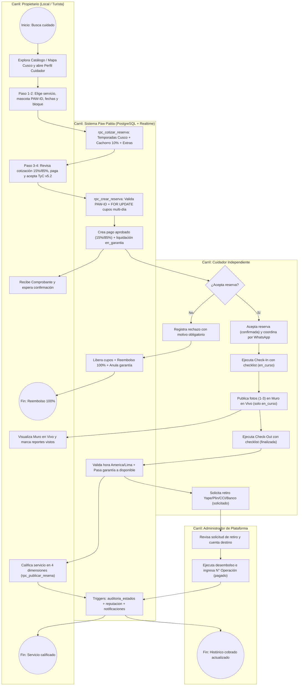

#### BPMN-02: Proceso de Atención de Emergencia Veterinaria S.O.S. 24h y Cargo Clínico

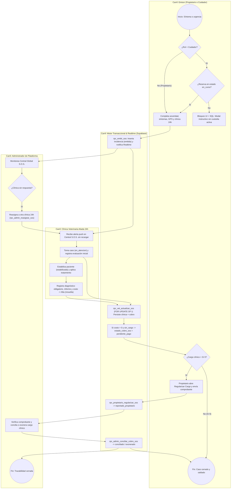

#### BPMN-03: Proceso de Postulación, Verificación Documental y Acreditación de Cuidadores y Clínicas

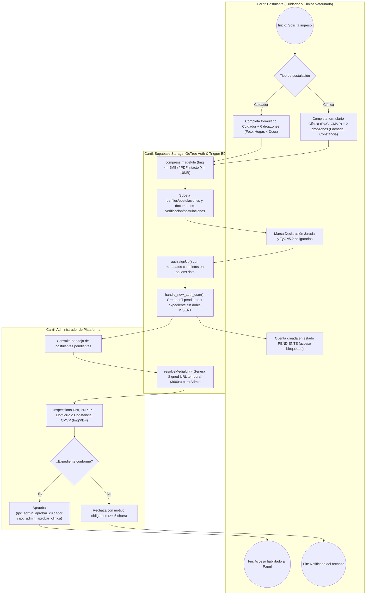

---

### 3.2. Diagramas de Secuencia UML

#### SEQ-01: Autenticación, Resolución de Rol, Aislamiento de Notificaciones y Carga de Panel

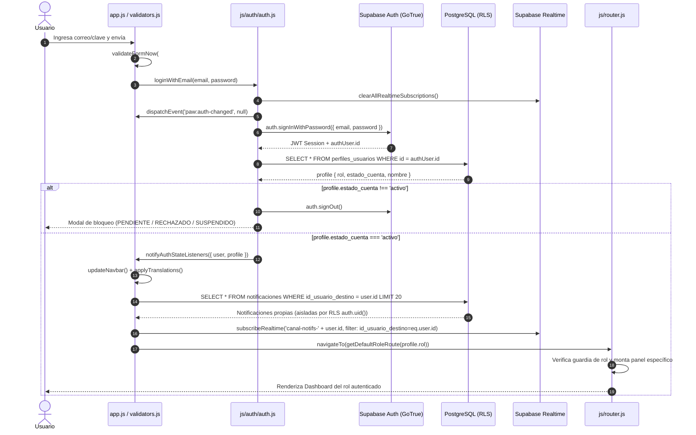

#### SEQ-02: Transacción Atómica de Cotización y Creación de Reserva (`rpc_cotizar_reserva` → `rpc_crear_reserva`)

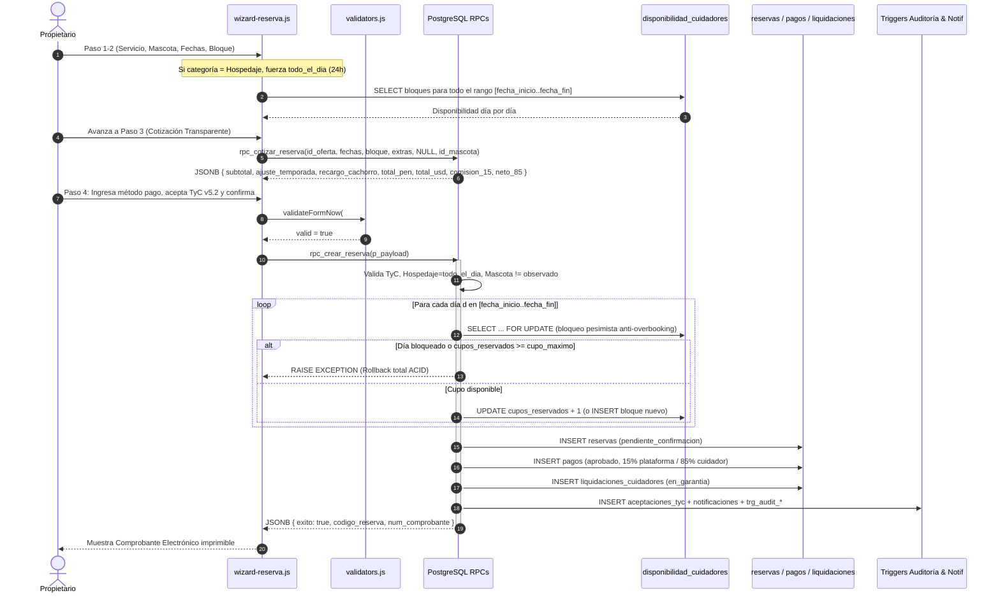

#### SEQ-03: Secuencia en Tiempo Real de Alerta S.O.S. y Trazabilidad de Cargo Clínico

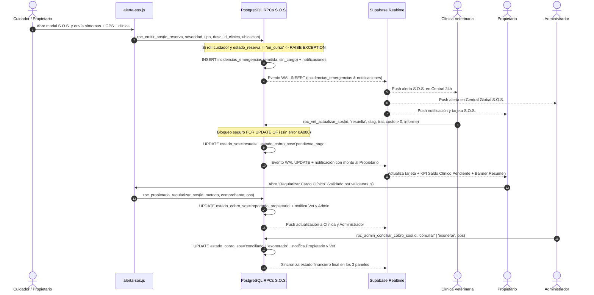

---

### 3.3. Diagramas de Máquina de Estados UML

#### EST-01: Ciclo de Vida de `public.reservas` (`estado_reserva_enum`)

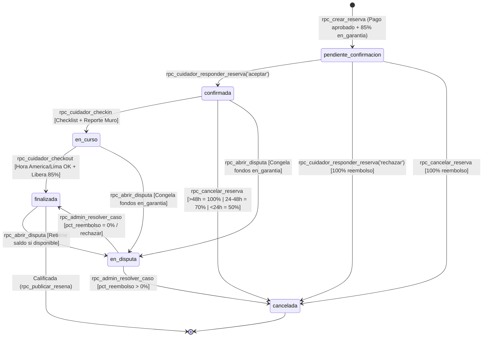

#### EST-02: Ciclo de Vida Clínico y Financiero de `public.incidencias_emergencias`

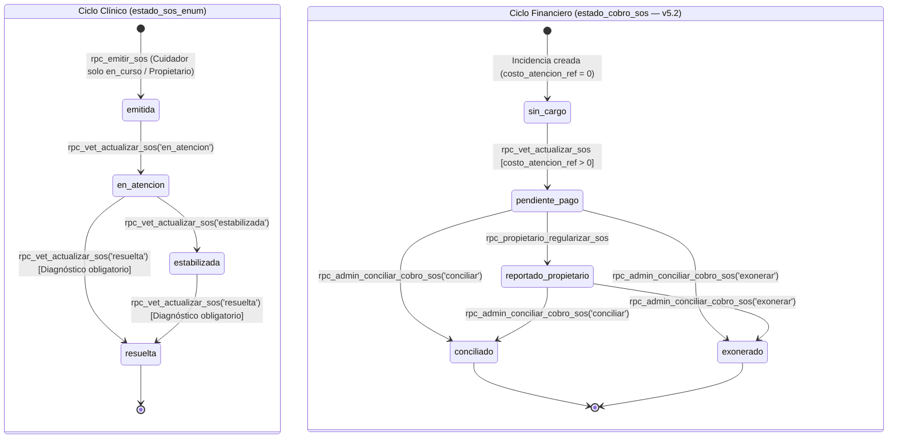

#### EST-03: Ciclo de Vida de Billetera en `public.liquidaciones_cuidadores` (`estado_liquidacion_enum`)

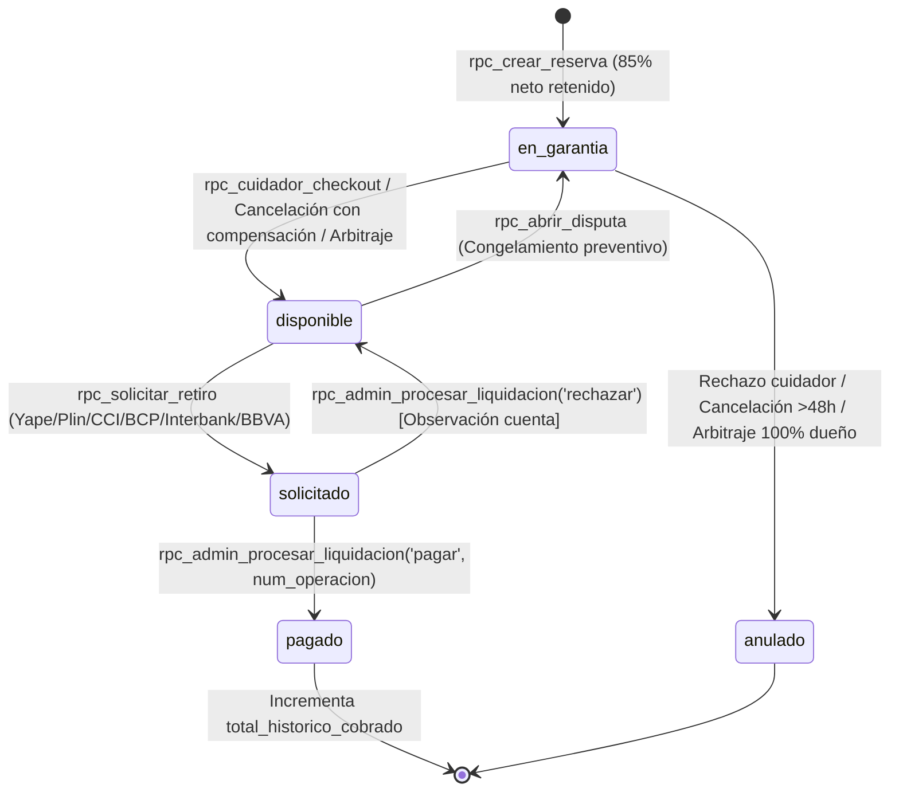

---

## 4. Arquitectura de Software y Diseño Detallado

### 4.1. Patrón y Estilo Arquitectónico

**Paw Patita Cusco v5.2** implementa una **Arquitectura Híbrida: SPA Modular en Capas (JAMstack Serverless) + Backend as a Service (BaaS) Relacional Orientado a Eventos**. Esta arquitectura desacopla por completo la distribución estática del cliente (GitHub Pages CDN) del motor transaccional, de seguridad y de eventos en tiempo real (Supabase / PostgreSQL 15+).

#### Arquitectura Frontend en 4 Capas (`index.html`, `css/`, `js/`)

1. **Capa de Presentación y Sistema de Diseño:**
   - `index.html`: Shell SPA único con landmarks semánticos (`<header>`, `<main id="app-content">`, `<footer>`), modales globales scrollables (`#modal-login`, `#modal-forgot-password`, `#modal-registro-propietario`, `#modal-postular-cuidador`, `#modal-postular-clinica`, `#modal-perfil-cuidador`) y carga CDN de librerías.
   - Hojas modulares CSS3: `css/tokens.css` (paleta WCAG AAA *"Andes & Huellas Cusco"*), `css/main.css` *(equivalente a la hoja base/global del proyecto)*, `css/auth.css`, `css/catalogo.css`, `css/paneles.css` y `css/print.css`.
2. **Capa de Control, Enrutamiento, Sesión e Internacionalización:**
   - `js/config.js`: Credenciales públicas (`SUPABASE_URL`, `SUPABASE_ANON_KEY`), constantes geográficas de Cusco, categorías, bloques horarios, `TYC_VERSION: '5.2'` y 4 perfiles demo.
   - `js/app.js`: Orquestador de arranque (`DOMContentLoaded`), actualización de Navbar, gestor aislado de notificaciones (`syncUserNotifications`, `resetNotificationsState`), listeners de formularios auth, toggles de contraseña, moneda (`PEN/USD`) e idioma (`ES/EN`).
   - `js/router.js`: Enrutador SPA basado en hash (`#/`, `#/catalogo`, `#/login`, `#/reset-password`, `#/paw-id/:id`, `#/propietario`, `#/cuidador`, `#/veterinaria`, `#/admin`) con guardias de rol.
   - `js/auth/auth.js` y `js/auth/postulaciones.js`: Ciclo de sesión JWT, bloqueo `estado_cuenta != 'activo'`, evento global `paw:auth-changed` y flujo de postulaciones con subida directa a Storage.
   - `js/i18n.js`: Motor reactivo bilingüe con `335` claves `ES` y `335` claves `EN` (`data-i18n`, `data-i18n-html`, `data-i18n-placeholder`, `data-i18n-title`).
3. **Capa de Lógica de Dominio por Rol y Vistas Públicas:**
   - Vistas públicas: `js/public/landing.js`, `js/public/catalogo.js`, `js/public/mapa-cusco.js`, `js/public/paw-id-publico.js`.
   - Paneles privados por rol: `js/roles/propietario.js`, `js/roles/cuidador.js`, `js/roles/veterinaria.js`, `js/roles/administrador.js`. Cada módulo gestiona su estado local, normalizadores defensivos anti-`undefined`, suscripciones Realtime filtradas y limpieza de singletons ante `paw:auth-changed`.
4. **Capa de Infraestructura, Almacenamiento y Componentes Reutilizables:**
   - `js/supabase-client.js` *(módulo cliente Supabase + capa de almacenamiento `storage`)*: Singleton `@supabase/supabase-js@2`, compresión client-side HTML5 Canvas (`compressImageFile`), subida validada (`uploadFileToStorage`), resolución de URLs firmadas `storage://` (`resolveMediaUrl`), fallbacks SVG andinos (`getFallbackSvgDataUri`) y gestión de canales Realtime (`subscribeRealtime`, `unsubscribeRealtime`, `clearAllRealtimeSubscriptions`).
   - 10 Componentes transversales (`js/components/`): `alerta-sos.js`, `billetera-cuidador.js`, `calendario-agenda.js`, `carnet-digital.js`, `chart-dashboard.js`, `file-uploader.js`, `help-modal.js`, `legal-modal.js`, `muro-fotos.js`, `wizard-reserva.js`.
   - 3 Utilidades base (`js/utils/`): `validators.js` (motor central de validación en los 20 formularios), `formatters.js` (moneda `PEN/USD`, edad dinámica sin desfase UTC, fechas `America/Lima`, `escapeHtml`, `exportarCsv`) y `ui-helpers.js` (spinner concurrente, toasts, `showConfirmModal`, `crearModalDinamico`, `handleSupabaseError`).

#### Arquitectura Backend en 5 Capas (Supabase / PostgreSQL 15+)

1. **Capa de Autenticación y Autorización Perimetral:** Supabase Auth (`GoTrue` con JWT + `bcrypt` + flujo de recuperación por email) acoplado a **Row Level Security (RLS)** habilitado en las 23 tablas mediante funciones auxiliares `SECURITY DEFINER` (`get_my_role()`, `is_active_user()`, `get_my_cuidador_id()`, `get_my_clinica_id()`).
2. **Capa de Lógica Transaccional en Servidor (PL/pgSQL):** 23 funciones RPC `SECURITY DEFINER` con `SET search_path = public, auth`, que encapsulan las reglas críticas financieras, anti-overbooking (`FOR UPDATE`), validaciones temporales (`America/Lima`), protocolo S.O.S. (`FOR UPDATE OF i`) y gobernanza, eliminando manipulación desde el navegador.
3. **Capa de Persistencia Relacional:** PostgreSQL 15+ en 3FN con 23 tablas, 21 tipos `ENUM`, 10 secuencias, 28 índices de rendimiento, 6 funciones de trigger automatizadas (auditoría, reputación, sincronización auth, estado de bloques, muro `en_curso`, `updated_at`) y 3 vistas analíticas/operativas.
4. **Capa de Eventos en Tiempo Real (WebSockets):** `Supabase Realtime` sobre el *Write-Ahead Log (WAL)* de PostgreSQL con publicación `supabase_realtime` en 6 tablas (`incidencias_emergencias`, `notificaciones`, `reportes_seguimiento`, `reservas`, `liquidaciones_cuidadores`, `auditoria_estados`) y filtros a nivel de suscripción.
5. **Capa de Almacenamiento de Objetos:** `Supabase Storage` con 6 buckets configurados con restricciones MIME/peso (`5 MB` imágenes, `10 MB` PDFs) y políticas RLS sobre `storage.objects`, empleando referencias privadas `storage://` firmadas dinámicamente.

### 4.2. Justificación de Decisiones Arquitectónicas y Tecnológicas (ADRs)

| Decisión Arquitectónica | Tecnología Elegida en v5.2 | Alternativa Descartada | Justificación Técnica y de Negocio (Contexto Cusco) |
| :--- | :--- | :--- | :--- |
| **ADR-01: Motor de Base de Datos** | **PostgreSQL 15+ Relacional (3FN)** vía Supabase | Bases NoSQL (Firebase Firestore / MongoDB) o Hojas de Cálculo | El dominio exige integridad referencial estricta (`reservas` ↔ `pagos` ↔ `liquidaciones` ↔ `disponibilidad`), cálculos contables exactos en `numeric(10,2)` (sin errores de punto flotante), consultas analíticas agregadas por 8 distritos y bloqueos pesimistas ACID (`FOR UPDATE`) imposibles de garantizar con la misma rigidez en NoSQL documental. |
| **ADR-02: Ubicación de Lógica Crítica** | **23 RPCs PL/pgSQL (`SECURITY DEFINER`) en BD** | Lógica financiera y de cupos en cliente JS o microservicios REST separados | Ejecutar cotización, bloqueo de cupos, partición 15%/85%, validación horaria de Check-Out y cobro S.O.S. dentro de una sola transacción en el servidor evita condiciones de carrera, impide que un usuario altere comisiones desde DevTools y elimina el costo operativo/latencia de mantener un servidor intermedio. |
| **ADR-03: Stack Frontend** | **Vanilla JS ES6 Modules (28 archivos) + Bootstrap 5.3** | SPA compilada pesada (React/Angular/Next.js + Webpack/Vite) | Cero paso de compilación (*zero-build*), despliegue inmediato en GitHub Pages (`/(root)`), carga modular selectiva nativa del navegador sin *bundle* pesado para redes móviles 3G/4G de Cusco y mantenibilidad académica transparente sin deuda de dependencias `node_modules`. |
| **ADR-04: Gestión de Archivos y Documentos** | **Supabase Storage + Compresión Canvas + URLs Firmadas (`storage://`)** | Servicios gratuitos externos (`PostImg`) o servidor FTP propio | `PostImg` devolvía imágenes de error con HTTP 200 rompiendo `onerror` y no soportaba PDFs privados. Supabase Storage permite almacenar fotos e historiales/documentos PDF hasta `10 MB`, comprimir fotos de cámara móvil antes de subir y proteger DNI/antecedentes/comprobantes tras RLS con URLs firmadas temporales (`3600s`). |
| **ADR-05: Comunicación en Tiempo Real** | **Supabase Realtime (WebSockets + filtros `eq.`)** | Polling HTTP periódico (`setInterval`) | Ante una emergencia médica S.O.S., la clínica 24h y el propietario requieren latencia sub-segundo. Los WebSockets filtrados por `id_usuario_destino` o `id_clinica_derivada` reducen tráfico innecesario y evitan saturar cuota de peticiones REST. |
| **ADR-06: Enrutamiento SPA** | **Hash Routing (`#/ruta`)** | History API (`/ruta`) | GitHub Pages sirve archivos estáticos y devuelve HTTP 404 al recargar subrutas de History API sin servidor de reescritura. El enrutamiento por hash garantiza compatibilidad total con recargas, enlaces compartidos y escaneo directo de códigos QR (`#/paw-id/PAW-XXXX`). |

### 4.3. Diagramas de Despliegue y de Componentes

#### Diagrama de Despliegue (Infraestructura de Producción)

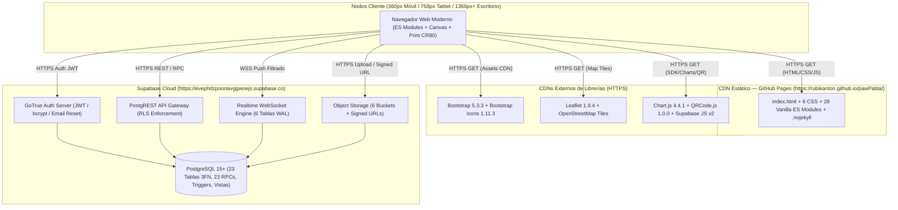

#### Diagrama de Componentes y Dependencias de Módulos

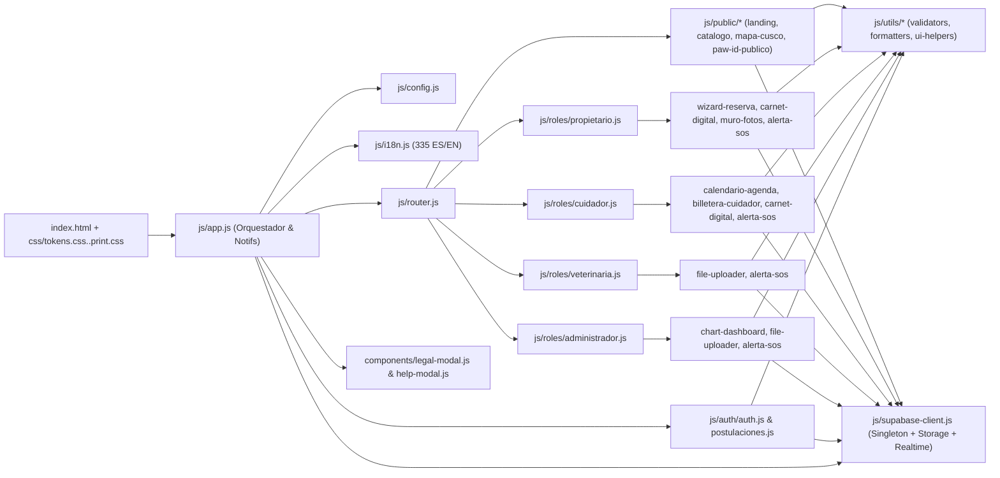

### 4.4. Inventario Comentado del Código Fuente

> Nota: Excluye deliberadamente `legacy-gas/` y `BD-PAWPATITAS-v3.xlsx` (artefactos históricos obsoletos fuera de arquitectura v5.2).

| Ruta del Archivo | Líneas | Capa / Tipo | Responsabilidad Exacta y Exportaciones Clave |
| :--- | :---: | :--- | :--- |
| `index.html` | 777 | Presentación (SPA) | Entrypoint único, cargas CDN, navbar reactivo, campanita de notificaciones (`#btn-mark-all-notifs-read`), footer WCAG AAA y 6 modales globales scrollables. |
| `.nojekyll` / `.gitignore` | — | DevOps | Desactiva procesamiento Jekyll en GitHub Pages y excluye archivos temporales/locales del control de versiones. |
| `css/tokens.css` | 106 | Presentación (Design Tokens) | Variables CSS `:root` *"Andes & Huellas Cusco"* (paleta WCAG AAA, tipografías `Poppins`/`Inter`/`Mono`, radios, sombras multicapa y transiciones). |
| `css/main.css` | 930 | Presentación (Global) | Layout base, `overflow-x: clip`, cinta textil andina (`.andean-textile-ribbon`), Hero editorial, `.cta-andes-banner`, reglas de contraste en banners/footer y modales flex `90dvh`. |
| `css/auth.css` | 332 | Presentación (Auth) | Estilos de modales de acceso, accesos demo 4 roles, toggle de contraseña `.input-password-wrapper` y `.auth-body` scrollable. |
| `css/catalogo.css` | 857 | Presentación (Público) | Cards de cuidadores, filtros sticky, marcadores Leaflet con pulso S.O.S., wrapper flex `#modal-perfil-cuidador-content` scrollable y ficha pública PAW-ID. |
| `css/paneles.css` | 1073 | Presentación (Roles) | Grid de 4 paneles sin recortes de nombre/email, drawer móvil `< 992px` (`.panel-mobile-toggle`), calendario 7 columnas `.agenda-calendar-matrix` (`min-width: 810px`), timeline Muro y stepper S.O.S. |
| `css/print.css` | 319 | Presentación (Impresión) | Reglas `@media print` para aislar Carné Digital PAW-ID en formato tarjeta billetera CR80 (`85mm x 54mm`) y comprobantes electrónicos A4. |
| `js/config.js` | 115 | Configuración | Exporta `ENV` (`SUPABASE_URL`, `SUPABASE_ANON_KEY`, `SITE_URL`) y `CUSCO_CONFIG` (8 distritos, coordenadas, 4 categorías, 4 bloques, 3 tipos doc, 4 cuentas demo, `TYC_VERSION: '5.2'`). |
| `js/supabase-client.js` | 619 | Infraestructura (BaaS) | Exporta `getSupabase`, `isSupabaseConfigured`, `compressImageFile`, `uploadFileToStorage`, `resolveMediaUrl`, `getFallbackSvgDataUri`, `uploadOrResolveMedia`, `subscribeRealtime`, `unsubscribeRealtime`, `clearAllRealtimeSubscriptions`. |
| `js/i18n.js` | 833 | Control (i18n) | Diccionario bilingüe simétrico (`335` claves `ES` / `335` claves `EN`). Exporta `getCurrentLang`, `setLanguage`, `t`, `applyTranslations`. |
| `js/router.js` | 264 | Control (Router) | Enrutador hash SPA con guardias de rol y vista `#/reset-password`. Exporta `getCurrentHash`, `navigateTo`, `handleRouteChange`, `getDefaultRoleRoute`, `initRouter`. |
| `js/app.js` | 644 | Control (Orquestador) | Inicializa Legal/Help modals, hidrata `PEN/USD` y `ES/EN`, gestiona centro de notificaciones aislado (`syncUserNotifications`, `resetNotificationsState`) y listeners globales auth. |
| `js/auth/auth.js` | 419 | Control (Auth) | Gestión JWT, auto-recuperación de perfil, bloqueo estricto `estado_cuenta != 'activo'`, evento `paw:auth-changed` y limpieza Realtime. Exporta `loginWithEmail`, `logout`, `initAuthSession`, `requestPasswordReset`, `updatePassword`, etc. |
| `js/auth/postulaciones.js` | 527 | Control (Altas) | Montaje de 6 dropzones Cuidador y 2 dropzones Clínica (`initPostulacionesUploaders`), subida a Storage previa a `signUp` y alta de propietario/cuidador/clínica. |
| `js/utils/validators.js` | 773 | Utilidad (Validación) | Motor central bilingüe conectado a los 20 formularios: 11 regex constantes, 7 sanitizadores live (`input`), 11 validadores puros, `attachFormValidation` y `validateFormNow`. |
| `js/utils/formatters.js` | 203 | Utilidad (Formato) | Exporta `escapeHtml`, `calcularEdadDinamica`, `formatMoneda` (`PEN/USD`), `formatFechaEs`, `getHoyIso` (`America/Lima`), `parseFechaLocal`, `sumarDiasIso`, `exportarCsv`. |
| `js/utils/ui-helpers.js` | 294 | Utilidad (UI) | Exporta `showSpinner`/`hideSpinner` concurrente, `showToast`, `showConfirmModal`, `crearModalDinamico` y traductor humano `handleSupabaseError`. |
| `js/public/landing.js` | 586 | Dominio Público | Renderiza portada editorial *"Andes & Huellas Cusco"*, métricas, clínicas aliadas dinámicas, temporadas, cancelaciones, testimonios y banner CTA (`renderLanding`). |
| `js/public/catalogo.js` | 1106 | Dominio Público | Catálogo reactivo sobre `v_catalogo_cuidadores`, 7 filtros combinados, modal scrollable *"Ver Perfil del Cuidador"* y reseñas reales (`renderCatalogo`, `aplicarFiltros`). |
| `js/public/mapa-cusco.js` | 286 | Dominio Público | Mapa Leaflet 1.9.4 centrado en Plaza de Armas, pines diferenciados cuidadores/clínicas 24h con pulso S.O.S. y popups bilingües (`inicializarMapaCusco`, `actualizarMarcadoresMapa`). |
| `js/public/paw-id-publico.js` | 279 | Dominio Público | Ruta `#/paw-id/:id` consumiendo `rpc_obtener_paw_id_publico` con alertas médicas, sello CMVP, botones WhatsApp/llamada y privacidad Ley 29733 (`renderPawIdPublico`). |
| `js/components/file-uploader.js` | 566 | Componente Storage | Dropzone reutilizable Img/PDF con progreso (`mountFileUploader`) y visor universal con firma temporal y `<iframe>` PDF (`abrirVisorDocumento`, `isPdfReference`). |
| `js/components/legal-modal.js` | 475 | Componente Legal | Modal Legal bilingüe v5.2 de 3 pestañas (*Términos, Privacidad Ley 29733, Declaración Jurada Art. 411 CP*) con apilamiento `z-index: 1085` (`initLegalModal`, `abrirModalLegal`). |
| `js/components/help-modal.js` | 444 | Componente Ayuda | Centro de Ayuda & FAQ contextual bilingüe en 5 pestañas por rol (`initHelpModal`, `abrirModalAyuda` — Heurística H10). |
| `js/components/carnet-digital.js` | 998 | Componente Mascotas | CRUD mascotas, generación de QR (`QRCode.js`), visor cartilla Img/PDF, historial clínico y comprobante de pago imprimible. |
| `js/components/wizard-reserva.js` | 1136 | Componente Reservas | Wizard transaccional de 4 pasos sin cupones, fijación 24h en Hospedaje, validación multi-día completa y pasarela validada (`abrirWizardReserva`). |
| `js/components/calendario-agenda.js` | 1190 | Componente Agenda | Calendario mensual de 7 días con scroll horizontal táctil, bloques horarios, plantilla semanal y replicación segura preservando `cupos_reservados`. |
| `js/components/billetera-cuidador.js` | 912 | Componente Finanzas | Conciliación de 4 saldos (`v_billetera_cuidador`), gráfico Chart.js de ingresos reales, retiros validados (`rpc_solicitar_retiro`) y exportación CSV. |
| `js/components/muro-fotos.js` | 454 | Componente Seguimiento | Galería cronológica privada del Muro en Vivo, filtros por reserva/mascota, confirmación de lectura y Lightbox (`renderSeccionMuroFotos`). |
| `js/components/alerta-sos.js` | 1015 | Componente S.O.S. | Emisión S.O.S. con restricción `en_curso` para cuidador, geolocalización GPS, stepper clínico, KPIs financieros S.O.S., badges de cobro y modal *"Regularizar Cargo Clínico"*. |
| `js/components/chart-dashboard.js` | 498 | Componente Analítica | Motor Chart.js 4.4 del Administrador: barras por los 8 distritos de Cusco, doughnut por categoría, estados de reserva y tabla exportable CSV. |
| `js/roles/propietario.js` | 1572 | Panel de Rol | Panel Unificado Propietario (Resumen con banner S.O.S., Mascotas PAW-ID, Reservas/Cancelación/Disputa/Reseña, Muro, S.O.S. y Perfil Local/Turista). |
| `js/roles/cuidador.js` | 2496 | Panel de Rol | Panel Operativo Cuidador (Reservas/Aceptar/Rechazar/Check-In/Check-Out temporal `America/Lima`, Agenda, Billetera, Muro exclusivo `en_curso`, S.O.S. exclusivo `en_curso`, Servicios y Reseñas). |
| `js/roles/veterinaria.js` | 2178 | Panel de Rol | Panel Clínica Aliada (Cabecera sede CMVP, Central S.O.S. Realtime con persistencia real y badges cobro clínico, Auditoría/Historial PAW-ID con visor PDF y Config Sede). |
| `js/roles/administrador.js` | 4459 | Panel de Rol | Centro Ejecutivo de 6 secciones (Dashboard 15% Chart.js, Cuidadores/Clínicas + Alta Directa, Disputas/Arbitraje, Liquidaciones, Central Global S.O.S. + Conciliación + Parámetros/Temporadas, Bitácora Humana). |
| `supabase/01..09_*.sql` | 7,732 | Backend SQL (9 scripts) | Esquema 23 tablas (`01`), Triggers/Vistas (`02`), 23 RPCs (`03`), RLS (`04`), Storage (`05`), Seed Cusco (`06`), Fix GoTrue (`07`), Pulido v5.1 (`08`) y Pulido v5.2 (`09`). |
| `tests/*.sql`, `*.md` | 459 | QA y Verificación | Suite SQL automatizada (`tests/sql_integrity_checks.sql`) y checklist de pruebas E2E (`tests/e2e_verification_checklist.md`). |

---

## 5. Diseño, Normalización y Diccionario de Base de Datos

### 5.1. Proceso de Normalización Relacional (1FN, 2FN y 3FN)

El esquema físico en PostgreSQL 15+ (`supabase/01_schema.sql`) fue modelado siguiendo estrictamente las formas normales relacionales para erradicar anomalías de inserción, actualización y borrado en operaciones críticas financieras y sanitarias:

#### Primera Forma Normal (1FN — Atomicidad y Eliminación de Grupos Repetitivos)
- **Separación de Galerías y Reportes:** En lugar de almacenar múltiples columnas `foto_1, foto_2, foto_3` en un registro de seguimiento, se descompuso en `reportes_seguimiento` (1) → `fotos_reporte` (N) con orden secuencial (`orden`).
- **Separación de Ofertas y Agenda:** Las tarifas y turnos del cuidador se separaron de `perfiles_cuidadores` hacia `servicios` (`1:N`) y `disponibilidad_cuidadores` (`1:N` con grano exacto de `fecha + bloque_horario + hora_inicio + hora_fin`).
- **Historial Clínico y Validaciones:** Las revisiones sanitarias históricas se separaron de `mascotas` hacia `validaciones_veterinarias` (`1:N`), y el historial de consentimientos legales hacia `aceptaciones_tyc` (`1:N`).
- **Uso deliberado de tipos nativos PostgreSQL (`text[]`, `jsonb`):** En atributos de catálogo ligero no relacional (`especialidades text[]`, `idiomas text[]`, `disponibilidad_semanal text[]`) o instantáneas de auditoría/checklists (`checklist_checkin jsonb`, `old_record jsonb`, `new_record jsonb`, `extras_detalle jsonb`), se aprovechan las estructuras nativas de PostgreSQL sin afectar la integridad referencial ni las consultas relacionales clave.

#### Segunda Forma Normal (2FN — Eliminación de Dependencias Parciales)
- **Llaves Primarias Surrogadas UUID + Restricciones de Unicidad Natural:** Todas las 23 tablas utilizan clave primaria atómica `id uuid PRIMARY KEY DEFAULT gen_random_uuid()` (excepto `perfiles_usuarios.id` en relación `1:1` estricta con `auth.users.id`), garantizando que todo atributo no clave dependa funcionalmente de la llave primaria completa.
- **Unicidad Compuesta Controlada:** En `disponibilidad_cuidadores`, la clave natural `(id_cuidador, fecha, bloque_horario, hora_inicio, hora_fin)` se declara como `UNIQUE`, evitando duplicidades de turnos mientras `cupo_maximo`, `cupos_reservados` y `estado_bloque` dependen estrictamente de esa combinación exacta.

#### Tercera Forma Normal (3FN — Eliminación de Dependencias Transitivas)
- **Desacoplamiento de Identidad, Rol Profesional, Expediente Legal y Sede Clínica:**
  - Los datos base de persona (`nombre`, `email`, `telefono`, `num_documento`, `distrito_cusco`) residen únicamente en `perfiles_usuarios`.
  - Los datos profesionales (`capacidad_max_mascotas`, `reputacion_promedio`, `cuenta_cobro_tipo`) se aíslan en `perfiles_cuidadores` (`1:1`).
  - Los documentos legales sensibles (`doc_identidad_url`, `doc_antecedentes_policiales_url`, `doc_antecedentes_penales_url`) se aíslan en `antecedentes_cuidadores` (`1:1`) con RLS privado exclusivo.
  - Los datos institucionales de clínicas (`ruc`, `colegiatura_cmvp`, `horario_atencion`, coordenadas) residen en `clinicas_veterinarias`, referenciados por FK desde `perfiles_usuarios.id_clinica_asociada`, evitando redundancia si una clínica tiene múltiples veterinarios.
- **Desacoplamiento del Núcleo Transaccional y Contable:** Una reserva no mezcla columnas de pago bancario, desembolso de billetera ni expedientes de cancelación/disputa: se separa en `reservas`, `pagos` (`1:1`), `liquidaciones_cuidadores` (`1:0..1`), `cancelaciones_reembolsos` (`1:N`) y `resenas` (`1:0..1`).
- **Eliminación de Atributos Derivados Persistidos:** La edad de la mascota **no** se almacena como entero estático (que caducaría cada año generando anomalía de actualización); se almacena `fecha_nacimiento date` y la vista `v_resumen_mascotas` calcula dinámicamente `edad_anios`, `edad_meses`, `edad_formateada` y `es_cachorro`.
- **Inmutabilidad Histórica Justificada (Snapshots Contables):** En `reservas` y `pagos` se preservan valores de `tarifa_unitaria`, `comision_porcentaje` y `monto_bruto` al momento de la transacción para garantizar auditoría contable histórica aunque el cuidador cambie luego su tarifa o el administrador modifique `configuracion_plataforma`.

---

### 5.2. Diagrama Entidad-Relación Completo (ERD — 23 Tablas Reales + `auth.users`)

```mermaid
erDiagram
    auth_users {
        uuid id PK
        text email UK
    }
    configuracion_plataforma {
        uuid id PK
        text clave UK
        numeric valor_numerico
        text valor_texto
    }
    clinicas_veterinarias {
        uuid id PK
        text codigo_clinica UK
        text ruc UK
        text email_institucional UK
        uuid aprobado_por FK
        enum estado_afiliacion
    }
    perfiles_usuarios {
        uuid id PK,FK
        text codigo_usuario UK
        text email UK
        text num_documento UK
        enum rol
        uuid id_clinica_asociada FK
        enum estado_cuenta
    }
    mascotas {
        uuid id PK
        text paw_id UK
        uuid id_propietario FK
        date fecha_nacimiento
        enum estado_validacion_vet
        uuid id_clinica_validadora FK
    }
    validaciones_veterinarias {
        uuid id PK
        uuid id_mascota FK
        uuid id_clinica FK
        uuid id_usuario_vet FK
        enum resultado
    }
    perfiles_cuidadores {
        uuid id PK
        text codigo_cuidador UK
        uuid id_usuario FK,UK
        uuid aprobado_por FK
        enum estado_postulacion
    }
    antecedentes_cuidadores {
        uuid id PK
        uuid id_cuidador FK,UK
        uuid revisado_por FK
        enum estado_verificacion
    }
    servicios {
        uuid id PK
        text hu_ecode UK
        uuid id_cuidador FK
        text categoria
        numeric tarifa_diaria_por_perro
    }
    disponibilidad_cuidadores {
        uuid id PK
        uuid id_cuidador FK
        date fecha
        enum bloque_horario
        enum estado_bloque
    }
    temporadas_tarifas {
        uuid id PK
        text nombre UK
        text mes_dia_inicio
        text mes_dia_fin
        numeric recargo_porcentaje
    }
    cupones_promocionales {
        uuid id PK
        text codigo UK
        boolean activo
    }
    reservas {
        uuid id PK
        text codigo_reserva UK
        uuid id_propietario FK
        uuid id_cuidador FK
        uuid id_oferta FK
        uuid id_mascota FK
        uuid id_temporada FK
        uuid id_cupon FK
        enum estado_reserva
    }
    pagos {
        uuid id PK
        text codigo_pago UK
        uuid id_reserva FK,UK
        numeric monto_bruto
        numeric comision_plataforma
        numeric monto_neto_cuidador
        enum estado_pago
    }
    liquidaciones_cuidadores {
        uuid id PK
        text codigo_liquidacion UK
        uuid id_cuidador FK
        uuid id_reserva FK,UK
        uuid aprobado_por_admin FK
        enum estado_liquidacion
    }
    cancelaciones_reembolsos {
        uuid id PK
        text codigo_cancelacion UK
        uuid id_reserva FK
        uuid solicitado_por FK
        uuid procesado_por FK
        enum estado_tramite
    }
    reportes_seguimiento {
        uuid id PK
        uuid id_reserva FK
        uuid id_cuidador FK
        text tipo_evento
    }
    fotos_reporte {
        uuid id PK
        uuid id_reporte FK
        text foto_url
    }
    incidencias_emergencias {
        uuid id PK
        text codigo_sos UK
        uuid id_reserva FK
        uuid id_mascota FK
        uuid reportado_por FK
        uuid id_clinica_derivada FK
        uuid atendido_por_vet FK
        enum estado_sos
        text estado_cobro_sos
    }
    resenas {
        uuid id PK
        uuid id_reserva FK,UK
        uuid id_propietario FK
        uuid id_cuidador FK
        integer calificacion_estrellas
    }
    terminos_condiciones {
        uuid id PK
        text codigo_version UK
        text ambito
    }
    aceptaciones_tyc {
        uuid id PK
        uuid id_usuario FK
        uuid id_tyc FK
        text codigo_version
    }
    auditoria_estados {
        uuid id PK
        text entidad
        text id_registro
        uuid actor_id FK
    }
    notificaciones {
        uuid id PK
        uuid id_usuario_destino FK
        text tipo
        boolean leida
    }

    auth_users ||--|| perfiles_usuarios : "1:1 identidad"
    clinicas_veterinarias ||--o{ perfiles_usuarios : "personal medico"
    perfiles_usuarios ||--o{ clinicas_veterinarias : "aprueba"
    perfiles_usuarios ||--o{ mascotas : "propietario"
    perfiles_usuarios ||--o| perfiles_cuidadores : "perfil cuidador"
    perfiles_usuarios ||--o{ perfiles_cuidadores : "aprueba"
    perfiles_usuarios ||--o{ antecedentes_cuidadores : "revisa"
    perfiles_usuarios ||--o{ reservas : "solicita"
    perfiles_usuarios ||--o{ cancelaciones_reembolsos : "solicita / procesa"
    perfiles_usuarios ||--o{ incidencias_emergencias : "reporta / atiende"
    perfiles_usuarios ||--o{ resenas : "publica"
    perfiles_usuarios ||--o{ aceptaciones_tyc : "acepta"
    perfiles_usuarios ||--o{ auditoria_estados : "ejecuta"
    perfiles_usuarios ||--o{ notificaciones : "recibe"
    perfiles_usuarios ||--o{ liquidaciones_cuidadores : "aprueba desembolso"

    perfiles_cuidadores ||--|| antecedentes_cuidadores : "expediente legal"
    perfiles_cuidadores ||--o{ servicios : "oferta"
    perfiles_cuidadores ||--o{ disponibilidad_cuidadores : "agenda horaria"
    perfiles_cuidadores ||--o{ reservas : "custodia"
    perfiles_cuidadores ||--o{ liquidaciones_cuidadores : "billetera"
    perfiles_cuidadores ||--o{ reportes_seguimiento : "publica muro"
    perfiles_cuidadores ||--o{ resenas : "recibe"

    clinicas_veterinarias ||--o{ mascotas : "ultima validadora"
    clinicas_veterinarias ||--o{ validaciones_veterinarias : "dictamina"
    clinicas_veterinarias ||--o{ incidencias_emergencias : "atiende SOS"

    mascotas ||--o{ validaciones_veterinarias : "historial CMVP"
    mascotas ||--o{ reservas : "beneficiaria"
    mascotas ||--o{ incidencias_emergencias : "paciente SOS"

    servicios ||--o{ reservas : "servicio contratado"
    temporadas_tarifas ||--o{ reservas : "recargo estacional"
    cupones_promocionales ||--o{ reservas : "cupon historico"

    reservas ||--|| pagos : "cobro 15/85"
    reservas ||--o| liquidaciones_cuidadores : "garantia cuidador"
    reservas ||--o{ cancelaciones_reembolsos : "cancelacion / disputa"
    reservas ||--o{ reportes_seguimiento : "muro en vivo"
    reservas ||--o{ incidencias_emergencias : "alerta SOS"
    reservas ||--o| resenas : "calificacion"

    reportes_seguimiento ||--o{ fotos_reporte : "multimedia"
    terminos_condiciones ||--o{ aceptaciones_tyc : "version aceptada"
```

---

### 5.3. Catálogo de Tipos `ENUM` (21) y Secuencias de Negocio (10)

| # | Tipo `ENUM` en PostgreSQL | Valores Canónicos Exactos |
| :---: | :--- | :--- |
| 1 | `rol_usuario_enum` | `'propietario'`, `'cuidador'`, `'veterinaria'`, `'administrador'` |
| 2 | `estado_cuenta_enum` | `'activo'`, `'pendiente'`, `'rechazado'`, `'suspendido'` |
| 3 | `tipo_documento_enum` | `'DNI'`, `'CE'`, `'Pasaporte'` |
| 4 | `estado_afiliacion_clinica_enum` | `'pendiente'`, `'activa'`, `'rechazada'`, `'suspendida'` |
| 5 | `horario_clinica_enum` | `'24 Horas'`, `'Diurno'`, `'Extendido'` |
| 6 | `tamano_mascota_enum` | `'Pequeño'`, `'Mediano'`, `'Grande'` |
| 7 | `sexo_mascota_enum` | `'Macho'`, `'Hembra'` |
| 8 | `estado_validacion_vet_enum` | `'pendiente'`, `'validado'`, `'observado'` |
| 9 | `estado_postulacion_cuidador_enum` | `'pendiente'`, `'aprobado'`, `'rechazado'`, `'suspendido'` |
| 10 | `bloque_horario_enum` | `'todo_el_dia'`, `'manana_08_12'`, `'tarde_14_18'`, `'noche_18_22'`, `'personalizado'` |
| 11 | `estado_bloque_enum` | `'disponible'`, `'parcial'`, `'lleno'`, `'bloqueado'` |
| 12 | `tipo_descuento_enum` | `'porcentaje'`, `'monto_fijo'` |
| 13 | `segmento_cupon_enum` | `'todos'`, `'local'`, `'turista'` |
| 14 | `estado_reserva_enum` | `'pendiente_confirmacion'`, `'confirmada'`, `'en_curso'`, `'finalizada'`, `'cancelada'`, `'en_disputa'` |
| 15 | `metodo_pago_enum` | `'Yape'`, `'Plin'`, `'Tarjeta'`, `'Transferencia'` |
| 16 | `estado_pago_enum` | `'aprobado'`, `'reembolsado_total'`, `'reembolsado_parcial'`, `'en_disputa'` |
| 17 | `estado_liquidacion_enum` | `'en_garantia'`, `'disponible'`, `'solicitado'`, `'pagado'`, `'rechazado'`, `'anulado'` |
| 18 | `tipo_caso_cancelacion_enum` | `'cancelacion_propietario'`, `'rechazo_cuidador'`, `'disputa'` |
| 19 | `estado_tramite_cancelacion_enum` | `'pendiente_revision'`, `'procesado'`, `'rechazado'` |
| 20 | `nivel_severidad_sos_enum` | `'leve'`, `'moderada'`, `'critica'` |
| 21 | `estado_sos_enum` | `'emitida'`, `'en_atencion'`, `'estabilizada'`, `'resuelta'` |

**Secuencias de Códigos Legibles (10):** `seq_paw_id` (`PAW-1001`), `seq_codigo_usuario` (`USR-101`), `seq_codigo_cuidador` (`CUID-101`), `seq_codigo_clinica` (`VET-101`), `seq_hu_ecode` (`HU-101`), `seq_codigo_reserva` (`RES-2026-1001`), `seq_codigo_pago` (`PAY-2026-1001` y `B001-001001`), `seq_codigo_liquidacion` (`LIQ-2026-1001`), `seq_codigo_sos` (`SOS-2026-1001`) y `seq_codigo_cancelacion` (`CAN-2026-1001`).

---

### 5.4. Diccionario de Datos Completo (23 Tablas de `supabase/01_schema.sql` + Parches `08`/`09`)

#### Tabla 01: `public.configuracion_plataforma`
Parámetros globales administrables en tiempo real (`comision_plataforma_pct`, `tipo_cambio_usd`, `tarifa_bano_extra`, `yape_oficial`, `soporte_whatsapp`).

| Columna | Tipo PostgreSQL | Restricciones | Descripción Funcional |
| :--- | :--- | :--- | :--- |
| `id` | `uuid` | `PK`, `DEFAULT gen_random_uuid()` | Identificador único del parámetro. |
| `clave` | `text` | `NOT NULL`, `UNIQUE` | Clave técnica canónica del parámetro. |
| `valor_numerico` | `numeric(12,4)` | Nullable | Valor decimal (ej. `0.1500`, `3.7500`, `25.0000`). |
| `valor_texto` | `text` | Nullable | Valor textual (ej. `'984-000-111'`, `'+51984123456'`). |
| `valor_booleano` | `boolean` | Nullable | Bandera booleana auxiliar del parámetro. |
| `descripcion` | `text` | `NOT NULL` | Explicación funcional visible en administración. |
| `editable_por_admin` | `boolean` | `NOT NULL`, `DEFAULT true` | Indica si el parámetro es modificable desde UI Admin. |
| `updated_at` | `timestamptz` | `NOT NULL`, `DEFAULT now()` | Última fecha de actualización (trigger `trg_configuracion_plataforma_updated_at`). |
| `created_at` | `timestamptz` | `NOT NULL`, `DEFAULT now()` | Fecha de creación del parámetro. |

#### Tabla 02: `public.clinicas_veterinarias`
Directorio de Clínicas Veterinarias Aliadas en Cusco para validación PAW-ID y atención de alertas S.O.S.

| Columna | Tipo PostgreSQL | Restricciones | Descripción Funcional |
| :--- | :--- | :--- | :--- |
| `id` | `uuid` | `PK`, `DEFAULT gen_random_uuid()` | Identificador único de la clínica. |
| `codigo_clinica` | `text` | `NOT NULL`, `UNIQUE`, `DEFAULT 'VET-...'` | Código de negocio legible (`VET-001`, `VET-101`). |
| `ruc` | `text` | `NOT NULL`, `UNIQUE`, `CHECK (ruc ~ '^[0-9]{11}$')` | Registro Único de Contribuyentes (11 dígitos). |
| `nombre` | `text` | `NOT NULL` | Razón social o nombre comercial de la clínica. |
| `email_institucional` | `text` | `NOT NULL`, `UNIQUE` | Correo institucional de contacto y acceso. |
| `direccion` | `text` | `NOT NULL` | Dirección física de la sede en Cusco. |
| `distrito_cusco` | `text` | `NOT NULL` | Distrito oficial de ubicación en Cusco. |
| `latitud` | `numeric(9,6)` | `NOT NULL`, `DEFAULT -13.516700` | Latitud geográfica para mapa Leaflet y proximidad S.O.S. |
| `longitud` | `numeric(9,6)` | `NOT NULL`, `DEFAULT -71.978800` | Longitud geográfica de la sede. |
| `telefono_emergencia` | `text` | `NOT NULL` | Línea telefónica directa de emergencias. |
| `horario_atencion` | `horario_clinica_enum` | `NOT NULL`, `DEFAULT '24 Horas'` | Régimen horario (`24 Horas`, `Diurno`, `Extendido`). |
| `especialidades` | `text[]` | `NOT NULL`, `DEFAULT ARRAY['Emergencias 24h','Medicina General']` | Lista de especialidades veterinarias ofrecidas. |
| `tarifa_consulta_emergencia` | `numeric(10,2)` | `NOT NULL`, `DEFAULT 60.00`, `CHECK (> 0)` | Tarifa referencial en PEN de consulta de urgencia. |
| `foto_fachada_url` | `text` | Nullable | URL pública de fachada (Storage `perfiles` o imagen verificada). |
| `constancia_url` | `text` | Nullable | Referencia `storage://documentos-verificacion/...` de constancia CMVP/RUC. |
| `colegiatura_cmvp` | `text` | `NOT NULL` | Número de colegiatura del director médico (CMVP Cusco). |
| `declaracion_jurada` | `boolean` | `NOT NULL`, `DEFAULT true` | Constancia de aceptación de declaración de responsabilidad. |
| `estado_afiliacion` | `estado_afiliacion_clinica_enum` | `NOT NULL`, `DEFAULT 'pendiente'` | Estado del flujo de acreditación (`pendiente`, `activa`, `rechazada`, `suspendida`). |
| `motivo_estado` | `text` | Nullable | Observación o motivo de aprobación/rechazo/suspensión. |
| `activa` | `boolean` | `NOT NULL`, `DEFAULT false` | Bandera rápida de visibilidad pública y derivación S.O.S. |
| `aprobado_por` | `uuid` | `FK -> perfiles_usuarios(id) ON DELETE SET NULL` | Administrador que acreditó o dictaminó la clínica. |
| `fecha_aprobacion` | `timestamptz` | Nullable | Marca temporal de acreditación. |
| `updated_at` / `created_at` | `timestamptz` | `NOT NULL`, `DEFAULT now()` | Marcas temporales de auditoría. |

#### Tabla 03: `public.perfiles_usuarios`
Perfil extendido `1:1` con `auth.users(id)`. Unifica Propietario Local y Turista bajo el rol `propietario`.

| Columna | Tipo PostgreSQL | Restricciones | Descripción Funcional |
| :--- | :--- | :--- | :--- |
| `id` | `uuid` | `PK`, `FK -> auth.users(id) ON DELETE CASCADE` | UUID idéntico al usuario autenticado en GoTrue. |
| `codigo_usuario` | `text` | `NOT NULL`, `UNIQUE`, `DEFAULT 'USR-...'` | Código de negocio legible (`USR-001`, `USR-101`). |
| `nombre` | `text` | `NOT NULL` | Nombres del usuario. |
| `apellido` | `text` | `NOT NULL`, `DEFAULT ''` | Apellidos del usuario. |
| `email` | `text` | `NOT NULL`, `UNIQUE` | Correo electrónico principal sincronizado con Auth. |
| `telefono` | `text` | `NOT NULL` | Teléfono móvil/WhatsApp (Perú o internacional). |
| `rol` | `rol_usuario_enum` | `NOT NULL`, `DEFAULT 'propietario'` | Rol operativo (`propietario`, `cuidador`, `veterinaria`, `administrador`). |
| `es_turista` | `boolean` | `NOT NULL`, `DEFAULT false` | Indica si el propietario visita temporalmente Cusco. |
| `tipo_documento` | `tipo_documento_enum` | `NOT NULL`, `DEFAULT 'DNI'` | Tipo de documento (`DNI`, `CE`, `Pasaporte`). |
| `num_documento` | `text` | `NOT NULL`, `UNIQUE` | Número único de identidad del usuario. |
| `pais_origen` | `text` | `NOT NULL`, `DEFAULT 'Perú'` | País de procedencia (clave para turistas). |
| `idioma_preferido` | `text` | `NOT NULL`, `DEFAULT 'ES'`, `CHECK (IN ('ES','EN'))` | Idioma de preferencia de comunicación. |
| `direccion` | `text` | Nullable | Dirección domiciliaria (oculta en QR público). |
| `distrito_cusco` | `text` | `NOT NULL`, `DEFAULT 'Cusco Centro'` | Distrito de Cusco del usuario (base de analítica por distrito). |
| `hospedaje_hotel_cusco` | `text` | Nullable | Nombre del hotel o Airbnb para turistas en Cusco. |
| `contacto_emergencia_nombre` | `text` | Nullable | Nombre de persona de auxilio en caso de emergencia. |
| `contacto_emergencia_tel` | `text` | Nullable | Teléfono del contacto de auxilio. |
| `id_clinica_asociada` | `uuid` | `FK -> clinicas_veterinarias(id) ON DELETE SET NULL` | Sede clínica vinculada (exclusivo para `rol = 'veterinaria'`). |
| `avatar_url` | `text` | Nullable | URL pública de foto de perfil (Storage `perfiles`). |
| `tyc_version_aceptada` | `text` | `DEFAULT 'v5.0'` | Última versión de Términos aceptada por el usuario. |
| `estado_cuenta` | `estado_cuenta_enum` | `NOT NULL`, `DEFAULT 'activo'` | Estado de habilitación (`activo`, `pendiente`, `rechazado`, `suspendido`). |
| `motivo_estado_cuenta` | `text` | Nullable | Justificación de bloqueo, rechazo o suspensión. |
| `updated_at` / `created_at` | `timestamptz` | `NOT NULL`, `DEFAULT now()` | Timestamps de control. |

#### Tabla 04: `public.mascotas`
Fichas médicas caninas y credencial digital `PAW-ID` con `fecha_nacimiento` para cálculo dinámico de edad.

| Columna | Tipo PostgreSQL | Restricciones | Descripción Funcional |
| :--- | :--- | :--- | :--- |
| `id` | `uuid` | `PK`, `DEFAULT gen_random_uuid()` | Identificador único de la mascota. |
| `paw_id` | `text` | `NOT NULL`, `UNIQUE`, `DEFAULT 'PAW-...'` | Código público de carné y QR (`PAW-6858`, `PAW-1001`). |
| `id_propietario` | `uuid` | `NOT NULL`, `FK -> perfiles_usuarios(id) ON DELETE CASCADE` | Propietario dueño de la mascota. |
| `nombre` | `text` | `NOT NULL` | Nombre de la mascota. |
| `raza` | `text` | `NOT NULL`, `DEFAULT 'Mestizo'` | Raza declarada. |
| `fecha_nacimiento` | `date` | `NOT NULL`, `CHECK (<= CURRENT_DATE)` | Fecha de nacimiento para cálculo exacto de edad y condición de cachorro. |
| `tamano` | `tamano_mascota_enum` | `NOT NULL`, `DEFAULT 'Mediano'` | Porte (`Pequeño`, `Mediano`, `Grande`). |
| `sexo` | `sexo_mascota_enum` | `NOT NULL`, `DEFAULT 'Macho'` | Sexo (`Macho`, `Hembra`). |
| `peso_kg` | `numeric(5,2)` | `NOT NULL`, `DEFAULT 10.00`, `CHECK (> 0 AND <= 120)` | Peso corporal en kilogramos. |
| `esterilizado` | `boolean` | `NOT NULL`, `DEFAULT false` | Estado reproductivo. |
| `vacunas_al_dia` | `boolean` | `NOT NULL`, `DEFAULT false` | Indicador actualizado por dictamen veterinario. |
| `fecha_venc_vacunas` | `date` | Nullable | Fecha de vigencia sanitaria de la cartilla. |
| `cartilla_vacunas_url` | `text` | Nullable | URL de imagen o PDF de cartilla en bucket `mascotas-fotos`. |
| `alergias_restricciones` | `text` | `DEFAULT 'Ninguna reportada'` | Alergias alimentarias o medicamentosas críticas. |
| `medicacion_actual` | `text` | `DEFAULT 'Ninguna'` | Tratamientos farmacológicos en curso. |
| `dieta_alimentacion` | `text` | `DEFAULT 'Croquetas balanceadas 2 veces al día'` | Pauta de alimentación para el cuidador. |
| `conducta_observaciones` | `text` | `DEFAULT 'Sociable y tranquilo'` | Notas de temperamento y socialización. |
| `foto_url` | `text` | Nullable | Fotografía de perfil de la mascota en Storage. |
| `estado_validacion_vet` | `estado_validacion_vet_enum` | `NOT NULL`, `DEFAULT 'pendiente'` | Dictamen vigente (`pendiente`, `validado`, `observado`). |
| `id_clinica_validadora` | `uuid` | `FK -> clinicas_veterinarias(id) ON DELETE SET NULL` | Última clínica aliada que emitió dictamen CMVP. |
| `observacion_veterinaria` | `text` | Nullable | Comentario clínico del último dictamen. |
| `fecha_ultima_validacion` | `timestamptz` | Nullable | Fecha del último dictamen médico. |
| `activa` | `boolean` | `NOT NULL`, `DEFAULT true` | Bandera de baja lógica (`false` = archivada). |
| `updated_at` / `created_at` | `timestamptz` | `NOT NULL`, `DEFAULT now()` | Timestamps de auditoría. |

#### Tabla 05: `public.validaciones_veterinarias`
Historial inmutable de dictámenes sanitarios emitidos sobre carnés `PAW-ID`.

| Columna | Tipo PostgreSQL | Restricciones | Descripción Funcional |
| :--- | :--- | :--- | :--- |
| `id` | `uuid` | `PK`, `DEFAULT gen_random_uuid()` | Identificador único del dictamen. |
| `id_mascota` | `uuid` | `NOT NULL`, `FK -> mascotas(id) ON DELETE CASCADE` | Mascota evaluada. |
| `id_clinica` | `uuid` | `NOT NULL`, `FK -> clinicas_veterinarias(id) ON DELETE RESTRICT` | Clínica que respalda el sello CMVP. |
| `id_usuario_vet` | `uuid` | `FK -> perfiles_usuarios(id) ON DELETE SET NULL` | Médico veterinario que registró el dictamen. |
| `resultado` | `estado_validacion_vet_enum` | `NOT NULL`, `CHECK (IN ('validado','observado'))` | Resultado final del examen documental. |
| `vacunas_verificadas` | `text` | `NOT NULL` | Detalle de vacunas comprobadas (Séxtuple, Antirrábica, etc.). |
| `vigencia_hasta` | `date` | Nullable | Fecha hasta la cual rige la conformidad sanitaria. |
| `observaciones_medicas` | `text` | `NOT NULL` | Dictamen u observación a subsanar por el dueño. |
| `cartilla_evaluada_url` | `text` | Nullable | Copia de la URL de cartilla revisada al dictaminar. |
| `created_at` | `timestamptz` | `NOT NULL`, `DEFAULT now()` | Fecha y hora de emisión del dictamen. |

#### Tabla 06: `public.perfiles_cuidadores`
Perfil profesional, capacidad, ubicación referencial en Cusco, reputación agregada y datos bancarios del cuidador.

| Columna | Tipo PostgreSQL | Restricciones | Descripción Funcional |
| :--- | :--- | :--- | :--- |
| `id` | `uuid` | `PK`, `DEFAULT gen_random_uuid()` | Identificador único del perfil de cuidador. |
| `codigo_cuidador` | `text` | `NOT NULL`, `UNIQUE`, `DEFAULT 'CUID-...'` | Código visible (`CUID-001`, `CUID-101`). |
| `id_usuario` | `uuid` | `NOT NULL`, `UNIQUE`, `FK -> perfiles_usuarios(id) ON DELETE CASCADE` | Relación `1:1` con el usuario titular. |
| `presentacion_corta` | `text` | `NOT NULL` | Titular o resumen de presentación en catálogo. |
| `descripcion_experiencia` | `text` | `NOT NULL` | Biografía detallada sobre manejo canino. |
| `anios_experiencia` | `integer` | `NOT NULL`, `DEFAULT 1`, `CHECK (0..50)` | Años de experiencia acreditada. |
| `especialidades` | `text[]` | `NOT NULL`, `DEFAULT ARRAY['Paseos Seguros','Cuidado en Casa']` | Etiquetas de especialidad del cuidador. |
| `idiomas` | `text[]` | `NOT NULL`, `DEFAULT ARRAY['Español']` | Idiomas hablados (relevante para turistas). |
| `tipo_vivienda` | `text` | `NOT NULL`, `DEFAULT 'Casa con patio cercado'` | Características del espacio anfitrión. |
| `capacidad_max_mascotas` | `integer` | `NOT NULL`, `DEFAULT 3`, `CHECK (1..10)` | Cupo máximo simultáneo base por bloque horario. |
| `acepta_cachorros` | `boolean` | `NOT NULL`, `DEFAULT true` | Habilita o bloquea cotización de perros `< 1 año`. |
| `acepta_medicacion_oral` | `boolean` | `NOT NULL`, `DEFAULT true` | Capacidad de administrar medicación recetada. |
| `latitud` / `longitud` | `numeric(9,6)` | `NOT NULL`, `DEFAULT -13.520000 / -71.970000` | Coordenadas aproximadas del distrito para Leaflet. |
| `reputacion_promedio` | `numeric(3,2)` | `NOT NULL`, `DEFAULT 5.00`, `CHECK (0..5)` | Promedio actualizado automáticamente por `trg_resenas_reputacion`. |
| `total_resenas` | `integer` | `NOT NULL`, `DEFAULT 0`, `CHECK (>= 0)` | Conteo total de reseñas visibles. |
| `estado_postulacion` | `estado_postulacion_cuidador_enum` | `NOT NULL`, `DEFAULT 'pendiente'` | Estado administrativo (`pendiente`, `aprobado`, `rechazado`, `suspendido`). |
| `motivo_estado` | `text` | Nullable | Observación de acreditación o suspensión. |
| `foto_url` / `foto_hogar_url` | `text` | Nullable | Fotografía del cuidador y del espacio de estadía en Cusco. |
| `disponibilidad_semanal` | `text[]` | `NOT NULL`, `DEFAULT ARRAY['Lun'..'Dom']` | Plantilla base semanal del cuidador. |
| `cuenta_cobro_tipo` | `text` | `NOT NULL`, `DEFAULT 'Yape'`, `CHECK (IN ('Yape','Plin','CCI','BCP','Interbank','BBVA'))` | Entidad financiera preferida para liquidaciones. |
| `cuenta_cobro_numero` | `text` | `NOT NULL`, `DEFAULT ''` | Número de celular o cuenta bancaria de desembolso. |
| `aprobado_por` | `uuid` | `FK -> perfiles_usuarios(id) ON DELETE SET NULL` | Administrador que evaluó la postulación. |
| `fecha_aprobacion` | `timestamptz` | Nullable | Fecha de aprobación oficial. |
| `updated_at` / `created_at` | `timestamptz` | `NOT NULL`, `DEFAULT now()` | Timestamps de auditoría. |

#### Tabla 07: `public.antecedentes_cuidadores`
Expediente documental privado de verificación legal (`DNI`, PNP, PJ, Domicilio). *(Nota v5.1: `08_pulido_v5_1.sql` relajó `NOT NULL` en los 3 campos de documento para purgar limpiamente URLs heredadas rotas).*

| Columna | Tipo PostgreSQL | Restricciones | Descripción Funcional |
| :--- | :--- | :--- | :--- |
| `id` | `uuid` | `PK`, `DEFAULT gen_random_uuid()` | Identificador único del expediente. |
| `id_cuidador` | `uuid` | `NOT NULL`, `UNIQUE`, `FK -> perfiles_cuidadores(id) ON DELETE CASCADE` | Relación `1:1` con el cuidador postulante. |
| `doc_identidad_url` | `text` | Nullable *(post `08_pulido_v5_1.sql`)* | Referencia `storage://documentos-verificacion/...` del DNI/CE. |
| `doc_antecedentes_policiales_url` | `text` | Nullable *(post `08_pulido_v5_1.sql`)* | Referencia del certificado de antecedentes policiales (PNP). |
| `doc_antecedentes_penales_url` | `text` | Nullable *(post `08_pulido_v5_1.sql`)* | Referencia del certificado de antecedentes penales (PJ). |
| `doc_domicilio_url` | `text` | Nullable | Referencia del recibo de servicio o comprobante domiciliario. |
| `declaracion_jurada` | `boolean` | `NOT NULL`, `DEFAULT true`, `CHECK (declaracion_jurada = true)` | Garantiza legalmente la declaración de idoneidad (Art. 411 CP). |
| `estado_verificacion` | `estado_postulacion_cuidador_enum` | `NOT NULL`, `DEFAULT 'pendiente'` | Estado de revisión documental sincronizado con `perfiles_cuidadores`. |
| `observaciones_admin` | `text` | Nullable | Dictamen escrito del administrador revisor. |
| `revisado_por` | `uuid` | `FK -> perfiles_usuarios(id) ON DELETE SET NULL` | Administrador que revisó el expediente. |
| `fecha_revision` | `timestamptz` | Nullable | Fecha y hora de revisión. |
| `updated_at` / `created_at` | `timestamptz` | `NOT NULL`, `DEFAULT now()` | Timestamps de control. |

#### Tabla 08: `public.servicios`
Catálogo de ofertas publicadas por los cuidadores con código `HU-XXX`.

| Columna | Tipo PostgreSQL | Restricciones | Descripción Funcional |
| :--- | :--- | :--- | :--- |
| `id` | `uuid` | `PK`, `DEFAULT gen_random_uuid()` | Identificador único de la oferta. |
| `hu_ecode` | `text` | `NOT NULL`, `UNIQUE`, `DEFAULT 'HU-...'` | Código único de oferta (`HU-101`, `HU-102`, etc.). |
| `id_cuidador` | `uuid` | `NOT NULL`, `FK -> perfiles_cuidadores(id) ON DELETE CASCADE` | Cuidador titular de la oferta. |
| `categoria` | `text` | `NOT NULL`, `CHECK (IN ('Paseo','Hospedaje','Guardería','Domicilio Turístico'))` | Categoría de servicio (si es `'Hospedaje'`, exige bloque `'todo_el_dia'`). |
| `tipo_servicio` | `text` | `NOT NULL` | Título comercial específico del servicio. |
| `descripcion_servicio` | `text` | `NOT NULL` | Detalle de alcance, paseos y cuidados incluidos. |
| `tarifa_diaria_por_perro` | `numeric(10,2)` | `NOT NULL`, `CHECK (> 0)` | Tarifa unitaria base en PEN por día/jornada. |
| `incluye_recojo_hotel` | `boolean` | `NOT NULL`, `DEFAULT false` | Indica si el traslado desde hotel/Airbnb está incluido sin costo extra. |
| `tarifa_recojo_extra` | `numeric(10,2)` | `NOT NULL`, `DEFAULT 15.00`, `CHECK (>= 0)` | Costo adicional en PEN si el turista solicita recojo y no está incluido. |
| `disponible` | `boolean` | `NOT NULL`, `DEFAULT true` | Permite pausar o reactivar la oferta sin borrar reservas pasadas. |
| `updated_at` / `created_at` | `timestamptz` | `NOT NULL`, `DEFAULT now()` | Timestamps de auditoría. |

#### Tabla 09: `public.disponibilidad_cuidadores`
Agenda operativa granular por fecha y franja horaria con bloqueo anti-overbooking.

| Columna | Tipo PostgreSQL | Restricciones | Descripción Funcional |
| :--- | :--- | :--- | :--- |
| `id` | `uuid` | `PK`, `DEFAULT gen_random_uuid()` | Identificador único del bloque de agenda. |
| `id_cuidador` | `uuid` | `NOT NULL`, `FK -> perfiles_cuidadores(id) ON DELETE CASCADE` | Cuidador propietario del calendario. |
| `fecha` | `date` | `NOT NULL` | Fecha calendario exacta (`YYYY-MM-DD`). |
| `bloque_horario` | `bloque_horario_enum` | `NOT NULL`, `DEFAULT 'todo_el_dia'` | Turno (`todo_el_dia`, `manana_08_12`, `tarde_14_18`, `noche_18_22`, `personalizado`). |
| `hora_inicio` | `time` | `NOT NULL`, `DEFAULT '08:00:00'` | Hora de inicio de la franja. |
| `hora_fin` | `time` | `NOT NULL`, `DEFAULT '20:00:00'`, `CHECK (hora_fin > hora_inicio)` | Hora de término de la franja. |
| `estado_bloque` | `estado_bloque_enum` | `NOT NULL`, `DEFAULT 'disponible'` | Estado sincronizado por `trg_disponibilidad_estado_bloque` (`disponible`, `parcial`, `lleno`, `bloqueado`). |
| `cupo_maximo` | `integer` | `NOT NULL`, `DEFAULT 3`, `CHECK (1..15)` | Capacidad habilitada para ese día/bloque. |
| `cupos_reservados` | `integer` | `NOT NULL`, `DEFAULT 0`, `CHECK (>= 0 AND <= cupo_maximo)` | Plazas ocupadas controladas atómicamente con `FOR UPDATE`. |
| `nota_agenda` | `text` | Nullable | Anotación operativa del cuidador. |
| `updated_at` / `created_at` | `timestamptz` | `NOT NULL`, `DEFAULT now()` | Timestamps de control. |
| *(Restricción de Tabla)* | `UNIQUE` | `uq_disponibilidad_cuidador_bloque (id_cuidador, fecha, bloque_horario, hora_inicio, hora_fin)` | Impide registros duplicados del mismo turno. |

#### Tabla 10: `public.temporadas_tarifas`
Calendario oficial de temporadas turísticas y climáticas de Cusco con recargos porcentuales.

| Columna | Tipo PostgreSQL | Restricciones | Descripción Funcional |
| :--- | :--- | :--- | :--- |
| `id` | `uuid` | `PK`, `DEFAULT gen_random_uuid()` | Identificador de la temporada. |
| `nombre` | `text` | `NOT NULL`, `UNIQUE` | Nombre oficial (ej. *Fiestas del Cusco e Inti Raymi*). |
| `descripcion` | `text` | `NOT NULL` | Justificación operativa/turística del recargo. |
| `mes_dia_inicio` | `text` | `NOT NULL`, `CHECK (~ '^[0-1][0-9]-[0-3][0-9]$')` | Inicio anual en formato `MM-DD` (ej. `'06-01'`). |
| `mes_dia_fin` | `text` | `NOT NULL`, `CHECK (~ '^[0-1][0-9]-[0-3][0-9]$')` | Fin anual en formato `MM-DD` (ej. `'06-30'`). |
| `factor_multiplicador` | `numeric(4,2)` | `NOT NULL`, `DEFAULT 1.15`, `CHECK (1.00..3.00)` | Factor multiplicador referencial (ej. `1.20`). |
| `recargo_porcentaje` | `numeric(5,2)` | `NOT NULL`, `DEFAULT 15.00`, `CHECK (0..100)` | Porcentaje aplicado en `rpc_cotizar_reserva` (ej. `20.00`). |
| `activa` | `boolean` | `NOT NULL`, `DEFAULT true` | Habilita o deshabilita la aplicación del recargo. |
| `created_at` | `timestamptz` | `NOT NULL`, `DEFAULT now()` | Fecha de registro. |

#### Tabla 11: `public.cupones_promocionales` *(Inactiva desde v5.1 por Regla `RN-04`)*
Conservada únicamente para preservar la integridad referencial histórica de `reservas.id_cupon`; todos sus registros permanecen con `activo = false`.

| Columna | Tipo PostgreSQL | Restricciones | Descripción Funcional |
| :--- | :--- | :--- | :--- |
| `id` | `uuid` | `PK`, `DEFAULT gen_random_uuid()` | Identificador histórico del cupón. |
| `codigo` | `text` | `NOT NULL`, `UNIQUE` | Código heredado (`BIENVENIDO10`, `MACHUPICCHU15`, `CUSCO20`). |
| `descripcion` | `text` | `NOT NULL` | Descripción histórica. |
| `tipo_descuento` | `tipo_descuento_enum` | `NOT NULL`, `DEFAULT 'porcentaje'` | Modalidad (`porcentaje` o `monto_fijo`). |
| `valor_descuento` | `numeric(10,2)` | `NOT NULL`, `CHECK (> 0)` + `chk_cupon_porcentaje` | Valor de descuento histórico. |
| `segmento_objetivo` | `segmento_cupon_enum` | `NOT NULL`, `DEFAULT 'todos'` | Segmento (`todos`, `local`, `turista`). |
| `monto_minimo` | `numeric(10,2)` | `NOT NULL`, `DEFAULT 0.00`, `CHECK (>= 0)` | Monto mínimo histórico. |
| `fecha_inicio` / `fecha_fin` | `date` | `NOT NULL`, `CHECK (fecha_fin >= fecha_inicio)` | Rango de vigencia histórico. |
| `usos_maximos` / `usos_actuales` | `integer` | `NOT NULL`, `CHECK (usos_actuales <= usos_maximos)` | Contadores históricos de redención. |
| `activo` | `boolean` | `NOT NULL`, `DEFAULT true` *(en prod `false`)* | Forzado a `false` por `08_pulido_v5_1.sql`. |
| `created_at` | `timestamptz` | `NOT NULL`, `DEFAULT now()` | Fecha de creación. |

#### Tabla 12: `public.reservas`
Entidad transaccional central del sistema con llaves foráneas protegidas con `ON DELETE RESTRICT`.

| Columna | Tipo PostgreSQL | Restricciones | Descripción Funcional |
| :--- | :--- | :--- | :--- |
| `id` | `uuid` | `PK`, `DEFAULT gen_random_uuid()` | Identificador único de la reserva. |
| `codigo_reserva` | `text` | `NOT NULL`, `UNIQUE`, `DEFAULT 'RES-2026-...'` | Código visible (`RES-2026-1001`). |
| `id_propietario` | `uuid` | `NOT NULL`, `FK -> perfiles_usuarios(id) ON DELETE RESTRICT` | Cliente propietario solicitante. |
| `id_cuidador` | `uuid` | `NOT NULL`, `FK -> perfiles_cuidadores(id) ON DELETE RESTRICT` | Cuidador asignado al servicio. |
| `id_oferta` | `uuid` | `NOT NULL`, `FK -> servicios(id) ON DELETE RESTRICT` | Servicio contratado (`HU-XXX`). |
| `id_mascota` | `uuid` | `NOT NULL`, `FK -> mascotas(id) ON DELETE RESTRICT` | Mascota beneficiaria de la custodia. |
| `fecha_inicio` / `fecha_fin` | `date` | `NOT NULL`, `CHECK (fecha_fin >= fecha_inicio)` | Rango de días del servicio. |
| `bloque_horario` | `bloque_horario_enum` | `NOT NULL`, `DEFAULT 'todo_el_dia'` | Modalidad horaria contratada (`todo_el_dia` obligatorio en Hospedaje). |
| `hora_inicio` / `hora_fin` | `time` | `NOT NULL`, `DEFAULT '08:00:00' / '20:00:00'`, `CHECK (hora_fin > hora_inicio)` | Franja exacta (usada para validación `America/Lima` en Check-Out y cancelaciones). |
| `dias_calculados` | `integer` | `NOT NULL`, `DEFAULT 1`, `CHECK (>= 1)` | Cantidad de días inclusivos `(fecha_fin - fecha_inicio) + 1`. |
| `tarifa_unitaria` / `subtotal_base` | `numeric(10,2)` | `NOT NULL`, `CHECK (> 0)` | Snapshot de tarifa diaria y subtotal base. |
| `id_temporada` | `uuid` | `FK -> temporadas_tarifas(id) ON DELETE SET NULL` | Temporada cusqueña aplicada si corresponde. |
| `ajuste_temporada` / `recargo_cachorro` | `numeric(10,2)` | `NOT NULL`, `DEFAULT 0.00`, `CHECK (>= 0)` | Monto de recargo estacional y recargo cachorro `10%`. |
| `id_cupon` / `descuento_cupon` | `uuid` / `numeric(10,2)` | `FK -> cupones_promocionales(id) ON DELETE SET NULL`, `DEFAULT 0.00` | Siempre `NULL` / `0.00` en nuevas reservas v5.1+. |
| `extras_detalle` / `extras_monto` | `jsonb` / `numeric(10,2)` | `NOT NULL`, `DEFAULT '{}'` / `0.00` | Detalle JSON de extras (`bano_higienico`, `recojo_hotel`) y suma total. |
| `monto_total` | `numeric(10,2)` | `NOT NULL`, `CHECK (> 0)` | Importe total a cobrar en PEN. |
| `moneda_referencial` | `text` | `NOT NULL`, `DEFAULT 'PEN'`, `CHECK (IN ('PEN','USD'))` | Moneda visualizada por el propietario al reservar. |
| `estado_reserva` | `estado_reserva_enum` | `NOT NULL`, `DEFAULT 'pendiente_confirmacion'` | Estado de máquina de estados auditado por `trg_audit_reservas`. |
| `motivo_rechazo` / `notas_propietario` | `text` | Nullable | Justificación de rechazo/cancelación e indicaciones del dueño. |
| `checklist_checkin` / `checklist_checkout` | `jsonb` | `DEFAULT '{}'::jsonb` | Protocolos de verificación física firmados en ingreso y entrega. |
| `fecha_checkin` / `fecha_checkout` | `timestamptz` | Nullable | Marcas reales de inicio y cierre de custodia. |
| `updated_at` / `created_at` | `timestamptz` | `NOT NULL`, `DEFAULT now()` | Timestamps de auditoría. |

#### Tabla 13: `public.pagos`
Conciliación financiera `1:1` de cada reserva: monto bruto, comisión `15%`, neto `85%`, reembolsos y comprobante.

| Columna | Tipo PostgreSQL | Restricciones | Descripción Funcional |
| :--- | :--- | :--- | :--- |
| `id` | `uuid` | `PK`, `DEFAULT gen_random_uuid()` | Identificador único del pago. |
| `codigo_pago` | `text` | `NOT NULL`, `UNIQUE`, `DEFAULT 'PAY-2026-...'` | Código transaccional de pago. |
| `id_reserva` | `uuid` | `NOT NULL`, `UNIQUE`, `FK -> reservas(id) ON DELETE RESTRICT` | Relación `1:1` con la reserva pagada. |
| `metodo_pago` | `metodo_pago_enum` | `NOT NULL`, `DEFAULT 'Yape'` | Medio de pago (`Yape`, `Plin`, `Tarjeta`, `Transferencia`). |
| `num_operacion` | `text` | `NOT NULL` | Código de operación bancaria o billetera digital. |
| `ultimos_4_digitos` | `text` | Nullable | Últimos 4 dígitos validados si el método es `Tarjeta`. |
| `monto_bruto` | `numeric(10,2)` | `NOT NULL`, `CHECK (> 0)` | Importe total cobrado al propietario. |
| `comision_porcentaje` | `numeric(5,2)` | `NOT NULL`, `DEFAULT 15.00`, `CHECK (0..100)` | Porcentaje de intermediación aplicado al momento del pago. |
| `comision_plataforma` | `numeric(10,2)` | `NOT NULL`, `CHECK (>= 0)` | Ingreso neto de Paw Patita (`15%` o proporción por penalidad/arbitraje). |
| `monto_neto_cuidador` | `numeric(10,2)` | `NOT NULL`, `CHECK (>= 0)` | Remuneración neta destinada al cuidador (`85%`). |
| `monto_reembolsado` / `penalidad_retenida` | `numeric(10,2)` | `NOT NULL`, `DEFAULT 0.00`, `CHECK (>= 0)` | Montos resultantes de cancelación o laudo arbitral. |
| `estado_pago` | `estado_pago_enum` | `NOT NULL`, `DEFAULT 'aprobado'` | Estado contable (`aprobado`, `reembolsado_total`, `reembolsado_parcial`, `en_disputa`). |
| `tipo_comprobante` | `text` | `NOT NULL`, `DEFAULT 'Boleta Electrónica'`, `CHECK (IN ('Boleta Electrónica','Factura Electrónica'))` | Tipo de documento emitido. |
| `num_comprobante` | `text` | `NOT NULL`, `DEFAULT 'B001-...'` | Numeración correlativa referencial. |
| `comprobante_url` | `text` | Nullable | Referencia opcional en bucket privado `comprobantes-pago`. |
| `fecha_pago` / `updated_at` / `created_at` | `timestamptz` | `NOT NULL`, `DEFAULT now()` | Marcas temporales contables. |

#### Tabla 14: `public.liquidaciones_cuidadores`
Libro mayor de la Billetera del Cuidador (`en_garantia` → `disponible` → `solicitado` → `pagado`).

| Columna | Tipo PostgreSQL | Restricciones | Descripción Funcional |
| :--- | :--- | :--- | :--- |
| `id` | `uuid` | `PK`, `DEFAULT gen_random_uuid()` | Identificador único de la liquidación. |
| `codigo_liquidacion` | `text` | `NOT NULL`, `UNIQUE`, `DEFAULT 'LIQ-2026-...'` | Código visible en billetera y tabla administrativa. |
| `id_cuidador` | `uuid` | `NOT NULL`, `FK -> perfiles_cuidadores(id) ON DELETE RESTRICT` | Cuidador beneficiario del abono. |
| `id_reserva` | `uuid` | `UNIQUE`, `FK -> reservas(id) ON DELETE RESTRICT` | Reserva origen del derecho económico. |
| `tipo_concepto` | `text` | `NOT NULL`, `CHECK (IN ('Servicio de Custodia (85%)','Compensación por Cancelación','Resolución de Arbitraje'))` | Naturaleza contable del movimiento. |
| `monto_liquidado` | `numeric(10,2)` | `NOT NULL`, `CHECK (> 0)` | Importe neto en PEN acreditado al cuidador. |
| `estado_liquidacion` | `estado_liquidacion_enum` | `NOT NULL`, `DEFAULT 'en_garantia'` | Estado del ciclo de desembolso auditado por `trg_audit_liquidaciones`. |
| `metodo_desembolso` / `cuenta_destino` | `text` | `DEFAULT 'Yape'` / Nullable | Entidad y cuenta destino especificada al solicitar retiro. |
| `num_operacion_desembolso` | `text` | Nullable | Código de transferencia bancaria registrado por el Admin al pagar. |
| `motivo_rechazo` | `text` | Nullable | Motivo de anulación o devolución a `disponible`. |
| `fecha_disponible` / `fecha_solicitud_retiro` / `fecha_liquidacion` | `timestamptz` | Nullable | Hitos temporales de liberación, solicitud y pago efectivo. |
| `aprobado_por_admin` | `uuid` | `FK -> perfiles_usuarios(id) ON DELETE SET NULL` | Administrador que ejecutó el desembolso. |
| `updated_at` / `created_at` | `timestamptz` | `NOT NULL`, `DEFAULT now()` | Timestamps de auditoría. |

#### Tabla 15: `public.cancelaciones_reembolsos`
Expedientes de cancelaciones escalonadas, rechazos de cuidador y arbitrajes de disputas.

| Columna | Tipo PostgreSQL | Restricciones | Descripción Funcional |
| :--- | :--- | :--- | :--- |
| `id` | `uuid` | `PK`, `DEFAULT gen_random_uuid()` | Identificador único del expediente. |
| `codigo_cancelacion` | `text` | `NOT NULL`, `UNIQUE`, `DEFAULT 'CAN-2026-...'` | Código de caso (`CAN-2026-1001`). |
| `id_reserva` | `uuid` | `NOT NULL`, `FK -> reservas(id) ON DELETE RESTRICT` | Reserva afectada. |
| `solicitado_por` | `uuid` | `NOT NULL`, `FK -> perfiles_usuarios(id) ON DELETE RESTRICT` | Usuario que inició la cancelación, rechazo o disputa. |
| `tipo_caso` | `tipo_caso_cancelacion_enum` | `NOT NULL`, `DEFAULT 'cancelacion_propietario'` | Clasificación (`cancelacion_propietario`, `rechazo_cuidador`, `disputa`). |
| `horas_anticipacion` | `numeric(10,2)` | `NOT NULL`, `DEFAULT 0` | Horas restantes respecto al inicio en `America/Lima`. |
| `regla_aplicada` | `text` | `NOT NULL` | Descripción de la política escalonada o arbitraje aplicado. |
| `motivo` | `text` | `NOT NULL` | Justificación detallada del solicitante. |
| `porcentaje_reembolso` | `numeric(5,2)` | `NOT NULL`, `CHECK (0..100)` | Porcentaje devuelto al propietario. |
| `monto_reembolso` / `monto_penalidad_plataforma` / `monto_compensacion_cuidador` | `numeric(10,2)` | `NOT NULL`, `CHECK (>= 0)` | Desglose monetario exacto de la resolución. |
| `estado_tramite` | `estado_tramite_cancelacion_enum` | `NOT NULL`, `DEFAULT 'procesado'` | Estado (`pendiente_revision`, `procesado`, `rechazado`). |
| `resolucion_admin` / `num_operacion_reembolso` | `text` | Nullable | Dictamen escrito y referencia de devolución. |
| `procesado_por` | `uuid` | `FK -> perfiles_usuarios(id) ON DELETE SET NULL` | Administrador árbitro. |
| `fecha_resolucion` / `updated_at` / `created_at` | `timestamptz` | Nullable / `NOT NULL` | Marcas temporales del expediente. |

#### Tabla 16: `public.reportes_seguimiento`
Publicaciones cronológicas del Muro de Fotos en Vivo (controladas por trigger `trg_validar_reporte_en_curso`).

| Columna | Tipo PostgreSQL | Restricciones | Descripción Funcional |
| :--- | :--- | :--- | :--- |
| `id` | `uuid` | `PK`, `DEFAULT gen_random_uuid()` | Identificador único del reporte. |
| `id_reserva` | `uuid` | `NOT NULL`, `FK -> reservas(id) ON DELETE CASCADE` | Reserva activa (`en_curso`) asociada. |
| `id_cuidador` | `uuid` | `NOT NULL`, `FK -> perfiles_cuidadores(id) ON DELETE CASCADE` | Cuidador autor del reporte. |
| `tipo_evento` | `text` | `NOT NULL`, `CHECK (IN ('Check-In','Alimentación','Paseo y Recreación','Descanso','Medicación','Higiene','Reporte General','Check-Out'))` | Categoría operativa del hito de bienestar. |
| `estado_animo_mascota` | `text` | `NOT NULL`, `DEFAULT 'Feliz y activo'` | Indicador emocional/conductual observado. |
| `ubicacion_referencial` | `text` | `NOT NULL`, `DEFAULT 'Cusco'` | Lugar referencial del paseo o estancia. |
| `nota_estado` | `text` | `NOT NULL` | Relato del cuidador dirigido al propietario. |
| `visto_por_propietario` | `boolean` | `NOT NULL`, `DEFAULT false` | Confirmación de lectura marcada por el dueño. |
| `fecha_reporte` / `created_at` | `timestamptz` | `NOT NULL`, `DEFAULT now()` | Timestamp cronológico del reporte. |

#### Tabla 17: `public.fotos_reporte`
Galería fotográfica `1:N` vinculada a cada publicación del Muro en Vivo.

| Columna | Tipo PostgreSQL | Restricciones | Descripción Funcional |
| :--- | :--- | :--- | :--- |
| `id` | `uuid` | `PK`, `DEFAULT gen_random_uuid()` | Identificador único de la fotografía. |
| `id_reporte` | `uuid` | `NOT NULL`, `FK -> reportes_seguimiento(id) ON DELETE CASCADE` | Reporte padre en el Muro. |
| `foto_url` | `text` | `NOT NULL` | URL pública del objeto en `muro-fotos` (o externa verificada). |
| `origen_almacenamiento` | `text` | `NOT NULL`, `DEFAULT 'postimg'`, `CHECK (IN ('postimg','supabase_storage','externo'))` | Clasificación del origen (`supabase_storage` para nuevas subidas v5.1+). |
| `descripcion_foto` | `text` | Nullable | Pie de foto opcional. |
| `orden` | `integer` | `NOT NULL`, `DEFAULT 1`, `CHECK (>= 1)` | Orden de despliegue en el carrusel/grilla. |
| `created_at` | `timestamptz` | `NOT NULL`, `DEFAULT now()` | Fecha de subida. |

#### Tabla 18: `public.incidencias_emergencias` *(Actualizada con Trazabilidad Financiera v5.2)*
Central de Emergencias Veterinarias S.O.S. 24h con máquina de estados clínica y ciclo de cobro al propietario.

| Columna | Tipo PostgreSQL | Restricciones | Descripción Funcional |
| :--- | :--- | :--- | :--- |
| `id` | `uuid` | `PK`, `DEFAULT gen_random_uuid()` | Identificador único de la emergencia S.O.S. |
| `codigo_sos` | `text` | `NOT NULL`, `UNIQUE`, `DEFAULT 'SOS-2026-...'` | Código visible en tarjetas y notificaciones (`SOS-2026-1001`). |
| `id_reserva` | `uuid` | `FK -> reservas(id) ON DELETE RESTRICT` | Reserva asociada (obligatoria y `en_curso` si emite un cuidador). |
| `id_mascota` | `uuid` | `NOT NULL`, `FK -> mascotas(id) ON DELETE RESTRICT` | Mascota paciente. |
| `reportado_por` | `uuid` | `NOT NULL`, `FK -> perfiles_usuarios(id) ON DELETE RESTRICT` | Usuario emisor de la alerta. |
| `id_clinica_derivada` | `uuid` | `NOT NULL`, `FK -> clinicas_veterinarias(id) ON DELETE RESTRICT` | Clínica veterinaria aliada asignada (reasignable por Admin). |
| `atendido_por_vet` | `uuid` | `FK -> perfiles_usuarios(id) ON DELETE SET NULL` | Médico veterinario que atendió el caso. |
| `nivel_severidad` | `nivel_severidad_sos_enum` | `NOT NULL`, `DEFAULT 'moderada'` | Triaje inicial (`leve`, `moderada`, `critica`). |
| `tipo_incidencia` | `text` | `NOT NULL`, `DEFAULT 'Urgencia Médica General'` | Tipología del evento (mal de altura, intoxicación, trauma, etc.). |
| `descripcion` | `text` | `NOT NULL` | Descripción detallada de síntomas. |
| `ubicacion_emergencia` | `text` | `DEFAULT 'Cusco'` | Coordenadas GPS o dirección enviada por `p_ubicacion`. |
| `estado_sos` | `estado_sos_enum` | `NOT NULL`, `DEFAULT 'emitida'` | Etapa clínica (`emitida`, `en_atencion`, `estabilizada`, `resuelta`). |
| `diagnostico_clinico` / `tratamiento_aplicado` / `informe_resolucion` | `text` | Nullable *(diagnóstico obligatorio al dar alta)* | Historia clínica de urgencia registrada por la veterinaria. |
| `costo_atencion_ref` | `numeric(10,2)` | `DEFAULT 0.00`, `CHECK (>= 0)` | Costo clínico referencial en PEN registrado por la clínica. |
| `estado_cobro_sos` *(v5.2)* | `text` | `NOT NULL`, `DEFAULT 'sin_cargo'`, `CHECK (IN ('sin_cargo','pendiente_pago','reportado_propietario','conciliado','exonerado'))` | Estado de trazabilidad financiera del cargo clínico S.O.S. |
| `metodo_pago_sos` *(v5.2)* | `text` | Nullable | Método reportado por el propietario al regularizar (`Yape`, `Plin`, `Tarjeta`, `Transferencia`). |
| `comprobante_pago_sos` *(v5.2)* | `text` | Nullable | N.º de operación o constancia ingresada por el propietario. |
| `fecha_pago_sos` *(v5.2)* | `timestamptz` | Nullable | Timestamp de reporte o conciliación del cargo clínico. |
| `observacion_cobro_sos` *(v5.2)* | `text` | Nullable | Comentarios de regularización del propietario o conciliación/exoneración del Admin. |
| `fecha_incidencia` / `fecha_atencion` / `fecha_estabilizacion` / `fecha_resolucion` | `timestamptz` | `NOT NULL` / Nullable | Línea de tiempo clínica de las 4 etapas S.O.S. |
| `updated_at` / `created_at` | `timestamptz` | `NOT NULL`, `DEFAULT now()` | Timestamps de auditoría. |

#### Tabla 19: `public.resenas`
Calificaciones verificadas post-servicio (`1:0..1` por reserva finalizada).

| Columna | Tipo PostgreSQL | Restricciones | Descripción Funcional |
| :--- | :--- | :--- | :--- |
| `id` | `uuid` | `PK`, `DEFAULT gen_random_uuid()` | Identificador único de la reseña. |
| `id_reserva` | `uuid` | `NOT NULL`, `UNIQUE`, `FK -> reservas(id) ON DELETE RESTRICT` | Garantiza máximo 1 reseña por reserva completada. |
| `id_propietario` | `uuid` | `NOT NULL`, `FK -> perfiles_usuarios(id) ON DELETE RESTRICT` | Autor de la reseña. |
| `id_cuidador` | `uuid` | `NOT NULL`, `FK -> perfiles_cuidadores(id) ON DELETE RESTRICT` | Cuidador evaluado. |
| `calificacion_estrellas` | `integer` | `NOT NULL`, `CHECK (1..5)` | Calificación general (base de `reputacion_promedio`). |
| `puntualidad_estrellas` / `comunicacion_estrellas` / `cuidado_estrellas` | `integer` | `NOT NULL`, `DEFAULT 5`, `CHECK (1..5)` | Evaluación desglosada en 3 dimensiones clave. |
| `comentario` | `text` | `NOT NULL` | Testimonio escrito del propietario. |
| `respuesta_cuidador` / `fecha_respuesta` | `text` / `timestamptz` | Nullable | Respuesta pública oficial del cuidador. |
| `visible` | `boolean` | `NOT NULL`, `DEFAULT true` | Control de moderación pública (`catalogo.js` filtra `visible = true`). |
| `created_at` | `timestamptz` | `NOT NULL`, `DEFAULT now()` | Fecha de publicación. |

#### Tabla 20: `public.terminos_condiciones`
Catálogo versionado de contratos legales y políticas normativas de Paw Patita Cusco.

| Columna | Tipo PostgreSQL | Restricciones | Descripción Funcional |
| :--- | :--- | :--- | :--- |
| `id` | `uuid` | `PK`, `DEFAULT gen_random_uuid()` | Identificador de la versión legal. |
| `codigo_version` | `text` | `NOT NULL`, `UNIQUE` | Código único (`v5.0-GENERAL`, `v5.0-RESERVA`, etc.). |
| `ambito` | `text` | `NOT NULL`, `CHECK (IN ('General','Propietario','Cuidador','Veterinaria','Reserva'))` | Alcance contractual de la norma. |
| `titulo` / `contenido_markdown` | `text` | `NOT NULL` | Encabezado y clausulado completo. |
| `vigente` | `boolean` | `NOT NULL`, `DEFAULT true` | Indica si corresponde a la normativa activa. |
| `fecha_publicacion` / `created_at` | `timestamptz` | `NOT NULL`, `DEFAULT now()` | Fechas de publicación y registro. |

#### Tabla 21: `public.aceptaciones_tyc`
Evidencia inmutable de consentimiento legal vinculante (registros, postulaciones y reservas).

| Columna | Tipo PostgreSQL | Restricciones | Descripción Funcional |
| :--- | :--- | :--- | :--- |
| `id` | `uuid` | `PK`, `DEFAULT gen_random_uuid()` | Identificador de constancia. |
| `id_usuario` | `uuid` | `NOT NULL`, `FK -> perfiles_usuarios(id) ON DELETE CASCADE` | Usuario que otorgó el consentimiento. |
| `id_tyc` | `uuid` | `FK -> terminos_condiciones(id) ON DELETE RESTRICT` | Versión referenciada del contrato. |
| `codigo_version` | `text` | `NOT NULL`, `DEFAULT 'v5.0'` | Código de versión aceptada (ej. `'v5.1-RESERVA'`). |
| `contexto_aceptacion` | `text` | `NOT NULL`, `DEFAULT 'Registro de Cuenta'` | Contexto exacto (ej. `'Reserva RES-2026-1001'`). |
| `ip_referencial` / `user_agent` | `text` | `DEFAULT '127.0.0.1'` / Nullable | Metadatos técnicos de trazabilidad. |
| `fecha_aceptacion` | `timestamptz` | `NOT NULL`, `DEFAULT now()` | Timestamp exacto del consentimiento. |

#### Tabla 22: `public.auditoria_estados`
Bitácora forense global inmutable poblada automáticamente por triggers en las 8 entidades críticas.

| Columna | Tipo PostgreSQL | Restricciones | Descripción Funcional |
| :--- | :--- | :--- | :--- |
| `id` | `uuid` | `PK`, `DEFAULT gen_random_uuid()` | Identificador del evento de auditoría. |
| `entidad` | `text` | `NOT NULL` | Nombre de la tabla auditada (`TG_TABLE_NAME`). |
| `id_registro` | `text` | `NOT NULL` | Código legible de negocio (`RES-...`, `SOS-...`, `PAW-...`) o UUID. |
| `accion` | `text` | `NOT NULL` | Tipo de evento (`CREACION`, `TRANSICION_ESTADO`). |
| `estado_anterior` / `estado_nuevo` | `text` | Nullable | Valores antes y después de la transición auditada. |
| `actor_id` | `uuid` | `FK -> perfiles_usuarios(id) ON DELETE SET NULL` | Usuario `auth.uid()` ejecutor (NULL si fue proceso automático). |
| `actor_nombre` / `actor_rol` | `text` | `NOT NULL`, `DEFAULT 'Sistema Automático' / 'sistema'` | Nombre completo y rol resueltos al instante del cambio. |
| `detalle` | `text` | `NOT NULL` | Descripción textual del cambio. |
| `old_record` / `new_record` | `jsonb` | Nullable | Instantáneas completas antes/después (traducidas a tabla humana en Admin Sección 6). |
| `metadata` | `jsonb` | `DEFAULT '{}'::jsonb` | Metadatos del trigger (`operacion_sql`, `columna_auditada`, `timestamp_utc`). |
| `created_at` | `timestamptz` | `NOT NULL`, `DEFAULT now()` | Marca temporal inmutable del evento. |

#### Tabla 23: `public.notificaciones`
Centro de alertas In-App en tiempo real con aislamiento estricto por usuario (`id_usuario_destino = auth.uid()`).

| Columna | Tipo PostgreSQL | Restricciones | Descripción Funcional |
| :--- | :--- | :--- | :--- |
| `id` | `uuid` | `PK`, `DEFAULT gen_random_uuid()` | Identificador único de la notificación. |
| `id_usuario_destino` | `uuid` | `NOT NULL`, `FK -> perfiles_usuarios(id) ON DELETE CASCADE` | Único usuario autorizado por RLS para leer/marcar leída la fila. |
| `tipo` | `text` | `NOT NULL`, `DEFAULT 'info'`, `CHECK (IN ('info','reserva','pago','sos','validacion','sistema'))` | Categoría visual para ícono y prioridad de toast. |
| `titulo` / `mensaje` | `text` | `NOT NULL` | Encabezado y contenido informativo de la alerta. |
| `referencia_entidad` / `referencia_id` | `text` | Nullable | Entidad e ID relacionado para trazabilidad. |
| `leida` | `boolean` | `NOT NULL`, `DEFAULT false` | Se actualiza a `true` al abrir la campanita o pulsar *"Marcar leídas"*. |
| `created_at` | `timestamptz` | `NOT NULL`, `DEFAULT now()` | Timestamp de emisión (orden descendente, límite 20 en campanita). |

---

### 5.5. Catálogo de Lógica Programada en Base de Datos

#### 5.5.1. Triggers y Funciones Automáticas (`supabase/02_functions_triggers.sql` & `05_storage_buckets.sql`)

| Función PL/pgSQL | Trigger(s) Asociado(s) | Momento / Tabla(s) | Propósito Técnico Exacto |
| :--- | :--- | :--- | :--- |
| `public.fn_set_updated_at()` | `trg_<tabla>_updated_at` (13 triggers) | `BEFORE UPDATE` en 13 tablas con columna `updated_at` | Actualiza automáticamente `NEW.updated_at := now()` garantizando trazabilidad temporal sin depender del cliente. |
| `public.handle_new_auth_user()` (`SECURITY DEFINER`) | `on_auth_user_created` | `AFTER INSERT` en `auth.users` | Sincroniza `auth.users` → `perfiles_usuarios` respetando `estado_cuenta = 'pendiente'` para postulantes `cuidador`/`veterinaria`; evita colisión `UNIQUE` de `num_documento`; si `auto_create_perfil = true`, crea expediente en `perfiles_cuidadores` + `antecedentes_cuidadores` (4 docs) + servicio inicial o crea `clinicas_veterinarias` con `ON CONFLICT (ruc) DO NOTHING` (sin doble `INSERT`). |
| `public.fn_auditar_cambio_estado()` (`SECURITY DEFINER`) | `trg_audit_reservas`, `trg_audit_pagos`, `trg_audit_liquidaciones`, `trg_audit_cuidadores`, `trg_audit_clinicas`, `trg_audit_mascotas`, `trg_audit_sos`, `trg_audit_cancelaciones` (8 triggers) | `AFTER INSERT OR UPDATE` en las 8 tablas críticas | Recibe `TG_ARGV[0]` (columna de estado auditada). En `INSERT` registra `CREACION`; en `UPDATE` solo registra `TRANSICION_ESTADO` si cambió el estado auditado. Resuelve `actor_id = auth.uid()`, `actor_nombre` y `actor_rol`, extrae el código legible (`RES-`, `SOS-`, `PAW-`, etc.) e inserta instantáneas completas `old_record` y `new_record` en `auditoria_estados`. |
| `public.fn_recalcular_reputacion_cuidador()` (`SECURITY DEFINER`) | `trg_resenas_reputacion` | `AFTER INSERT OR UPDATE OR DELETE` en `public.resenas` | Recalcula `reputacion_promedio` (`ROUND(AVG, 2)`) y `total_resenas` filtrando `visible = true` y actualiza `perfiles_cuidadores`. |
| `public.fn_sincronizar_estado_bloque()` | `trg_disponibilidad_estado_bloque` | `BEFORE INSERT OR UPDATE` en `public.disponibilidad_cuidadores` | Si `estado_bloque != 'bloqueado'`, asigna automáticamente `'lleno'` (`cupos_reservados >= cupo_maximo`), `'parcial'` (`> 0`) o `'disponible'` (`0`). |
| `public.fn_validar_reporte_reserva_en_curso()` (`SECURITY DEFINER`) | `trg_validar_reporte_en_curso` | `BEFORE INSERT` en `public.reportes_seguimiento` | Bloquea con `RAISE EXCEPTION` cualquier publicación en el Muro si la reserva asociada no está en `estado_reserva = 'en_curso'` (permite únicamente el evento automático `'Check-Out'` en `'en_curso'` o `'finalizada'`). |
| `public.fn_clasificar_origen_imagen(p_url)` | Helper `IMMUTABLE` | Invocable desde SQL | Clasifica si una referencia multimedia corresponde a `'supabase_storage'` (`storage://%` o `%/storage/v1/object/%`) o `'externo'`. |

#### 5.5.2. Vistas Analíticas y Operativas (3 Vistas)

| Vista SQL | Permisos `GRANT` | Tablas Base | Función Operativa |
| :--- | :--- | :--- | :--- |
| `public.v_catalogo_cuidadores` | `anon`, `authenticated` | `perfiles_cuidadores`, `perfiles_usuarios`, `servicios` (`LEFT JOIN LATERAL`) | Expone únicamente cuidadores con `estado_postulacion = 'aprobado'` y `estado_cuenta = 'activo'`, agregando `tarifa_minima`, `tarifa_maxima`, `hu_ecode_principal`, `ofrece_recojo_hotel`, `categorias_servicio` y `servicios_disponibles jsonb`. |
| `public.v_billetera_cuidador` | `authenticated` | `perfiles_cuidadores`, `perfiles_usuarios`, `liquidaciones_cuidadores` | Concilia al céntimo mediante cláusulas `FILTER (WHERE ...)` los 4 saldos: `saldo_en_garantia`, `saldo_disponible_retiro`, `saldo_en_proceso_retiro`, `total_historico_cobrado` y conteos de partidas. |
| `public.v_resumen_mascotas` | `authenticated` *(público solo vía RPC)* | `mascotas`, `perfiles_usuarios`, `clinicas_veterinarias` | Calcula dinámicamente `edad_anios`, `edad_meses`, `edad_formateada` y `es_cachorro` (`age() < INTERVAL '1 year'`) desde `fecha_nacimiento`, cruzando nombre y colegiatura `CMVP` de la clínica validadora. |

#### 5.5.3. Catálogo Exhaustivo de Procedimientos Almacenados (23 RPCs Transaccionales)

Todas las funciones se ejecutan con `SECURITY DEFINER` y `SET search_path = public, auth` (o `public`), retornando `jsonb` estructurado:

| # | Firma del RPC (`public.*`) | `GRANT` | Validaciones de Seguridad / Bloqueos | Efecto Transaccional Principal |
| :---: | :--- | :---: | :--- | :--- |
| **1** | `rpc_cotizar_reserva(p_id_oferta uuid, p_fecha_inicio date, p_fecha_fin date, p_bloque_horario bloque_horario_enum, p_extras jsonb, p_codigo_cupon text, p_id_mascota uuid)` | `anon`, `authenticated` | Valida fechas (`fin >= inicio`), oferta disponible y elegibilidad `acepta_cachorros`. Fuerza `todo_el_dia` si `categoria = 'Hospedaje'`. Ignora `p_codigo_cupon` (`RN-04`). | Lee `configuracion_plataforma` y `temporadas_tarifas`, calcula días, temporada, cachorro `10%`, extras, comisión `15%`, neto `85%`, total `PEN` y `USD`. |
| **2** | `rpc_crear_reserva(p_payload jsonb)` | `authenticated` | Exige sesión (`auth.uid()`), `acepta_tyc = true`, `todo_el_dia` en Hospedaje, mascota activa perteneciente al dueño y `estado_validacion_vet != 'observado'`. Bloqueo pesimista `FOR UPDATE` día por día en `disponibilidad_cuidadores`. | Incrementa/crea cupos diarios, inserta `reservas` (`pendiente_confirmacion`), `pagos` (`aprobado`, `15%/85%`), `liquidaciones_cuidadores` (`en_garantia`), `aceptaciones_tyc` y 2 `notificaciones`. |
| **3** | `rpc_cuidador_responder_reserva(p_id_reserva uuid, p_accion text, p_motivo text)` | `authenticated` | `FOR UPDATE` sobre reserva; exige estado `pendiente_confirmacion`. Si `rechazar`, exige `motivo >= 5` caracteres. | `'aceptar'`/`'confirmar'` → `confirmada` + notifica dueño. `'rechazar'` → `cancelada`, libera cupos, `pagos` `reembolsado_total` (`100%`), liquidación `anulado`, inserta `cancelaciones_reembolsos` y notifica. |
| **4** | `rpc_cuidador_checkin(p_id_reserva uuid, p_checklist jsonb)` | `authenticated` | `FOR UPDATE`; exige estado `confirmada`. | Pasa reserva a `en_curso`, guarda `checklist_checkin` y `fecha_checkin`, inserta reporte `'Check-In'` en Muro y notifica al propietario. |
| **5** | `rpc_cuidador_checkout(p_id_reserva uuid, p_checklist jsonb)` | `authenticated` | `FOR UPDATE`; exige `en_curso` y valida zona `America/Lima` (`inicio_lima <= now()`, `RN-09`). | Pasa reserva a `finalizada`, libera `liquidaciones_cuidadores` (`en_garantia` → `disponible`), inserta reporte `'Check-Out'` y notifica para calificar. |
| **6** | `rpc_preview_cancelacion(p_id_reserva uuid)` | `authenticated` | Exige estado `pendiente_confirmacion` o `confirmada`. Calcula horas en `America/Lima`. | Simula sin mutar BD la política escalonada (`>48h`: `100%`, `24–48h`: `70%`, `<24h`: `50%`) retornando montos exactos de reembolso, plataforma y cuidador. |
| **7** | `rpc_cancelar_reserva(p_id_reserva uuid, p_motivo text)` | `authenticated` | `FOR UPDATE`; exige `motivo >= 5` caracteres; invoca `rpc_preview_cancelacion`. | Pasa reserva a `cancelada`, libera cupos horarios, actualiza `pagos`, pasa compensación a `disponible` (o anula liquidación) e inserta `cancelaciones_reembolsos`. |
| **8** | `rpc_abrir_disputa(p_id_reserva uuid, p_motivo text)` | `authenticated` | `FOR UPDATE`; exige `motivo >= 10` caracteres. | Pasa `reservas` y `pagos` a `en_disputa`, retiene `liquidaciones_cuidadores` en `en_garantia` y crea expediente `disputa` (`pendiente_revision`). |
| **9** | `rpc_admin_resolver_caso(p_id_cancelacion uuid, p_accion text, p_pct_reembolso numeric, p_resolucion text)` | `authenticated` | `FOR UPDATE`; exige `resolucion >= 5` chars; acota porcentaje `0..100` (`0` si `'rechazar'`). | Distribuye `reembolso`, `comision = 15%` remanente y `cuidador = 85%` remanente; actualiza `cancelaciones_reembolsos`, `reservas`, `pagos`, `liquidaciones_cuidadores` y notifica. |
| **10** | `rpc_solicitar_retiro(p_cuenta_tipo text, p_cuenta_numero text)` | `authenticated` | Valida entidad bancaria (`Yape`/`Plin`/`CCI`/`BCP`/`Interbank`/`BBVA`), cuenta `>= 6` dígitos y existencia de partidas `disponible`. | Actualiza cuenta preferida en `perfiles_cuidadores` y pasa todas sus liquidaciones `disponible` → `solicitado` con `fecha_solicitud_retiro`. |
| **11** | `rpc_admin_procesar_liquidacion(p_id_liquidacion uuid, p_accion text, p_num_operacion text, p_motivo text)` | `authenticated` | `FOR UPDATE`; si `'pagar'`, exige `num_operacion >= 4` chars. | `'pagar'` → `pagado`, guarda operación y `aprobado_por_admin`, notifica al cuidador. `'rechazar'` → retorna saldo a `disponible` con `motivo_rechazo`. |
| **12** | `rpc_emitir_sos(p_id_reserva uuid, p_severidad nivel_severidad_sos_enum, p_tipo text, p_descripcion text, p_id_clinica uuid, p_ubicacion text)` | `authenticated` | Valida sesión, `descripcion >= 5`, pertenencia a la reserva (`propietario`/`cuidador`/`admin`) y **bloquea si `rol = 'cuidador'` y `estado_reserva != 'en_curso'`** (`09_pulido_v5_2.sql`). | Auto-asigna clínica 24h activa si no se especificó, inserta `incidencias_emergencias` (`emitida`, `ubicacion_emergencia`) y notifica a Dueño, Cuidador, Clínica y Admin. |
| **13** | `rpc_vet_actualizar_sos(p_id_incidencia uuid, p_accion text, p_diagnostico text, p_tratamiento text, p_costo numeric, p_informe text)` | `authenticated` | Exige `rol IN ('veterinaria','administrador')`, `p_costo >= 0`, pertenencia a clínica derivada, bloqueo **`FOR UPDATE OF i`** (fix `0A000`) y diagnóstico obligatorio al dar alta. | Transiciona `en_atencion`/`estabilizada`/`resuelta`, persiste diagnóstico/tratamiento/informe/costo; si `costo > 0` y `sin_cargo` pasa `estado_cobro_sos` → `'pendiente_pago'`; notifica a Dueño, Cuidador y Admin. |
| **14** | `rpc_propietario_regularizar_sos(p_id_incidencia uuid, p_metodo_pago text, p_comprobante text, p_observacion text)` *(v5.2)* | `authenticated` | `FOR UPDATE OF i`; exige sesión del propietario de la reserva/mascota, `costo_atencion_ref > 0`, estado cobro no `conciliado`/`exonerado`, método y comprobante válidos. | Actualiza `estado_cobro_sos = 'reportado_propietario'`, guarda método, comprobante y `fecha_pago_sos`, y notifica a la Clínica y Administradores. |
| **15** | `rpc_admin_conciliar_cobro_sos(p_id_incidencia uuid, p_accion text, p_observacion text)` *(v5.2)* | `authenticated` | `FOR UPDATE OF i`; exige `get_my_role() = 'administrador'`; acción `'conciliar'` (con `costo > 0`) o `'exonerar'`. | Actualiza `estado_cobro_sos` a `'conciliado'` o `'exonerado'`, registra observación/fecha y notifica a Propietario y Clínica. |
| **16** | `rpc_admin_reasignar_sos(p_id_incidencia uuid, p_nueva_clinica uuid)` | `authenticated` | Verifica que la clínica destino exista y tenga `estado_afiliacion = 'activa'`. | Reasigna `incidencias_emergencias.id_clinica_derivada` a otra clínica 24h de Cusco. |
| **17** | `rpc_vet_dictaminar_ficha(p_id_mascota uuid, p_resultado estado_validacion_vet_enum, p_vacunas text, p_vigencia date, p_observaciones text)` | `authenticated` | `FOR UPDATE` sobre `mascotas`; exige resultado `'validado'` u `'observado'`. | Actualiza `mascotas` (`estado_validacion_vet`, `vacunas_al_dia`, `id_clinica_validadora`), inserta historial en `validaciones_veterinarias` y notifica al propietario. |
| **18** | `rpc_obtener_paw_id_publico(p_paw_id text)` | `anon`, `authenticated` | Consulta segura sin sesión sobre `v_resumen_mascotas` (`activa = true`). | Retorna ficha médica de emergencia, sello CMVP y teléfono/distrito del dueño **omitiendo DNI y dirección domiciliaria**. |
| **19** | `rpc_admin_aprobar_cuidador(p_id_cuidador uuid, p_accion text, p_motivo text)` | `authenticated` | `FOR UPDATE`; exige motivo `>= 5` chars al rechazar. | Sincroniza `perfiles_cuidadores.estado_postulacion`, `antecedentes_cuidadores.estado_verificacion` y `perfiles_usuarios.estado_cuenta` + notifica. |
| **20** | `rpc_admin_aprobar_clinica(p_id_clinica uuid, p_accion text, p_motivo text)` | `authenticated` | `FOR UPDATE`; exige motivo `>= 5` chars al rechazar. | Sincroniza `clinicas_veterinarias` (`estado_afiliacion`, `activa`) y `perfiles_usuarios.estado_cuenta` del personal veterinario asociado. |
| **21** | `rpc_admin_crear_clinica_directa(p_payload jsonb)` | `authenticated` | Validación de constraints de `clinicas_veterinarias` (RUC único 11 dígitos, email único). | Inserta clínica directamente como `'activa'` (`activa = true`) y opcionalmente vincula y activa a un usuario `veterinaria`. |
| **22** | `rpc_admin_dashboard_metrics()` | `authenticated` | Agregaciones autoritativas sobre `pagos` (`aprobado`, `reembolsado_parcial`), `liquidaciones_cuidadores`, `reservas`, `perfiles_cuidadores`, `clinicas_veterinarias`, `incidencias_emergencias` y `cancelaciones_reembolsos`. | Retorna KPIs ejecutivos reales (comisión `15%`, neto `85%`, saldos, pendientes, S.O.S.) y 3 series JSONB: `series_distritos_cusco`, `series_categorias_servicio` y `series_estados_reserva`. |
| **23** | `rpc_publicar_resena(p_id_reserva uuid, p_calificacion int, p_puntualidad int, p_comunicacion int, p_cuidado int, p_comentario text)` | `authenticated` | Exige `comentario >= 5`, `estado_reserva = 'finalizada'` y unicidad (no calificada previamente); acota estrellas `1..5`. | Inserta `resenas`, dispara `trg_resenas_reputacion` y retorna nuevo promedio y conteo del cuidador. |

#### 5.5.4. Seguridad a Nivel de Fila (RLS), Publicación Realtime y Storage Buckets

**Funciones Helper de Autorización RLS (`04_rls_policies.sql`, `STABLE SECURITY DEFINER`):**
- `public.get_my_role()` → retorna `rol::text` del `auth.uid()`.
- `public.is_active_user()` → retorna `boolean` (`estado_cuenta = 'activo'`).
- `public.get_my_cuidador_id()` → retorna `perfiles_cuidadores.id` del usuario actual.
- `public.get_my_clinica_id()` → retorna `perfiles_usuarios.id_clinica_asociada`.

**Matriz Consolidada de Políticas RLS (23 Tablas — `ENABLE ROW LEVEL SECURITY` en el 100%):**

| Tabla(s) | `anon` (Visitante) | `propietario` | `cuidador` | `veterinaria` | `administrador` |
| :--- | :--- | :--- | :--- | :--- | :--- |
| `configuracion_plataforma`, `temporadas_tarifas`, `terminos_condiciones` | `SELECT` | `SELECT` | `SELECT` | `SELECT` | `ALL` |
| `clinicas_veterinarias` | `SELECT` activas; `INSERT` postulación | `SELECT` activas | `SELECT` activas | `SELECT`/`UPDATE` su sede | `ALL` |
| `perfiles_usuarios` | `SELECT` cuidadores activos | `SELECT` auth; `INSERT`/`UPDATE` propio | `SELECT` auth; `INSERT`/`UPDATE` propio | `SELECT` auth; `INSERT`/`UPDATE` propio | `ALL` (`SELECT`/`INSERT`/`UPDATE`) |
| `mascotas` | Sin acceso directo *(solo RPC QR)* | `ALL` solo propias | `SELECT` solo de sus reservas | `SELECT` todas (auditoría/SOS) | `ALL` |
| `validaciones_veterinarias` | Sin acceso | `SELECT` de sus mascotas | Sin acceso | `SELECT` / `INSERT` | `SELECT` / `INSERT` |
| `perfiles_cuidadores` | `SELECT` aprobados | `SELECT` aprobados | `SELECT`/`INSERT`/`UPDATE` propio | `SELECT` aprobados | `ALL` (`SELECT`/`INSERT`/`UPDATE`) |
| `antecedentes_cuidadores` | Sin acceso | Sin acceso | `SELECT`/`INSERT`/`UPDATE` propios | Sin acceso | `SELECT`/`INSERT`/`UPDATE` |
| `servicios` | `SELECT` disponibles | `SELECT` disponibles | `ALL` propios | `SELECT` disponibles | `ALL` |
| `disponibilidad_cuidadores` | `SELECT` | `SELECT` | `ALL` propia agenda | `SELECT` | `ALL` |
| `cupones_promocionales` | `SELECT` activos *(0 en v5.1+)* | `SELECT` activos | `SELECT` activos | `SELECT` activos | `ALL` |
| `reservas` | Sin acceso | `SELECT` propias *(alta vía RPC)* | `SELECT` asignadas *(mutación vía RPC)* | `SELECT` (contexto SOS) | `ALL` |
| `pagos`, `cancelaciones_reembolsos` | Sin acceso | `SELECT` de sus reservas | `SELECT` de sus reservas | Sin acceso | `ALL` |
| `liquidaciones_cuidadores` | Sin acceso | Sin acceso | `SELECT` propias *(retiro vía RPC)* | Sin acceso | `ALL` |
| `reportes_seguimiento`, `fotos_reporte` | Sin acceso | `SELECT` y `UPDATE` (`visto`) de sus reservas | `SELECT`/`INSERT` propios *(trigger exige `en_curso`)* | Sin acceso | `ALL` |
| `incidencias_emergencias` | Sin acceso | `SELECT` por reserva **o** `mascotas.id_propietario = auth.uid()` | `SELECT` de sus reservas *(emisión vía RPC `en_curso`)* | `SELECT` derivadas/clínicas; `UPDATE` vía RPC | `SELECT` / `UPDATE` |
| `resenas` | `SELECT` `visible = true` | `SELECT`; `INSERT` propias | `SELECT`; `UPDATE` (`respuesta_cuidador`) | `SELECT` visibles | `SELECT`/`INSERT`/`UPDATE` |
| `aceptaciones_tyc` | Sin acceso | `SELECT`/`INSERT` propias | `SELECT`/`INSERT` propias | `SELECT`/`INSERT` propias | `SELECT`/`INSERT` |
| `auditoria_estados` | Sin acceso | Sin acceso | Sin acceso | Sin acceso | `SELECT` *(inmutable; solo triggers insertan)* |
| `notificaciones` *(Endurecido v5.2)* | Sin acceso | `SELECT`/`UPDATE(leida)` **solo `id_usuario_destino = auth.uid()`** | `SELECT`/`UPDATE(leida)` **solo `auth.uid()`** | `SELECT`/`UPDATE(leida)` **solo `auth.uid()`** | `SELECT`/`UPDATE(leida)` **solo `auth.uid()`** |

**Publicación `supabase_realtime` (`08_pulido_v5_1.sql` & `09_pulido_v5_2.sql`):** 6 tablas activas con `REPLICA IDENTITY DEFAULT`: `incidencias_emergencias`, `notificaciones`, `reportes_seguimiento`, `reservas`, `liquidaciones_cuidadores` y `auditoria_estados`.

**Configuración de Supabase Storage Buckets (`supabase/05_storage_buckets.sql` & `08_pulido_v5_1.sql`):**

| Bucket ID | Visibilidad | Límite Peso | MIME Types Permitidos | Políticas RLS (`storage.objects`) |
| :--- | :---: | :---: | :--- | :--- |
| `perfiles` | Público | `5 MB` | `image/jpeg`, `image/png`, `image/webp` | `SELECT` público; `INSERT` a `authenticated` o `anon` en `postulaciones/%`; `UPDATE`/`DELETE` por `owner` o `administrador`. |
| `mascotas-fotos` *(y alias `mascotas`)* | Público | `10 MB` | `image/jpeg`, `image/png`, `image/webp`, `application/pdf` | `SELECT` público (Carné PAW-ID y QR); `INSERT` por `authenticated`; `UPDATE`/`DELETE` por `owner` o `administrador`. |
| `muro-fotos` | Público | `5 MB` | `image/jpeg`, `image/png`, `image/webp` | `SELECT` público; `INSERT` por `authenticated`; `UPDATE`/`DELETE` por `owner` o `administrador`. |
| `documentos-verificacion` | **Privado** (`public = false`) | `10 MB` | `image/jpeg`, `image/png`, `image/webp`, `application/pdf` | `INSERT` a `authenticated` y `anon` bajo `postulaciones/%`; `SELECT` (URLs firmadas `3600s`) **solo `owner`, carpeta `auth.uid()`, `administrador` o `veterinaria`**. |
| `comprobantes-pago` | **Privado** (`public = false`) | `10 MB` | `image/jpeg`, `image/png`, `image/webp`, `application/pdf` | `INSERT` por `authenticated`; `SELECT` (URLs firmadas) **solo `owner`, carpeta `auth.uid()`, `administrador` o `veterinaria`**. |

---

## 6. Diseño de Interacción Humano-Computadora (HCI)

### 6.1. Sistema de Diseño Visual ("Andes & Huellas Cusco")

A partir de la versión v5.1 (consolidada en v5.2), se extrajeron los tokens de diseño hacia `css/tokens.css` bajo la identidad **"Andes & Huellas Cusco"**, inspirada en la arcilla cusqueña, el textil andino, la vegetación del Valle Sagrado y el cielo nocturno andino, garantizando cumplimiento **WCAG AA (`>= 4.5:1`)** y **WCAG AAA (`>= 7:1`)** en superficies de lectura crítica.

#### Paleta Cromática Oficial (`css/tokens.css`)

| Categoría / Rol Semántico | Token CSS | Código HEX / RGBA | Justificación Cultural y Funcional (Cusco) | Contraste WCAG |
| :--- | :--- | :---: | :--- | :---: |
| **Fondo Principal** | `--pp-bg-body` | `#FAF7F2` | Crema pizarra andina cálida; reduce fatiga visual frente al blanco frío clínico. | Base clara |
| **Superficie Arena** | `--pp-bg-sand` / `--pp-bg-subtle` | `#F3EDE2` | Tono piedra/arena andina para bandas secundarias y contraste suave de tarjetas. | Base cálida |
| **Superficie Tarjetas** | `--pp-bg-surface` / `--pp-bg-card` | `#FFFFFF` | Máxima nitidez para tablas, formularios, carnés `PAW-ID` y cotizaciones. | Base pura |
| **Borde Cálido** | `--pp-border-warm` | `#E7DDD0` | Delimitación sutil de contenedores sin líneas grises duras. | Decorativo |
| **Primario (Terracota Andino)** | `--pp-primary` | `#E85D24` | Color de marca y CTA principal; evoca tejas coloniales y textiles cusqueños (Hover `#C84B17`, Deep `#9A3412`, Soft `#FFF4EF`). | AA sobre blanco / `#FFFFFF` bold |
| **Acento / Salud (Verde Bosque)** | `--pp-forest` / `--pp-success` | `#1E5631` | Evoca bosques del Valle Sagrado; identifica verificación sanitaria CMVP, Banner CTA (`.cta-andes-banner`) y estados exitosos (Dark `#143D23`, Light `#F0FDF4`). | **AAA (`> 8.6:1`)** con `#FFFFFF` |
| **Sol / Reputación (Dorado Inti)** | `--pp-gold` / `--pp-warning` | `#D99B26` | Referencia al Sol Inti; estrellas de reseñas, acentos textiles y advertencias (Hover `#B87F18`, Soft `#FEF3C7`, Text `#92400E`). | AA/AAA (`#92400E` en `#FEF3C7`) |
| **Secundario (Azul-Noche Profundo)** | `--pp-secondary` / `--pp-secondary-dark` | `#111827` / `#0B1120` | Encabezados principales (`#111827`) y Footer institucional (`#0B1120`) con enlaces en `#FDBA74` y textos en `#E2E8F0`/`#FFFFFF`. | **AAA (`> 12:1`)** en Footer |
| **Texto Principal y Secundario** | `--pp-text-main` / `--pp-text-muted` | `#1E293B` / `#64748B` | Slate 800/500 para jerarquía tipográfica ergonómica en lecturas largas. | **AAA (`13.5:1`)** / **AA (`4.6:1`)** |
| **Emergencia S.O.S. (Rojo Crítico)** | `--pp-danger` | `#DC2626` | Alerta médica 24h de alta saliencia visual (Hover `#B91C1C`, Soft `#FEF2F2`, Text `#991B1B`), acompañada de pulso animado en mapa y banner. | **AAA** (`#991B1B` en `#FEF2F2`) |
| **Informativo (Azul Cielo)** | `--pp-info` | `#0284C7` | Estados informativos y notificaciones regulares (Light `#F0F9FF`, Text `#075985`). | **AAA** (`#075985` en `#F0F9FF`) |

#### Tipografía, Elevaciones, Identidad Gráfica e Impresión
- **Familias Tipográficas:** `--pp-font-display` (`'Poppins'`, pesos `600/700/800`) para títulos y KPIs; `--pp-font-sans` (`'Inter'`, pesos `400/500/600/700`) para cuerpo, tablas y formularios; `--pp-font-mono` (`SFMono-Regular, Consolas, monospace`) para identificadores críticos (`PAW-6858`, `RES-2026-1001`, `DNI`, `RUC`, `CCI`, `CMVP`).
- **Identidad Textil y Gráfica:** Cinta decorativa cusqueña `.andean-textile-ribbon` (6 px, gradiente geométrico en `#E85D24`, `#D99B26`, `#1E5631`, `#9A3412`) en cabecera y pie; corrección global de especificidad CSS imponiendo `#FFFFFF !important` en encabezados y párrafos dentro de `.cta-andes-banner`, `.paw-id-banner-emergencia` y `.text-white`.
- **Micro-Interacciones y Sombras Multicapa:** Sombras difusas calibradas (`--pp-shadow-card`, `--pp-shadow-hover`, `--pp-shadow-focus`), curva física `--pp-transition: all 0.22s cubic-bezier(0.16, 1, 0.3, 1)`, elevación suave en hover (`translateY(-2px/-4px)`), feedback táctil al presionar (`scale(0.97)`) y zonas táctiles mínimas de `44px`.
- **Impresión Física Estándar (`css/print.css`):** Aísla mediante `@media print` el Carné Digital `PAW-ID` en dimensiones internacionales de tarjeta **CR80 (`85mm x 54mm`)** con `print-color-adjust: exact` y los comprobantes electrónicos en hoja A4, ocultando navbar, footer y controles interactivos.

---

### 6.2. Diseño Responsivo Multi-Dispositivo e Internacionalización

#### Matriz de Breakpoints y Adaptaciones Verificadas (`css/*.css`)

| Viewport Objetivo | Media Query CSS | Comportamiento Responsivo Implementado en v5.2 |
| :--- | :--- | :--- |
| **Móvil Ultra-Compacto (`360px`–`575px`)** | `@media (max-width: 576px)`, `@media (max-width: 480px)` | `body { overflow-x: clip; }` garantizando **`0px` de desbordamiento horizontal**; `.navbar-controls` con `flex-wrap: wrap`; dropdown de notificaciones y toasts limitados a `min(350px, calc(100vw - 1.5rem))`; filtros de catálogo apilados; mapa Leaflet en `300px`; modales flex scrollables (`90dvh`) con botones de acción siempre visibles. |
| **Tablet (`576px`–`991px`, ref. `768px`)** | `@media (max-width: 767.98px)`, `@media (max-width: 991.98px)` | Sustitución de la barra lateral fija de los 4 paneles por un **Drawer / Acordeón Colapsable Fluido** (`.panel-mobile-toggle`) que despliega el menú vertical completo al 100% de ancho sin recortar ninguna letra; cuadrícula de cuidadores en 2 columnas; `.table-responsive` en todas las tablas. |
| **Laptop / Desktop Compacto (`992px`–`1199px`)** | `@media (min-width: 992px) and (max-width: 1199.98px)` | `.panel-dashboard-shell` en `grid-template-columns: minmax(280px, 300px) minmax(0, 1fr)`; calendario mensual mantiene 7 columnas (`Lun..Dom`) dentro de `.agenda-calendar-scroll` con `.agenda-calendar-matrix { min-width: 810px; }` y guía táctil horizontal. |
| **Desktop Estándar (`1200px`–`1440px+`, ref. `1366px`)** | `@media (min-width: 992px)` / base | `.panel-dashboard-shell` en `minmax(295px, 315px) minmax(0, 1fr)`; nombres (`.panel-user-name`) y correos (`.panel-user-email` con `overflow-wrap: anywhere`) 100% legibles sin `.text-truncate`; dashboard ejecutivo de 4 KPIs y gráficos Chart.js con `min-width: 0`. |

#### Internacionalización (`ES / EN`), Lenguaje Neutro y Conversión Monetaria (`PEN / USD`)
- **Motor Bilingüe Simétrico (`js/i18n.js`):** Contiene exactamente **335 claves en español (`ES`) y 335 claves en inglés (`EN`)** (`0` claves faltantes), persistidas en `localStorage` (`paw_lang`) y aplicadas sobre atributos declarativos `data-i18n`, `data-i18n-html` (preservando énfasis como `<strong>PAW-ID</strong>`), `data-i18n-placeholder` y `data-i18n-title`, además de regenerar dinámicamente el Modal Legal (`legal-modal.js`), el Centro de Ayuda (`help-modal.js`), el Mapa Cusco y la vista activa (`handleRouteChange()`).
- **Lenguaje Neutro 100% Consistente:** Auditoría grep certificando `0` apariciones visibles de *"Cuidadora"* o *"Propietaria"* en interfaz (`Cuidador`/`Propietario` en `ES`, `Caregiver`/`Owner` en `EN`), manteniendo intacto únicamente el correo literal de cuenta demo `valeria.cuidadora@pawpatitacusco.pe` para estabilidad de pruebas.
- **Conmutador Monetario Reactivo (`S/ PEN ↔ $ USD`):** Persistido en `paw_currency` y formateado por `formatMoneda()` (`js/utils/formatters.js`), actualizando tarifas del catálogo, cotizaciones, comprobantes y KPIs de cargos clínicos S.O.S. al instante sin perder el ícono `bi-cash-stack`.

---

### 6.3. Matriz de Evaluación de las 10 Heurísticas de Usabilidad de Jakob Nielsen (`20 / 20`)

Auditoria IHC oficial trazada contra `docs/05_EVALUACION_HEURISTICAS_NIELSEN.md` y el código fuente v5.2:

| N.º | Heurística de Jakob Nielsen | Criterio Evaluado | v5.1 | v5.2 | Implementación Técnica y Evidencia Verificable en Código |
| :---: | :--- | :--- | :---: | :---: | :--- |
| **H1** | **Visibilidad del estado del sistema** | Informar siempre al usuario qué está ocurriendo mediante feedback oportuno y veraz. | `1/2` | **2/2** | Campanita aislada (`js/app.js`) con limpieza inmediata del badge `#notif-badge-count` y persistencia `leida = true` al abrir o pulsar *"Marcar leídas"*; stepper clínico S.O.S. 4 etapas + badges de estado de cobro (`Pendiente`, `Reportado`, `Conciliado`, `Exonerado`) en Propietario, Veterinaria y Admin; spinner concurrente (`ui-helpers.js`) y progreso de carga Storage (`file-uploader.js`). |
| **H2** | **Correspondencia sistema–mundo real** | Usar el lenguaje natural del usuario, convenciones locales y cero jerga interna. | `1/2` | **2/2** | Lenguaje neutro 100% (`Cuidador`/`Propietario`); **0** fugas visibles de `rpc_`, `JSONB`, `PostImg`, `GoTrue`, `old_record` o `Realtime`; traducción completa `ES/EN` (`335` claves); `PEN/USD`; terminología cusqueña real y bitácora de auditoría traducida a español humano. |
| **H3** | **Control y libertad del usuario** | Permitir recorrer vistas sin quedar atrapado, deshacer acciones y cancelar con seguridad. | `1/2` | **2/2** | Scroll fluido (`max-height: 90dvh`, `overflow-y: auto`) en `#modal-perfil-cuidador` y todos los modales de registro/postulación manteniendo cabecera y pie fijos; scroll táctil en calendario 7 días; drawer móvil reversible; botón *"Paso Anterior"* en Wizard; *"Restablecer Filtros"* en catálogo; `showConfirmModal` antes de acciones críticas y preservación de `modal-open` al cerrar el Modal Legal sobre modales padre. |
| **H4** | **Consistencia y estándares** | Mantener patrones visuales, de validación y nomenclatura homogéneos en toda la app. | `1/2` | **2/2** | `novalidate` y motor único **`js/utils/validators.js`** conectado a los **20 formularios** del sistema (`.is-invalid`, `.is-valid`, `.invalid-feedback d-block`); sistema de tokens `css/tokens.css` WCAG AAA; íconos Bootstrap Icons consistentes y hora oficial `America/Lima`. |
| **H5** | **Prevención de errores** | Evitar que el error ocurra antes de mostrar alertas mediante restricciones y sanitización. | `0/2` | **2/2** | Sanitizadores live (`input`) que bloquean letras en teléfonos, DNI, RUC, Yape/Plin, CCI y tarjeta 4 dígitos; regex estricto en emails/nombres; bloqueo uniforme si faltan checkboxes de TyC/Declaración Jurada; restricción doble (UI + SQL) de S.O.S. cuidador solo a `en_curso`; anti-overbooking multi-día (`FOR UPDATE`); bloqueo temporal de Check-Out y bloqueo de Muro fuera de `en_curso`. |
| **H6** | **Reconocimiento antes que recuerdo** | Hacer visibles opciones, datos y contexto para minimizar la carga cognitiva. | `1/2` | **2/2** | Sidebars de los 4 paneles sin recortes (nombre completo, correo con `overflow-wrap: anywhere`, etiquetas completas); encabezados `Lun..Dom` siempre visibles en calendario; desglose `85%/15%` explícito en cotización; clínica, diagnóstico, tratamiento, monto y estado de cobro siempre visibles en tarjetas S.O.S. |
| **H7** | **Flexibilidad y eficiencia de uso** | Proveer aceleradores y atajos para usuarios frecuentes sin perjudicar a novatos. | `1.5/2` | **2/2** | 4 accesos demo en 1 clic con limpieza de validación; atajo *"Marcar leídas"*; filtros reactivos combinados; menú drawer móvil rápido; exportación CSV en Billetera, Distritos y Auditoría; y enlaces directos desde Resumen hacia Regularización S.O.S. y Check-In. |
| **H8** | **Diseño estético y minimalista** | Eliminar ruido visual, cortes y redundancias preservando jerarquía limpia. | `1/2` | **2/2** | Verificado en `360x780`, `768x900` y `1366x800` con `0px` de overflow horizontal, scrollbars delgados estilizados, eliminación de cupones distractores, separación limpia de tarjetas en los 4 paneles y bitácora humana sin bloques `<pre>` JSON. |
| **H9** | **Ayuda a reconocer, diagnosticar y recuperarse de errores** | Mensajes claros que expliquen el problema y cómo corregirlo. | `1/2` | **2/2** | Mensajes `.invalid-feedback` bilingües y accionables (*"El DNI debe contener exactamente 8 dígitos numéricos"*, *"Para Yape o Plin ingresa un celular peruano de 9 dígitos empezando en 9"*); foco y scroll suave automático al primer error; estado vacío instructivo en S.O.S. cuidador con enlace directo a Check-In; y `handleSupabaseError()`. |
| **H10** | **Ayuda y documentación** | Ofrecer documentación breve, contextual y fácil de localizar cuando se necesite. | `1/2` | **2/2** | **Centro de Ayuda & FAQ Contextual por Rol (`js/components/help-modal.js`)** bilingüe (`ES/EN`) con 5 pestañas (*Propietarios & Turistas, Cuidadores, Clínicas Veterinarias, S.O.S. & Cobros, Seguridad PAW-ID*) accesible desde Navbar, Footer y los 4 Sidebars; Modal Legal bilingüe v5.2 (`legal-modal.js`) y textos guía `.form-text` bajo campos clave. |
| **TOTAL** | **Calificación Global IHC** | **Escala 0 a 20 puntos (10 heurísticas × 2 pts)** | **9.5 / 20** | **20 / 20** | **🏆 100% Cumplimiento Certificado v5.2** |

---

## 7. Aseguramiento de Calidad (QA), Gestión de Configuración y Guía de Uso

### 7.1. Matriz de Casos de Prueba (`CP-01` a `CP-20`)

| ID | Categoría | Escenario de Prueba | Entrada / Pasos Ejecutados | Resultado Esperado | Resultado Obtenido | Estado |
| :---: | :--- | :--- | :--- | :--- | :--- | :---: |
| **CP-01** | Funcional (Auth) | Bloqueo de acceso a cuentas no activas (`pendiente`) | Iniciar sesión con `postulacion@sacsayhuamanvet.pe` / `PawPatita2026!`. | Destruye sesión JWT (`signOut`), muestra modal de cuenta `PENDIENTE` e impide entrar al panel. | Bloqueo efectivo; 0 paneles vacíos accesibles. | ✅ PASS |
| **CP-02** | Funcional (PAW-ID) | CRUD mascota, subida cartilla PDF y QR público seguro | Crear/editar mascota con `fecha_nacimiento`, subir PDF (`<=10 MB`), abrir Carné QR y navegar a `#/paw-id/PAW-6858`. | Calcula edad exacta sin `undefined`; QR carga ficha médica + sello CMVP sin exponer DNI ni dirección. | Edad dinámica exacta; visor PDF `<iframe>` y privacidad Ley 29733 verificados. | ✅ PASS |
| **CP-03** | Funcional (Wizard) | Cotización sin cupones y Hospedaje 24h obligatorio | Elegir servicio categoría `Hospedaje` por 3 días en junio (Inti Raymi `+20%`) en Wizard Pasos 1–4. | Fija automáticamente `todo_el_dia` ocultando bloques parciales, aplica `+20%`, sin campo cupón, desglose `15%/85%`. | Cotización servidor y frontend 100% conciliadas en `PEN` y `USD`. | ✅ PASS |
| **CP-04** | Funcional (Cuidador) | Aceptar/Rechazar reserva y Check-In con Muro | Ejecutar `rpc_cuidador_responder_reserva('aceptar')` y luego `rpc_cuidador_checkin`. | Transición `pendiente_confirmacion` → `confirmada` → `en_curso` y reporte `'Check-In'` creado automáticamente. | Transiciones atómicas y notificación en vivo al propietario. | ✅ PASS |
| **CP-05** | Funcional (Muro) | Bloqueo de publicación en Muro fuera de `en_curso` | Intentar publicar foto desde cuidador sin reservas `en_curso` (UI e `INSERT` directo SQL). | UI oculta/deshabilita formulario con mensaje guía; trigger `trg_validar_reporte_en_curso` lanza excepción. | Bloqueo doble UI + PostgreSQL verificado. | ✅ PASS |
| **CP-06** | Funcional (Check-Out) | Validación temporal de Check-Out en `America/Lima` | Intentar ejecutar Check-Out en una reserva `en_curso` cuya `fecha_inicio + hora_inicio` sea futura en Cusco. | UI deshabilita botón indicando hora disponible; `rpc_cuidador_checkout` lanza excepción sin liberar el `85%`. | Protección temporal exacta verificada en `UTC-5`. | ✅ PASS |
| **CP-07** | Funcional (Billetera) | Liberación `85%`, retiro bancario y desembolso Admin | Completar Check-Out válido, solicitar retiro Yape (`9` dígitos), aprobar pago en Admin con N.º operación y exportar CSV. | Garantía → Disponible → Solicitado → Pagado; *Total Histórico Cobrado* sube al instante; CSV válido UTF-8. | Conciliación exacta al céntimo y firma `exportarCsv(rows, filename)` verificada. | ✅ PASS |
| **CP-08** | Funcional (Disputas) | Cancelación escalonada y Arbitraje porcentual | Previsualizar cancelación en los 3 tramos (`>48h`, `24–48h`, `<24h`); abrir disputa y resolver al `60%` propietario. | Escala `100%`/`70%`/`50%` exacta; arbitraje asigna `60%` dueño y reparte `40%` remanente en `15%` plataforma / `85%` cuidador. | Saldos exactos sin discrepancias de redondeo. | ✅ PASS |
| **CP-09** | Funcional (Veterinaria) | Dictamen CMVP y configuración de sede | Abrir cartilla Img/PDF con `abrirVisorDocumento`, emitir `validado` con vigencia 1 año y actualizar foto fachada. | Estampa sello CMVP, inserta `validaciones_veterinarias` y actualiza `mascotas` y `clinicas_veterinarias`. | Dictamen persistido y visible en Carné PAW-ID y QR público. | ✅ PASS |
| **CP-10** | Seguridad (Claves) | Ausencia de `service_role` y prevención XSS | Escaneo regex de `service_role` en `index.html`/`js/` e inyección `<script>alert(1)</script>` en notas/comentarios. | `0` exposiciones de clave privada; payload renderizado como texto literal escapado. | `0` coincidencias `service_role`; `escapeHtml()` neutraliza XSS. | ✅ PASS |
| **CP-11** | Seguridad (RLS) | Aislamiento multitenant y protección de comisión | Autenticado como `propietario`, ejecutar consulta a `liquidaciones_cuidadores` y `auditoria_estados`, y enviar payload con comisión alterada. | RLS devuelve `[]`; `rpc_crear_reserva` ignora montos cliente y recalcula `15%` en servidor. | Aislamiento estricto comprobado en las 23 tablas. | ✅ PASS |
| **CP-12** | Seguridad (Notifs) | Aislamiento estricto `auth.uid()` y auto-lectura | Iniciar sesión como Admin, cambiar a Propietario sin F5, abrir campanita y pulsar *"Marcar leídas"*. | Cero notificaciones ajenas; canales previos purgados (`paw:auth-changed`); `#notif-badge-count` se oculta y persiste `leida = true`. | Aislamiento RLS y limpieza inmediata del contador verificados. | ✅ PASS |
| **CP-13** | Validación Estricta | Teléfono Perú/Internacional y Documentos (`validators.js`) | Escribir `"abc984123456"` en teléfono, `"1234"` en DNI, `"999"` en RUC y `"123"` en CCI. | Sanitización live elimina letras al teclear; `blur`/`submit` marcan `.is-invalid` con mensaje bilingüe y mueven el foco. | Los 20 formularios bloquean entradas inválidas uniformemente. | ✅ PASS |
| **CP-14** | Validación Estricta | Bloqueo obligatorio de Términos y Declaración Jurada | Enviar Registro Propietario, Postulación Cuidador, Postulación Clínica y Wizard Paso 4 con checkbox desmarcado. | Impide envío, resalta `.form-check` en rojo, muestra aviso debajo del checkbox y toast claro. | Comportamiento estandarizado en los 4 formularios legales. | ✅ PASS |
| **CP-15** | Concurrencia (BD) | Bloqueo anti-overbooking multi-día (`FOR UPDATE`) | Intentar reservar un rango de 3 días donde el Día 2 está bloqueado o con `cupos_reservados = cupo_maximo`. | UI advierte fecha exacta sin cupo; `rpc_crear_reserva` ejecuta rollback completo sin cobrar ni ocupar Día 1. | Atomicidad ACID comprobada día por día. | ✅ PASS |
| **CP-16** | Persistencia S.O.S. | Actualización clínica S.O.S. sin error `0A000` | Desde Veterinaria, tomar S.O.S. (`en_atencion`), estabilizar y dar alta (`resuelta`) con diagnóstico y costo `S/ 120.00`, luego recargar (F5). | `rpc_vet_actualizar_sos` (`FOR UPDATE OF i`) persiste todos los campos, activa `estado_cobro_sos = 'pendiente_pago'` y sobrevive F5. | Persistencia real confirmada; cero fallback silencioso. | ✅ PASS |
| **CP-17** | Regla S.O.S. Cuidador | Restricción S.O.S. cuidador a custodia `en_curso` | Abrir S.O.S. como Cuidador sin reservas `en_curso` y probar invocación RPC directa con reserva `finalizada`. | UI muestra modal instructivo sin selector de reservas cerradas; `rpc_emitir_sos` lanza `RAISE EXCEPTION`. | Doble barrera UI + PostgreSQL verificada. | ✅ PASS |
| **CP-18** | Financiero S.O.S. | Ciclo de Cargo Clínico Propietario ↔ Vet ↔ Admin | Propietario regulariza cargo de `S/ 60.00` (Yape + código); Admin concilia o exonera en Sección 5. | Transiciones `pendiente_pago` → `reportado_propietario` → `conciliado`/`exonerado` con KPIs y badges sincronizados en los 3 roles. | Flujo completo validado y notificado a los involucrados. | ✅ PASS |
| **CP-19** | Responsividad & Scroll | Inspección Multi-Viewport (`360px`, `768px`, `1366px`) | Abrir Landing, Catálogo, `#modal-perfil-cuidador`, Sidebars de 4 roles y Calendario mensual en 3 viewports. | `0px` desbordamiento horizontal; scroll suave en modal perfil (`90dvh`); drawer móvil funcional; calendario 7 días `Lun..Dom` íntegro. | 0 errores consola JS y `0px` overflow en los 3 viewports. | ✅ PASS |
| **CP-20** | i18n, Legal y Ayuda | Conmutador `ES/EN`, Modal Legal y Centro FAQ H10 | Alternar `ES → EN`, abrir Modal Legal desde un modal de registro abierto y abrir Ayuda desde los 4 sidebars. | Traduce las `335` claves simétricas; Modal Legal apila (`z-index: 1085`) sin congelar scroll padre; Help Modal abre pestaña contextual del rol. | 335/335 claves verificadas y 20/20 Heurísticas Nielsen cumplidas. | ✅ PASS |

### 7.2. Auditoría Estática y Suite Automatizada de Integridad

- **Suite SQL (`tests/sql_integrity_checks.sql`, 350 líneas):** Ejecutable en Supabase SQL Editor; valida existencia de las 23 tablas canónicas, activación de RLS en el 100%, ausencia de huérfanos en llaves foráneas, exactitud de comisión `15%`, prevención de overbooking, política escalonada de reembolsos, triggers de auditoría y máquina de estados de liquidaciones.
- **Verificación Sintáctica ES Modules:** Ejecución de `node --input-type=module --check` sobre los **28 / 28 módulos JS** con **0 errores de sintaxis**.
- **Auditoría de Diccionario `i18n`:** Script automatizado verificando paridad exacta (`ES = 335`, `EN = 335`, `0` faltantes).
- **Auditoría Grep Anti-Jerga y Lenguaje Neutro:** Confirmación de `0` fugas técnicas visibles en interfaz (`rpc_`, `jsonb`, `PostImg`, `GoTrue`, `old_record`, `Realtime` en badge) y `0` menciones visuales a `"Cuidadora"`/`"Propietaria"`.

### 7.3. Control de Versiones y Trazabilidad de Mejoras (`v5.0` → `v5.1` → `v5.2`)

| Versión / Hito | Commit / Script SQL | Hallazgos Forenses Detectados en Producción | Solución Técnica Implementada |
| :---: | :--- | :--- | :--- |
| **`v5.0`** *(Migración Base)* | `46cf0db`, `3cd0413`, `1380518` • `01_schema.sql`..`06_seed.sql` | Incompatibilidad de contratos API/BD en arquitectura anterior, comisión `15%` en `S/ 0.00`, distritos colapsados en `'Cusco'`, ausencia de transacciones ACID, Auth y tiempo real. | Migración integral a GitHub Pages (Vanilla ES Modules) + Supabase PostgreSQL 15 (23 tablas 3FN, 21 RPCs iniciales, RLS en 100%, Leaflet, QRCode, Chart.js y 4 cuentas demo activas). |
| **`v5.0 Hotfix`** *(GoTrue & PostgREST)* | `e3a9bd0` • `07_fix_auth_and_audit.sql` | Error HTTP 500 `Database error querying schema` en GoTrue v2 por tokens `NULL` en `auth.users` seed y falta de `auth.identities`; ambigüedad FK `PGRST201` en joins de `perfiles_usuarios`. | Reemplazo idempotente de tokens `NULL` por `''` y sincronización de `auth.identities`; desambiguación explícita `!fkey` en PostgREST; botón accesible "ojito" en todos los campos de contraseña. |
| **`v5.1`** *("Andes & Huellas Cusco")* | `28d335f` • `08_pulido_v5_1.sql` | 1) Error fatal PostgreSQL `0A000` (`FOR UPDATE` sobre `LEFT JOIN`) rompía el 100% de `rpc_vet_actualizar_sos` ocultado por *error-swallowing*.<br>2) `PostImg` devolvía imagen rota con HTTP 200 y buckets privados devolvían URL pública rota.<br>3) Contraste deficiente en Footer/CTA (`.text-muted` y especificidad `h1..h6`).<br>4) Enlaces legales muertos; cupones innecesarios; Check-Out anticipado permitido; Muro aceptaba reservas cerradas; `exportarCsv` con argumentos invertidos; fuga de datos demo (`data.length > 0`). | 1) `FOR UPDATE OF i` en `rpc_vet_actualizar_sos`, fin del tragueo de errores y `supabase_realtime` en 6 tablas.<br>2) `file-uploader.js` + `compressImageFile` + `storage://` firmadas + PDF `10 MB` + purga total `PostImg`.<br>3) `css/tokens.css` WCAG AAA + `legal-modal.js` + `i18n.js` inicial.<br>4) Validación horaria `America/Lima` en Check-Out, `todo_el_dia` obligatorio en Hospedaje, trigger `trg_validar_reporte_en_curso`, inhabilitación de cupones, corrección `Array.isArray(data)` y Bitácora humana sin JSON crudo. |
| **`v5.2`** *(Calidad Comercial & IHC 20/20)* | `081d21a` • `09_pulido_v5_2.sql` | 1) Scroll bloqueado en `#modal-perfil-cuidador` y modales auth altos; sidebars truncando nombres/emails; calendario mensual recortado sin scroll horizontal.<br>2) Notificaciones cruzadas por RLS permisivo en Admin y badge rojo sin auto-limpieza.<br>3) Cuidador podía emitir S.O.S. sobre reservas finalizadas.<br>4) Sin trazabilidad financiera de cargos clínicos S.O.S.<br>5) Sin motor único de validación de campos, `ES/EN` incompleto en vistas públicas y sin centro FAQ (H10). | 1) Modales flex `90dvh`, sidebars sin recortes + drawer móvil `< 992px`, calendario 7 días `.agenda-calendar-matrix` (`810px`) con scroll táctil y `0px` overflow.<br>2) RLS `notificaciones` estricto a `id_usuario_destino = auth.uid()`, purga Realtime en `paw:auth-changed` y auto-lectura (`leida = true`).<br>3) Restricción UI+SQL `en_curso` en `rpc_emitir_sos`.<br>4) Columnas de cobro S.O.S. + `rpc_propietario_regularizar_sos` + `rpc_admin_conciliar_cobro_sos` (23 RPCs totales).<br>5) `validators.js` en 20 formularios, `335` claves `ES/EN`, lenguaje neutro 100% y `help-modal.js` (certificación Nielsen **`20/20`**). |

### 7.4. Manual Rápido de Despliegue y Credenciales de Prueba

#### Requisitos de Entorno
- **Base de Datos / Backend:** Proyecto activo en [Supabase Cloud](https://supabase.com/dashboard) (plan gratuito o superior, PostgreSQL 15+).
- **Alojamiento Frontend:** GitHub Pages (rama `main`, carpeta `/(root)` con `.nojekyll`) o cualquier servidor HTTP estático (no requiere Node.js, npm ni bundler en producción).
- **Entorno Local de Desarrollo / QA:** Navegador moderno con soporte ES Modules + Python 3 (opcional, para servidor local) y Node.js 18+ (opcional, para chequeo sintáctico `node --check`).

#### Orden Exacto de Ejecución de Scripts SQL (Supabase SQL Editor)

| Escenario | Orden de Ejecución | Archivos SQL (`supabase/`) |
| :--- | :---: | :--- |
| **Instalación Nueva (Desde Cero)** | `1° → 9°` | 1. `01_schema.sql` → 2. `02_functions_triggers.sql` → 3. `03_rpc_business.sql` → 4. `04_rls_policies.sql` → 5. `05_storage_buckets.sql` → 6. `06_seed.sql` → 7. `07_fix_auth_and_audit.sql` *(opcional si el seed ya aplicó tokens `''`, recomendado por `GRANT`)* → 8. `08_pulido_v5_1.sql` → 9. **`09_pulido_v5_2.sql`**. |
| **Actualización desde v5.1 en Producción** | Único script idempotente | Ejecutar únicamente **`supabase/09_pulido_v5_2.sql`** (preserva el 100% de datos; añade columnas/RPCs de cobro S.O.S., endurece `rpc_emitir_sos` para cuidadores y aísla RLS de `public.notificaciones`). |
| **Verificación Post-Despliegue** | Suite de integridad | Ejecutar **`tests/sql_integrity_checks.sql`** y comprobar `PASS` en todas las suites. |

#### Configuración de Supabase Auth, Credenciales y Ejecución Local
1. **Authentication → URL Configuration (Supabase Dashboard):**
   - **Site URL:** `https://rubikanton.github.io/pawPatita/`
   - **Redirect URLs:** `https://rubikanton.github.io/pawPatita/**`, `http://localhost:5500/**`, `http://127.0.0.1:8091/**`
2. **Credenciales Frontend (`js/config.js`):** Verificar `ENV.SUPABASE_URL` y `ENV.SUPABASE_ANON_KEY` (nunca incluir `service_role`).
3. **Ejecución Local Instantánea:**
   ```powershell
   # Desde la raíz del repositorio (d:\Usuario\analisisGithub)
   python -m http.server 8091 --bind 127.0.0.1
   # Abrir en el navegador: http://127.0.0.1:8091/
   ```
4. **Despliegue Continuo (GitHub Pages):** Cada `git push origin main` publica automáticamente en `https://rubikanton.github.io/pawPatita/`.

#### Credenciales Oficiales de Demostración (Contraseña Universal: `PawPatita2026!`)

Disponibles con botones de **Acceso Rápido en 1 Clic** dentro de `#modal-login`:

| Rol Operativo | Actor / Sede Demo | Correo Electrónico | Contraseña | Estado | Alcance de Validación Recomendado |
| :--- | :--- | :--- | :---: | :---: | :--- |
| **Propietario (Local / Turista)** | Lucía Mendoza Vargas *(Wanchaq — Mascota Inti `PAW-6858`)* | `lucia.mendoza@gmail.com` | `PawPatita2026!` | `activo` | CRUD mascotas Img/PDF, Carné QR imprimible, Catálogo/Mapa Cusco, Wizard 4 pasos (Hospedaje 24h), Muro en Vivo, Cancelación/Disputa, S.O.S. + **Regularización de Cargo Clínico**. |
| **Cuidador Independiente** | Valeria Huamán Delgado *(`CUID-001` — Wanchaq)* | `valeria.cuidadora@pawpatitacusco.pe` | `PawPatita2026!` | `activo` | Aceptar/Rechazar reservas, Check-In, Muro y **S.O.S. restringidos a `en_curso`**, Check-Out validado `America/Lima`, Calendario 7 días y Billetera (`85%` + Yape/Plin/CCI + CSV). |
| **Clínica Veterinaria Aliada** | Dra. Claudia Salazar Cáceres *(Clínica San Francisco 24h `VET-001`, `CMVP-CUSCO-4821`)* | `vet.sanfrancisco@pawpatitacusco.pe` | `PawPatita2026!` | `activo` | Auditoría sanitaria PAW-ID (Img/PDF + sello CMVP), Central S.O.S. Realtime con persistencia real (`FOR UPDATE OF i`) y **badge de estado de cobro clínico**, y Config de Sede. |
| **Administrador de Plataforma** | Rodrigo Quispe Monzón *(Cusco Centro)* | `admin@pawpatitacusco.pe` | `PawPatita2026!` | `activo` | Panel Ejecutivo `15%` y Chart.js por los 8 distritos, acreditación con URLs firmadas, alta directa clínica, arbitraje `0%–100%`, liquidaciones bancarias, **Conciliación/Exoneración S.O.S.** y Bitácora humana. |

*(Cuentas adicionales en semilla `06_seed.sql` con clave `PawPatita2026!` para pruebas complementarias: `martin.dupont@france.fr` [Propietario Turista activo, `es_turista = true`, Francia] y `postulacion@sacsayhuamanvet.pe` [Clínica Veterinaria `VET-005` en estado `pendiente` para validar el bloqueo automático de login]).*
