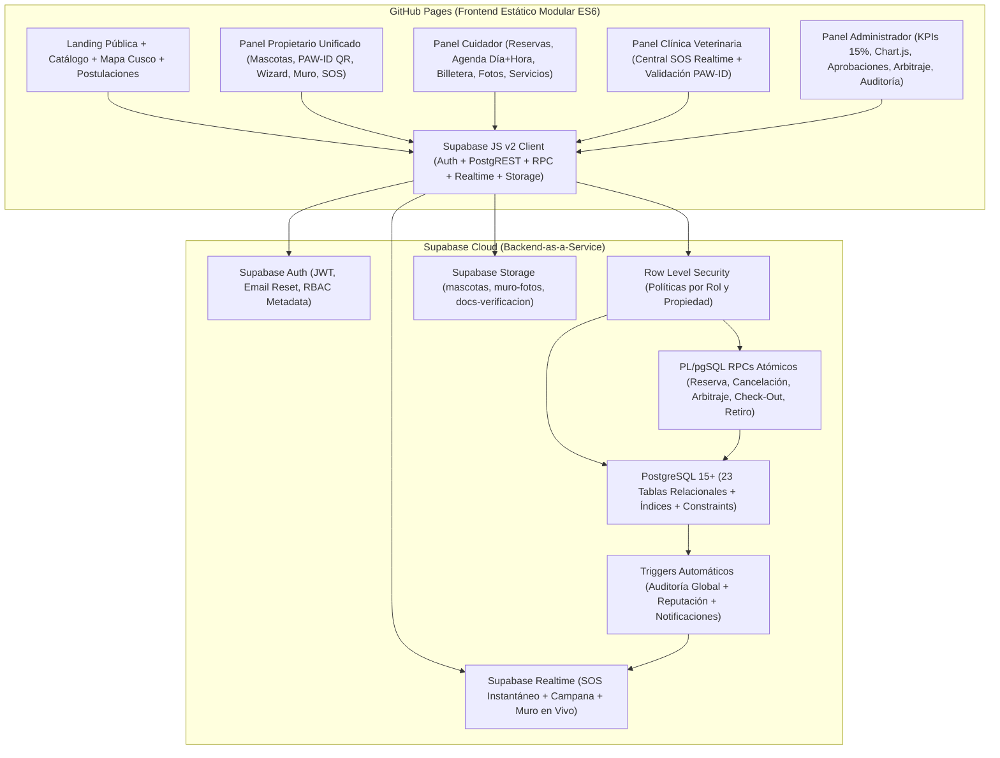
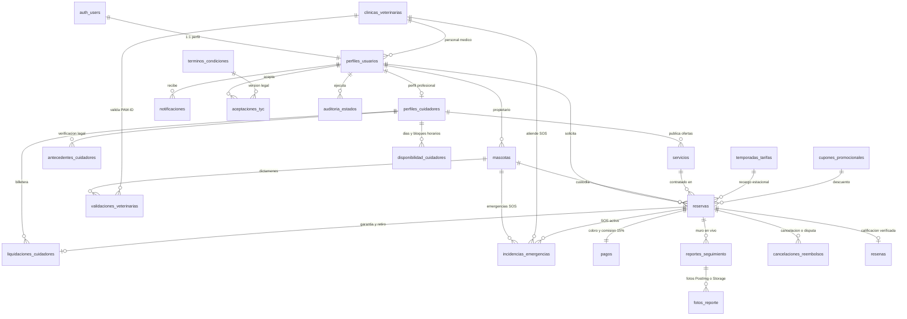

# 🐾 PLAN MAESTRO DE MIGRACIÓN — PAW PATITA CUSCO v5.0
## De Google Apps Script + Google Sheets hacia GitHub Pages (HTML5/CSS3/JS Modular) + Supabase (PostgreSQL + Auth + RLS + Realtime + Storage)

> **Repositorio Oficial:** `https://github.com/RubikAnton/pawPatita.git`  
> **Rol del Documento:** Blueprint de Arquitectura Full-Stack, Auditoría Forense y Checklist Maestro por Fases  
> **Estado de Fase 1:** ✅ Completada (Auditoría Total + Diseño de Arquitectura + Plan de Migración)  
> **Fecha:** Noviembre 2026 | **Cusco, Perú**

> [!IMPORTANT]
> **DIRECTIVA OBLIGATORIA DE AHORRO DE TOKENS PARA TODOS LOS AGENTES / CHATS SUBSECUENTES:**  
> **BAJO NINGUNA CIRCUNSTANCIA LEAS LOS ARCHIVOS LEGACY (`Codigo.gs`, `Index.html`, `BD-PAWPATITAS-v3.xlsx`, carpeta `tools/`)**.  
> Toda la auditoría forense, contratos de base de datos (23 tablas), firmas RPC (21 funciones), reglas de negocio (comisión 15%, cancelaciones escalonadas, billetera exacta, bloques horarios, protocolo SOS), arquitectura de interfaz y criterios de aceptación están **100% autocontenidos y detallados en este documento**.  
> Leer los archivos legacy quema entre 40,000 y 80,000 tokens innecesariamente en cada nuevo chat y arriesga reintroducir deuda técnica obsoleta. Todo el desarrollo de las Fases 2 a 8 se guiará exclusivamente a partir de las especificaciones de este plan y de la bitácora viva [`BITACORA_EJECUCION_V5.md`](./BITACORA_EJECUCION_V5.md).

---

## 1. Resumen Ejecutivo de la Migración (v4.0 → v5.0)

La versión actual (**v4.0**) sobre Google Apps Script (`Codigo.gs`) + Google Sheets (`BD-PAWPATITAS-v3.xlsx`) + SPA monolítica (`Index.html`) demostró la viabilidad conceptual del negocio, pero presenta **fallos críticos de integridad de contratos API/BD** (desalineación masiva de nombres de columnas y payloads entre `Codigo.gs`, `Index.html` y el Excel), además de las limitaciones estructurales de GAS (latencia de 2–5 s por llamada RPC, ausencia de transacciones ACID reales, falta de autenticación estándar con recuperación de contraseña, imposibilidad de tiempo real para alertas S.O.S. y mantenimiento insostenible en un archivo HTML de 3,429 líneas).

La migración a **Paw Patita Cusco v5.0** transforma el proyecto en una **aplicación SaaS moderna, segura y 100% gratuita de alojar**:
- **Frontend en GitHub Pages:** HTML5 semántico + CSS3 modular + JavaScript ES Modules nativo (`type="module"`, cero paso de compilación requerido), Bootstrap 5.3, Chart.js 4.4, Leaflet.js (mapa real de Cusco) y QRCode.js (carné digital PAW-ID escaneable).
- **Backend & Datos en Supabase:** PostgreSQL relacional en 3FN estricta (**23 tablas**), **Supabase Auth** (JWT + bcrypt + recuperación real de contraseña por correo), **Row Level Security (RLS)** granular por rol, **Funciones RPC en PL/pgSQL (`SECURITY DEFINER`)** para operaciones financieras/anti-overbooking atómicas, **Triggers automáticos de auditoría**, **Supabase Realtime** (alertas S.O.S., notificaciones y muro en vivo) y **Supabase Storage** (carga directa de fotos con compatibilidad total para enlaces `PostImg`).



---

## 2. Auditoría Forense Completa del Sistema Actual (v4.0)

Tras inspeccionar línea por línea `Codigo.gs` (2,440 líneas), `Index.html` (3,429 líneas), `BD-PAWPATITAS-v3.xlsx` (22 pestañas, 154 filas), `tools/seed.json` y los 5 manuales de `docs/`, se descubrió la **causa raíz sistémica**: durante la evolución a v4.0 coexistieron **dos contratos de datos incompatibles** — las secciones 1–9 de `Codigo.gs` siguen los encabezados reales del Excel, mientras que la sección 10 (Administrador) de `Codigo.gs` y gran parte de `Index.html` referencian nombres de columnas/propiedades heredados de `docs/04_DICCIONARIO_DE_DATOS_Y_ARQUITECTURA.md` que **no existen** en el Excel ni en las respuestas RPC.

### 2.1. Matriz Forense de Fallos Detectados vs. Causa Raíz Exacta

| Módulo / Área | Fallo Reportado / Detectado | Causa Raíz Exacta en v4.0 (Archivo y Línea) | Solución Definitiva en v5.0 (Supabase) |
| :--- | :--- | :--- | :--- |
| **Global RPC** | Todos los errores de negocio muestran un mensaje genérico inútil. | `Codigo.gs:311` devuelve `{ exito: false, mensaje }` pero `Index.html:1972` lee `res.error`. | Capa central `js/utils.js` + `handleSupabaseError()` que traduce errores PostgreSQL/Auth/RPC a toasts claros en español. |
| **Landing & Catálogo** | Solo muestra 3 cuidadores, datos falsos (`5.0`, `1 año`, `HU-001`, `S/ 35`), filtros de categoría y fecha no funcionan. | Seed solo tiene 3 cuidadores aprobados (`CUID-01..03`). `Index.html:2077-2097` lee `foto_perfil`, `calificacion_promedio`, `anios_experiencia`, `hu_ecode`, `tarifa_minima`, `presentacion` (el backend devuelve `foto_url`, `reputacion`, `experiencia`, `tarifa_min`, `servicios[]`). `aplicarFiltrosCatalogo()` (`Index.html:2119`) ignora `filtro-categoria` y `filtro-fecha`. | Vista SQL `v_catalogo_cuidadores` con 6+ cuidadores aprobados en seed, filtros reales combinados (distrito, servicio, fecha/disponibilidad, modalidad, ordenamiento) + mapa Leaflet de Cusco. |
| **Landing Clínicas & Postulación** | Clínicas hardcodeadas en HTML; no existe formulario público para postular como Clínica Veterinaria. | `Index.html:511-551` tiene 3 cards fijas; `apiInfoPublica()` nunca se invoca. El Excel incluso tiene `VET-05` + `USR-10` en estado `Pendiente`, sin UI de postulación ni aprobación. | Directorio dinámico desde `clinicas_veterinarias` (`estado_afiliacion = 'activa'`) + modal público **"Postular como Clínica Veterinaria Aliada"** con RUC, CMVP, horario 24h y TyC. |
| **Auth & Registros** | Falta "Olvidé mi contraseña"; existe rol absurdo *"Cuidador Pendiente"* con panel vacío; registros de Propietario y Cuidador fallan. | `Index.html:323` ofrece login demo para `lucia@gmail.com`; `apiRegistrarCuidador` (`Codigo.gs:876`) crea `estado_cuenta: 'Activo'` en vez de `'Pendiente'`. Además `Index.html:2201-2233` envía `num_documento`, `acepto_tyc`, `policial_url`, `domicilio_url` mientras `Codigo.gs:828-861` exige `num_doc`, `acepta_tyc`, `doc_identidad_url`, `doc_policial_url`, `doc_penal_url`, `tarifa`. | Supabase Auth real con `resetPasswordForEmail()` + pantalla de restablecimiento. Bloqueo de acceso en login si `estado_cuenta IN ('pendiente','rechazado','suspendido')`. Eliminación total del rol/panel "Cuidador Pendiente". |
| **Propietario Unificado** | Panel vacío *"Propietario Turista"* dividido del Local; gastos y servicios mal mostrados en tabla. | Separación artificial Local/Turista en menú demo y vistas. `Index.html:2437,2462` lee `r.monto_total` y `r.servicio_categoria`, pero `vistaReserva()` devuelve `r.total` y `r.servicio`. | **Un solo rol `propietario`** con selector editable en perfil (Local/Turista, DNI/CE/Pasaporte, país, idioma, hotel en Cusco) y toggle de moneda PEN/USD. |
| **Mascotas & Carné PAW-ID** | Múltiples `undefined` (edad, PAW-ID, estado sanitario, observaciones); guardar mascota pierde campos; carné no imprimible ni tiene QR. | `vistaMascota()` (`Codigo.gs:902`) retorna `{ paw_id, edad, estado_validacion, observacion }`, pero `Index.html:2346-2392` lee `paw_patita_id`, `edad_anios`, `estado_validacion_vet`, `condiciones_medicas`, y compara con `'Validada'` (BD usa `'Validado'`). `ejecutarGuardarMascota` envía claves distintas a las que lee `Codigo.gs:923-929`. | CRUD completo (Crear/Editar/Archivar), `fecha_nacimiento` con cálculo dinámico de edad (años y meses), vista e impresión profesional de **Carné PAW-ID con código QR escaneable** (`#/paw-id/PAW-XXXX`). |
| **Reservar, Cancelar, Disputa y Reseña** | No se puede reservar desde catálogo; cancelación muestra `undefined h` y `S/ 0.00`; calificar falla siempre. | `Index.html:2525` hardcodea `id_oferta = 'OFE-001'` (inexistente; reales son `OF-101..107`) y `ejecutarCreacionReserva` omite `acepta_tyc: true` y `numero_operacion`. `abrirCancelacionPropietario` (`Index.html:2721`) lee `horas_anticipacion`, `monto_reembolso`, `monto_penalidad` (backend retorna `horas`, `reembolso`, `penalidad_total`). `ejecutarCalificacion` envía `calificacion_estrellas` y backend exige `puntualidad`, `comunicacion`, `cuidado`. | Selector real de servicio/oferta del cuidador + bloque horario en Wizard de 4 pasos. RPCs atómicos `rpc_cotizar_reserva`, `rpc_crear_reserva`, `rpc_preview_cancelacion`, `rpc_cancelar_reserva`, `rpc_abrir_disputa` y `rpc_publicar_resena` (estrellas globales + 3 dimensiones). |
| **Muro de Fotos en Vivo** | Siempre aparece vacío para el propietario; cuidador no puede publicar fotos. | `apiPropMuro` devuelve `{ posts: [...] }` con `fotos[]`, pero `Index.html:2481` lee `res.reportes` y `rep.foto_url`. `enviarReporteCuidador` (`Index.html:2995`) envía `{ foto_url, nota_estado }` y `apiCuidReporte` (`Codigo.gs:1535`) exige `{ fotos: [], nota }`. | Consulta relacional `reportes_seguimiento` + `fotos_reporte` ordenada cronológicamente, soporte para múltiples fotos (`PostImg` + subida directa a Supabase Storage) y actualización en vivo con Realtime. |
| **Alerta S.O.S.** | Emisión de S.O.S. siempre falla y no hay seguimiento para el propietario. | `ejecutarAlertaSOS` (`Index.html:3404`) envía `gravedad` (`Media/Alta/Crítica`) sin `id_clinica`; `apiCrearSOS` (`Codigo.gs:1238-1241`) exige `nivel_severidad` (`Leve/Moderada/Crítica`) e `id_clinica` obligatorio. | RPC `rpc_emitir_sos` con selección de clínica (auto-sugiriendo la 24h más cercana en Cusco), notificación Realtime inmediata a **Clínica + Admin + contraparte**, y panel de seguimiento de estados (`Emitida` → `En Atención` → `Estabilizada` → `Resuelta`). |
| **Cuidador: Reservas** | Botón **Aceptar Reserva** falla siempre; monto neto sale `S/ 0.00`; ver ficha de mascota da error de permisos. | `Index.html:2818` envía `accion = 'confirmar'` y `Codigo.gs:1335` espera `'aceptar'`. `Index.html:2833` lee `r.monto_neto` (backend devuelve `r.neto`). `verFichaMascotaCuidador` llama `verHistorialMascota` que exige rol `Propietario`. | RPC `rpc_cuidador_responder_reserva('aceptar' | 'rechazar')` con modal de motivo obligatorio al rechazar, Check-In/Check-Out con checklist, y modal dedicado de Ficha PAW-ID accesible por RLS al cuidador asignado. |
| **Cuidador: Agenda y Cupos** | Muestra `0/undefined`, desbloquear falla, no permite navegar meses ni configurar bloques horarios. | `Index.html:2899` lee `cupos_reservados`/`cupo_maximo` (backend devuelve `ocupados`/`cupo`) y envía `'desbloquear'` (backend espera `'liberar'`). El modelo v4.0 solo contempla día completo. | Calendario mensual navegable con **selección de día + configuración de bloques horarios exactos** (`08:00-12:00`, `14:00-18:00`, `18:00-22:00`, `Todo el día` o rango personalizado) y cupo por fecha/bloque. |
| **Cuidador: Billetera** | Historial lleno de `undefined`; retiro con BCP/Interbank/BBVA falla; "Total Histórico Cobrado" nunca sube cuando Admin paga. | `Index.html:2945-2951` lee `id_liquidacion`, `monto_liquidado`, `estado_liquidacion`, `numero_operacion_pago` (backend devuelve `id`, `monto`, `estado`, `operacion`). `apiCuidSolicitarRetiro` solo acepta `Yape/Plin/CCI`. `apiAdminLiquidar` guarda `'Pagado'` pero `totalesBilletera()` (`Codigo.gs:1280`) suma solo `'Liquidado'`. | Estados canónicos unificados (`en_garantia`, `disponible`, `solicitado`, `pagado`, `rechazado`, `anulado`), soporte para Yape/Plin/CCI/BCP/Interbank/BBVA y recálculo automático vía vista SQL `v_billetera_cuidador`. |
| **Clínica Veterinaria** | No muestra nombre de clínica en cabecera; Central SOS y tabla PAW-ID llenos de `undefined`; enlace de cartilla roto (`#`); botones Validar/Observar fallan. | `Index.html:3032-3046` lee `estado_alerta`, `id_incidencia`, `gravedad`, `mascota_nombre`, `propietario_nombre` (backend devuelve `estado`, `id`, `severidad`, `mascota`, `propietario`). `Index.html:3101-3126` lee `paw_patita_id`, `edad_anios`, `propietario_nombre`, `enlace_vacunas_postimg` y envía `{ accion, dictamen }` mientras `apiVetValidarFicha` exige `{ resultado, vacunas, vigencia, observaciones }`. | Cabecera destacada con nombre, distrito, horario 24h y estado de la clínica autenticada. Central SOS Realtime con modal clínico profesional (Tomar → Estabilizar → Resolver con diagnóstico/tratamiento/costo). Visor real de cartilla (lightbox + nueva pestaña) y modal estructurado Validar/Observar. |
| **Admin: Dashboard & Gráficos** | Comisión 15% siempre `S/ 0.00`; gráfico de distritos colapsa todo en `'Cusco'`. | `Codigo.gs:1798` filtra `estado_pago === 'Completado'` (los pagos reales son `'Aprobado'`). `Codigo.gs:1835` lee `u[d].distrito` en vez de `u[d].distrito_cusco`. | RPC analítico `rpc_admin_dashboard_metrics()` que calcula en SQL en tiempo real ingresos brutos, comisión exacta del 15%, neto a cuidadores, reembolsos, SOS activos, postulantes pendientes (cuidadores + clínicas) y series reales por distrito específico de Cusco y categoría. |
| **Admin: Cuidadores, Clínicas, Cancelaciones, Liquidaciones y Auditoría** | `undefined` masivos en distrito, enlaces documentales, tabla de cancelaciones y botones ausentes; no hay UI para aprobar/crear clínicas; liquidación no guarda N° operación; auditoría muestra `'Sistema'` sin detalle. | Sección 10 de `Codigo.gs` usa ~20 nombres de columnas inexistentes (`distrito`, `enlace_comprobante_policial_postimg`, `solicitado_por_usuario`, `estado_reembolso`, `monto_reembolso_estimado`, `numero_operacion_pago`, `hoyIso()`). `Index.html:3368` lee `rol_usuario`/`motivo_cambio` en vez de `actor_rol`/`detalle_motivo`. Sin pestaña de Clínicas en `Index.html`. | Esquema único PostgreSQL + pestaña unificada **Cuidadores & Clínicas Veterinarias** (aprobar/rechazar/crear clínica con cuenta), tabla completa de **Cancelaciones y Disputas** con modal de arbitraje, **Liquidaciones** conectadas a saldos reales con N° operación bancaria y **Bitácora Global automática por triggers**. |

---

## 3. Iniciativa del Arquitecto: Qué Eliminar, Qué Mejorar y Qué Agregar

### 3.1. Qué ELIMINAR (Deuda Técnica y Redundancias)
1. **División de Roles *Propietario Local* vs. *Propietario Turista*:** Se elimina por completo el panel duplicado/vacío de turista. El origen (`Local` vs `Turista`), documento (`DNI`/`CE`/`Pasaporte`), país, idioma y hotel pasan a ser atributos editables del único perfil **Propietario**.
2. **Rol / Acceso *"Cuidador Pendiente"*:** Se elimina del selector demo y se prohíbe el acceso al panel para cualquier usuario con `estado_cuenta != 'activo'` (tanto cuidadores como clínicas postulantes). Al intentar iniciar sesión ven una pantalla clara de estado de revisión; al ser aprobados por el Admin, ingresan directamente con la contraseña que registraron.
3. **Limitaciones y Hacks de Google Apps Script:**
   - Adiós a la restricción ES5 (se habilita ES2022+ limpio: `async/await`, `?.`, `??`, módulos ES6).
   - Adiós a `LockService`, `CacheService`, `_memo`, `siguienteId()` en hojas y hashing manual `SHA-256('PAW::')`.
   - Adiós al archivo monolítico `Index.html` de 3,429 líneas y al compilador `tools/construir_index.py`.
4. **Diálogos Nativos `prompt()` / `confirm()` / `alert()`:** Se eliminan en todos los paneles y se reemplazan por modales Bootstrap 5 con validaciones de formulario y confirmación segura.
5. **Datos Hardcodeados en Frontend:** Eliminación de tarjetas estáticas de clínicas en la landing, `OFE-001` fijo en el wizard, y textos "Conectando con Google Apps Script & Sheets".
6. **Inconsistencias de Vocabulario en BD:** Se eliminan dualidades como `Validado`/`Validada`, `Liquidado`/`Pagado`, `edad_anos`/`edad_anios`, `Gravedad`/`Severidad`, `Sí`/`No` en texto (reemplazados por `BOOLEAN` nativo en PostgreSQL).

### 3.2. Qué MEJORAR (Arquitectura, Seguridad y UX)
1. **Transaccionalidad ACID Real con PL/pgSQL:** Las operaciones críticas (reservar con verificación anti-overbooking por fecha+bloque horario, cancelar con cálculo escalonado, check-out con liberación de garantía, solicitar retiro, aprobar pago con N° de operación, arbitrar disputa) se ejecutan como **RPCs atómicos en PostgreSQL** con `FOR UPDATE` row-level locks. Cero condiciones de carrera y cero manipulación desde el navegador.
2. **Seguridad Cero-Confianza (Supabase Auth + RLS):** GitHub Pages solo contiene `SUPABASE_URL` y `SUPABASE_ANON_KEY` (pública por diseño). Toda autorización se aplica a nivel de motor PostgreSQL con políticas RLS estrictas por `auth.uid()` y rol verificado.
3. **Multimedia Híbrida (Supabase Storage + PostImg):** Los usuarios pueden **subir imágenes directamente desde su celular/PC** (con compresión client-side <1 MB y previsualización) a buckets de Supabase Storage O pegar un enlace directo de `PostImg`, manteniendo compatibilidad con el historial existente y fallback `onerror`.
4. **Agenda Evolucionada por Días Y Bloques Horarios:** El cuidador puede configurar su plantilla semanal y, al hacer clic en cualquier día del calendario mensual, activar/bloquear o asignar cupos a bloques exactos:
   - `Mañana (08:00 - 12:00)`
   - `Tarde (14:00 - 18:00)`
   - `Noche (18:00 - 22:00)`
   - `Todo el día (08:00 - 20:00)`
   - `Horario personalizado (hora_inicio - hora_fin)`
5. **Carné Digital PAW-ID de Grado Real:** Calcula edad exacta dinámicamente desde `fecha_nacimiento` (ej. *"2 años y 4 meses"* o *"7 meses"*), muestra sello oficial de la clínica validadora con fecha de vigencia, incrusta un **código QR real**, incluye botón **"Imprimir / Guardar PDF"** (`@media print`) y permite escaneo público seguro.
6. **Tiempo Real en Alertas S.O.S. y Notificaciones:** Suscripciones **Supabase Realtime** sobre `incidencias_emergencias`, `notificaciones` y `reportes_seguimiento` para que una emergencia S.O.S. dispare una alerta visual instantánea en la Clínica Veterinaria y en el panel de Administrador sin recargar la página.

### 3.3. Qué AGREGAR (Nuevas Funcionalidades CRUD y Capacidades SaaS Cusco)
1. **Operaciones CRUD Esenciales Faltantes:**
   - **Propietario:** Edición de perfil completo (Local/Turista, DNI/Pasaporte, hotel, contacto de emergencia), **Edición y Baja lógica de Mascotas**, visor/impresión de **Comprobante de Pago (Boleta/Factura)**, y sección dedicada **"Mis Alertas S.O.S."** con línea de tiempo de atención veterinaria.
   - **Cuidador:** Pestaña **"Mi Perfil y Servicios"** (CRUD completo de modalidades de servicio: Paseo, Hospedaje, Guardería, Domicilio Turístico, tarifas, recojo en hotel, pausa/activación), **Respuesta pública a reseñas**, **Checklist de seguridad en Check-In / Check-Out**, y gráfico de ingresos mensuales en su billetera.
   - **Clínica Veterinaria:** Formulario público de **Postulación de Clínica Aliada**, pestaña de **Historial de Validaciones PAW-ID** (validadas y observadas, no solo pendientes), y **Configuración de Sede** (teléfono 24h, horarios, tarifa de urgencia, especialidades).
   - **Administrador:** Gestión completa de **Clínicas Veterinarias** (aprobar/rechazar postulantes + **registrar nuevas clínicas directamente con credenciales listas**), **Central Global S.O.S.** (con capacidad de **reasignar** un caso crítico si una clínica no responde), **Modal de Arbitraje de Disputas** (decidir % exacto de reembolso al propietario vs. pago al cuidador), **Gestor de Cupones, Temporadas Turísticas de Cusco, TyC y Parámetros Globales** (`comision_pct`, `tipo_cambio_usd`), y **Exportación a CSV** de auditoría y reportes financieros.
2. **Funcionalidades Avanzadas de Alto Valor (Diferenciadores SaaS & Académicos):**
   - **Mapa Interactivo de Cusco (`Leaflet.js` + OpenStreetMap, 100% gratuito sin API Key):** Visualiza cuidadores aprobados (pin aproximado por distrito para privacidad) y Clínicas Veterinarias Aliadas 24h en Cusco Centro, Wanchaq, San Sebastián, San Jerónimo, Santiago y San Blas; durante un S.O.S., calcula automáticamente la clínica 24h más cercana por distancia geodésica.
   - **Ruta Pública de Escaneo QR para Mascota Extraviada (`#/paw-id/PAW-6858`):** Cualquier persona o veterinario en Cusco que escanee el QR del collar/carné ve una ficha pública segura (foto, nombre, raza, alergias, clínica validadora, estado sanitario y botón de llamada/WhatsApp de emergencia al dueño, ocultando dirección exacta y DNI).
   - **Centro de Notificaciones In-App con Campana Realtime:** Contador de no leídas, lista desplegable y marcado como leídas en los 4 roles.
   - **Botón de Coordinación Directa por WhatsApp (`wa.me/51...`):** Se habilita exclusivamente cuando una reserva está en estado `Confirmada` o `En Curso` (protege la desintermediación antes del pago).
   - **Accesos Demo Rápidos Limpios (Solo 4 Roles Activos):** Selector discreto en el login para evaluación académica/comercial con los 4 perfiles reales operativos (Propietario, Cuidador Aprobado, Clínica Veterinaria y Administrador), eliminando los 2 accesos rotos/redundantes de v4.0.

---

## 4. Arquitectura de Archivos Limpia para GitHub Pages

El despliegue en GitHub Pages funcionará directamente desde la rama `main` (raíz `/`) sin necesidad de bundlers ni Node.js en producción, usando **ES Modules nativos** (`<script type="module" src="./js/app.js"></script>`). Los archivos legacy de Google Apps Script se preservarán archivados en `legacy-gas/` durante la Fase 8 (sin perder historial git).

```text
paw-patita-cusco/
├── index.html                        # Entrypoint SPA único (GitHub Pages)
├── PLAN_MIGRACION_SUPABASE.md        # Plan Maestro vivo y checklist por fases
├── BITACORA_EJECUCION_V5.md          # Bitácora técnica viva de ejecución y trazabilidad
├── README.md                         # Documentación v5.0 (arquitectura, credenciales demo y despliegue)
├── .nojekyll                         # Evita procesamiento Jekyll en GitHub Pages
│
├── css/
│   ├── main.css                      # Variables de diseño (paleta Cusco), resets, layout base y navbar
│   ├── auth.css                      # Modales y formularios de login, registro y postulaciones
│   ├── catalogo.css                  # Tarjetas de cuidadores, filtros interactivos y popups Leaflet
│   ├── paneles.css                   # Dashboards para Propietario, Cuidador, Veterinaria y Admin
│   └── print.css                     # Estilos @media print para Carné Digital PAW-ID y comprobantes
│
├── js/
│   ├── config.js                     # SUPABASE_URL, SUPABASE_ANON_KEY, constantes Cusco (distritos, bloques)
│   ├── supabase-client.js            # Cliente Supabase singleton (Auth, DB, Storage, Realtime)
│   ├── router.js                     # Enrutador cliente SPA basado en hash con guardias por rol
│   ├── utils/
│   │   ├── formatters.js             # Formato de fechas en español, moneda (S/ y $ USD), edad dinámica
│   │   └── ui-helpers.js             # Toasts, alertas accesibles, modales dinámicos y sanitización XSS
│   ├── auth/
│   │   ├── auth.js                   # Login, logout, sesión persistente, recuperación de contraseña
│   │   └── postulaciones.js          # Formularios de postulación pública (Propietarios, Cuidadores, Clínicas)
│   ├── public/
│   │   ├── landing.js                # Hero, testimonios, propuesta de valor, CTA
│   │   ├── catalogo.js               # Catálogo completo con filtros reactivos (distritos Cusco, servicios, precio)
│   │   ├── mapa-cusco.js             # Mapa interactivo Leaflet.js de cuidadores y clínicas en Cusco
│   │   └── paw-id-publico.js         # Vista pública segura de emergencia para carné escaneado por QR
│   ├── components/
│   │   ├── carnet-digital.js         # CRUD mascotas, edad dinámica, visor cartilla y QRCode.js
│   │   ├── wizard-reserva.js         # Asistente de reserva en 4 pasos con cotización en tiempo real
│   │   ├── calendario-agenda.js      # Calendario por días y bloques horarios (08-12, 14-18, 18-22, etc.) con cupos
│   │   ├── muro-fotos.js             # Galería cronológica privada de reportes y fotos
│   │   ├── alerta-sos.js             # Emisión, geolocalización y seguimiento de emergencias veterinarias
│   │   ├── billetera-cuidador.js     # Billetera con desglose (garantía, disponible, histórico) y retiros
│   │   └── chart-dashboard.js        # Gráficos Chart.js para Administrador (distritos Cusco, servicios)
│   └── roles/
│       ├── propietario.js            # Panel Propietario Unificado (Resumen, Mascotas, Reservas, Muro, SOS, Perfil)
│       ├── cuidador.js               # Panel Cuidador (4 secciones core: Reservas, Agenda, Billetera, Muro)
│       ├── veterinaria.js            # Panel Clínica Veterinaria (Cabecera sede, Central SOS, Validación PAW-ID)
│       └── administrador.js          # Panel Administrador (Dashboard 15%, Cuidadores/Vets, Disputas, Liquidaciones, Auditoría)
│
├── supabase/
│   ├── 01_schema.sql                 # 23 tablas relacionales en 3FN, constraints, índices
│   ├── 02_functions_triggers.sql     # Triggers de auditoría a auditoria_estados, reputación, secuencias
│   ├── 03_rpc_business.sql           # RPCs transaccionales atómicos (cotizar, reservar, cancelar, arbitrar, SOS, liquidar)
│   ├── 04_rls_policies.sql           # Políticas Row Level Security para las 23 tablas y roles
│   ├── 05_storage_buckets.sql        # Buckets (mascotas, muro, documentos, comprobantes) y políticas
│   ├── 06_seed.sql                   # Semilla Cusco realista (cuidadores, clínicas, mascotas, reservas)
│   └── README_SETUP_SUPABASE.md      # Guía paso a paso de ejecución en Supabase
│
├── tests/
│   ├── sql_integrity_checks.sql      # Aserciones de integridad SQL ejecutables en Supabase
│   └── e2e_verification_checklist.md # Matriz de verificación E2E en navegador
│
├── docs/                             # Documentación técnica y académica v5.0
└── legacy-gas/                       # (Creado en Fase 8) Archivo histórico (Codigo.gs, Index.html, BD v3, tools/)
```

---

## 5. Diseño Relacional Objetivo para Supabase (PostgreSQL + RLS + RPCs)

### 5.1. Diagrama Entidad-Relación v5.0



### 5.2. Resumen Técnico del Esquema Relacional (`supabase/01_schema.sql`)

Todas las tablas usan `id uuid PRIMARY KEY DEFAULT gen_random_uuid()`, timestamps `timestamptz DEFAULT now()` y códigos de negocio legibles autogenerados mediante secuencias (`PAW-1001`, `RES-2026-0001`, `PAY-2026-0001`, `LIQ-2026-0001`, `SOS-2026-0001`, `VET-001`, `CUID-001`).

1. **`configuracion_plataforma`**: Parámetros vivos editables por Admin (`comision_plataforma_pct = 0.15`, `tipo_cambio_usd = 3.75`, `tarifa_bano_extra = 25.00`, `yape_oficial = '984-000-111'`).
2. **`clinicas_veterinarias`**: `id`, `codigo_clinica`, `ruc` (UNIQUE, 11 dígitos), `nombre`, `email_institucional`, `direccion`, `distrito_cusco`, `latitud`, `longitud`, `telefono_emergencia`, `horario_atencion` (`24 Horas` | `Diurno` | `Extendido`), `especialidades text[]`, `tarifa_consulta_emergencia`, `foto_fachada_url`, `constancia_url`, `colegiatura_cmvp`, `estado_afiliacion` (`pendiente` | `activa` | `rechazada` | `suspendida`), `motivo_estado`, `activa boolean`, `aprobado_por`.
3. **`perfiles_usuarios`**: `id uuid PK REFERENCES auth.users(id)`, `codigo_usuario`, `nombre`, `apellido`, `email`, `telefono`, `rol` (`propietario` | `cuidador` | `veterinaria` | `administrador`), `es_turista boolean DEFAULT false`, `tipo_documento` (`DNI` | `CE` | `Pasaporte`), `num_documento UNIQUE`, `pais_origen`, `idioma_preferido` (`ES` | `EN`), `direccion`, `distrito_cusco`, `hospedaje_hotel_cusco`, `contacto_emergencia_nombre`, `contacto_emergencia_tel`, `id_clinica_asociada`, `avatar_url`, `tyc_version_aceptada`, `estado_cuenta` (`activo` | `pendiente` | `rechazado` | `suspendido`).
4. **`mascotas`**: `id`, `paw_id UNIQUE`, `id_propietario`, `nombre`, `raza`, `fecha_nacimiento date NOT NULL` (permite edad dinámica exacta), `tamano` (`Pequeño` | `Mediano` | `Grande`), `sexo` (`Macho` | `Hembra`), `peso_kg`, `esterilizado boolean`, `vacunas_al_dia boolean`, `fecha_venc_vacunas date`, `cartilla_vacunas_url`, `alergias_restricciones`, `medicacion_actual`, `dieta_alimentacion`, `conducta_observaciones`, `foto_url`, `estado_validacion_vet` (`pendiente` | `validado` | `observado`), `id_clinica_validadora`, `observacion_veterinaria`, `activa boolean DEFAULT true`.
5. **`validaciones_veterinarias`**: Dictámenes médicos históricos de cada ficha `PAW-ID` (`resultado`: `validado` | `observado`, `vacunas_verificadas`, `vigencia_hasta`, `observaciones_medicas`, `id_clinica`, `id_usuario_vet`).
6. **`perfiles_cuidadores`**: `id`, `codigo_cuidador`, `id_usuario UNIQUE`, `presentacion_corta`, `descripcion_experiencia`, `anios_experiencia`, `especialidades text[]`, `idiomas text[]`, `tipo_vivienda`, `capacidad_max_mascotas` (`1..10`), `acepta_cachorros boolean`, `acepta_medicacion_oral boolean`, `latitud`, `longitud`, `reputacion_promedio`, `total_resenas`, `estado_postulacion` (`pendiente` | `aprobado` | `rechazado` | `suspendido`), `motivo_estado`, `foto_url`, `foto_hogar_url`, `disponibilidad_semanal text[]`, `cuenta_cobro_tipo`, `cuenta_cobro_numero`.
7. **`antecedentes_cuidadores`**: Expediente documental (`doc_identidad_url`, `doc_antecedentes_policiales_url`, `doc_antecedentes_penales_url`, `doc_domicilio_url`, `declaracion_jurada boolean`, `estado_verificacion`, `observaciones_admin`, `revisado_por`, `fecha_revision`).
8. **`servicios`**: Ofertas del cuidador (`hu_ecode UNIQUE`, `categoria`, `tipo_servicio`, `descripcion_servicio`, `tarifa_diaria_por_perro`, `incluye_recojo_hotel boolean`, `tarifa_recojo_extra`, `disponible boolean`).
9. **`disponibilidad_cuidadores`** *(Evolucionada a Días + Bloques Horarios)*:
   - `id`, `id_cuidador`, `fecha date`, `bloque_horario` (`todo_el_dia` | `manana_08_12` | `tarde_14_18` | `noche_18_22` | `personalizado`), `hora_inicio time`, `hora_fin time`, `estado_bloque` (`disponible` | `parcial` | `lleno` | `bloqueado`), `cupo_maximo int`, `cupos_reservados int`, `nota_agenda text`.
   - Índice único `(id_cuidador, fecha, bloque_horario, hora_inicio, hora_fin)` para control anti-overbooking exacto por día y franja horaria.
10. **`temporadas_tarifas`**: Temporadas de Cusco (`Inti Raymi`, `Fiestas Patrias`, `Semana Santa`, `Fin de Año`, `Temporada de Lluvias`) con `mes_dia_inicio`, `mes_dia_fin`, `factor_multiplicador`, `activa boolean`.
11. **`cupones_promocionales`**: `codigo UNIQUE`, `descripcion`, `tipo_descuento` (`porcentaje` | `monto_fijo`), `valor_descuento`, `segmento_objetivo` (`todos` | `local` | `turista`), `monto_minimo`, `fecha_inicio`, `fecha_fin`, `usos_maximos`, `usos_actuales`, `activo boolean`.
12. **`reservas`**: Transacción principal con `codigo_reserva`, `id_propietario`, `id_cuidador`, `id_oferta`, `id_mascota`, `fecha_inicio`, `fecha_fin`, `bloque_horario`, `hora_inicio`, `hora_fin`, `dias_calculados`, `tarifa_unitaria`, `subtotal_base`, `id_temporada`, `ajuste_temporada`, `id_cupon`, `descuento_cupon`, `extras_detalle`, `extras_monto`, `monto_total`, `moneda_referencial`, `estado_reserva` (`pendiente_confirmacion` | `confirmada` | `en_curso` | `finalizada` | `cancelada` | `en_disputa`), `motivo_rechazo`, `notas_propietario`, `checklist_checkin jsonb`, `checklist_checkout jsonb`, `fecha_checkin`, `fecha_checkout`.
13. **`pagos`**: `id_reserva UNIQUE`, `metodo_pago` (`Yape` | `Plin` | `Tarjeta` | `Transferencia`), `num_operacion`, `ultimos_4_digitos`, `monto_bruto`, `comision_porcentaje`, `comision_plataforma`, `monto_neto_cuidador`, `monto_reembolsado`, `penalidad_retenida`, `estado_pago` (`aprobado` | `reembolsado_total` | `reembolsado_parcial` | `en_disputa`), `tipo_comprobante`, `num_comprobante`, `fecha_pago`.
14. **`liquidaciones_cuidadores`**: Billetera unificada con estados estrictos: `en_garantia` → `disponible` → `solicitado` → `pagado` | `rechazado` | `anulado`. Incluye `tipo_concepto`, `monto_liquidado`, `cuenta_destino`, `num_operacion_desembolso`, `fecha_disponible`, `fecha_solicitud_retiro`, `fecha_liquidacion`, `aprobado_por_admin`.
15. **`cancelaciones_reembolsos`**: Tramitación de cancelaciones escalonadas y disputas (`tipo_caso`: `cancelacion_propietario` | `rechazo_cuidador` | `disputa`, `horas_anticipacion`, `regla_aplicada`, `motivo`, `porcentaje_reembolso`, `monto_reembolso`, `monto_penalidad_plataforma`, `monto_compensacion_cuidador`, `estado_tramite`: `pendiente_revision` | `procesado` | `rechazado`, `resolucion_admin`, `procesado_por`, `fecha_resolucion`).
16. **`reportes_seguimiento`** y 17. **`fotos_reporte`**: Muro privado cronológico (`tipo_evento`, `estado_animo_mascota`, `ubicacion_referencial`, `nota_estado`, `visto_por_propietario boolean` + múltiples fotos `PostImg` o `Supabase Storage`).
18. **`incidencias_emergencias`**: Protocolo S.O.S. con máquina de estados unificada (`emitida` → `en_atencion` → `estabilizada` → `resuelta`), `nivel_severidad` (`leve` | `moderada` | `critica`), `tipo_incidencia`, `descripcion`, `id_clinica_derivada`, `atendido_por_vet`, `diagnostico_clinico`, `tratamiento_aplicado`, `informe_resolucion`, `costo_atencion_ref`, `fecha_incidencia`, `fecha_atencion`, `fecha_resolucion`.
19. **`resenas`**: Calificaciones verificadas (`id_reserva UNIQUE`, `calificacion_estrellas`, `puntualidad_estrellas`, `comunicacion_estrellas`, `cuidado_estrellas`, `comentario`, `respuesta_cuidador`, `visible boolean`) + trigger que actualiza `perfiles_cuidadores`.
20. **`terminos_condiciones`** y 21. **`aceptaciones_tyc`**: Versiones legales vigentes (`General`, `Propietario`, `Cuidador`, `Veterinaria`, `Reserva`) y registro inmutable de aceptación.
22. **`auditoria_estados`**: Bitácora global inmutable poblada **automáticamente por triggers PostgreSQL** en cada inserción/transición crítica (`entidad`, `id_registro`, `accion`, `estado_anterior`, `estado_nuevo`, `actor_id`, `actor_nombre`, `actor_rol`, `detalle`, `metadata jsonb`, `created_at`).
23. **`notificaciones`**: Alertas internas Realtime (`id_usuario_destino`, `tipo`, `titulo`, `mensaje`, `referencia_id`, `leida boolean`, `created_at`).

### 5.3. Funciones RPC Transaccionales (`supabase/03_rpc_business.sql`)
- `rpc_cotizar_reserva(p_id_oferta, p_fecha_inicio, p_fecha_fin, p_bloque_horario, p_extras, p_codigo_cupon)`
- `rpc_crear_reserva(p_payload jsonb)` *(Bloqueo anti-overbooking + validación PAW-ID + pago + garantía + uso cupón + TyC + notificaciones en 1 transacción)*
- `rpc_cuidador_responder_reserva(p_id_reserva, p_accion, p_motivo)`
- `rpc_cuidador_checkin(p_id_reserva, p_checklist)` / `rpc_cuidador_checkout(p_id_reserva, p_checklist)` *(Libera garantía a saldo disponible)*
- `rpc_preview_cancelacion(p_id_reserva)` / `rpc_cancelar_reserva(p_id_reserva, p_motivo)`
- `rpc_abrir_disputa(p_id_reserva, p_motivo)` / `rpc_admin_resolver_caso(p_id_cancelacion, p_accion, p_pct_reembolso, p_resolucion)`
- `rpc_solicitar_retiro(p_cuenta_tipo, p_cuenta_numero)` / `rpc_admin_procesar_liquidacion(p_id_liquidacion, p_accion, p_num_operacion, p_motivo)`
- `rpc_emitir_sos(p_id_reserva, p_severidad, p_tipo, p_descripcion, p_id_clinica)` / `rpc_vet_actualizar_sos(p_id_incidencia, p_accion, p_diagnostico, p_tratamiento, p_informe, p_costo)` / `rpc_admin_reasignar_sos(p_id_incidencia, p_nueva_clinica)`
- `rpc_vet_dictaminar_ficha(p_id_mascota, p_resultado, p_vacunas, p_vigencia, p_observaciones)`
- `rpc_admin_aprobar_cuidador(p_id_cuidador, p_accion, p_motivo)` / `rpc_admin_aprobar_clinica(p_id_clinica, p_accion, p_motivo)`
- `rpc_admin_dashboard_metrics()` *(KPIs en tiempo real con comisión exacta del 15%, series por distrito Cusco y por categoría)*
- `rpc_obtener_paw_id_publico(p_paw_id)` *(Solo expone datos de emergencia seguros al escanear QR, sin exponer DNI ni dirección)*

### 5.4. Matriz Resumida de Seguridad RLS (`supabase/04_rls_policies.sql`)

| Tabla | Visitante (anon) | Propietario | Cuidador | Clínica Veterinaria | Administrador |
| :--- | :--- | :--- | :--- | :--- | :--- |
| `perfiles_cuidadores` / `servicios` / `disponibilidad_cuidadores` | `SELECT` solo aprobados/disponibles | `SELECT` aprobados | `ALL` en su propio perfil/servicios/agenda | `SELECT` aprobados | `ALL` |
| `clinicas_veterinarias` | `SELECT` solo `activa = true` | `SELECT` activas | `SELECT` activas | `SELECT`/`UPDATE` su propia clínica | `ALL` |
| `mascotas` | Sin acceso directo (solo vía `rpc_obtener_paw_id_publico`) | `ALL` solo propias (`id_propietario = auth.uid()`) | `SELECT` solo mascotas de sus reservas activas/pasadas | `SELECT` todas para validar/atender SOS | `ALL` |
| `reservas` / `pagos` | Sin acceso | `SELECT` propias (creación vía RPC) | `SELECT` asignadas a su `id_cuidador` | `SELECT` vinculadas a SOS derivados | `ALL` |
| `liquidaciones_cuidadores` | Sin acceso | Sin acceso | `SELECT` solo propias (retiros vía RPC) | Sin acceso | `ALL` |
| `reportes_seguimiento` / `fotos_reporte` | Sin acceso | `SELECT` / marcar visto solo de sus reservas | `SELECT` / `INSERT` solo de sus reservas `en_curso` | Sin acceso | `ALL` |
| `incidencias_emergencias` | Sin acceso | `SELECT` propias (emisión vía RPC) | `SELECT` de sus reservas (emisión vía RPC) | `SELECT` derivadas a su clínica (update vía RPC) | `ALL` |
| `auditoria_estados` | Sin acceso | Sin acceso | Sin acceso | Sin acceso | `SELECT` (inmutable; solo triggers/RPC insertan) |
| `notificaciones` | Sin acceso | `SELECT`/`UPDATE(leida)` propias | `SELECT`/`UPDATE(leida)` propias | `SELECT`/`UPDATE(leida)` propias | `SELECT`/`UPDATE(leida)` propias |

---

## 6. Plan Maestro Ejecutable por Fases (Checklist)

> **Regla de Ejecución:** Ejecuta una fase por turno o sesión para mantener la calidad de código al 100% sin saturar el contexto. Al completar cada tarea, marca `[x]` en este archivo.

---

### ✅ FASE 1: Auditoría Forense, Arquitectura Objetivo y Plan Maestro
> **Modelo Ejecutado:** *Gemini 4 Neon — Nivel Extra*  
> **Estado:** Completada en este turno.

- [x] Auditar íntegramente `Codigo.gs`, `Index.html`, `BD-PAWPATITAS-v3.xlsx`, `tools/seed.json` y `docs/`.
- [x] Cruzar los 5 bloques de fallos detectados por el usuario con las causas raíz exactas en código y esquema.
- [x] Definir estrategia de eliminación de deuda técnica, mejoras de arquitectura y nuevas capacidades SaaS Cusco.
- [x] Diseñar arquitectura de archivos modular para GitHub Pages y modelo relacional completo de 23 tablas + RPCs + RLS para Supabase.
- [x] Generar `PLAN_MIGRACION_SUPABASE.md` con checklist ejecutable y matriz de modelos recomendada.

---

### ✅ FASE 2: Infraestructura de Base de Datos en Supabase (SQL, Triggers, RPCs, RLS, Storage y Seed)
> **🤖 Modelo Ejecutado:** **Gemini 4 Argon — Nivel Medio**  
> **Estado:** Completada con éxito.

**Archivos a crear:**
- `supabase/01_schema.sql`
- `supabase/02_functions_triggers.sql`
- `supabase/03_rpc_business.sql`
- `supabase/04_rls_policies.sql`
- `supabase/05_storage_buckets.sql`
- `supabase/06_seed.sql`
- `supabase/README_SETUP_SUPABASE.md`

**Checklist de tareas:**
- [x] Crear `supabase/01_schema.sql` con las 23 tablas en 3FN, constraints `CHECK` estrictos, claves foráneas, índices de rendimiento (distrito, estado, fecha+bloque, propietario, cuidador, clínica) y secuencias de códigos (`PAW-`, `RES-`, `PAY-`, `LIQ-`, `SOS-`, `CUID-`, `VET-`, `HU-`).
- [x] Incorporar en `disponibilidad_cuidadores` soporte nativo por **fecha + bloque horario exacto** (`todo_el_dia`, `manana_08_12`, `tarde_14_18`, `noche_18_22`, `personalizado` con `hora_inicio`/`hora_fin` y `cupo_maximo`).
- [x] Incorporar en `mascotas` el campo `fecha_nacimiento` para cálculo dinámico de edad y garantizar estado sanitario canónico (`pendiente`, `validado`, `observado`).
- [x] Crear `supabase/02_functions_triggers.sql`:
  - [x] Trigger `handle_new_auth_user()` para sincronizar `auth.users` con `perfiles_usuarios` (respetando `estado_cuenta = 'pendiente'` para postulantes a Cuidador y Clínica Veterinaria).
  - [x] Triggers automáticos de **Bitácora de Auditoría Global (`auditoria_estados`)** en `reservas`, `pagos`, `liquidaciones_cuidadores`, `perfiles_cuidadores`, `clinicas_veterinarias`, `mascotas`, `incidencias_emergencias` y `cancelaciones_reembolsos`.
  - [x] Trigger de recálculo automático de `reputacion_promedio` y `total_resenas` en `perfiles_cuidadores` tras insertar/modificar `resenas`.
  - [x] Vistas optimizadas: `v_catalogo_cuidadores`, `v_billetera_cuidador`, `v_resumen_mascotas`.
- [x] Crear `supabase/03_rpc_business.sql` con todos los RPCs transaccionales atómicos:
  - [x] `rpc_cotizar_reserva` y `rpc_crear_reserva` (anti-overbooking por fecha y bloque horario, temporadas Cusco, cupones, extras, 15% comisión, 85% neto en garantía).
  - [x] `rpc_cuidador_responder_reserva`, `rpc_cuidador_checkin`, `rpc_cuidador_checkout` (liberación automática de `en_garantia` → `disponible`).
  - [x] `rpc_preview_cancelacion`, `rpc_cancelar_reserva` (>48h 100%, 24-48h 70%/15%/15%, <24h 0%/15%/85%), `rpc_abrir_disputa` y `rpc_admin_resolver_caso` (reembolso y arbitraje con % personalizado).
  - [x] `rpc_solicitar_retiro` y `rpc_admin_procesar_liquidacion` (transición estricta `solicitado` → `pagado` sumando correctamente al Total Histórico Cobrado + N° operación bancaria).
  - [x] `rpc_emitir_sos`, `rpc_vet_actualizar_sos` (`emitida` → `en_atencion` → `estabilizada` → `resuelta`), `rpc_admin_reasignar_sos` y `rpc_vet_dictaminar_ficha`.
  - [x] `rpc_admin_aprobar_cuidador`, `rpc_admin_aprobar_clinica`, `rpc_admin_crear_clinica_directa` y `rpc_admin_dashboard_metrics` (comisión real del 15% y conteos exactos por distrito de Cusco).
  - [x] `rpc_obtener_paw_id_publico` (vista segura sin datos sensibles para escaneo QR).
- [x] Crear `supabase/04_rls_policies.sql` habilitando `ALTER TABLE ... ENABLE ROW LEVEL SECURITY` en las 23 tablas con políticas completas por rol y funciones helper `get_my_role()` / `is_active_user()`.
- [x] Crear `supabase/05_storage_buckets.sql` para buckets `mascotas`, `muro-fotos`, `perfiles` (públicos de lectura, escritura autenticada) y `documentos-verificacion` (privado solo propietario/cuidador + Admin).
- [x] Crear `supabase/06_seed.sql` poblando datos realistas de Cusco (migrando y enriqueciendo los de `BD-PAWPATITAS-v3.xlsx`): **6 cuidadores aprobados** (en Cusco Centro, Wanchaq, San Sebastián, San Jerónimo, Santiago y San Blas) + **2 cuidadores pendientes**, **4 clínicas activas + 1 clínica pendiente** (`VET-05`), mascotas con `fecha_nacimiento` y `PAW-ID`, reservas en todos los estados, pagos con 15% conciliado, liquidaciones (`en_garantia`, `disponible`, `solicitado`, `pagado`), reportes fotográficos, emergencias S.O.S., cupones, temporadas y TyC v5.0.
- [x] Crear `supabase/README_SETUP_SUPABASE.md` con instrucciones claras para pegar los scripts en Supabase SQL Editor, habilitar Realtime en `incidencias_emergencias`/`notificaciones`/`reportes_seguimiento` y configurar Site URL / Redirect URLs de GitHub Pages.

**Criterio de Aceptación Fase 2:** Todos los scripts SQL se ejecutan sin errores en un proyecto limpio de Supabase y `rpc_admin_dashboard_metrics()` devuelve comisión > 0 y desglose por los 6 distritos de Cusco.

---

### ✅ FASE 3: Núcleo Frontend Modular, Sistema de Diseño, Auth Real, Recuperación y Postulaciones Públicas
> **🤖 Modelo Utilizado:** **Gemini 3.8 Flash — Nivel Medio**  
> **Justificación:** Excelente capacidad de estructuración modular ES6, estética CSS moderna y manejo riguroso de sesiones Supabase Auth y formularios con validación.

**Archivos creados:**
- `.nojekyll`
- `index.html` (shell modular limpio con Bootstrap 5.3, Bootstrap Icons y modales globales)
- `legacy-Index.html` (archivo legacy preservado intacto)
- `css/main.css`, `css/auth.css`, `css/print.css`
- `js/config.js`, `js/supabase-client.js`, `js/router.js`, `js/app.js`
- `js/utils/formatters.js`, `js/utils/ui-helpers.js`
- `js/auth/auth.js`, `js/auth/postulaciones.js`

**Checklist de tareas:**
- [x] Implementar sistema de diseño visual **"Andes Pet Care v5.0"** (`css/main.css`, `css/auth.css`, `css/print.css`) manteniendo la identidad de marca naranja/oscuro, accesibilidad WCAG AA, 100% responsivo (360px–1920px) y cumpliendo las 10 Heurísticas de Nielsen.
- [x] Configurar cliente Supabase (`js/config.js` + `js/supabase-client.js`) con placeholders claros y pantalla de diagnóstico si faltan credenciales.
- [x] Construir `js/utils/formatters.js` y `js/utils/ui-helpers.js` (cálculo de edad dinámica desde `fecha_nacimiento`, conversor PEN/USD dinámico desde `configuracion_plataforma`, escape XSS `escapeHtml()`, exportador CSV, formateadores de fecha/hora en zona `America/Lima`).
- [x] Integrar soporte de almacenamiento en `js/supabase-client.js` con soporte híbrido: subida directa con compresión de imagen a Supabase Storage O pegado de URL `PostImg`, con previsualización instantánea y fallback `onerror`.
- [x] Construir `js/utils/ui-helpers.js` con spinner global con apagado garantizado (`try/finally`), sistema de toasts en español y modales de confirmación/entrada reutilizables (0 `prompt`/`confirm`/`alert`).
- [x] Implementar `js/auth/auth.js` y `js/auth/postulaciones.js` con Supabase Auth:
  - [x] **Iniciar Sesión:** Validación de `estado_cuenta`. Si es `pendiente`, mostrar modal/aviso claro (*"Tu solicitud está en revisión; podrás ingresar con tu contraseña en cuanto el Administrador te apruebe"*) y cerrar sesión inmediatamente (**cero acceso a paneles vacíos**).
  - [x] **"Olvidé mi contraseña":** Flujo real `resetPasswordForEmail()` + vista dedicada `#/reset-password` para establecer la nueva contraseña al volver desde el enlace del correo.
  - [x] **Registro de Propietario Unificado:** Un solo formulario con toggle *"¿Eres visitante/turista en Cusco?"*, selector DNI/CE/Pasaporte, país, idioma, hotel opcional, contacto de emergencia y aceptación obligatoria de TyC v5.0.
  - [x] **Postulación como Cuidador Independiente:** Datos personales, distrito, experiencia, vivienda, capacidad, oferta inicial de servicio y tarifa, subida/URL de DNI + Antecedentes Policiales + Penales + Domicilio, **Declaración Jurada obligatoria** y TyC. Queda en `estado_cuenta = 'pendiente'`.
  - [x] **Postulación como Clínica Veterinaria Aliada (NUEVO):** Razón social, RUC (11 dígitos), dirección, distrito de Cusco, teléfono de emergencias 24h, horario, especialidades, tarifa consulta urgencia, colegiatura CMVP, constancia/foto, datos y contraseña del médico veterinario responsable + TyC. Queda en `estado_afiliacion = 'pendiente'`.
  - [x] **Selector Demo Limpio:** Solo 4 cuentas activas reales (`Propietario`, `Cuidador Aprobado`, `Clínica Veterinaria`, `Administrador`). Eliminados *Propietario Turista* y *Cuidador Pendiente*.
- [x] Implementar notificaciones Realtime en `js/supabase-client.js` y navbar con campana de notificaciones en navbar, badge de no leídas y suscripción **Supabase Realtime** (incluyendo alerta visual urgente cuando llega un S.O.S. a Vet o Admin).
- [x] Implementar `js/router.js` con rutas hash (`#/`, `#/catalogo`, `#/login`, `#/propietario`, `#/cuidador`, `#/veterinaria`, `#/admin`, `#/paw-id/:id`, `#/reset-password`).

**Criterio de Aceptación Fase 3:** ✅ Un usuario puede registrarse como Propietario, postular como Cuidador o Clínica (quedando bloqueado hasta aprobación), recuperar su contraseña por correo e iniciar sesión con cualquiera de los 4 roles activos viendo su sidebar correspondiente.

---

### ✅ FASE 4: Landing Pública, Catálogo Completo con Filtros Reales, Mapa Cusco y Verificación QR PAW-ID
> **🤖 Modelo Utilizado:** **Gemini 3.8 Flash — Nivel Medio**  
> **Estado:** Completada con Éxito.

**Archivos creados:**
- `css/catalogo.css`
- `js/public/landing.js`
- `js/public/catalogo.js`
- `js/public/mapa-cusco.js`
- `js/public/paw-id-publico.js`

**Checklist de tareas:**
- [x] Implementar `js/public/landing.js` y `js/public/catalogo.js` consultando `v_catalogo_cuidadores`:
  - [x] Renderizar **TODOS** los cuidadores aprobados (sin límites artificiales ni datos hardcodeados), mostrando foto real, distrito exacto, años de experiencia, badge `HU-XXX`, reputación real y reseñas, especialidades, idiomas, precio mínimo dinámico (PEN/USD) y servicios que ofrece.
  - [x] Implementar **filtros reales combinados**: Distrito de Cusco (`Cusco Centro`, `Wanchaq`, `San Sebastián`, `San Jerónimo`, `Santiago`, `San Blas`, `Poroy`, `Saylla`), Categoría de Servicio (`Paseo`, `Hospedaje`, `Guardería`, `Domicilio Turístico`), Fecha + Disponibilidad real (consultando `disponibilidad_cuidadores`), Toggle *"Con recojo en hotel"*, búsqueda por nombre/especialidad y ordenamiento (mejor calificados, menor tarifa, más experiencia).
  - [x] Añadir modal de **"Ver Perfil Completo del Cuidador"** con galería del hogar, lista de todos sus servicios y tarifas, reseñas verificadas con respuestas del cuidador y disponibilidad de la semana antes de pulsar "Reservar".
  - [x] Renderizar dinámicamente la sección **"Red de Clínicas Veterinarias Aliadas 24h"** desde `clinicas_veterinarias` (con teléfono clicable, especialidades, horario y CTA **"¿Tienes una veterinaria en Cusco? Postula aquí"**).
  - [x] Mostrar sección dinámica de Temporadas Turísticas activas y Política Escalonada de Cancelaciones leída desde BD.
- [x] Implementar `js/public/mapa-cusco.js` usando **Leaflet.js + OpenStreetMap**:
  - [x] Mapa interactivo centrado en la Plaza de Armas de Cusco (`-13.5167, -71.9788`) con marcadores diferenciados para Cuidadores Aprobados y Clínicas Veterinarias 24h, popups informativos con botón "Reservar" o "Llamar Emergencias", y filtro sincronizado con el catálogo.
- [x] Implementar `js/public/paw-id-publico.js` para la ruta `#/paw-id/PAW-XXXX`:
  - [x] Al abrir el enlace de un QR escaneado, invocar `rpc_obtener_paw_id_publico` y mostrar una ficha pública móvil de emergencia (foto del perro, nombre, raza, edad calculada dinámicamente, alergias/medicación crítica, sello de clínica validadora y botón directo de llamada/WhatsApp al propietario).

**Criterio de Aceptación Fase 4:** ✅ La landing muestra a todos los cuidadores aprobados (6+ en seed), filtra con precisión por distrito/servicio/fecha, renderiza el mapa de Cusco con pines reales y la ruta `#/paw-id/PAW-6858` funciona sin iniciar sesión.

---

### ✅ FASE 5: Panel Unificado de Propietario (Mascotas + PAW-ID QR + Wizard Reserva + Muro + S.O.S.)
> **🤖 Modelo Utilizado:** **Claude Opus 5.5 (Nivel Alto) + Gemini 4 Argon (Nivel Medio)**  
> **Estado:** Completada con Éxito.

**Archivos creados y actualizados:**
- `css/paneles.css`, `css/print.css`
- `js/roles/propietario.js`
- `js/components/carnet-digital.js`
- `js/components/wizard-reserva.js`
- `js/components/muro-fotos.js`
- `js/components/alerta-sos.js`
- `index.html`, `js/router.js`, `js/auth/auth.js`, `js/utils/formatters.js`, `js/utils/ui-helpers.js`

**Checklist de tareas:**
- [x] **Unificación de Propietario (`js/roles/propietario.js`):**
  - [x] Sub-pestañas limpias en sidebar: *Resumen y Reservas*, *Mis Mascotas y PAW-ID*, *Muro de Fotos en Vivo*, *Alertas S.O.S.*, *Mi Perfil* y acceso rápido al *Catálogo Completo*.
  - [x] **Mi Perfil:** Edición de nombre, teléfono, dirección, distrito, tipo/número de documento (`DNI`/`CE`/`Pasaporte`), interruptor *"Soy turista / visitante en Cusco"* (despliega país, idioma y hotel de recojo) y contacto de emergencia.
- [x] **CRUD de Mascotas y Carné Digital PAW-ID (`js/components/carnet-digital.js`):**
  - [x] Crear, editar y archivar mascotas con carga de foto y cartilla de vacunas (Supabase Storage o `PostImg`) y campo `fecha_nacimiento`.
  - [x] Eliminar el 100% de los `undefined`: edad calculada dinámicamente (ej. *"3 años, 2 meses"*), estado sanitario real (`Pendiente` / `Validado` / `Observado`), observaciones reales de la clínica y fecha de vigencia de vacunas.
  - [x] Modal **Carné Digital PAW-ID** con diseño tipo credencial oficial, **código QR real** (`QRCode.js`) apuntando a `#/paw-id/PAW-XXXX`, botón **"Imprimir / Descargar PDF"** (`window.print()` estilizado por `css/print.css`) e historial médico completo (validaciones + atenciones S.O.S.).
- [x] **Wizard de Reserva en 4 Pasos (`js/components/wizard-reserva.js`):**
  - [x] Permite reservar **cualquier cuidador y cualquiera de sus servicios** del catálogo completo (sin IDs hardcodeados).
  - [x] **Paso 1:** Selección de mascota validada (aviso claro si aún está pendiente de validación veterinaria) y selección de la oferta/servicio específico del cuidador.
  - [x] **Paso 2:** Selección de fechas + **selección de bloque horario disponible** del cuidador + extras (Baño higiénico, Recojo en hotel) + notas.
  - [x] **Paso 3:** Cotización en vivo vía `rpc_cotizar_reserva` (días, tarifa, temporada Cusco detectada, extras, validación de cupón `BIENVENIDO10`/`MACHUPICCHU15`/`CUSCO20`, total en PEN y USD).
  - [x] **Paso 4:** Pasarela simulada (Yape/Plin con QR y N° operación o Tarjeta con últimos 4 dígitos), aceptación de TyC, ejecución atómica de `rpc_crear_reserva` y apertura automática del **Comprobante Electrónico imprimible** (`js/components/carnet-digital.js`).
- [x] **Gestión de Reservas del Propietario:**
  - [x] Botón **Cancelar** con previsualización exacta vía `rpc_preview_cancelacion` (horas reales de anticipación, regla aplicada, monto reembolso y penalidad sin `undefined`) y confirmación vía `rpc_cancelar_reserva`.
  - [x] Botón **Abrir Disputa** (reservas `en_curso` o hasta 72h tras `finalizada`) con modal de motivo detallado.
  - [x] Botón **Calificar Servicio** (reservas `finalizada` no calificadas) con calificación 1–5 estrellas interactiva (General + Puntualidad, Comunicación y Cuidado) + comentario.
  - [x] Botón **Contactar por WhatsApp** habilitado en reservas `confirmada` y `en_curso`.
- [x] **Muro de Fotos en Vivo:**
  - [x] Feed cronológico privado mostrando todas las fotos (`PostImg` o Storage), tipo de evento, estado de ánimo, ubicación en Cusco, fecha/hora y nota del cuidador, filtrable por mascota/reserva, con lightbox de imagen y suscripción Realtime.
- [x] **Alertas S.O.S. (`js/components/alerta-sos.js`):**
  - [x] Reparar emisión S.O.S. vía `rpc_emitir_sos` seleccionando reserva activa, severidad (`Leve`/`Moderada`/`Crítica`), tipo de emergencia, descripción y clínica (preseleccionando la clínica 24h más cercana en Cusco).
  - [x] Notificación instantánea al **Administrador**, a la **Clínica Veterinaria** y al **Cuidador**.
  - [x] Pestaña **"Alertas S.O.S."** del propietario mostrando timeline en tiempo real de sus incidencias (`Emitida` → `En Atención` → `Estabilizada` → `Resuelta`) con diagnóstico, tratamiento y teléfono directo de la clínica asignada.

**Criterio de Aceptación Fase 5:** ✅ Flujo E2E completo del Propietario (crear mascota → ver/imprimir carné QR → reservar cualquier cuidador → ver comprobante → cancelar otra reserva con cálculo real → ver fotos en muro → emitir S.O.S. y ver su estado en vivo → calificar reserva finalizada) con 0 `undefined` y 0 errores de consola.

---

### ✅ FASE 6: Panel del Cuidador Independiente (4 Secciones Core + Agenda Horaria + Billetera Exacta + Perfil/Servicios)
> **🤖 Modelo Utilizado:** **Gemini 4 Argon — Nivel Medio**  
> **Estado:** Completada con Éxito.

**Archivos creados y actualizados:**
- `js/roles/cuidador.js`
- `js/components/calendario-agenda.js`
- `js/components/billetera-cuidador.js`
- `css/paneles.css`, `index.html`, `js/router.js`

**Checklist de tareas:**
- [x] **Sección 1 — Reservas y Clientes:**
  - [x] KPIs exactos: Solicitudes Pendientes, En Curso Hoy, Saldo Disponible para Retiro y Calificación Media real.
  - [x] Reparar **Aceptar Reserva** y **Rechazar Reserva** (modal con motivo obligatorio y reembolso automático 100% al propietario) vía `rpc_cuidador_responder_reserva`.
  - [x] Implementar **Check-In** y **Check-Out** con modal de checklist rápido de seguridad (al ejecutar Check-Out, los fondos pasan inmediatamente de `En Garantía` a `Disponible`).
  - [x] Reparar acceso a la **Ficha PAW-ID de la Mascota** desde la tabla de reservas (modal de lectura médica con alergias, dieta, medicación y contacto de emergencia del propietario sin error de permisos).
  - [x] Botón directo de **S.O.S.** y enlace de **WhatsApp** para reservas `confirmada`/`en_curso`.
- [x] **Sección 2 — Agenda y Cupos (Calendario por Días Y Bloques Horarios en `js/components/calendario-agenda.js`):**
  - [x] Navegación libre mes anterior / mes siguiente y editor visual de plantilla semanal (`Lun..Dom`).
  - [x] Al hacer clic en cualquier día del mes, abrir panel/modal de **Configuración Diaria y Horaria**:
    - [x] Elegir modo **Todo el día (08:00 - 20:00)** o configurar **Bloques Horarios Exactos** (`08:00-12:00`, `14:00-18:00`, `18:00-22:00` o bloque personalizado `hora_inicio` - `hora_fin`).
    - [x] Definir **capacidad disponible (cupos)** por bloque/fecha, ver reservas ya asignadas en ese día y bloquear/liberar fechas sin reservas activas.
  - [x] Indicadores visuales claros por celda: Disponible (verde), Parcial (azul/ámbar con `ocupados/cupo`), Lleno (rojo), Bloqueado (gris) y número de bloques configurados.
- [x] **Sección 3 — Billetera y Retiros:**
  - [x] Eliminar todos los `undefined` en tarjetas y tabla de historial de liquidaciones.
  - [x] Mostrar claramente las 4 métricas reales desde `v_billetera_cuidador`: **Saldo en Garantía** (reservas confirmadas/en curso), **Saldo Disponible para Retiro** (reservas finalizadas/compensaciones), **En Proceso de Retiro** (`solicitado`) y **Total Histórico Cobrado** (`pagado` — aumenta automáticamente en cuanto el Admin aprueba la liquidación).
  - [x] Modal de **Solicitar Retiro** compatible con `Yape`, `Plin`, `CCI`, `BCP`, `Interbank`, `BBVA` invocando `rpc_solicitar_retiro`.
  - [x] Gráfico Chart.js de ingresos netos mensuales del cuidador.
- [x] **Sección 4 — Enviar Foto al Muro:**
  - [x] Selector de reservas `en_curso`, carga de foto vía **Supabase Storage** O enlace directo **`PostImg`** (hasta 3 fotos por reporte), selector de tipo de evento, estado de ánimo, ubicación referencial en Cusco y nota de bienestar.
  - [x] Confirmar entrega inmediata al muro privado del propietario (y notificación Realtime).
- [x] **Sección Extra (Iniciativa) — Mi Perfil, Servicios y Reseñas:**
  - [x] CRUD de servicios del cuidador (crear/editar/pausar ofertas de Paseo, Hospedaje, Guardería, Domicilio Turístico, tarifa diaria y recojo en hotel).
  - [x] Visualización de reseñas recibidas con formulario para emitir respuesta pública.

**Criterio de Aceptación Fase 6:** ✅ El cuidador acepta/rechaza reservas sin errores, configura bloques horarios exactos en días específicos del calendario, envía fotos que aparecen al instante en el muro del propietario y solicita un retiro cuyo historial y saldos cuadran al céntimo.

---

### ✅ FASE 7: Panel de Clínica Veterinaria Aliada + Panel de Administrador de Red Completo
> **🤖 Modelo Utilizado:** **Gemini 4 Argon — Nivel Alto**  
> **Estado:** Completada con Éxito.

**Archivos creados y actualizados:**
- `js/roles/veterinaria.js`
- `js/roles/administrador.js`
- `js/components/chart-dashboard.js`
- `js/router.js`

**Checklist de tareas — Panel de Clínica Veterinaria Aliada (`js/roles/veterinaria.js`):**
- [x] **Cabecera Identificatoria:** Mostrar visiblemente en la cabecera del panel y sidebar el **nombre oficial de la clínica autenticada**, distrito de Cusco, badge de horario (`24 Horas` / `Diurno`) y teléfono de emergencias.
- [x] **Sección 1 — Central S.O.S. (Realtime):**
  - [x] Corregir el 100% de los `undefined` (código SOS, severidad, mascota + PAW-ID + alergias, propietario + teléfono, cuidador + teléfono, descripción y hora exacta).
  - [x] Suscripción Realtime a nuevas alertas derivadas a su clínica (alerta visual destacada).
  - [x] Flujo clínico completo mediante modales (sin `prompt()`): **Tomar Caso** (`Emitida` → `En Atención`), **Estabilizar** (`En Atención` → `Estabilizada` con tratamiento inicial) y **Registrar Diagnóstico y Alta** (`Resuelta` con diagnóstico clínico, tratamiento aplicado, informe de alta y costo referencial).
- [x] **Sección 2 — Validar Fichas PAW-ID:**
  - [x] Corregir `undefined` en `PAW-ID`, edad dinámica real y nombre + teléfono real del propietario.
  - [x] Reparar visor de cartilla de vacunación (modal lightbox con zoom + botón abrir en nueva pestaña).
  - [x] Hacer funcionar al 100% los botones **Validar** (modal con vacunas verificadas + fecha de vigencia + observaciones opcionales) y **Observar** (modal con observaciones obligatorias) vía `rpc_vet_dictaminar_ficha`.
  - [x] Filtro de pestaña entre *Pendientes de Validación* e *Historial Auditado (Validadas / Observadas)*.
- [x] **Ajuste Rápido de Perfil Clínico:** Permitir actualizar teléfono 24h, horario, tarifa de urgencia y especialidades.

**Checklist de tareas — Panel de Administrador de Red (`js/roles/administrador.js`):**
- [x] **Sección 1 — Dashboard Ejecutivo y Gráficos (`Chart.js`):**
  - [x] KPIs reales desde `rpc_admin_dashboard_metrics()`: **Ingresos Brutos**, **Comisión Real del 15%** (corregida de `S/ 0.00`), **Neto Cuidadores (85%)**, **Reembolsos Procesados**, **Postulantes Pendientes** (Cuidadores + Clínicas) y **Alertas S.O.S. Activas**.
  - [x] Gráfico de Barras real por **distritos específicos de Cusco** (*Cusco Centro, Wanchaq, San Sebastián, San Jerónimo, Santiago, San Blas*, etc.).
  - [x] Gráfico Doughnut real por **categoría de servicio** (*Paseo, Hospedaje, Guardería, Domicilio Turístico*) + gráfico de estado de reservas.
- [x] **Sección 2 — Gestión de Cuidadores y Clínicas Veterinarias:**
  - [x] Sub-vista **Cuidadores:** Corregir `undefined` en distrito y enlaces de documentos (DNI, policiales, penales, domicilio); aprobar o rechazar con motivo obligatorio; suspender/reactivar cuidadores aprobados.
  - [x] Sub-vista **Clínicas Veterinarias (NUEVO):** Listar solicitudes pendientes (aprobar/rechazar clínica y activar automáticamente la cuenta de su veterinario), listar clínicas afiliadas con métricas de SOS atendidos y modal **"Registrar Nueva Clínica Veterinaria"** directamente desde Admin.
- [x] **Sección 3 — Cancelaciones, Reembolsos y Disputas:**
  - [x] Corregir todos los `undefined` de la tabla (código reserva, solicitante, tipo caso, horas de anticipación, regla escalonada, reembolso, penalidad y estado).
  - [x] Botones intuitivos con modal de resolución: **Ejecutar Reembolso** (en cancelaciones) y **Arbitrar Disputa** (selector de % de reembolso al propietario y % al cuidador + dictamen arbitral escrito).
- [x] **Sección 4 — Liquidaciones a Cuidadores:**
  - [x] Conectar a los fondos reales de la plataforma (`liquidaciones_cuidadores`), mostrando resumen de fondos en garantía vs. por pagar vs. liquidados.
  - [x] Aprobar retiros pendientes ingresando **N° de operación bancaria** (actualizando a `pagado` y reflejando inmediatamente el incremento en el *Total Histórico Cobrado* del cuidador) o rechazar con motivo devolviendo saldo a `disponible`.
- [x] **Sección 5 — Central Global S.O.S. y Configuración de Plataforma:**
  - [x] Monitor de todas las emergencias S.O.S. de Cusco con botón para **Reasignar Clínica** si un caso crítico sigue en `Emitida`.
  - [x] Gestor rápido de **Cupones Promocionales**, **Temporadas Turísticas de Cusco**, **Términos y Condiciones** y **Parámetros** (% comisión, tipo de cambio USD).
- [x] **Sección 6 — Bitácora Global de Auditoría:**
  - [x] Tabla filtrable por entidad, actor y fechas mostrando automáticamente cada acción crítica registrada por los triggers SQL (`fecha_hora`, `entidad`, `id_registro`, `estado_anterior` → `estado_nuevo`, `actor_nombre + rol`, `detalle`) + botón **Exportar CSV**.

**Criterio de Aceptación Fase 7:** ✅ La Clínica Veterinaria atiende un S.O.S. de extremo a extremo y valida/observa carnés PAW-ID sin un solo `undefined`; el Admin visualiza la comisión real del 15%, gráficos reales por distritos de Cusco, aprueba cuidadores y clínicas, procesa reembolsos/disputas, paga liquidaciones con N° operación y audita cada acción en la Bitácora.

---

### ✅ FASE 8: Verificación Integral, Suite de Pruebas, Limpieza del Repo, Documentación v5.0 y Go-Live en GitHub Pages
> **🤖 Modelo Recomendado:** **Gemini 4 Argon — Nivel Alto**  
> **Justificación:** Gran equilibrio de velocidad y rigor para auditoría cruzada de archivos, creación de pruebas de integridad SQL/E2E, archivo limpio del código legacy y actualización coherente de la documentación académica/técnica.

**Archivos a crear / actualizar:**
- `tests/sql_integrity_checks.sql`
- `tests/e2e_verification_checklist.md`
- `legacy-gas/` *(mover aquí `Codigo.gs`, `Index.html` legacy, `BD-PAWPATITAS-v3.xlsx`, `tools/` conservando historial con `git mv`)*
- `README.md` *(actualizado a v5.0: arquitectura GitHub Pages + Supabase, guía de despliegue y 4 credenciales demo)*
- `docs/01_CHANGELOG_Y_TRAZABILIDAD_CAMBIOS.md` *(agregar sección v4.0 → v5.0)*
- `docs/04_DICCIONARIO_DE_DATOS_Y_ARQUITECTURA.md` *(actualizar ERD, 23 tablas PostgreSQL, RPCs y RLS)*

**Checklist de tareas:**
- [x] Crear `tests/sql_integrity_checks.sql` con aserciones automáticas ejecutables en Supabase SQL Editor (validar 23 tablas, RLS activo en todas, cálculo 15% comisión, anti-overbooking horario, cancelación escalonada >48h/24-48h/<24h, transición de liquidación a `pagado` y registro automático en `auditoria_estados`).
- [x] Ejecutar recorrido QA de punta a punta cubriendo los 4 roles y documentar resultados en `tests/e2e_verification_checklist.md`:
  - [x] Verificar 0 textos `undefined`, `NaN` o `null` visibles en toda la UI.
  - [x] Verificar responsividad móvil (360px / 768px / 1440px) y vista de impresión del Carné PAW-ID con QR.
  - [x] Verificar seguridad: comprobar que la clave `service_role` NO existe en ningún archivo del repositorio y que un `Propietario` no puede leer tablas administrativas vía consola del navegador (bloqueado por RLS).
- [x] Mover archivos legacy de Google Apps Script a `legacy-gas/` manteniendo intacta la trazabilidad académica en Git y asegurando que la raíz tenga únicamente `index.html` (minúscula) como entrypoint de GitHub Pages.
- [x] Actualizar `README.md` y documentación clave en `docs/` reflejando **Paw Patita Cusco v5.0 (GitHub Pages + Supabase)**.
- [x] Configurar y validar publicación en **GitHub Pages** (`https://rubikanton.github.io/pawPatita/`) y verificar Redirect URLs de recuperación de contraseña en Supabase Auth.

**Criterio de Aceptación Fase 8:** ✅ Sitio publicado y funcional en GitHub Pages conectado a Supabase, 100% de pruebas SQL y E2E en verde, 0 errores en consola y documentación v5.0 al día.

---

## 7. Matriz Dual de Modelos Recomendados por Fase (Ahorro de Tokens vs. Máxima Potencia)

Para optimizar el consumo de tokens y presupuesto de cuota sin sacrificar calidad de software, dispones de dos rutas seleccionables antes de abrir cada chat:
- **🟢 Ruta A (Ahorro Máximo de Tokens / Modo Rápido):** Utiliza modelos ligeros de alta velocidad (`Gemini 3.8 Flash` o `Gemini 4 Argon`). Consume entre **60% y 80% menos tokens**, ideal si cuentas con cuotas ajustadas. Gracias a que cada tarea y contrato de datos está 100% especificado en este plan, estos modelos entregan código modular limpio y exacto.
- **🔵 Ruta B (Máxima Potencia / Razonamiento Completo):** Utiliza modelos insignia de razonamiento profundo (`Claude Sonnet 5.5`, `Claude Opus 5.5` o `Gemini 4 Neon`). Recomendado en fases con lógica relacional crítica (SQL, RPCs financieros y paneles con múltiples estados cruzados).

| Fase | Alcance Principal | 🟢 Ruta A (Ahorro de Tokens) | 🔵 Ruta B (Máxima Potencia) | Criterio de Selección |
| :---: | :--- | :--- | :--- | :--- |
| **Fase 1** | Auditoría Forense + Arquitectura + `PLAN_MIGRACION_SUPABASE.md` | `Gemini 3.8 Flash` [Alto] | `Gemini 4 Neon` [Extra] | *Completada en este turno con Gemini 4 Neon.* |
| **Fase 2** | Esquema SQL (23 tablas), RPCs, Triggers, RLS, Storage y Seed | **Gemini 4 Argon** [Medio] | **Gemini 4 Neon** [Alto] | Si buscas ahorrar tokens, Argon maneja SQL impecablemente; Neon ofrece máxima garantía matemática en RPCs. |
| **Fase 3** | Shell Frontend, CSS Modular, Supabase Auth y Postulaciones | **Gemini 3.8 Flash** [Medio] | **Claude Sonnet 5.5** [Alto] | Flash es ideal para maquetación y módulos base; Sonnet asegura pulcritud en el manejo de sesiones Auth. |
| **Fase 4** | Landing Pública, Catálogo Completo, Filtros, Mapa Leaflet y QR | **Gemini 3.8 Flash** [Bajo] | **Claude Sonnet 5.5** [Medio] | Muy bajo consumo; gran parte es HTML, Leaflet.js y lógica de filtros DOM donde Flash destaca. |
| **Fase 5** | Panel Propietario Unificado, Mascotas, Carné PAW-ID, Wizard, Muro, SOS | **Gemini 4 Argon** [Medio] | **Claude Opus 5.5** [Alto] | Wizard de 4 pasos y cálculo dinámico de edad/SOS; Argon ahorra tokens, Opus asegura cero `undefined`. |
| **Fase 6** | Panel Cuidador (4 Secciones + Calendario Días/Horas + Billetera Exacta) | **Gemini 4 Argon** [Medio] | **Claude Sonnet 5.5** [Alto] | Calendario por bloques horarios y cálculo de retiros; Argon es muy económico, Sonnet es infalible. |
| **Fase 7** | Panel Clínica Veterinaria + Administrador (Chart.js, 15%, Arbitraje) | **Gemini 4 Argon** [Alto] | **Claude Opus 5.5** [Alto] | La fase más densa en reglas de negocio; usa Argon para ahorrar tokens u Opus para perfección total. |
| **Fase 8** | Suite de Pruebas SQL/E2E, Archivo `legacy-gas/`, Docs v5.0 y GitHub Pages | **Gemini 3.8 Flash** [Medio] | **Gemini 4 Argon** [Alto] | Pruebas y documentación consumen muchos tokens de lectura; Flash es sumamente económico y eficaz. |

---

## 8. Estrategia Git y Reglas Operativas Durante la Migración

1. **Rama de Trabajo Aislada:** Al comenzar la Fase 2, se recomienda crear o trabajar sobre la rama `feat/v5-supabase-migration` para mantener la rama `main` limpia hasta superar la suite de pruebas de la Fase 8, momento en el que se fusionará con `main` para el despliegue automático en GitHub Pages.
2. **Cero Secretos en Git:** Bajo ninguna circunstancia se debe commitear la clave `service_role` ni contraseñas maestras de PostgreSQL. El archivo cliente `js/config.js` únicamente expondrá la URL pública del proyecto y la `anon_key` (public key protegida integralmente por las políticas RLS de Supabase).
3. **Regla de Inmutabilidad Legacy:** Durante las Fases 2 a 7, **ningún archivo original del proyecto** (`Codigo.gs`, `Index.html`, `BD-PAWPATITAS-v3.xlsx`, `docs/`) debe ser alterado ni eliminado. Solo en la Fase 8 se moverán ordenadamente hacia `legacy-gas/` utilizando `git mv`.
4. **Arquitectura sin Bundlers (Vanilla ES Modules):** Todo el código frontend debe ejecutarse directamente en el navegador con `<script type="module">` importando dependencias CDN (Bootstrap 5.3, Supabase JS v2, Leaflet, Chart.js, QRCode.js). Cero dependencias de Node.js, npm, Webpack o Vite en tiempo de ejecución.
5. **Idioma y Localización:** 100% en español peruano (moneda en Soles `S/`, distritos auténticos de Cusco, mensajes amables y profesionales).
6. **Convención de Commits y Trazabilidad:** Un commit por fase con formato convencional (`feat(fase-X): descripción concisa`), actualizando concurrentemente el checklist de tareas `[x]` en este documento.

---

## 9. Guía de Ejecución Multi-Chat: Prompts de Arranque Listos para Copiar y Pegar (Fase por Fase)

> **💡 Instrucción para el Usuario:**  
> Para ejecutar la migración sin saturar la ventana de contexto y optimizar el consumo de tokens, abre un **chat nuevo e independiente en Antigravity para cada fase**.  
> Elige el modelo según tu prioridad (🟢 Ruta A: Ahorro de Tokens, o 🔵 Ruta B: Máxima Potencia) y copia íntegramente el prompt correspondiente del bloque desplegable. Cada prompt contiene todo el contexto, restricciones, directiva de ahorro de tokens y la instrucción de actualizar la bitácora técnica [`BITACORA_EJECUCION_V5.md`](./BITACORA_EJECUCION_V5.md) para que el nuevo chat trabaje de forma 100% autónoma.

---

### 9.1 Prompt de Arranque para la FASE 2: Infraestructura SQL, RPCs, RLS, Storage y Seed en Supabase

```markdown
Actúa como Arquitecto de Base de Datos y Backend Lead especializado en PostgreSQL 15+ y Supabase para el proyecto "Paw Patita Cusco".

Tu objetivo en este chat es ejecutar de forma 100% autónoma y rigurosa la **FASE 2: Infraestructura de Base de Datos en Supabase** detallada en el plan maestro.

Por favor, sigue estas directrices estrictas:
1. Lee primero el archivo `PLAN_MIGRACION_SUPABASE.md` en la raíz del workspace para comprender a fondo la arquitectura, el modelo relacional de 23 tablas, los RPCs financieros/anti-overbooking, las políticas RLS y la auditoría.
2. 🚫 DIRECTIVA OBLIGATORIA DE AHORRO DE TOKENS: BAJO NINGUNA CIRCUNSTANCIA LEAS LOS ARCHIVOS LEGACY (`Codigo.gs`, `Index.html`, `BD-PAWPATITAS-v3.xlsx`, carpeta `tools/`). Toda la verdad técnica y de negocio está autocontenida en `PLAN_MIGRACION_SUPABASE.md`.
3. REGLA DE ORO: NO toques, modifiques ni elimines ningún archivo legacy.
4. Crea la carpeta `supabase/` y genera en ella los siguientes 7 archivos modulares, completamente comentados y listos para ejecutar en el SQL Editor de Supabase:
   - `supabase/01_schema.sql`: 23 tablas relacionales en 3FN estricta (`configuracion_plataforma`, `clinicas_veterinarias`, `perfiles_usuarios`, `mascotas`, `validaciones_veterinarias`, `perfiles_cuidadores`, `antecedentes_cuidadores`, `servicios`, `disponibilidad_cuidadores`, `temporadas_tarifas`, `cupones_promocionales`, `reservas`, `pagos`, `liquidaciones_cuidadores`, `cancelaciones_reembolsos`, `reportes_seguimiento`, `fotos_reporte`, `incidencias_emergencias`, `resenas`, `terminos_condiciones`, `aceptaciones_tyc`, `auditoria_estados`, `notificaciones`), tipos ENUM, UUIDs, claves foráneas (`CASCADE` en perfiles, `RESTRICT` en transacciones financieras), restricciones `CHECK` (porcentajes 0-100, montos > 0, horas fin > horas inicio) e índices en columnas de búsqueda y filtrado.
   - `supabase/02_functions_triggers.sql`: Triggers de auditoría automática hacia `auditoria_estados` (capturando `old_record` y `new_record` en jsonb), trigger de actualización automática de `reputacion_promedio` y `total_resenas` en `perfiles_cuidadores`, secuencias de códigos legibles (`PAW-XXXX`, `RES-2026-XXXX`, etc.) y vistas analíticas seguras.
   - `supabase/03_rpc_business.sql`: Funciones transaccionales atómicas con `SECURITY DEFINER` y `SET search_path = public, auth`:
     * `rpc_cotizar_reserva`: cotización con desglose (15% comisión plataforma, 85% neto cuidador, extras, recargo por cachorro/feriado Cusco y descuento de cupón).
     * `rpc_crear_reserva`: creación atómica con bloqueo `FOR UPDATE` anti-overbooking horario por bloques (`disponibilidad_cuidadores`).
     * `rpc_cuidador_responder_reserva`: aceptar/rechazar reserva (rechazo con motivo obligatorio y liberación inmediata del cupo).
     * `rpc_cuidador_checkin` / `rpc_cuidador_checkout`: check-in y check-out (este último libera el saldo de la reserva de *garantía* a *disponible para retiro*).
     * `rpc_preview_cancelacion` / `rpc_cancelar_reserva`: cálculo y ejecución de cancelación escalonada (>48h 100% reembolso / 0% penalidad; 24-48h 70% reembolso / 30% penalidad dividida entre plataforma y cuidador; <24h 50% reembolso / 50% penalidad).
     * `rpc_abrir_disputa` / `rpc_admin_resolver_caso`: arbitraje administrativo con porcentaje configurable de reembolso y dictamen formal.
     * `rpc_solicitar_retiro` / `rpc_admin_procesar_liquidacion`: solicitud de retiro del cuidador y aprobación del Admin con N° de operación bancaria (marcando `pagado` e incrementando el *Total Histórico Cobrado*).
     * `rpc_emitir_sos` / `rpc_vet_actualizar_sos` / `rpc_admin_reasignar_sos`: ciclo de vida S.O.S. (`emitida` -> `en_atencion` -> `estabilizada` -> `resuelta`) con diagnóstico, tratamiento y costo.
     * `rpc_vet_dictaminar_ficha` / `rpc_obtener_paw_id_publico`: validación médica oficial de ficha PAW-ID y vista pública segura por QR (sin exponer datos sensibles).
     * `rpc_admin_aprobar_cuidador` / `rpc_admin_aprobar_clinica` / `rpc_admin_crear_clinica_directa`: aprobación de postulaciones y alta médica directa.
     * `rpc_admin_dashboard_metrics`: KPIs en tiempo real con comisión real del 15%, series por distrito de Cusco y categorías de servicio.
     * `rpc_publicar_resena`: calificación verificada de 1 a 5 estrellas con desglose.
   - `supabase/04_rls_policies.sql`: Habilitación obligatoria de Row Level Security (`ENABLE ROW LEVEL SECURITY`) en las 23 tablas y creación de políticas granulares para perfiles `anon`, `propietario`, `cuidador`, `veterinaria` y `administrador`.
   - `supabase/05_storage_buckets.sql`: Definición de buckets (`mascotas-fotos`, `muro-fotos`, `documentos-verificacion`, `comprobantes-pago`), políticas de almacenamiento seguras y soporte para URLs externas (`PostImg`).
   - `supabase/06_seed.sql`: Datos maestros realistas de Cusco (distritos: Cusco Centro, Wanchaq, San Sebastián, San Jerónimo, Santiago; cuidadores aprobados con agenda horaria; clínicas aliadas; mascotas de prueba; y reservas con estados variados para probar métricas).
   - `supabase/README_SETUP_SUPABASE.md`: Guía paso a paso para el desarrollador sobre cómo aplicar estos scripts en Supabase, configurar variables de entorno y verificar la conexión.
5. Al finalizar:
   - Actualiza el checklist de la Fase 2 en `PLAN_MIGRACION_SUPABASE.md` marcando las casillas con `[x]`.
   - REGISTRA OBLIGATORIAMENTE tu entrada en `BITACORA_EJECUCION_V5.md` detallando: archivos creados/modificados, tablas/RPCs generados, decisiones técnicas adoptadas y advertencias para la Fase 3.
6. Muestra un resumen ejecutivo y las instrucciones exactas para que el usuario abra el siguiente chat de la Fase 3.
```

---

### 9.2 Prompt de Arranque para la FASE 3: Shell Frontend Modular, CSS Moderno, Supabase Auth y Postulaciones Públicas

```markdown
Actúa como Ingeniero Frontend Senior especializado en Arquitectura Modular JavaScript (ES Modules) y Supabase Auth para "Paw Patita Cusco".

Tu objetivo en este chat es ejecutar de forma autónoma la **FASE 3: Núcleo Frontend Modular, Shell de la Aplicación, Supabase Auth y Registro/Postulaciones Públicas**.

Por favor, sigue estas directrices estrictas:
1. Lee `PLAN_MIGRACION_SUPABASE.md` (especialmente el checklist de la Fase 3, la arquitectura de archivos en la Sección 4 y la matriz RLS).
2. 🚫 DIRECTIVA OBLIGATORIA DE AHORRO DE TOKENS: BAJO NINGUNA CIRCUNSTANCIA LEAS LOS ARCHIVOS LEGACY (`Codigo.gs`, `Index.html`, `BD-PAWPATITAS-v3.xlsx`, carpeta `tools/`). Toda la verdad técnica reside en el plan y en `BITACORA_EJECUCION_V5.md`.
3. REGLA DE ORO: NO toques ningún archivo legacy. Todo el código frontend residirá en `index.html`, `css/` y `js/`.
4. Crea y estructura los siguientes módulos limpios y responsivos:
   - `index.html`: Shell HTML5 semántico moderno con Bootstrap 5.3 CDN, Bootstrap Icons CDN, Navbar reactivo con estados dinámicos (Visitante / Propietario / Cuidador / Veterinaria / Administrador), selector de idioma (ES/EN) y moneda (S/ PEN / $ USD), contenedor de toasts y alerts accesibles, `<main id="app-content">` para renderizado dinámico de vistas y modales globales (Login, Olvidé mi Contraseña, Registro Propietario con selector DNI/Pasaporte, Postular como Cuidador, y Postular como Clínica Veterinaria Aliada con CMVP y declaración jurada).
   - `css/main.css`: Variables CSS de la marca Paw Patita (paleta Cusco: terracota, mostaza andino, verde bosque, blanco cálido), tipografías, micro-interacciones, diseño adaptable para móviles (360px) hasta escritorio (1440px).
   - `css/auth.css`: Estilos visuales pulidos para formularios de acceso, recuperación de contraseña y formularios de postulación.
   - `js/config.js`: Constantes de la plataforma (distritos de Cusco, bloques horarios, comisión 15%), endpoints CDN y cliente Supabase (`supabase.createClient(SUPABASE_URL, SUPABASE_ANON_KEY)`).
   - `js/supabase-client.js`: Módulo singleton para interactuar con Supabase (Auth, DB, Storage y canales Realtime).
   - `js/router.js`: Enrutador cliente basado en hash (`#/`, `#/catalogo`, `#/login`, `#/propietario`, `#/cuidador`, `#/veterinaria`, `#/admin`, `#/paw-id/:id`) con guardias de seguridad por rol autenticado.
   - `js/utils/formatters.js`: Formateo de fechas relativas/absolutas en español, formateo de moneda (`S/ 0.00` y `$ 0.00`), cálculo dinámico de edad de mascotas en años y meses desde `fecha_nacimiento`.
   - `js/utils/ui-helpers.js`: Toasts accesibles, alertas dinámicas, modal helper, sanitización XSS de inputs y loaders globales.
   - `js/auth/auth.js`: Lógica de autenticación completa (Login, Logout, Registro de Propietario con DNI/Pasaporte, Recuperación de Contraseña con enlace al correo, y bloqueo explícito para postulantes a cuidador no aprobados con mensaje amigable).
   - `js/auth/postulaciones.js`: Manejo de postulaciones públicas con validación estricta y carga de documentos para: Cuidadores (DNI, antecedentes, experiencia) y Clínicas Veterinarias (RUC, número de colegiatura CMVP, dirección en Cusco, servicios de urgencia, horario 24h/diurno/extendido y declaración jurada obligatoria).
5. Asegúrate de que el código use ES Modules nativos (`export` / `import`), sin pasos de compilación ni dependencias npm.
6. Al finalizar:
   - Marca con `[x]` las tareas de la Fase 3 en `PLAN_MIGRACION_SUPABASE.md`.
   - REGISTRA OBLIGATORIAMENTE tu entrada en `BITACORA_EJECUCION_V5.md` detallando archivos creados, funciones implementadas, decisiones de maquetación/seguridad y advertencias para la Fase 4.
7. Presenta el resumen ejecutivo y las instrucciones para pasar a la Fase 4.
```

---

### 9.3 Prompt de Arranque para la FASE 4: Landing Pública, Catálogo Completo con Filtros Reales, Mapa Leaflet Cusco y QR Público

```markdown
Actúa como Diseñador UI/UX y Desarrollador Frontend Senior para "Paw Patita Cusco".

Tu objetivo en este chat es ejecutar la **FASE 4: Landing Page Pública, Catálogo de Cuidadores con Filtros Reales, Mapa Interactivo de Cusco y Vista Pública de Carné PAW-ID**.

Por favor, sigue estas directrices estrictas:
1. Lee `PLAN_MIGRACION_SUPABASE.md` (revisa el checklist de la Fase 4 y las especificaciones de interfaz).
2. 🚫 DIRECTIVA OBLIGATORIA DE AHORRO DE TOKENS: BAJO NINGUNA CIRCUNSTANCIA LEAS LOS ARCHIVOS LEGACY (`Codigo.gs`, `Index.html`, etc.). Toda la verdad técnica reside en el plan y en `BITACORA_EJECUCION_V5.md`.
3. REGLA DE ORO: No alteres los archivos legacy. Todo el código nuevo reside en `css/catalogo.css` y `js/public/`.
4. Desarrolla los siguientes archivos y capacidades:
   - `css/catalogo.css`: Tarjetas de cuidadores modernas, distintivos de verificación, calificaciones con estrellas visuales, panel lateral de filtros responsivo y popups interactivos para el mapa.
   - `js/public/landing.js`: Sección Hero con llamado a la acción claro, propuesta de valor para dueños locales y turistas en Cusco, testimonios reales, directorio de clínicas aliadas de urgencia y accesos directos a postulaciones.
   - `js/public/catalogo.js`: Renderizado del catálogo completo de cuidadores aprobados (superando el límite de 3 del sistema anterior), con filtrado reactivo instantáneo por distrito de Cusco (*Cusco Centro, San Sebastián, San Jerónimo, Wanchaq, Santiago, Saylla, Poroy*), tipo de servicio (*Paseo Canino, Hospedaje Familiar, Guardería de Día, Cuidado a Domicilio Turístico*), rango de precio por día/hora y calificación mínima (estrellas).
   - `js/public/mapa-cusco.js`: Integración de Leaflet.js con OpenStreetMap centrado en Cusco (-13.5319, -71.9675), renderizado de marcadores con íconos personalizados para cuidadores y clínicas aliadas con popups interactivos ("Ver perfil y reservar").
   - `js/public/paw-id-publico.js`: Vista pública del carné digital canino escaneado vía código QR (`#/paw-id/:paw_id`), llamando al RPC seguro `rpc_obtener_paw_id_publico` (muestra foto, nombre de mascota, raza, estado sanitario, vacunas vigentes, datos de contacto de emergencia y clínica validadora, ocultando DNI y dirección privada).
5. Conecta el catálogo directamente a la base de datos de Supabase vía `supabase-client.js`.
6. Al finalizar:
   - Marca con `[x]` las tareas de la Fase 4 en `PLAN_MIGRACION_SUPABASE.md`.
   - REGISTRA OBLIGATORIAMENTE tu entrada en `BITACORA_EJECUCION_V5.md` detallando archivos creados, filtros y componentes de mapa implementados, y recomendaciones para la Fase 5.
7. Presenta el resumen ejecutivo para que el usuario proceda a la Fase 5.
```

---

### 9.4 Prompt de Arranque para la FASE 5: Panel Propietario Unificado, Mascotas CRUD, Carné PAW-ID QR, Wizard 4 Pasos, Muro y SOS

```markdown
Actúa como Ingeniero de Software Full-Stack Senior especializado en Experiencia de Usuario y Lógica Transaccional para "Paw Patita Cusco".

Tu objetivo en este chat es ejecutar la **FASE 5: Panel Unificado de Propietario (Local/Turista), Gestión de Mascotas y Carné Digital PAW-ID, Wizard de Reserva de 4 Pasos, Muro en Vivo y Emisión S.O.S.**.

Por favor, sigue estas directrices estrictas:
1. Lee `PLAN_MIGRACION_SUPABASE.md` (revisa el análisis de fallos en el rol Propietario en la Sección 2, las firmas RPC en la Sección 5.3 y el checklist de la Fase 5).
2. 🚫 DIRECTIVA OBLIGATORIA DE AHORRO DE TOKENS: BAJO NINGUNA CIRCUNSTANCIA LEAS LOS ARCHIVOS LEGACY (`Codigo.gs`, `Index.html`, etc.). Toda la verdad técnica reside en el plan y en `BITACORA_EJECUCION_V5.md`.
3. REGLA DE ORO: No toques archivos legacy. Todo el código nuevo reside en `js/roles/propietario.js`, `js/components/carnet-digital.js`, `js/components/wizard-reserva.js`, `js/components/muro-fotos.js`, `js/components/alerta-sos.js` y `css/paneles.css`, `css/print.css`.
4. Implementa con máxima calidad y cero textos `undefined`:
   - `css/paneles.css` y `css/print.css`: Estilos visuales del dashboard de usuario y hoja de estilos de impresión profesional para el carné digital PAW-ID (tamaño tarjeta de presentación o carné sanitario con QR nítido).
   - `js/roles/propietario.js`: Dashboard integral para dueños locales y turistas (eliminando la división anterior de dos roles separados; selector de origen y documento DNI/Pasaporte en perfil). Sub-vistas: Resumen, Mis Mascotas, Mis Reservas, Muro en Vivo, Alertas SOS y Mi Perfil.
   - `js/components/carnet-digital.js`: CRUD completo de mascotas con cálculo de edad en años/meses en tiempo real desde la fecha de nacimiento (adiós al fallo de edad `undefined`), subida de fotos a Supabase Storage o enlaces `PostImg`, historial clínico, cartilla de vacunación y generación de QR oficial con biblioteca QRCode.js.
   - `js/components/wizard-reserva.js`: Asistente de reserva en 4 pasos fluidos:
     * Paso 1: Selección de mascota y servicio.
     * Paso 2: Selección de fechas y bloques horarios exactos (validando disponibilidad en tiempo real con Supabase).
     * Paso 3: Cotización transparente calculada con el RPC `rpc_cotizar_reserva` (precio base, tarifa por bloque, recargo por cachorro si aplica, comisión del 15% desglosada y total).
     * Paso 4: Confirmación y pago ficticio/pasarela simulada llamando a `rpc_crear_reserva` (con actualización inmediata a `pendiente_confirmacion`).
   - `js/components/muro-fotos.js`: Galería cronológica privada de fotos y reportes enviados por el cuidador para esa reserva, con visualización lightbox y comentarios.
   - `js/components/alerta-sos.js`: Emisión inmediata de alertas veterinarias con geolocalización o dirección de emergencia en Cusco, motivo, síntomas y derivación automática a clínicas aliadas y al Administrador llamando a `rpc_emitir_sos`.
   - Acciones de reserva: Cancelación con cálculo de reembolso automático llamando a `rpc_preview_cancelacion` y `rpc_cancelar_reserva` (>48h 100%, 24-48h 70%, <24h 50%), botón para abrir disputas (`rpc_abrir_disputa`) y formulario de calificación con estrellas (1 a 5) llamando a `rpc_publicar_resena`.
5. Al finalizar:
   - Marca con `[x]` las tareas de la Fase 5 en `PLAN_MIGRACION_SUPABASE.md`.
   - REGISTRA OBLIGATORIAMENTE tu entrada en `BITACORA_EJECUCION_V5.md` detallando archivos creados, lógica de reservas/cancelaciones implementada y recomendaciones para la Fase 6.
6. Presenta el resumen ejecutivo para arrancar la Fase 6.
```

---

### 9.5 Prompt de Arranque para la FASE 6: Panel Cuidador (4 Secciones + Calendario Días/Horas + Billetera Exacta + Servicios)

```markdown
Actúa como Desarrollador Full-Stack Senior especializado en Herramientas Operativas y Billeteras Digitales para "Paw Patita Cusco".

Tu objetivo en este chat es ejecutar la **FASE 6: Panel del Cuidador (4 Secciones Operativas, Calendario Granular por Días y Bloques Horarios, Billetera y Liquidaciones Exactas y Publicación en el Muro)**.

Por favor, sigue estas directrices estrictas:
1. Lee `PLAN_MIGRACION_SUPABASE.md` (revisa minuciosamente los fallos del cuidador en la Sección 2, las firmas RPC en la Sección 5.3 y las especificaciones de la Fase 6).
2. 🚫 DIRECTIVA OBLIGATORIA DE AHORRO DE TOKENS: BAJO NINGUNA CIRCUNSTANCIA LEAS LOS ARCHIVOS LEGACY (`Codigo.gs`, `Index.html`, etc.). Toda la verdad técnica reside en el plan y en `BITACORA_EJECUCION_V5.md`.
3. REGLA DE ORO: Mantén intactos los archivos legacy. Todo el código del cuidador se modularizará en `js/roles/cuidador.js`, `js/components/calendario-agenda.js`, `js/components/billetera-cuidador.js` y hojas de estilo complementarias.
4. Desarrolla las 4 secciones clave corrigiendo de raíz los errores detectados en la versión anterior:
   - **Sección 1 — Reservas y Clientes (`js/roles/cuidador.js`):**
     * Solucionar definitivamente el botón **Aceptar Reserva** (llamando a `rpc_cuidador_responder_reserva` con acción `'aceptar'`) y **Rechazar Reserva** (con motivo obligatorio y devolución automática del cupo en agenda).
     * Ver detalles completos de la mascota cliente (acceso directo a su Carné PAW-ID validado).
     * Estados de servicio en vivo: Check-in con checklist inicial (`rpc_cuidador_checkin`) y Check-out con checklist final (`rpc_cuidador_checkout`, liberando el saldo en garantía a disponible para retiro) + botón directo de WhatsApp.
   - **Sección 2 — Agenda y Cupos (`js/components/calendario-agenda.js`):**
     * Calendario interactivo mensual y semanal que permite seleccionar fechas y configurar **bloques horarios exactos** (*08:00 - 12:00*, *14:00 - 18:00*, *18:00 - 22:00* o *Todo el día*).
     * Configuración de capacidad máxima simultánea de mascotas por bloque horario y bloqueo de días no disponibles en `disponibilidad_cuidadores`.
   - **Sección 3 — Billetera Digital y Retiros (`js/components/billetera-cuidador.js`):**
     * Eliminar todos los `undefined` en el historial de liquidaciones.
     * Desglose financiero exacto en 3 saldos: **Saldo en Garantía** (servicios en curso), **Saldo Disponible para Retiro** (servicios finalizados) y **Total Histórico Cobrado** (liquidaciones marcadas como `pagado` por el Admin).
     * Formulario de solicitud de liquidación bancaria llamando a `rpc_solicitar_retiro` (indicando banco peruano, CCI o número de cuenta y monto disponible).
   - **Sección 4 — Enviar Fotos y Reportes al Muro:**
     * Formulario rápido para seleccionar la reserva activa, cargar foto a Supabase Storage o pegar enlace `PostImg`, agregar nota de estado (ánimo, alimentación, paseos) y publicar instantáneamente en el muro privado del dueño (`reportes_seguimiento` y `fotos_reporte`).
5. Conecta todas las acciones a las tablas y RPCs de Supabase correspondientes.
6. Al finalizar:
   - Marca con `[x]` las casillas de la Fase 6 en `PLAN_MIGRACION_SUPABASE.md`.
   - REGISTRA OBLIGATORIAMENTE tu entrada en `BITACORA_EJECUCION_V5.md` detallando archivos creados, lógica horaria/financiera implementada y advertencias para la Fase 7.
7. Presenta el resumen ejecutivo para arrancar la Fase 7.
```

---

### 9.6 Prompt de Arranque para la FASE 7: Panel Clínica Veterinaria Aliada + Panel Administrador Completo (Chart.js, 15%, Arbitraje, Auditoría)

```markdown
Actúa como Ingeniero de Software Principal y Especialista en Paneles de Control Administrativos y Analítica para "Paw Patita Cusco".

Tu objetivo en este chat es ejecutar la **FASE 7: Panel de Clínica Veterinaria Aliada y Panel Maestro de Administración de Red**.

Por favor, sigue estas directrices estrictas:
1. Lee `PLAN_MIGRACION_SUPABASE.md` (revisa los fallos de clínica veterinaria y administrador en la Sección 2, las firmas RPC en la Sección 5.3 y el checklist detallado de la Fase 7).
2. 🚫 DIRECTIVA OBLIGATORIA DE AHORRO DE TOKENS: BAJO NINGUNA CIRCUNSTANCIA LEAS LOS ARCHIVOS LEGACY (`Codigo.gs`, `Index.html`, etc.). Toda la verdad técnica reside en el plan y en `BITACORA_EJECUCION_V5.md`.
3. REGLA DE ORO: No toques ningún archivo legacy. Desarrolla las soluciones en `js/roles/veterinaria.js`, `js/roles/administrador.js` y `js/components/chart-dashboard.js`.
4. Implementa con exactitud matemática y cero `undefined`:
   - **Panel de Clínica Veterinaria Aliada (`js/roles/veterinaria.js`):**
     * Identificación visual clara en la barra superior con el nombre de la clínica veterinaria autenticada y su sede en Cusco.
     * **Central S.O.S. Veterinaria:** Bandeja de incidencias derivadas sin ningún `undefined` (datos de la mascota, cuidador a cargo, ubicación en Cusco, teléfono de contacto y síntomas). Acciones para cambiar estado (`en_atencion` -> `estabilizada` -> `resuelta`), registrar diagnóstico clínico, tratamiento, informe y costo llamando a `rpc_vet_actualizar_sos`.
     * **Validación de Fichas PAW-ID:** Listado de mascotas pendientes de validación sanitaria; visualización completa del carné con edad real calculada, cartilla de vacunación ampliable y botones funcionales para **Validar Carné** (otorga sello oficial de verificación sanitaria con vigencia y colegiatura CMVP) u **Observar** (con motivo médico obligatorio) llamando a `rpc_vet_dictaminar_ficha`.
   - **Panel de Administrador de Red (`js/roles/administrador.js` y `js/components/chart-dashboard.js`):**
     * **Dashboard y Métricas:** Conexión con `rpc_admin_dashboard_metrics` mostrando: Ingresos Brutos, **Comisión Real del 15%** (reparando el error donde salía `S/ 0.00`), Neto para Cuidadores (85%), Reembolsos, Postulantes Pendientes y Alertas SOS activas.
     * **Gráficos Chart.js:** Gráfico de barras interactivo con distribución por **distritos específicos de Cusco** (*Cusco Centro, San Sebastián, Wanchaq, San Jerónimo, Santiago, Saylla, Poroy*) y gráfico doughnut de reservas por categoría de servicio.
     * **Gestión de Cuidadores y Clínicas:** Corrección de `undefined` en distritos y enlaces de documentos; aprobación/rechazo de cuidadores (`rpc_admin_aprobar_cuidador`) y clínicas veterinarias (`rpc_admin_aprobar_clinica`); modal para **Registrar Nueva Clínica Directamente** llamando a `rpc_admin_crear_clinica_directa`.
     * **Cancelaciones, Reembolsos y Disputas:** Tabla corregida sin `undefined`; botones para procesar reembolsos bancarios y modal de arbitraje de disputas (asignación porcentual propietario/cuidador y redacción del dictamen llamando a `rpc_admin_resolver_caso`).
     * **Liquidaciones a Cuidadores:** Gestión de solicitudes de retiro pendientes con aprobación mediante **N° de Operación Bancaria** llamando a `rpc_admin_procesar_liquidacion`, actualizando a `pagado` y reflejándose en el total histórico del cuidador.
     * **Bitácora de Auditoría en Tiempo Real:** Visualizador de la tabla `auditoria_estados` con filtros por fecha, entidad y actor, más botón para exportar a CSV.
5. Al finalizar:
   - Marca con `[x]` las tareas de la Fase 7 en `PLAN_MIGRACION_SUPABASE.md`.
   - REGISTRA OBLIGATORIAMENTE tu entrada en `BITACORA_EJECUCION_V5.md` detallando archivos creados, lógica administrativa/analítica implementada y recomendaciones para la Fase 8.
6. Presenta el resumen ejecutivo para dar paso a la Fase 8.
```

---

### 9.7 Prompt de Arranque para la FASE 8: Verificación Integral, Suite de Pruebas SQL/E2E, Archivo `legacy-gas/`, Documentación v5.0 y Go-Live en GitHub Pages

```markdown
Actúa como Ingeniero de QA y DevOps Lead para el despliegue final de "Paw Patita Cusco v5.0".

Tu objetivo en este chat es ejecutar la **FASE 8: Suite de Pruebas, Verificación Integral, Archivo Seguro del Código Legacy, Documentación Oficial v5.0 y Publicación en GitHub Pages**.

Por favor, sigue estas directrices estrictas:
1. Lee `PLAN_MIGRACION_SUPABASE.md` (revisa el checklist de la Fase 8, las aserciones de prueba y los criterios de aceptación).
2. 🚫 DIRECTIVA OBLIGATORIA DE AHORRO DE TOKENS: No requieres leer los archivos legacy. Su contenido se moverá a `legacy-gas/` preservando el historial con `git mv`. Toda la información de verificación técnica está autocontenida en el plan y en `BITACORA_EJECUCION_V5.md`.
3. Desarrolla y ejecuta las siguientes tareas:
   - `tests/sql_integrity_checks.sql`: Script de verificación con aserciones ejecutables en Supabase para validar: existencia de las 23 tablas, RLS activo en todas, integridad de claves foráneas, cálculo de comisión del 15%, prevención de overbooking horario, cálculo escalonado de reembolsos y triggers de auditoría.
   - `tests/e2e_verification_checklist.md`: Matriz de validación funcional cubriendo los 4 roles (Propietario, Cuidador, Veterinaria, Admin), confirmando 0 textos `undefined` en pantalla, responsividad móvil y vista de impresión del Carné PAW-ID.
   - **Archivo Seguro de Código Legacy:** Crear el directorio `legacy-gas/` y trasladar ordenadamente mediante comandos Git (`git mv`) los archivos históricos: `Codigo.gs`, `Index.html` (legacy), `BD-PAWPATITAS-v3.xlsx` y scripts de `tools/`, preservando el 100% del historial de Git y dejando la raíz del repositorio limpia con `index.html` (minúscula) como punto de entrada para GitHub Pages.
   - **Documentación v5.0:**
     * Actualizar `README.md` con la nueva arquitectura (GitHub Pages + Supabase), guía de despliegue, enlaces a documentación y 4 credenciales demo para pruebas.
     * Actualizar `docs/01_CHANGELOG_Y_TRAZABILIDAD_CAMBIOS.md` con la sección detallada de la migración v4.0 -> v5.0.
     * Actualizar `docs/04_DICCIONARIO_DE_DATOS_Y_ARQUITECTURA.md` con el nuevo esquema relacional PostgreSQL de 23 tablas, diccionario de columnas y políticas de seguridad RLS.
   - **Verificación de Publicación:** Validar la configuración del repositorio para GitHub Pages (`https://rubikanton.github.io/pawPatita/`).
4. Al finalizar:
   - Marca con `[x]` todas las tareas pendientes de la Fase 8 en `PLAN_MIGRACION_SUPABASE.md`.
   - REGISTRA OBLIGATORIAMENTE tu entrada de cierre en `BITACORA_EJECUCION_V5.md` resumiendo la suite de pruebas ejecutada, el estado final del repositorio y las métricas de calidad obtenidas.
5. Entrega un informe final de cierre felicitando la migración completa y certificando que el sistema está 100% operativo, documentado y libre de errores.
```
