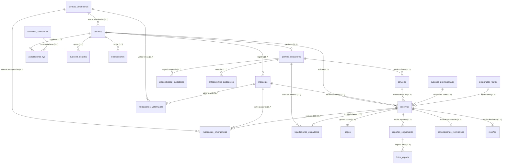

# DICCIONARIO DE DATOS Y ARQUITECTURA TÉCNICA DEL SISTEMA (v4.0)

**Proyecto:** Paw Patita Cusco — Plataforma Integral de Cuidado Canino y Bienestar Animal  
**Entorno Tecnológico:** Google Apps Script + Google Sheets (22 Pestañas en 3FN) + HtmlService  
**Versión del Documento:** 4.0  
**Fecha:** Noviembre 2026  

---

## 1. Arquitectura de Software en Capas

La solución implementa una **Arquitectura en Capas Desacoplada** sobre la plataforma Google Workspace:

```mermaid
flowchart TD
    subgraph CAPA_PRESENTACION["1. Capa de Presentación (Index.html - SPA Client)"]
        UI_NAV["Barra de Navegación + Selector Moneda (PEN/USD) + Switcher Demo"]
        UI_LANDING["Landing Pública: Buscador Cusco, Catálogo y Red Veterinaria"]
        UI_PROP["Dashboard Propietario: PAW-ID, Wizard 4 Pasos, Muro Fotos"]
        UI_CUID["Dashboard Cuidador: Agenda Mensual, Reservas, Billetera y Retiros"]
        UI_VET["Dashboard Veterinaria: Triaje SOS y Validación Médica PAW-ID"]
        UI_ADM["Dashboard Administrador: KPIs, Chart.js, Aprobaciones y Conciliación"]
        STORE["Store Reactivo de Estado (PawState) + Safe RPC Caller"]
    end

    subgraph CAPA_CONTROLADOR["2. Capa de Controladores RPC (Codigo.gs)"]
        RPC_GATEWAY["google.script.run Gateway + Error Boundary"]
        RBAC_GUARD["RBAC Guard: Validación de Sesión y Token con CacheService"]
        TRANSACTION_MGR["Transaction Manager: Control Concurrente con LockService"]
    end

    subgraph CAPA_NEGOCIO["3. Capa de Lógica de Negocio (Domain Engines)"]
        ENG_COT["Motor de Cotización Dinámica (Temporada Cusco + Extras + Cupones)"]
        ENG_AGENDA["Motor de Agenda y Control Anti-Overbooking por Cupos"]
        ENG_CANCEL["Motor de Cancelación Escalonada (>48h 100%, 24-48h 70%, <24h 0%)"]
        ENG_SOS["Motor de Derivación y Triaje Clínico S.O.S."]
        ENG_WALLET["Motor de Billetera Digital y Liquidaciones"]
    end

    subgraph CAPA_PERSISTENCIA["4. Capa de Repositorio y Datos (Sheets DAO)"]
        DAO["Repositorio Genérico: Mapeo Dinámico por Encabezados + Cache _memo"]
        SHEETS["Google Sheets (BD-PAWPATITAS-v3.xlsx - 22 Pestañas en 3FN)"]
    end

    CAPA_PRESENTACION -->|Llamadas Asíncronas RPC| CAPA_CONTROLADOR
    CAPA_CONTROLADOR -->|Verificación de Reglas| CAPA_NEGOCIO
    CAPA_NEGOCIO -->|Lectura / Escritura| CAPA_PERSISTENCIA
```

---

## 2. Diccionario de Datos Completo (22 Pestañas en 3FN)

### 2.1. Tabla: `usuarios`
Almacena las cuentas maestras de todos los actores del sistema.
* **Clave Primaria:** `id_usuario` | **Claves Foráneas:** `id_clinica_asociada` $\rightarrow$ `clinicas_veterinarias.id_clinica`
* **Cardinalidad:** 1 usuario tiene 0..* mascotas, 0..* reservas, 0..1 perfil de cuidador.

| Columna | Tipo de Dato | Restricción | Descripción | Ejemplo |
| :--- | :--- | :--- | :--- | :--- |
| `id_usuario` | String | PK, No Nulo | Identificador correlativo del usuario | `USR-01` |
| `nombre` | String | No Nulo | Nombres del usuario | `Angelo` |
| `apellido` | String | No Nulo | Apellidos del usuario | `Pérez` |
| `email` | String | No Nulo, Único | Correo electrónico de inicio de sesión | `angelo@gmail.com` |
| `password_hash` | String | No Nulo | Hash SHA-256 con salt `PAW::` | `f416c34...` |
| `tipo_usuario` | String | Enum | Rol: `Propietario`, `Cuidador`, `Veterinaria`, `Administrador` | `Propietario` |
| `subtipo_propietario` | String | Enum | Segmentación: `Local`, `Turista`, `N/A` | `Local` |
| `pais_origen` | String | Opcional | País de procedencia | `Perú` |
| `idioma_preferido` | String | No Nulo | Idioma de comunicación: `ES`, `EN` | `ES` |
| `num_documento` | String | No Nulo | DNI, CE o Pasaporte | `70809010` |
| `telefono` | String | No Nulo | Teléfono celular de contacto | `984123456` |
| `direccion` | String | No Nulo | Dirección domiciliaria | `Av. El Sol 450` |
| `distrito_cusco` | String | No Nulo | Distrito de residencia en Cusco | `Cusco` |
| `hospedaje_hotel_cusco` | String | Opcional | Nombre del hotel en Cusco (para turistas) | `Hotel Monasterio` |
| `contacto_emergencia_nombre` | String | Opcional | Nombre del contacto de respaldo | `María Pérez` |
| `contacto_emergencia_tel` | String | Opcional | Teléfono del contacto de respaldo | `984999888` |
| `id_clinica_asociada` | String | FK, Opcional | Identificador de clínica si es rol Veterinaria | `VET-01` |
| `tyc_version_aceptada` | String | No Nulo | Versión de Términos aceptada | `v4.0` |
| `estado_cuenta` | String | Enum | `Activo`, `Pendiente`, `Suspendido` | `Activo` |
| `fecha_registro` | String | Formato Fecha | Timestamp ISO de registro | `2026-10-01 10:00:00` |

---

### 2.2. Tabla: `mascotas`
Registro oficial de caninos bajo custodia con identificador único `PAW PATITA-ID`.
* **Clave Primaria:** `id_mascota` | **Claves Foráneas:** `id_propietario` $\rightarrow$ `usuarios.id_usuario`

| Columna | Tipo de Dato | Restricción | Descripción | Ejemplo |
| :--- | :--- | :--- | :--- | :--- |
| `id_mascota` | String | PK, No Nulo | Identificador interno | `MASC-01` |
| `id_propietario` | String | FK, No Nulo | Usuario propietario del perro | `USR-01` |
| `paw_patita_id` | String | Único, No Nulo | Carné oficial de identificación canina | `PAW-101` |
| `nombre` | String | No Nulo | Nombre de la mascota | `Boby` |
| `raza` | String | No Nulo | Raza canina | `Beagle` |
| `edad_anios` | Number | $\ge 0$ | Edad de la mascota en años | `3` |
| `tamano` | String | Enum | `Pequeño`, `Mediano`, `Grande` | `Mediano` |
| `sexo` | String | Enum | `Macho`, `Hembra` | `Macho` |
| `foto_url` | String | URL | Fotografía del perro (PostImg / externa) | `https://images...` |
| `condiciones_medicas` | String | Opcional | Alergias, dietas o temperamento | `Sociable, alérgico al pollo` |
| `enlace_vacunas_postimg` | String | URL | Fotografía de la cartilla sanitaria | `https://i.postimg...` |
| `estado_validacion_vet` | String | Enum | `Validada`, `Pendiente`, `Observada` | `Validada` |
| `fecha_ultima_validacion` | String | Fecha | Fecha del último dictamen clínico | `2026-10-05` |
| `observaciones_veterinarias` | String | Texto | Dictamen del médico veterinario | `Cartilla al día comprobada` |

---

### 2.3. Tabla: `perfiles_cuidadores`
Información profesional, biografía y capacidades del cuidador independiente.
* **Clave Primaria:** `id_cuidador` | **Claves Foráneas:** `id_usuario` $\rightarrow$ `usuarios.id_usuario`

| Columna | Tipo de Dato | Restricción | Descripción | Ejemplo |
| :--- | :--- | :--- | :--- | :--- |
| `id_cuidador` | String | PK, No Nulo | Identificador del cuidador | `CUID-01` |
| `id_usuario` | String | FK, Único | Usuario vinculado | `USR-03` |
| `presentacion_corta` | String | No Nulo | Lema o resumen público de perfil | `Paseador experto en Sacsayhuamán` |
| `biografia_detallada` | String | Texto | Descripción amplia de experiencia | `Más de 4 años cuidando perros...` |
| `anios_experiencia` | Number | $\ge 0$ | Años ejerciendo cuidado canino | `4` |
| `capacidad_max_mascotas` | Number | $1 \dots 6$ | Perros máximos simultáneos autorizados | `3` |
| `foto_perfil_url` | String | URL | Fotografía del cuidador | `https://images...` |
| `acepta_cachorros` | String | `Sí` / `No` | Si admite cachorros menores a 6 meses | `Sí` |
| `acepta_medicacion_oral` | String | `Sí` / `No` | Si suministra pastillas recetadas | `Sí` |
| `cuenta_cobro_tipo` | String | Enum | `Yape`, `Plin`, `CCI` | `Yape` |
| `cuenta_cobro_numero` | String | No Nulo | Celular o número de cuenta bancaria | `984111222` |
| `disponibilidad_semanal` | String | Texto | Días base de atención | `Lun,Mar,Mie,Jue,Vie,Sab` |
| `estado_postulacion` | String | Enum | `Aprobado`, `Pendiente`, `Rechazado` | `Aprobado` |
| `motivo_rechazo` | String | Opcional | Razón si el perfil fue observado | `Documento ilegible` |

---

### 2.4. Tabla: `servicios`
Catálogo de ofertas y modalidades de cuidado canino (`HU E-Code`).
* **Clave Primaria:** `id_oferta` | **Claves Foráneas:** `id_cuidador` $\rightarrow$ `perfiles_cuidadores.id_cuidador`

| Columna | Tipo de Dato | Restricción | Descripción | Ejemplo |
| :--- | :--- | :--- | :--- | :--- |
| `id_oferta` | String | PK, No Nulo | Identificador de la oferta | `OF-101` |
| `hu_ecode` | String | No Nulo | Código estandarizado de servicio | `HU-801` |
| `id_cuidador` | String | FK, No Nulo | Cuidador que oferta el servicio | `CUID-01` |
| `categoria` | String | Enum | `Paseo`, `Hospedaje`, `Guardería`, `Domicilio Turístico` | `Hospedaje` |
| `tipo_servicio` | String | No Nulo | Nombre comercial de la modalidad | `Hospedaje Nocturno Familiar` |
| `descripcion_servicio` | String | Texto | Detalle de lo que incluye | `Camas térmicas, patio cercado...` |
| `tarifa_diaria_por_perro` | Number | $> 0$ | Tarifa base por perro por día (PEN) | `45.00` |
| `incluye_recojo_hotel` | String | `Sí` / `No` | Disponibilidad de recojo en hoteles Cusco | `Sí` |
| `tarifa_recojo_extra` | Number | $\ge 0$ | Tarifa adicional por recojo | `10.00` |
| `disponible` | String | `Sí` / `No` | Estado activo de la oferta | `Sí` |

---

### 2.5. Tabla: `reservas`
Entidad transaccional central del sistema.
* **Clave Primaria:** `id_reserva` | **Claves Foráneas:** `id_propietario`, `id_cuidador`, `id_oferta`, `id_mascota`, `id_temporada`, `id_cupon`

| Columna | Tipo de Dato | Restricción | Descripción | Ejemplo |
| :--- | :--- | :--- | :--- | :--- |
| `id_reserva` | String | PK, No Nulo | Identificador de reserva | `RES-101` |
| `codigo_reserva` | String | No Nulo | Código comercial amigable | `RES-2026-101` |
| `id_propietario` | String | FK, No Nulo | Propietario solicitante | `USR-01` |
| `id_cuidador` | String | FK, No Nulo | Cuidador asignado | `CUID-01` |
| `id_oferta` | String | FK, No Nulo | Servicio contratado | `OF-101` |
| `id_mascota` | String | FK, No Nulo | Perro hospedado | `MASC-01` |
| `fecha_inicio` | String | Fecha YYYY-MM-DD | Día de ingreso | `2026-10-15` |
| `fecha_fin` | String | Fecha YYYY-MM-DD | Día de salida | `2026-10-17` |
| `dias_calculados` | Number | $\ge 1$ | Noches o días facturados | `2` |
| `tarifa_unitaria` | Number | $> 0$ | Tarifa por día aplicada | `45.00` |
| `subtotal_base` | Number | $> 0$ | Días $\times$ Tarifa Base | `90.00` |
| `id_temporada` | String | FK, Opcional | Temporada activa detectada | `TMP-01` |
| `ajuste_temporada` | Number | $\ge 0$ | Recargo estacional aplicado | `18.00` |
| `id_cupon` | String | FK, Opcional | Cupón promocional aplicado | `CUP-01` |
| `descuento_cupon` | Number | $\ge 0$ | Descuento deducido | `10.80` |
| `extras_detalle` | String | Texto | Descripción de extras seleccionados | `Baño higiénico (S/ 25.00)` |
| `extras_monto` | Number | $\ge 0$ | Total de servicios extras | `25.00` |
| `monto_total` | Number | $> 0$ | Importe total liquidado | `122.20` |
| `moneda_referencial` | String | Enum | `PEN`, `USD` | `PEN` |
| `estado_reserva` | String | FSM Enum | `Pendiente Confirmación`, `Confirmada`, `En Curso`, `Finalizada`, `Cancelada`, `En Disputa` | `Finalizada` |
| `tyc_version_aceptada` | String | No Nulo | Versión legal aprobada | `v4.0` |
| `notas_propietario` | String | Texto | Instrucciones de cuidado | `Pasear con correa corta` |
| `fecha_solicitud` | String | Timestamp | Momento de creación de la reserva | `2026-10-10 14:30:00` |

---

### 2.6. Tabla: `pagos`
Registro de cobros asociados a reservas y pasarela simulada.
* **Clave Primaria:** `id_pago` | **Claves Foráneas:** `id_reserva` $\rightarrow$ `reservas.id_reserva`

| Columna | Tipo de Dato | Restricción | Descripción | Ejemplo |
| :--- | :--- | :--- | :--- | :--- |
| `id_pago` | String | PK, No Nulo | Identificador del pago | `PAG-101` |
| `id_reserva` | String | FK, Único | Reserva asociada | `RES-101` |
| `metodo_pago` | String | Enum | `Yape`, `Plin`, `Tarjeta` | `Yape` |
| `pasarela_simulacion` | String | Texto | Identificador de pasarela ficticia | `Simulada v4` |
| `num_operacion` | String | No Nulo | Código de operación bancaria | `OP-789456` |
| `ultimos_4_digitos` | String | Longitud 4 | Últimos dígitos de tarjeta (si aplica) | `9921` |
| `monto_bruto` | Number | $> 0$ | Monto cobrado al cliente | `122.20` |
| `comision_porcentaje` | Number | Constante | Porcentaje de plataforma ($15\%$) | `15` |
| `comision_plataforma` | Number | $\ge 0$ | Ingreso de Paw Patita Cusco | `18.33` |
| `monto_neto_cuidador` | Number | $> 0$ | Importe correspondiente al cuidador ($85\%$) | `103.87` |
| `monto_reembolsado` | Number | $\ge 0$ | Fondos devueltos al cliente | `0.00` |
| `penalidad_retenida` | Number | $\ge 0$ | Penalidad administrativa retenida | `0.00` |
| `estado_pago` | String | Enum | `Aprobado`, `Reembolsado`, `Parcialmente Reembolsado` | `Aprobado` |
| `tipo_comprobante` | String | Enum | `Boleta`, `Factura` | `Boleta` |
| `num_comprobante` | String | No Nulo | Numeración fiscal | `B001-000101` |
| `comprobante_url` | String | URL | Enlace a comprobante imprimible | `https://i.postimg...` |
| `fecha_pago` | String | Timestamp | Fecha y hora de transacción | `2026-10-10 14:32:00` |

---

### 2.7. Tabla: `liquidaciones_cuidadores`
Billetera digital y conciliación de haberes para cuidadores.
* **Clave Primaria:** `id_liquidacion` | **Claves Foráneas:** `id_cuidador`, `id_pago`, `id_reserva`

| Columna | Tipo de Dato | Restricción | Descripción | Ejemplo |
| :--- | :--- | :--- | :--- | :--- |
| `id_liquidacion` | String | PK, No Nulo | Identificador del movimiento | `LIQ-101` |
| `id_cuidador` | String | FK, No Nulo | Cuidador beneficiario | `CUID-01` |
| `id_pago` | String | FK, No Nulo | Pago origen de los fondos | `PAG-101` |
| `id_reserva` | String | FK, No Nulo | Reserva ejecutada | `RES-101` |
| `tipo_concepto` | String | Enum | `Servicio Finalizado`, `Compensación Cancelación` | `Servicio Finalizado` |
| `monto_liquidado` | Number | $> 0$ | Saldo neto a transferir | `103.87` |
| `estado_liquidacion` | String | Enum | `En Garantía`, `Disponible`, `Solicitado`, `Pagado`, `Rechazado` | `Pagado` |
| `fecha_disponible` | String | Timestamp | Fecha de liberación de fondos tras check-out | `2026-10-17 18:00:00` |
| `fecha_solicitud_retiro` | String | Opcional | Momento en que el cuidador pide retiro | `2026-10-18 09:00:00` |
| `cuenta_destino` | String | Texto | Canal y cuenta de desembolso | `Yape 984111222` |
| `num_operacion_desembolso` | String | Opcional | N.º operación bancaria emitido por Admin | `OP-987123` |
| `fecha_liquidacion` | String | Opcional | Fecha efectiva del pago por Admin | `2026-10-18 11:30:00` |

---

### 2.8. Tabla: `reportes_seguimiento`
Bitácora de actualizaciones y paseos enviados por el cuidador.
* **Clave Primaria:** `id_reporte` | **Claves Foráneas:** `id_reserva`, `id_cuidador`

| Columna | Tipo de Dato | Restricción | Descripción | Ejemplo |
| :--- | :--- | :--- | :--- | :--- |
| `id_reporte` | String | PK, No Nulo | Identificador del reporte | `REP-101` |
| `id_reserva` | String | FK, No Nulo | Reserva a la que pertenece | `RES-101` |
| `id_cuidador` | String | FK, No Nulo | Cuidador autor del informe | `CUID-01` |
| `fecha_hora_reporte` | String | Timestamp | Momento de publicación | `2026-10-16 10:15:00` |
| `nota_estado` | String | Texto | Comentario sobre el perro | `Paseo matutino en Plaza San Blas` |
| `ubicacion_gps_referencial`| String | Opcional | Coordenadas o barrio de Cusco | `San Blas, Cusco` |

---

### 2.9. Tabla: `fotos_reporte`
Galería de fotografías asociadas a los reportes de seguimiento.
* **Clave Primaria:** `id_foto` | **Claves Foráneas:** `id_reporte` $\rightarrow$ `reportes_seguimiento.id_reporte`

| Columna | Tipo de Dato | Restricción | Descripción | Ejemplo |
| :--- | :--- | :--- | :--- | :--- |
| `id_foto` | String | PK, No Nulo | Identificador de foto | `FOT-101` |
| `id_reporte` | String | FK, No Nulo | Reporte vinculado | `REP-101` |
| `foto_url` | String | URL No Nula | Enlace a la imagen en PostImg | `https://i.postimg.cc/HxXrCmbp/images.jpg` |
| `orden_visualizacion` | Number | $\ge 1$ | Orden de visualización en galería | `1` |

---

### 2.10. Tabla: `clinicas_veterinarias`
Directorio oficial de clínicas aliadas para emergencias y validación médica.
* **Clave Primaria:** `id_clinica`

| Columna | Tipo de Dato | Restricción | Descripción | Ejemplo |
| :--- | :--- | :--- | :--- | :--- |
| `id_clinica` | String | PK, No Nulo | Identificador de la clínica | `VET-01` |
| `nombre` | String | No Nulo | Razón social de la veterinaria | `Clínica Veterinaria Cusco Centro` |
| `ruc` | String | Longitud 11 | Registro Único de Contribuyentes | `20601234567` |
| `direccion` | String | No Nulo | Ubicación física | `Av. El Sol 840` |
| `distrito` | String | No Nulo | Distrito de Cusco | `Cusco` |
| `telefono_emergencia` | String | No Nulo | Línea telefónica 24 horas | `984111222` |
| `horario_atencion` | String | Enum | `24 Horas`, `Diurno` | `24 Horas` |
| `especialidades` | String | Texto | Áreas médicas atendidas | `Triage, Traumatología, Cirugía` |
| `tarifa_consulta_emergencia` | Number | $> 0$ | Costo referencial de atención de urgencia | `60.00` |
| `foto_fachada_url` | String | URL | Fotografía de la fachada de la sede | `https://i.postimg...` |
| `estado_afiliacion` | String | Enum | `Afiliada`, `Suspendida` | `Afiliada` |
| `activa` | Boolean | Booleano | Si recibe derivaciones S.O.S. en vivo | `true` |

---

### 2.11. Tabla: `antecedentes_cuidadores`
Auditoría y control de seguridad legal de los cuidadores independientes.
* **Clave Primaria:** `id_antecedente` | **Claves Foráneas:** `id_cuidador` $\rightarrow$ `perfiles_cuidadores.id_cuidador`

| Columna | Tipo de Dato | Restricción | Descripción | Ejemplo |
| :--- | :--- | :--- | :--- | :--- |
| `id_antecedente` | String | PK, No Nulo | Identificador del expediente | `ANT-101` |
| `id_cuidador` | String | FK, No Nulo | Cuidador auditado | `CUID-01` |
| `tipo_documento` | String | Enum | `DNI`, `CE`, `Pasaporte` | `DNI` |
| `numero_documento` | String | No Nulo | Número de documento | `45127890` |
| `enlace_comprobante_policial_postimg` | String | URL | Documento policial escaneado | `https://i.postimg...` |
| `enlace_comprobante_domicilio_postimg` | String | URL | Recibo de servicios públicos | `https://i.postimg...` |
| `estado_verificacion` | String | Enum | `Aprobado`, `Pendiente`, `Rechazado` | `Aprobado` |
| `observaciones_verificacion` | String | Texto | Dictamen del auditor de red | `Sin observaciones policiales` |
| `fecha_verificacion` | String | Fecha | Momento de revisión por Admin | `2026-10-02` |

---

### 2.12. Tabla: `incidencias_emergencias`
Gestión en tiempo real del protocolo S.O.S. y triaje clínico veterinario.
* **Clave Primaria:** `id_incidencia` | **Claves Foráneas:** `id_reserva`, `id_mascota`, `reportado_por_usuario`, `id_clinica_derivada`, `atendido_por_vet_usuario`

| Columna | Tipo de Dato | Restricción | Descripción | Ejemplo |
| :--- | :--- | :--- | :--- | :--- |
| `id_incidencia` | String | PK, No Nulo | Identificador de la alerta | `INC-101` |
| `id_reserva` | String | FK, No Nulo | Reserva durante la cual ocurrió | `RES-101` |
| `id_mascota` | String | FK, No Nulo | Perro afectado | `MASC-01` |
| `reportado_por_usuario` | String | FK, No Nulo | Quien activó el botón de pánico | `USR-03` |
| `descripcion_incidencia` | String | Texto No Nulo | Relato de síntomas o accidente | `Ingestión de cuerpo extraño` |
| `gravedad` | String | Enum | `Media`, `Alta`, `Crítica` | `Alta` |
| `id_clinica_derivada` | String | FK, No Nulo | Sede médica asignada en Cusco | `VET-01` |
| `estado_alerta` | String | FSM Enum | `Activa`, `En Atención Clínica`, `Estabilizada`, `Resuelta` | `Resuelta` |
| `atendido_por_vet_usuario`| String | FK, Opcional | Médico veterinario que tomó el caso | `USR-06` |
| `diagnostico_clinico` | String | Opcional | Diagnóstico profesional | `Obstrucción gástrica leve` |
| `tratamiento_aplicado` | String | Opcional | Medicación y procedimientos | `Lavado gástrico y protector` |
| `informe_resolucion` | String | Opcional | Informe de alta médica | `Mascota recuperada sin secuelas` |
| `costo_atencion_ref` | Number | $\ge 0$ | Costo de la atención médica | `85.00` |
| `fecha_registro` | String | Timestamp | Emisión del S.O.S. | `2026-10-16 11:00:00` |
| `fecha_atencion` | String | Opcional | Momento en que la clínica toma el caso | `2026-10-16 11:10:00` |
| `fecha_resolucion` | String | Opcional | Cierre médico del caso | `2026-10-16 13:30:00` |

---

### 2.13. Tabla: `reseñas`
Reputación y evaluación verificada de los cuidadores.
* **Clave Primaria:** `id_resena` | **Claves Foráneas:** `id_reserva`, `id_propietario`, `id_cuidador`

| Columna | Tipo de Dato | Restricción | Descripción | Ejemplo |
| :--- | :--- | :--- | :--- | :--- |
| `id_resena` | String | PK, No Nulo | Identificador de reseña | `REV-101` |
| `id_reserva` | String | FK, Único | Reserva calificada | `RES-101` |
| `id_propietario` | String | FK, No Nulo | Autor de la reseña | `USR-01` |
| `id_cuidador` | String | FK, No Nulo | Cuidador evaluado | `CUID-01` |
| `calificacion_estrellas` | Number | $1 \dots 5$ | Puntuación global | `5` |
| `puntualidad_estrellas` | Number | $1 \dots 5$ | Evaluación de puntualidad | `5` |
| `comunicacion_estrellas`| Number | $1 \dots 5$ | Evaluación de reportes y trato | `5` |
| `cuidado_estrellas` | Number | $1 \dots 5$ | Evaluación del bienestar animal | `5` |
| `comentario` | String | Texto No Nulo | Opinión del propietario | `Excelente trato a Boby` |
| `respuesta_cuidador` | String | Opcional | Réplica pública del cuidador | `¡Gracias, fue un placer cuidarlo!` |
| `visible` | String | `Sí` / `No` | Control de moderación | `Sí` |
| `fecha_reseña` | String | Fecha | Momento de publicación | `2026-10-18` |

---

### 2.14. Tabla: `disponibilidad_cuidadores`
Control anti-overbooking y calendario granular diario.
* **Clave Primaria:** `id_disp` | **Claves Foráneas:** `id_cuidador` $\rightarrow$ `perfiles_cuidadores.id_cuidador`

| Columna | Tipo de Dato | Restricción | Descripción | Ejemplo |
| :--- | :--- | :--- | :--- | :--- |
| `id_disp` | String | PK, No Nulo | Identificador de registro | `DSP-101` |
| `id_cuidador` | String | FK, No Nulo | Cuidador | `CUID-01` |
| `fecha` | String | Fecha YYYY-MM-DD | Día específico | `2026-10-15` |
| `estado_dia` | String | Enum | `Disponible`, `Parcial`, `Lleno`, `Bloqueado` | `Parcial` |
| `cupo_maximo_dia` | Number | $1 \dots 6$ | Límite de perros para esa fecha | `3` |
| `cupos_reservados` | Number | $\ge 0$ | Perros que ocupan cupo confirmado | `1` |
| `nota_agenda` | String | Opcional | Motivo de bloqueo o ajuste | `Paseos solo en la tarde` |

---

### 2.15. Tabla: `validaciones_veterinarias`
Historial de auditorías médicas a las cartillas sanitarias caninas.
* **Clave Primaria:** `id_validacion` | **Claves Foráneas:** `id_mascota`, `id_clinica`, `validado_por_usuario`

| Columna | Tipo de Dato | Restricción | Descripción | Ejemplo |
| :--- | :--- | :--- | :--- | :--- |
| `id_validacion` | String | PK, No Nulo | Identificador de dictamen | `VAL-101` |
| `id_mascota` | String | FK, No Nulo | Perro evaluado | `MASC-01` |
| `id_clinica` | String | FK, No Nulo | Clínica que auditó | `VET-01` |
| `validado_por_usuario` | String | FK, No Nulo | Médico veterinario firmante | `USR-06` |
| `resultado` | String | Enum | `Validada`, `Observada` | `Validada` |
| `dictamen_medico` | String | Texto No Nulo | Justificación profesional | `Vacunas completas y desparasitado` |
| `vacunas_al_dia` | Boolean | Booleano | Si cumple con el esquema obligatorio | `true` |
| `fecha_validacion` | String | Fecha | Día del dictamen | `2026-10-05` |
| `vigente_hasta` | String | Fecha | Caducidad del carné médico (1 año) | `2027-10-05` |

---

### 2.16. Tabla: `cancelaciones_reembolsos`
Trazabilidad de cancelaciones y devoluciones monetarias escalonadas.
* **Clave Primaria:** `id_cancelacion` | **Claves Foráneas:** `id_reserva`, `id_pago`, `solicitado_por`, `procesado_por_admin`

| Columna | Tipo de Dato | Restricción | Descripción | Ejemplo |
| :--- | :--- | :--- | :--- | :--- |
| `id_cancelacion` | String | PK, No Nulo | Identificador del trámite | `CAN-101` |
| `id_reserva` | String | FK, No Nulo | Reserva cancelada | `RES-101` |
| `id_pago` | String | FK, No Nulo | Pago origen | `PAG-101` |
| `solicitado_por` | String | FK, No Nulo | Usuario solicitante | `USR-01` |
| `tipo_caso` | String | Enum | `Cancelación Propietario`, `Disputa Arbitrada` | `Cancelación Propietario` |
| `horas_anticipacion` | Number | Calculado | Horas antes de las 08:00 hrs de inicio | `72.5` |
| `regla_aplicada` | String | Texto | Regla escalonada legal | `Más de 48h: Reembolso 100%` |
| `motivo` | String | Texto No Nulo | Explicación del cliente | `Vuelo reprogramado` |
| `porcentaje_reembolso` | Number | $0, 70, 100$ | Porcentaje reintegrado | `100` |
| `monto_reembolso` | Number | $\ge 0$ | Dinero devuelto al propietario | `122.20` |
| `monto_penalidad_plataforma`| Number | $\ge 0$ | Penalidad retenida por el sistema | `0.00` |
| `monto_compensacion_cuidador`| Number | $\ge 0$ | Indemnización otorgada al cuidador | `0.00` |
| `estado_tramite` | String | Enum | `Pendiente`, `Completado`, `Rechazado` | `Completado` |
| `resolucion_admin` | String | Opcional | Dictamen arbitral emitido por Admin | `Reembolso aprobado conforme a ley` |
| `procesado_por_admin` | String | FK, Opcional | Administrador ejecutor | `USR-05` |
| `fecha_solicitud` | String | Timestamp | Registro de cancelación | `2026-10-12 10:00:00` |
| `fecha_resolucion` | String | Opcional | Cierre financiero | `2026-10-12 11:00:00` |

---

### 2.17. Tabla: `cupones_promocionales`
Motor de descuentos para residentes locales y turistas.
* **Clave Primaria:** `id_cupon`

| Columna | Tipo de Dato | Restricción | Descripción | Ejemplo |
| :--- | :--- | :--- | :--- | :--- |
| `id_cupon` | String | PK, No Nulo | Identificador | `CUP-01` |
| `codigo` | String | Único, No Nulo | Código promocional en mayúsculas | `MACHUPICCHU15` |
| `descripcion` | String | Texto | Finalidad del beneficio | `15% descuento para turistas` |
| `tipo_descuento` | String | Enum | `Porcentaje`, `Monto Fijo` | `Porcentaje` |
| `valor_descuento` | Number | $> 0$ | Descuento aplicable (15% o S/ fijo) | `15` |
| `segmento_objetivo` | String | Enum | `Todos`, `Local`, `Turista` | `Turista` |
| `monto_minimo` | Number | $\ge 0$ | Gasto mínimo requerido para aplicar | `50.00` |
| `fecha_inicio` | String | Fecha | Inicio de vigencia | `2026-10-01` |
| `fecha_fin` | String | Fecha | Fin de vigencia | `2027-03-31` |
| `usos_maximos` | Number | $> 0$ | Tope de canjes permitidos | `100` |
| `usos_actuales` | Number | $\ge 0$ | Canjes ejecutados a la fecha | `1` |
| `activo` | String | `Sí` / `No` | Habilitación comercial | `Sí` |

---

### 2.18. Tabla: `temporadas_tarifas`
Parámetros de estacionalidad turística en Cusco.
* **Clave Primaria:** `id_temporada`

| Columna | Tipo de Dato | Restricción | Descripción | Ejemplo |
| :--- | :--- | :--- | :--- | :--- |
| `id_temporada` | String | PK, No Nulo | Identificador | `TMP-01` |
| `nombre_temporada` | String | No Nulo | Nombre festivo en Cusco | `Inti Raymi y Fiestas Jubilares` |
| `fecha_inicio` | String | Fecha | Inicio de temporada alta | `2026-06-20` |
| `fecha_fin` | String | Fecha | Cierre de temporada alta | `2026-06-30` |
| `factor_multiplicador` | Number | $\ge 1.0$ | Factor de recargo ($1.20 = +20\%$) | `1.20` |
| `motivo_festivo` | String | Texto | Justificación cultural y turística | `Alta afluencia por fiestas del sol` |
| `activa` | String | `Sí` / `No` | Habilitada en el cotizador | `Sí` |

---

### 2.19. Tabla: `terminos_condiciones`
Gobernanza legal y versiones de acuerdos de usuario.
* **Clave Primaria:** `id_tyc`

| Columna | Tipo de Dato | Restricción | Descripción | Ejemplo |
| :--- | :--- | :--- | :--- | :--- |
| `id_tyc` | String | PK, No Nulo | Identificador | `TYC-01` |
| `version` | String | No Nulo | Número de versión legal | `v4.0` |
| `alcance` | String | Enum | `General`, `Propietario`, `Cuidador` | `General` |
| `titulo` | String | No Nulo | Título del acuerdo | `Términos y Condiciones Generales v4.0` |
| `contenido_resumen` | String | Texto | Extracto legal y políticas de servicio | `Reglas de cancelación y cuidado...` |
| `fecha_publicacion` | String | Fecha | Entrada en vigor | `2026-10-01` |
| `estado` | String | Enum | `Vigente`, `Archivada` | `Vigente` |
| `publicado_por_admin` | String | FK | Admin responsable | `USR-05` |

---

### 2.20. Tabla: `aceptaciones_tyc`
Consentimiento legal registrado por usuario.
* **Clave Primaria:** `id_aceptacion` | **Claves Foráneas:** `id_usuario`, `id_tyc`

| Columna | Tipo de Dato | Restricción | Descripción | Ejemplo |
| :--- | :--- | :--- | :--- | :--- |
| `id_aceptacion` | String | PK, No Nulo | Identificador | `ACP-101` |
| `id_usuario` | String | FK, No Nulo | Usuario que consintió | `USR-01` |
| `id_tyc` | String | FK, No Nulo | Acuerdo legal aceptado | `TYC-01` |
| `version_tyc` | String | No Nulo | Versión explícita | `v4.0` |
| `contexto` | String | Enum | `Registro`, `Reserva` | `Registro` |
| `id_referencia` | String | Opcional | ID de usuario o reserva asociada | `USR-01` |
| `fecha_aceptacion` | String | Timestamp | Registro temporal inmutable | `2026-10-01 10:00:00` |

---

### 2.21. Tabla: `auditoria_estados`
Bitácora global inmutable de eventos sensibles.
* **Clave Primaria:** `id_auditoria` | **Claves Foráneas:** `id_usuario_responsable` $\rightarrow$ `usuarios.id_usuario`

| Columna | Tipo de Dato | Restricción | Descripción | Ejemplo |
| :--- | :--- | :--- | :--- | :--- |
| `id_auditoria` | String | PK, No Nulo | Identificador de auditoría | `AUD-101` |
| `entidad` | String | No Nulo | Tabla afectada (`Reserva`, `Cuidador`, `Incidencia`, etc.) | `Reserva` |
| `id_registro` | String | No Nulo | ID del registro modificado | `RES-101` |
| `estado_anterior` | String | No Nulo | Estado previo | `En Curso` |
| `estado_nuevo` | String | No Nulo | Nuevo estado alcanzado | `Finalizada` |
| `id_usuario_responsable`| String | FK, No Nulo | Usuario que ejecutó la transición | `USR-03` |
| `rol_usuario` | String | No Nulo | Rol del operador | `Cuidador` |
| `motivo_cambio` | String | Texto | Justificación de la acción | `Check-Out completado por cuidador` |
| `fecha_hora` | String | Timestamp | Timestamp inmutable | `2026-10-17 18:00:00` |

---

### 2.22. Tabla: `notificaciones`
Centro de alertas internas en la plataforma.
* **Clave Primaria:** `id_notificacion` | **Claves Foráneas:** `id_usuario_destino` $\rightarrow$ `usuarios.id_usuario`

| Columna | Tipo de Dato | Restricción | Descripción | Ejemplo |
| :--- | :--- | :--- | :--- | :--- |
| `id_notificacion` | String | PK, No Nulo | Identificador de alerta | `NOT-101` |
| `id_usuario_destino` | String | FK, No Nulo | Destinatario del mensaje | `USR-01` |
| `tipo_notificacion` | String | Enum | `Reserva`, `SOS`, `Pago`, `Aprobación`, `Cancelación` | `Reserva` |
| `titulo` | String | No Nulo | Encabezado de la alerta | `Reserva Confirmada` |
| `mensaje` | String | Texto | Detalle del suceso | `Carlos Quispe confirmó tu reserva RES-101.` |
| `referencia_id` | String | Opcional | ID de reserva, incidencia o liquidación | `RES-101` |
| `leida` | Boolean | Booleano | Estado de lectura in-app | `false` |
| `fecha_creacion` | String | Timestamp | Momento de emisión | `2026-10-10 15:00:00` |

---

## 3. Diagrama Entidad-Relación Conceptual (ERD)

---

## 4. Arquitectura Relacional de Datos en Supabase (PostgreSQL 15 - v5.0)

En la versión **v5.0**, el repositorio de datos migró formalmente de hojas de cálculo de Google Sheets hacia **PostgreSQL 15** administrado en **Supabase**, incorporando integridad referencial estricta, claves primarias compuestas y UUID, tipos enumerados (`ENUM`), índices b-tree y políticas de seguridad declarativa por fila (**Row Level Security - RLS**).

### 4.1. Catálogo Canónico de las 23 Tablas PostgreSQL

| N° | Nombre de Tabla | Clave Primaria | Claves Foráneas (FK) | Propósito de Negocio |
| :---: | :--- | :--- | :--- | :--- |
| **1** | `configuracion_plataforma` | `clave (text)` | — | Parámetros globales de la plataforma (comisión base 15%, umbrales de cancelación, versión de TyC). |
| **2** | `clinicas_veterinarias` | `id_clinica (uuid)` | — | Directorio de sedes veterinarias 24h acreditadas en Cusco con RUC y datos de contacto. |
| **3** | `perfiles_usuarios` | `id_usuario (uuid)` | `id_usuario -> auth.users`, `id_clinica_asociada -> clinicas_veterinarias` | Perfil extendido de usuarios vinculados 1:1 con `auth.users` de Supabase (rol, distrito de Cusco, datos personales). |
| **4** | `mascotas` | `id_mascota (uuid)` | `id_propietario -> perfiles_usuarios` | Expediente canino con código PAW-ID único, raza, peso, edad, vacunas y enlace a cartilla. |
| **5** | `validaciones_veterinarias`| `id_validacion (uuid)`| `id_mascota -> mascotas`, `id_veterinario -> perfiles_usuarios` | Dictamen médico oficial (Sello CMVP: `validado`, `observado` o `pendiente`) con vigencia. |
| **6** | `perfiles_cuidadores` | `id_cuidador (uuid)` | `id_usuario -> perfiles_usuarios` | Perfil profesional de cuidadores (biografía, tarifa base, capacidad máxima, estado de aprobación). |
| **7** | `antecedentes_cuidadores` | `id_antecedente (uuid)`| `id_cuidador -> perfiles_cuidadores` | Expediente de validación de antecedentes policiales, penales y verificación domiciliaria en Cusco. |
| **8** | `servicios` | `id_servicio (uuid)` | `id_cuidador -> perfiles_cuidadores` | Ofertas de servicios (Paseo, Hospedaje, Guardería, Domicilio) y recargo de recojo en hotel. |
| **9** | `disponibilidad_cuidadores`| `id_disponibilidad (uuid)`| `id_cuidador -> perfiles_cuidadores` | Agenda granular diaria/bloques horarios con control anti-overbooking (`cupos_reservados <= cupo_maximo`). |
| **10** | `temporadas_tarifas` | `id_temporada (uuid)`| — | Calendario de temporadas turísticas de Cusco (Inti Raymi, Fiestas Patrias) con multiplicadores tarifarios. |
| **11** | `cupones_promocionales` | `id_cupon (uuid)` | — | Descuentos promocionales segmentados (Local/Turista) con límite de redenciones. |
| **12** | `reservas` | `id_reserva (uuid)` | `id_propietario -> perfiles_usuarios`, `id_cuidador -> perfiles_cuidadores`, `id_mascota -> mascotas`, `id_servicio -> servicios` | Contrato transaccional de cuidado canino con máquina de estados finita (7 estados). |
| **13** | `pagos` | `id_pago (uuid)` | `id_reserva -> reservas`, `id_usuario -> perfiles_usuarios` | Transacciones de cobro simuladas (Yape, Plin, Tarjeta) con desglose de comisión y penalidades. |
| **14** | `liquidaciones_cuidadores`| `id_liquidacion (uuid)`| `id_cuidador -> perfiles_cuidadores`, `id_reserva -> reservas` | Billetera digital del cuidador: retención en garantía, liberación a disponible y pago bancario auditado. |
| **15** | `cancelaciones_reembolsos`| `id_cancelacion (uuid)`| `id_reserva -> reservas`, `id_solicitante -> perfiles_usuarios` | Gestión de disputas y reembolsos escalonados (>48h: 100%, 24-48h: 50%, <24h: 0%). |
| **16** | `reportes_seguimiento` | `id_reporte (uuid)` | `id_reserva -> reservas`, `id_cuidador -> perfiles_cuidadores` | Reportes periódicos de cuidado emitidos por el cuidador durante el servicio activo. |
| **17** | `fotos_reporte` | `id_foto (uuid)` | `id_reporte -> reportes_seguimiento` | Galería fotográfica de evidencia para el Muro de Seguimiento en vivo del propietario. |
| **18** | `incidencias_emergencias` | `id_incidencia (uuid)`| `id_reserva -> reservas`, `id_mascota -> mascotas`, `id_clinica -> clinicas_veterinarias` | Alertas médicas prioritarias S.O.S. 24h con triaje, tratamiento y alta clínica. |
| **19** | `resenas` | `id_resena (uuid)` | `id_reserva -> reservas`, `id_evaluador -> perfiles_usuarios` | Evaluaciones multidimensionales (1-5 estrellas) y derecho a réplica pública. |
| **20** | `terminos_condiciones` | `id_version_tyc (uuid)`| — | Repositorio versionado del contrato de términos y condiciones de servicio. |
| **21** | `aceptaciones_tyc` | `id_aceptacion (uuid)`| `id_usuario -> perfiles_usuarios`, `id_version_tyc -> terminos_condiciones` | Registro inmutable de consentimiento legal con hash, IP y timestamp. |
| **22** | `auditoria_estados` | `id_auditoria (uuid)`| `id_usuario -> perfiles_usuarios` | Bitácora forense de auditoría inmutable alimentada automáticamente por triggers de PostgreSQL. |
| **23** | `notificaciones` | `id_notificacion (uuid)`| `id_usuario -> perfiles_usuarios` | Mensajes in-app para alertas de estado, recordatorios y notificaciones de pago. |

---

## 5. Políticas de Seguridad Row Level Security (RLS) y RPCs Transaccionales

### 5.1. Matriz de Acceso por Rol (Row Level Security)

Todas las 23 tablas cuentan con `ALTER TABLE ... ENABLE ROW LEVEL SECURITY;`. Ningún cliente puede leer o escribir filas no autorizadas:

1. **`Propietario` (`rol = 'propietario'`):**
   - Solo puede leer y editar sus propias mascotas (`id_propietario = auth.uid()`).
   - Solo puede ver sus propias reservas, pagos y notificaciones.
   - Tiene acceso de solo lectura al catálogo público de cuidadores aprobados, clínicas activas y servicios.
   - Tiene estrictamente **bloqueada** la lectura directa a `liquidaciones_cuidadores`, `antecedentes_cuidadores` y `auditoria_estados`.
2. **`Cuidador` (`rol = 'cuidador'`):**
   - Solo puede gestionar su propio perfil profesional y bloques de disponibilidad en agenda.
   - Puede leer las reservas donde él es el cuidador asignado y las mascotas vinculadas a dichas reservas.
   - Solo puede visualizar sus propias partidas en `liquidaciones_cuidadores`.
   - Puede publicar reportes y fotos en `reportes_seguimiento` y `fotos_reporte`.
3. **`Veterinaria` (`rol = 'veterinaria'`):**
   - Puede inspeccionar fichas de mascotas pendientes de validación y registrar dictámenes en `validaciones_veterinarias`.
   - Puede ver y atender incidentes en `incidencias_emergencias` asignados a su clínica asociada.
4. **`Administrador` (`rol = 'administrador'`):**
   - Acceso total de lectura y actualización para auditoría, aprobación de postulaciones, procesamiento de pagos y arbitraje de disputas.

### 5.2. Catálogo de las 21 Funciones RPC PL/pgSQL

| Categoría | Nombre de Función RPC | Parámetros Clave | Regla de Negocio que Garantiza |
| :--- | :--- | :--- | :--- |
| **Cotización y Reserva** | `rpc_cotizar_reserva` | fechas, servicio, cupon, hotel | Cálculo de días, factor de temporada Cusco, descuento y subtotal. |
| | `rpc_crear_reserva` | payload JSON | Validación anti-overbooking atómica, reserva de cupo, cálculo de comisión 15% y registro de pago. |
| **Operación Cuidador** | `rpc_cuidador_responder_reserva` | id_reserva, accion, motivo | Aceptación (`confirmada`) o rechazo con liberación de cupos y reembolso 100%. |
| | `rpc_cuidador_checkin` | id_reserva, checklist | Transición a `en_curso`, verificación física y evento de inicio en muro. |
| | `rpc_cuidador_checkout` | id_reserva, checklist | Transición a `finalizada` y **liberación inmediata del 85% neto** a `disponible`. |
| | `rpc_solicitar_retiro` | cuenta_tipo, cuenta_numero | Transición de partidas `disponible` a `solicitado` para desembolso admin. |
| **Cancelaciones** | `rpc_preview_cancelacion` | id_reserva | Cálculo previo de reembolso (>48h: 100%, 24-48h: 50%, <24h: 0%). |
| | `rpc_cancelar_reserva` | id_reserva, motivo | Cancelación definitiva, liberación de agenda y registro en auditoría. |
| | `rpc_abrir_disputa` | id_reserva, motivo | Congelamiento de fondos en liquidación (`retenido_disputa`). |
| | `rpc_admin_resolver_caso`| id_cancelacion, accion, pct | Arbitraje ejecutivo distribuyendo fondos proporcionalmente. |
| **Médico / S.O.S.** | `rpc_emitir_sos` | id_reserva, sintomas, clinica | Creación de alerta roja 24h y notificación prioritaria. |
| | `rpc_vet_actualizar_sos` | id_incidencia, estado, notas | Triaje clínico y seguimiento médico en tiempo real. |
| | `rpc_vet_dictaminar_ficha`| id_mascota, resultado, vacunas | Emisión del Sello Oficial CMVP o registro de observaciones médicas. |
| | `rpc_obtener_paw_id_publico`| paw_id | Validación pública del carné para consulta por QR en el reverso. |
| **Administración** | `rpc_admin_dashboard_metrics`| — | Cálculo en tiempo real de ingresos brutos, comisión real 15% y KPIs por distrito. |
| | `rpc_admin_aprobar_cuidador`| id_cuidador, accion, motivo | Aprobación/rechazo de postulante con verificación de antecedentes. |
| | `rpc_admin_aprobar_clinica`| id_clinica, accion, motivo | Acreditación oficial de clínica veterinaria aliada en Cusco. |
| | `rpc_admin_crear_clinica_directa`| payload JSON | Alta administrativa directa de nuevas clínicas 24h. |
| | `rpc_admin_procesar_liquidacion`| id_liquidacion, operacion | Desembolso bancario pasando partida a `pagado` y sumando al total cobrado. |
| | `rpc_admin_reasignar_sos` | id_incidencia, nueva_clinica | Derivación médica urgente a otra sede aliada de Cusco. |
| **Reputación** | `rpc_publicar_resena` | id_reserva, puntuacion, texto | Calificación multidimensional y actualización de promedio del cuidador. |

